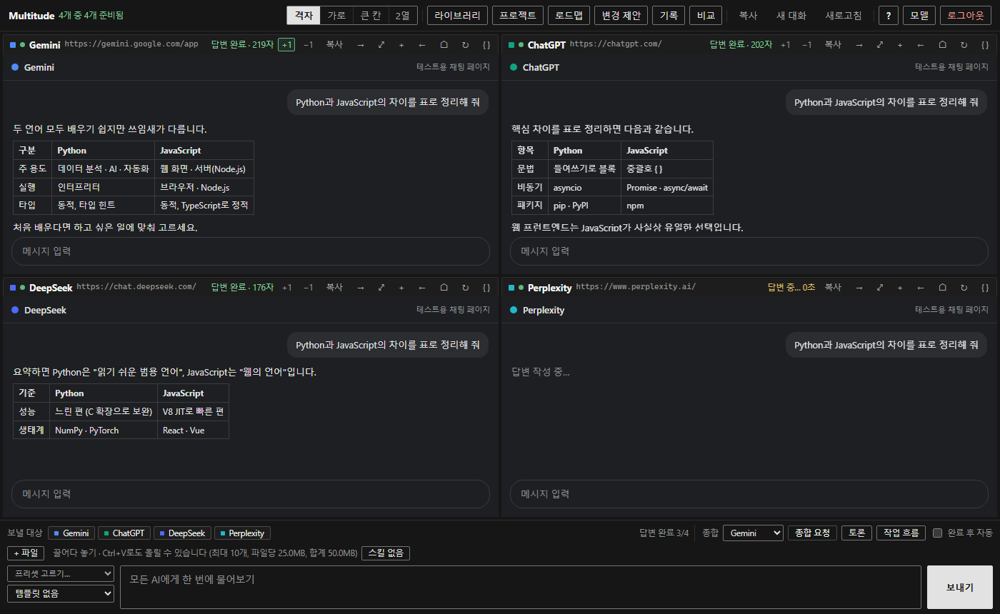

# Multitude LLM

[한국어](README.md) · **English**

[](https://github.com/dyj02056/multitude_llm_ai/actions/workflows/release.yml)


**Ask several AI web chats the same question at once, then compare and merge their answers.** Open up to 6 of 11 services (Gemini, ChatGPT, Claude and more) side by side. Open a local project folder to send code context, compare each AI's code changes, and apply or undo them. It uses each service's own web chat as-is, so **no API keys are needed**.

**[Install](#quick-start)** · **[Features](#features)** · **[User guide](docs/en/guide.md)** · **[Privacy](PRIVACY.md)**



> **Interface language:** the app's screens are currently in **Korean**. This page and the [English user guide](docs/en/guide.md) explain every button. An English interface is planned.

## At a glance

| | |
|---|---|
| **AI services** | Gemini · ChatGPT · Claude · DeepSeek · Perplexity · Grok · Mistral · Qwen · Z.ai · Genspark · Duck.ai (11) + an optional local LLM on your PC |
| **Side by side** | Up to 6 panels, 4 layouts (grid · row · main · 2col), focus one panel |
| **Ask** | One input box sends to every panel; file attachments; prompt templates with variables; skills (SKILL.md) |
| **Work with answers** | Compare view (highlight differences, disagreement table), ask one AI to merge the others, history and search, export to Markdown / HTML (→ PDF), rate answers `[+1]` / `[-1]` |
| **Code work** | Send a local project folder → compare each AI's changes → preview, run tests, apply, undo; protects against cut-off answers; sends only changed files on follow-ups |
| **In the browser** | Chrome extension: the same app in one tab, right-click to ask about a page, and a **side panel** with 2 AIs next to the page you are reading |
| **Runs as** | Windows app (Electron, sign in once with Google, auto-update) · Chrome extension (uses the accounts already signed in to Chrome) |

## How it works

- Each AI opens in a panel **exactly as its own website**. The app only types your question, presses send, and reads the answer.
- There is **no Multitude LLM server**. Your questions go only to the AI services you open. History stays on your PC (encrypted on Windows). → [Privacy](PRIVACY.md)
- The Windows app and the Chrome extension share the same screens and logic.

## Features

| Area | Feature | What it does |
|---|---|---|
| **Ask** | Ask all | Sends to every enabled panel; each shows `answering… → done · N chars` |
| | Attachments | Drag & drop, Ctrl+V (screenshots), or `[+] 파일`; adapts to what each service accepts |
| | Templates & skills | `{{variable}}` templates, up to 3 SKILL.md skills, AI-assisted compression |
| **Answers** | Synthesis | Collects the other answers and asks one AI for errors, gaps and a final answer |
| | Compare & analysis | Answers in columns, highlight sentences that differ, agreements / disagreement table / weak claims / final answer |
| | Hand-offs & debate | Hand one AI's answer to another for review, counter-argument or continuation; let 2–3 AIs debate and a judge AI conclude (v0.26.0) |
| | History & export | Saves the last 500 questions with answers (100–2000 in settings); search with filters (period, AI, rating, tags, star), group by conversation thread, export MD / HTML, several records in one document (v0.27.0) |
| | Stats & self-check | Completion rate, response time, usage-limit detection and satisfaction per AI; suggested AIs per question kind (v0.27.0); warns when a site's layout changes |
| **Code** | Project mode | Sends folder structure and chosen files (3-level ignore rules, secret scan); handles `NEED_FILES` requests |
| | Apply changes | Apply from the bar under each panel, compare across AIs, apply by hunk, undo; a failed multi-file apply rolls back; mix changes from several AIs per file and pick up work after a restart (v0.28.0) |
| | Cut-off protection | Blocks truncated or abbreviated code, find/replace blocks for long files, continue automatically, plan-first mode |
| | Test run, git console & commit | Compare `npm test` and lint / typecheck / build before/after (v0.28.0); commit only the applied files, never pushed (v0.28.0); run git commands in that folder (Windows app) |
| **Extension** | Side panel | Two AIs in Chrome's side panel; the page you are reading is sent along |
| | Ask about a page | Right-click › selected text or the whole page goes into the app |
| | Local LLM | Ollama / LM Studio / any OpenAI-compatible server on localhost as a panel; nothing leaves your PC |

## Quick start

**Chrome extension**

- From the Chrome Web Store: *(link will be added after review)*
- Or load it yourself: download this repository (**Code → Download ZIP**) → open `chrome://extensions` → turn on **Developer mode** → **Load unpacked** → choose the `extension` folder.
- Pin **Multitude LLM** in the toolbar and click it to open the app tab. For services that are not signed in, click **로그인 탭** (login tab) in the panel header, sign in, then press ↻.
- Side panel: `Alt+Shift+S`.

**Windows app** — run `MultitudeLLM-Setup-<version>.exe` from [Releases](https://github.com/dyj02056/multitude_llm_ai/releases). The installer is not code-signed yet, so SmartScreen may warn: choose **More info → Run anyway**. The app tells you when a new version is out.

**Development**

```bash
git clone https://github.com/dyj02056/multitude_llm_ai.git
cd multitude_llm_ai
npm install
npm start          # Windows app
npm test           # unit tests
npm run build:ext  # rebuild extension/ from src/
```

## Known limitations

- **When a site changes its layout**, typing or reading answers can break. The panel shows `⚠`; selectors are fixed remotely through a signed `remote/selectors.json` without a new release.
- Each service's **own usage limits and terms** apply. When a limit is hit the panel shows `[limit]`.
- The **interface is Korean** for now.
- The extension must be re-granted folder access each time the app tab opens a project, and has no git console or test run.
- History and settings stay **on this PC only**. The Windows app encrypts them with Windows DPAPI; the extension stores them unencrypted in Chrome's extension storage.

## Documentation

| | |
|---|---|
| English user guide | [docs/en/guide.md](docs/en/guide.md) |
| Privacy policy | [PRIVACY.md](PRIVACY.md) |
| Korean docs (full) | [README.md](README.md) · [사용 안내](docs/guide.md) · [프로젝트 모드](docs/project-mode.md) · [크롬 확장](docs/chrome-extension.md) · [보안](docs/security.md) |
| Changes | [docs/changelog.md](docs/changelog.md) (Korean) · [Releases](https://github.com/dyj02056/multitude_llm_ai/releases) |
