# multitude_llm_ai

Gemini · ChatGPT · DeepSeek · Perplexity · Grok · Mistral · Qwen · Genspark · Duck.ai 웹 채팅 중 **최대 4개**를 한 화면에 띄워 같은 질문(과 이미지·문서 파일)을 동시에 보내고 답변을 비교합니다. 로컬 프로젝트 폴더를 열어 **코드 작업**(맥락 보내기 → 수정안 비교 → 적용·되돌리기)도 함께 할 수 있습니다.

- **Windows 앱** (Electron) — 로그인은 Google 계정 하나로 합니다. [설치](#설치-windows) · [직접 빌드](#설치-파일-직접-만들기-windows)
- **크롬 확장 프로그램** — 크롬에 이미 로그인된 각 서비스 계정을 그대로 씁니다. [설치](#크롬-확장-프로그램)

API 키 없이 각 서비스의 무료 웹 채팅을 그대로 씁니다. 처음 고른 모델은 Gemini · ChatGPT · DeepSeek · Perplexity이고, 격자(2×2)·가로(1×4) 배치를 고를 수 있습니다.

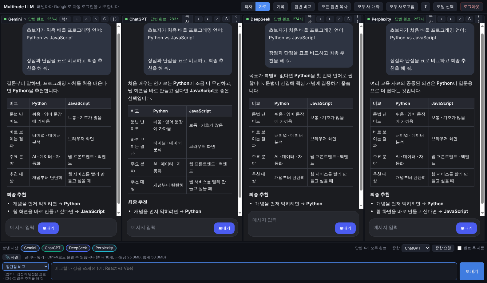

## 버전별 변경 사항

| 버전 | 내용 |
|---|---|
| **v0.4.5** | Qwen 토큰 다리가 `refresh_token` 쿠키(로그인 시 Qwen이 두는 30일짜리 토큰)도 쓰도록 수정. 패널에 아직 유효한 토큰이 있으면 건드리지 않음 |
| **v0.4.4** | 크롬 확장 **Qwen 로그인 문제 실제 원인 수정**: Qwen은 쿠키가 아니라 `localStorage.token`으로 로그인을 확인하는데, 확장 탭 안 iframe의 저장소가 일반 탭과 분리돼 토큰이 없었음. 크롬이 가진 Qwen `token` 쿠키 값을 그 iframe의 localStorage에 넣고 한 번 새로고침 |
| **v0.4.3** | 크롬 확장에서 **Qwen**이 크롬에 로그인돼 있어도 로그아웃 화면으로 뜨던 문제 수정 (iframe 안 화면 스크립트가 로그인 쿠키를 읽지 못하던 크롬 동작 보완) |
| **v0.4.2** | **Genspark** 추가, **Poe** 제거. 크롬 확장에서 Grok이 "네트워크에서 Grok을 차단" 오류로 대화를 시작하지 못하던 문제 수정 (iframe 안 WebSocket 연결에 로그인 쿠키가 빠지던 크롬 동작 보완) |
| **v0.4.1** | **보안 보강**: 앱 탭을 떠나면 iframe 허용 규칙을 즉시 해제, 요청 파일·다시 요청에 확인과 검사, 실행 영향 파일과 삭제는 기본 체크 해제, 원격 설정 범위 축소, iframe 범위·권한 축소, 임시 파일·Windows 경로 정리 ([보안](#보안)) |
| **v0.4.0** | **프로젝트 모드**: 로컬 폴더를 열어 구조·파일을 AI에게 보내고(3단계 제외 규칙·비밀 정보 검사), `NEED_FILES` 요청에 답하고, 코드 수정안을 비교·미리보기·적용·되돌리기. Windows 앱과 크롬 확장 모두 |
| **v0.3.0** | Mistral(`chat.mistral.ai/work`) 추가 — 9개 서비스. 공통 입력창 **파일 첨부**(끌어다 놓기 · Ctrl+V · 📎). 크롬 확장에서 Perplexity처럼 서비스 워커가 있는 사이트가 패널에 안 뜨던 문제 수정 |
| **v0.2.0** | Groq → **Grok**(grok.com). **Perplexity · Qwen · Poe · Duck.ai** 추가, **최대 4개 선택**(처음 값 Gemini · ChatGPT · DeepSeek · Perplexity). **크롬 확장 프로그램** 추가 |
| v0.1.0 | Gemini · ChatGPT · DeepSeek · Groq 4개, Windows 앱 첫 배포 |

자세한 내용은 [docs/release-notes](docs/release-notes)를 보세요.

## 한눈에 보기

> 스크린샷의 패널 안은 실제 서비스 화면이 아니라 **테스트용 채팅 페이지와 예시 답변**입니다. 앱 화면(툴바·패널 머리줄·공통 입력창·비교·기록·설정)은 실제 앱 그대로입니다.
> 실제로는 각 패널에 해당 서비스의 웹 채팅이 그대로 열립니다.

### 1. 모델 고르기

쓸 모델을 9개 중 최대 4개까지 고릅니다. 4개를 고르면 나머지는 선택이 막히고 "4 / 4 선택"이 표시됩니다. 고른 모델만 패널로 열리고, Windows 앱은 각 서비스에 "Google로 계속하기"로 자동 로그인합니다.

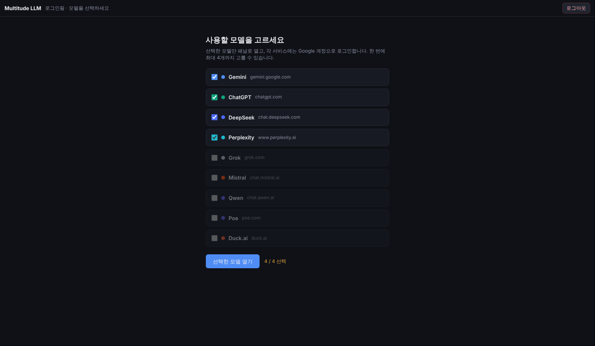

### 2. 한 번에 질문하기

아래 공통 입력창에 쓰면 켜 둔 AI 모두에게 동시에 보냅니다. 왼쪽 아래 **템플릿**(예: 장단점 비교)을 고르면 질문을 자동으로 감싸 줍니다. 패널마다 "답변 중… → 답변 완료 · N자"가 표시됩니다. 위쪽 **격자 / 가로**로 2×2 · 1×4 배치를 바꿉니다.


### 3. 파일 첨부

이미지·문서를 공통 입력창에 **끌어다 놓거나**, **Ctrl+V**로 붙여 넣거나(스크린샷), **📎 파일** 버튼으로 올리면 보낼 대상 패널마다 첨부해서 보냅니다. 받지 않는 종류가 있는 서비스는 올릴 때 미리 알려 주고(예: "Duck.ai은(는) 문서 빼고 보냄"), 보낸 뒤 패널 머리줄에 `📎 일부 파일은 빼고 보냄` · `📎 첨부 없이 보냄`으로 표시합니다. [자세히](#파일-첨부)

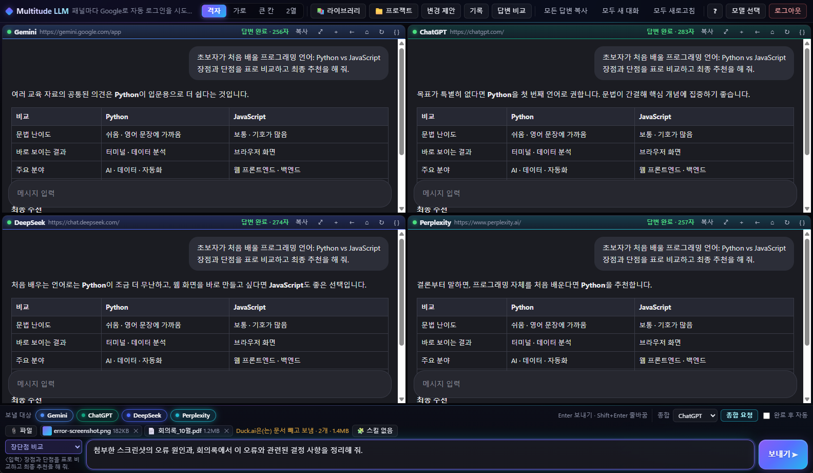

### 4. 교차검토(종합)

**종합 요청**을 누르면 다른 AI들의 답변을 모아, 고른 AI 하나(여기서는 Gemini)에게 오류·빠진 내용·최종 답변을 정리해 달라고 보냅니다. "완료 후 자동"을 켜면 모든 답변이 끝나는 순간 알아서 요청합니다. 종합 요청에는 첨부 파일을 다시 보내지 않습니다.

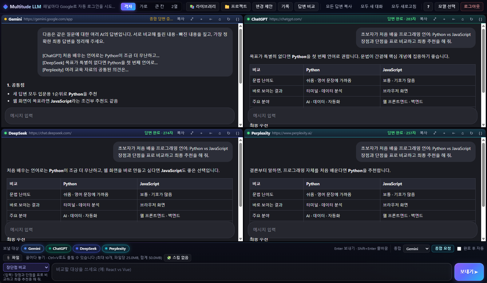

### 5. 답변 비교

**답변 비교**(Ctrl+Shift+D)는 마지막 질문과 각 AI의 최신 답변을 칸별로 나란히 보여 줍니다. 칸마다 Markdown(표·코드 블록 유지)으로 복사할 수 있습니다.

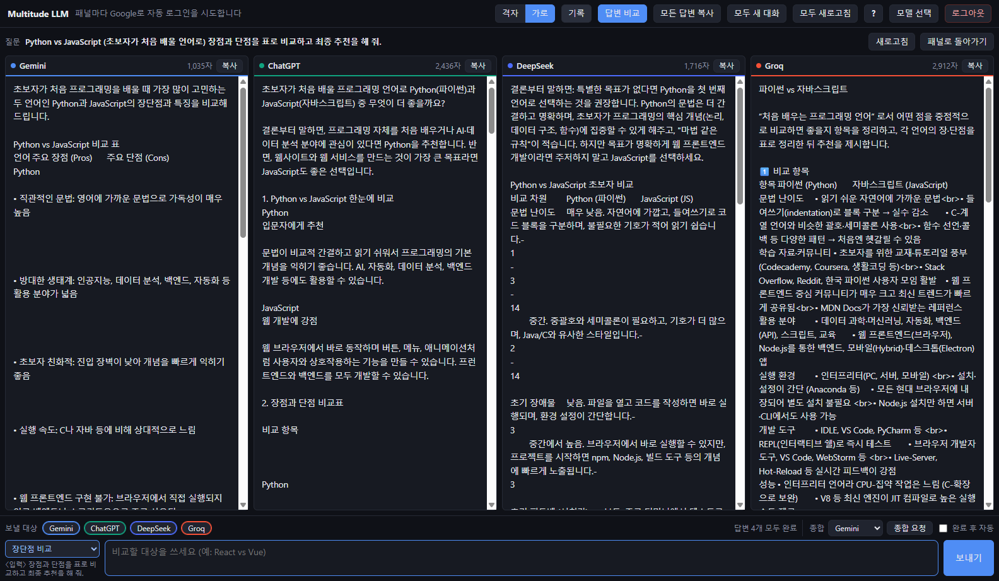

### 6. 기록

**기록**(Ctrl+H)에는 보낸 질문과 각 답변·종합 결과, 첨부한 파일 이름이 저장됩니다(파일 내용은 저장하지 않음). 검색, Markdown 복사, 질문 다시 쓰기를 할 수 있습니다. 기록은 이 PC에만 저장됩니다.

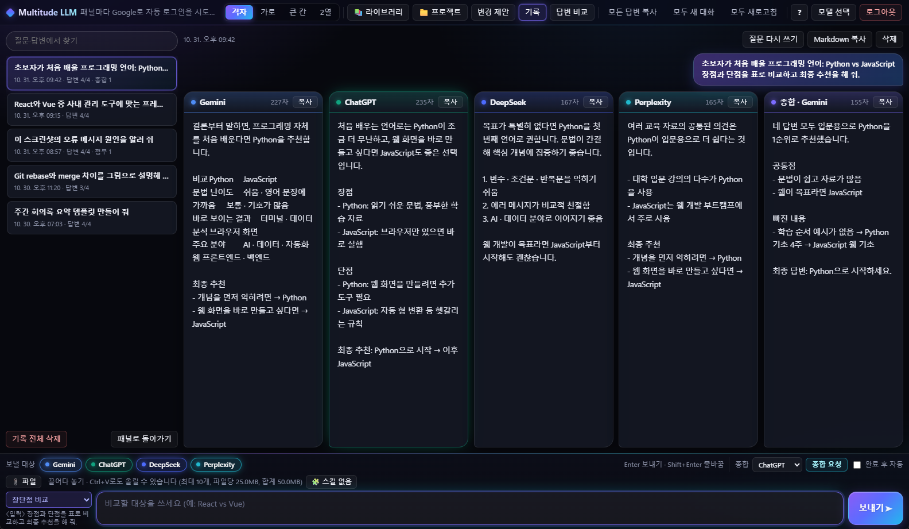

### 7. 설정 · 단축키

`?`(Ctrl+/) 화면에서 답변 대기 시간, 사이트 셀렉터 자동 갱신을 설정하고 단축키를 볼 수 있습니다.

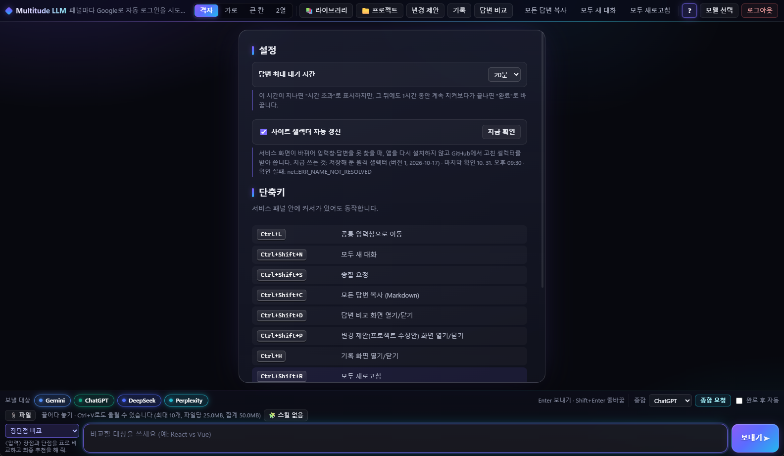

### 8. 프로젝트 모드 (로컬 코드 작업)

툴바의 **📁 프로젝트**로 로컬 폴더를 열면 왼쪽에 파일 트리가 뜹니다. 빼야 할 파일은 `L1`·`L2`·`L3` 표시와 이유(예: `.gitignore 1행 (dist/)`)가 붙고, 비밀 정보로 보이는 파일은 `⚠ 비밀?`로 경고합니다. 질문을 보내면 프로젝트 구조와 고른 파일 내용이 함께 갑니다. AI가 답변 끝에 `NEED_FILES:`로 파일을 요청하면 패널 머리줄에 **📂 요청 파일 N개 보내기** 버튼이 생깁니다. [자세히](#프로젝트-모드)

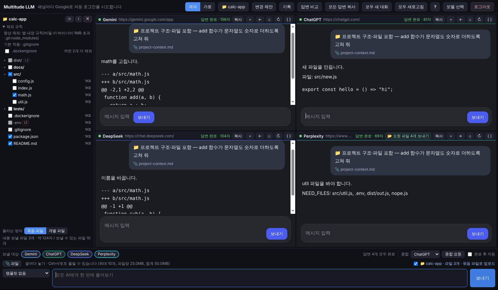

**변경 제안**(Ctrl+Shift+P)에서 AI마다 낸 수정안을 파일별로 비교하고, **미리보기·적용**으로 diff를 확인한 뒤 고른 파일만 씁니다. 맞지 않는 diff는 **전체 파일 다시 요청**으로, 여러 안은 **종합으로 합치기**로 처리합니다. 적용한 것은 **적용 기록**에서 되돌릴 수 있습니다.

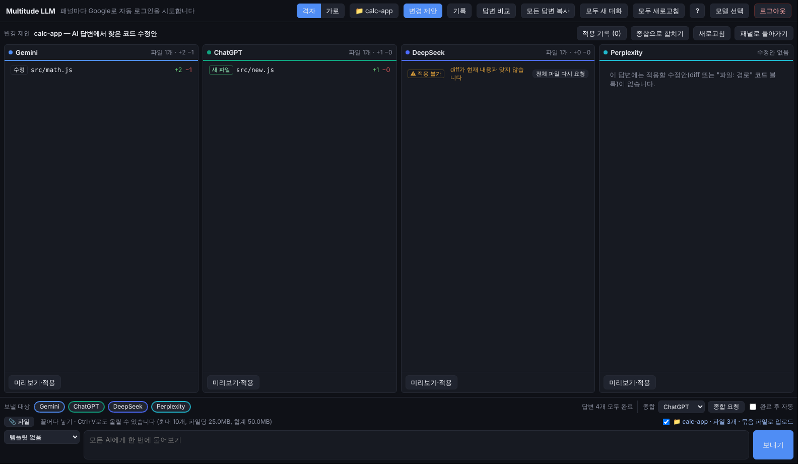

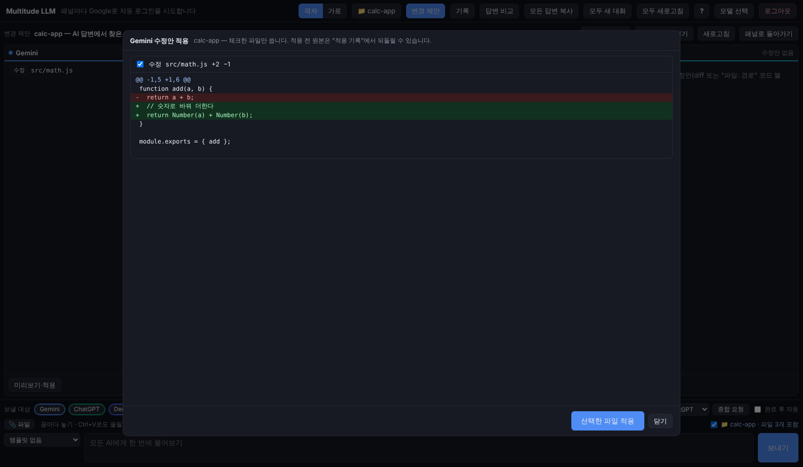

### 9. 크롬 확장 프로그램

같은 화면을 크롬 탭 하나에서 씁니다. 각 서비스는 크롬에 로그인된 계정을 그대로 쓰고, 로그인이 필요한 패널은 머리줄의 **로그인 탭**으로 일반 탭에서 로그인합니다. [설치 방법](#크롬-확장-프로그램)

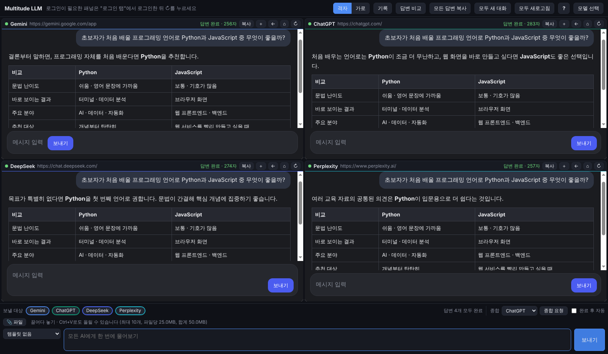

## 크롬 확장 프로그램

스토어에 올리지 않은 상태라 **압축해제된 확장 프로그램**으로 직접 추가합니다.

1. 이 저장소를 받습니다 (`git clone` 또는 GitHub의 **Code → Download ZIP** 후 압축 풀기).
2. 크롬 주소창에 `chrome://extensions`를 엽니다.
3. 오른쪽 위 **개발자 모드**를 켭니다.
4. **압축해제된 확장 프로그램을 로드합니다**를 누르고 저장소 안의 `extension` 폴더를 고릅니다.
5. 툴바의 퍼즐 아이콘에서 **Multitude LLM**을 고정(📌)하고 누르면 앱 탭이 열립니다.

처음 쓸 때:

- 각 서비스는 **크롬에 로그인된 계정을 그대로** 씁니다. 로그인이 안 된 서비스는 패널 머리줄의 **로그인 탭**을 눌러 새 탭에서 로그인한 뒤, 패널의 ↻로 새로고침하세요.
  Google 로그인 화면은 다른 페이지 안에 뜨지 않으므로 로그인은 꼭 일반 탭에서 합니다.
- Duck.ai는 로그인이 없고, 처음 열면 이용 동의 화면을 한 번 눌러야 합니다.
- 코드를 받아 새 버전으로 바꾼 뒤에는 `chrome://extensions`에서 Multitude LLM의 **새로고침(↻)** 을 누릅니다.

확장 프로그램에서만 다른 점:

- 크롬이 페이지에 넘겨주지 않는 키 두 가지는 바꿔 씁니다: 모두 새 대화 `Alt+Shift+N`, N번째 보낼 대상 켜기/끄기 `Alt+Shift+1~4`.
- 로그아웃 버튼과 패널 개발자 도구 버튼이 없습니다 (크롬 자체 로그인 상태를 씀, 패널은 F12 개발자 도구의 프레임 선택으로 봅니다).
- 기록·설정은 크롬 프로필의 확장 프로그램 저장소에 저장됩니다 (Windows 앱과 따로).
- 앱 탭을 오래 백그라운드에 두면 크롬이 타이머를 늦춰 "답변 완료" 표시가 늦을 수 있습니다.

어떻게 동작하나요: 앱 탭 안에 각 서비스를 iframe으로 띄우고, 그 탭 안의 iframe에 한해서만 사이트의 iframe 차단 헤더(`X-Frame-Options`, CSP)를 지웁니다(`declarativeNetRequest` 세션 규칙). 같은 사이트를 일반 탭으로 열 때는 아무것도 바뀌지 않습니다. 질문 입력·답변 읽기는 각 iframe 안의 content script(`extension/content.js`)가 합니다.
사이트가 서비스 워커(PWA)를 등록해 두면 그 서비스 워커가 페이지를 대신 받아 와 이 규칙을 피해 가므로, 패널을 열거나 새로고침할 때마다 그 서비스의 **서비스 워커 등록만** 지웁니다(`browsingData` 권한, 로그인·저장 데이터는 그대로).

패널에 회색 "연결 거부" 아이콘이 뜨면: 패널의 ↻를 누르세요. 그래도 그대로면 `chrome://extensions`에서 확장 프로그램을 ↻(새로고침)한 뒤 앱 탭을 다시 엽니다.

## 설치 (Windows)

[Releases](https://github.com/dyj02056/multitude_llm_ai/releases)의 `MultitudeLLM-Setup-<버전>.exe`를 실행합니다.
코드 서명이 없어서 처음 실행할 때 Windows SmartScreen 경고가 뜰 수 있습니다 ("추가 정보" → "실행").

> `dist` 폴더의 설치 파일은 GitHub에 올라가지 않습니다(`.gitignore`). 코드를 새로 받았다면 아래처럼 **다시 빌드해야** 새 버전이 들어간 설치 파일이 생깁니다. 파일 이름의 버전은 `package.json`의 `version`을 따릅니다.

## 설치 파일 직접 만들기 (Windows)

저장소 폴더에서 연 **PowerShell** 창에서 차례로 실행합니다.

```powershell
# 1) 최신 코드 받기
git pull origin claude/magical-pasteur-ksk533

# 2) 예전 빌드 결과(0.1.0 등) 지우기
Remove-Item -Recurse -Force dist -ErrorAction SilentlyContinue

# 3) 의존성 맞추기
npm install

# 4) 이 창에서만 스크립트 실행을 허용하고 빌드 실행
Set-ExecutionPolicy -Scope Process -ExecutionPolicy Bypass
.\scripts\build-win.ps1
```

- 1번의 브랜치 이름은 작업 중인 브랜치입니다. main에 병합한 뒤에는 `git pull origin main`을 씁니다.
- 결과물은 `dist\MultitudeLLM-Setup-<버전>.exe`입니다 (지금 버전: 0.4.5). 처음에는 Electron을 내려받느라 몇 분 걸릴 수 있습니다.
- 4번의 실행 허용은 그 PowerShell 창을 닫으면 사라집니다 (PC 설정은 바뀌지 않음).
- `powershell -ExecutionPolicy Bypass -File ...` 형태는 PATH에 `powershell`이 없는 PC에서 `'powershell' 용어가 ... 인식되지 않습니다` 오류가 납니다. 위 4번처럼 열린 창에서 직접 실행하세요. 그래도 빌드 중 같은 오류가 나면 전체 경로로 실행합니다.

  ```powershell
  & "$env:SystemRoot\System32\WindowsPowerShell\v1.0\powershell.exe" -ExecutionPolicy Bypass -File scripts\build-win.ps1
  ```
- 아이콘은 `node scripts/make-icon.js`로 다시 만들 수 있습니다.
- 태그(`v0.4.5` 등)를 푸시하면 GitHub Actions가 설치 파일과 확장 프로그램 zip을 만들어 Releases에 올립니다 (`.github/workflows/release.yml`).

## 코드 구조

| 폴더 | 내용 |
|---|---|
| `src/shared/` | Windows 앱과 확장 프로그램이 **같이 쓰는** 코드: 서비스 목록·셀렉터(`services.js`), 질문 보내기·종합(`rounds.js`), 답변 감시, 페이지 주입 함수, 기록, 셀렉터 원격 갱신, 단축키, 프로젝트 모드(`project-ignore.js` 제외 규칙, `secret-scan.js`, `project-context.js`, `patch.js`) |
| `src/shared/vendor/` | 포함한 외부 라이브러리: [ignore](https://github.com/kaelzhang/node-ignore) 7.0.12 (MIT), [jsdiff](https://github.com/kpdecker/jsdiff) 9.0.0 (BSD-3-Clause) — 라이선스 파일 함께 |
| `src/main/`, `src/preload/` | Windows 앱(Electron) 전용 (`project.js`: 프로젝트 폴더 읽기·쓰기) |
| `src/renderer/` | 화면 (두 쪽이 같은 파일을 씀) |
| `test/` | 공통 모듈 단위 테스트 (`npm test`) |
| `extension/` | 크롬 확장 프로그램. 직접 고치는 파일은 `host.js`·`project-fs.js`·`content.js`·`cookie-shim.js`·`cookie-bridge.js`·`background.js`·`ext.css`뿐이고, 나머지(`manifest.json`, `app.html`, `lib/`, `icons/`)는 생성 파일 |

`src/shared/`나 `src/renderer/`를 고친 뒤에는 확장 프로그램 폴더를 다시 만들어 함께 커밋합니다.

```bash
npm run build:ext   # extension/ 다시 만들기
npm run check:ext   # extension/ 이 src/와 맞는지 확인
npm test            # 공통 모듈 단위 테스트 (제외 규칙·비밀 검사·맥락·diff 적용)
```

## 실행 (개발)

```bash
npm install
npm start
```

1. Google 계정으로 로그인합니다.
2. 사용할 모델을 고릅니다 (최대 4개).
3. 각 패널이 "Google로 계속하기"로 자동 로그인합니다 (Google 계정 선택·동의, 캡차는 직접).
4. 아래 공통 입력창에 질문을 쓰고 보냅니다.

## 기능

- 9개 서비스 중 최대 4개를 골라 질문 동시 전송 (대상 켜기/끄기), 격자(2×2)·가로(1×4) 배치
- 프로젝트 모드: 로컬 폴더의 구조·파일을 함께 보내고, AI 수정안을 비교·미리보기·적용·되돌리기 ([자세히](#프로젝트-모드))
- 파일 첨부: 공통 입력창에 끌어다 놓기 · Ctrl+V(스크린샷) · 📎 버튼 → 보낼 대상 패널마다 첨부해서 보냄 ([자세히](#파일-첨부))
- 답변 완료 감지, 패널별·전체 답변 복사 (Markdown — 표·코드 블록·목록 서식 유지)
- 사이트 셀렉터 원격 갱신: 서비스 화면이 바뀌면 [remote/selectors.json](remote/README.md)만 고쳐 바로잡음 (6시간마다 확인, 설정에서 끄기 가능)
- 답변 대기 시간 설정(기본 20분, `?` 화면), 기다린 시간 표시, 시간 초과 뒤에도 계속 지켜보다가 늦게 끝나면 완료로 갱신
- 패널별·전체 새 대화, 로그아웃(모든 로그인 정보 삭제)
- 교차검토(종합): 다른 AI 답변을 모아 한 AI에게 비교·정리 요청, 완료 후 자동 종합
- 답변 비교 화면, 질문 템플릿(요약·번역·장단점 비교 등)
- 질문·답변 기록: 자동 저장(최근 500개), 검색, Markdown 복사, 질문 다시 쓰기 — 이 PC의 앱 데이터 폴더에만 저장

## 파일 첨부

공통 입력창에 이미지·문서·파일을 올리면 보낼 대상 패널마다 첨부한 뒤 질문을 보냅니다. 글 없이 파일만 보낼 수도 있습니다.

- 올리는 방법: 입력창 쪽으로 **끌어다 놓기**, 입력창에서 **Ctrl+V**(스크린샷·복사한 파일), **📎 파일** 버튼
  (서비스 패널 위에 끌어다 놓으면 그 사이트에만 올라갑니다)
- 한도: 최대 **10개**, 파일당 **25MB**, 합계 **50MB**. 넘는 파일은 올릴 때 바로 빼고 이유를 보여 줍니다. 실제 한도는 각 서비스 제한도 따릅니다.
- 사이트마다 사람이 하는 방법(붙여넣기 → 파일 선택 칸 → 끌어다 놓기)을 차례로 시도합니다. Windows 앱은 그래도 안 되면 크롬 개발자 프로토콜로 파일 선택 칸에 직접 넣습니다.
- 첨부에 실패한 패널은 **글만 보내고** 패널 머리줄에 `📎 첨부 없이 보냄`을 표시합니다 (마우스를 올리면 이유).
  받지 않는 종류(예: Duck.ai의 문서)는 빼고 보내며 `📎 일부 파일은 빼고 보냄`으로 알립니다. 올릴 때 미리 알려 줍니다.
- 기록에는 첨부 파일의 이름·크기만 남고 내용은 저장하지 않습니다. 종합 요청에는 첨부를 다시 보내지 않습니다.

## 프로젝트 모드

로컬 프로젝트 폴더를 열어 AI 4곳과 함께 코드 작업을 합니다. 웹 채팅의 AI가 폴더를 직접 열어 보는 것이 아니라, **앱이 고른 내용만 대화에 넣어 주고**, AI 답변의 수정안을 **사용자가 확인한 뒤** 파일에 씁니다.

| 단계 | 하는 일 |
|---|---|
| 1. 열기 | 툴바 **📁 프로젝트** → 폴더 선택. 왼쪽 사이드바(300px)에 파일 트리. `package.json`·`README` 같은 핵심 파일은 처음부터 골라 둠 |
| 2. 고르기 | 체크한 파일의 내용과, 제외 규칙을 통과한 **전체 구조(파일 이름 목록)** 를 보냄. 입력창 오른쪽 `📁 이름 · 파일 N개 포함`을 끄면 맥락 없이 보냄 |
| 3. 보내기 | 질문 뒤에 답변 규칙(수정은 파일별 `diff`, 새 파일은 `파일: 경로` + 코드 블록, 더 볼 파일은 `NEED_FILES:`)이 붙음. 10만 자가 넘으면 `project-context.md` 파일로 첨부 (문서를 받지 않는 Duck.ai에는 본문에 잘라서) |
| 4. 요청 파일 | 답변 끝에 `NEED_FILES: a.js, b.ts`가 있으면 패널에 **📂 요청 파일 N개 보내기** → 그 패널에만 보냄 (제외 규칙·비밀 검사 그대로 적용, 못 보낸 파일은 이유를 함께 알림) |
| 5. 변경 제안 | **변경 제안**(Ctrl+Shift+P, 확장 Alt+Shift+P) — AI별 수정안 목록(수정·새 파일·삭제, +/− 줄 수). 맞지 않으면 `⚠ 적용 불가` + **전체 파일 다시 요청** |
| 6. 적용 | **미리보기·적용** → 파일별 diff 확인 → 체크한 파일만 씀. 쓰기 직전에 파일이 바뀌었으면 다시 계산. 앱 내장 제외 경로(`.env`, `.git`, `node_modules` 등)에는 쓰지 않음 |
| 7. 되돌리기 | **적용 기록**(최근 20개)에서 되돌리기 — 적용 전 내용으로 복구, 새로 만든 파일은 지움. 그 뒤에 다시 바뀐 파일이 있으면 확인을 받음. git은 건드리지 않음 |

### 3단계 제외 규칙

| 단계 | 기본 | 대상 | 직접 체크 |
|---|---|---|---|
| **L1 항상 제외** | 항상 | 앱 내장: `.git/` `node_modules/` `.env*`(`.env.example` 제외) 키·인증서(`*.pem` `*.key` `id_rsa*` …) 자격 증명(`credentials*.json` `.npmrc` `.aws/` `.ssh/` …) 바이너리·미디어·압축·문서(`*.png` `*.pdf` `*.zip` `*.exe` …) 1MB 초과 파일, 바로가기 링크 | 불가 |
| **L2 기본 적용** | 켜짐 | `.gitignore`(하위 폴더 것 포함), `.git/info/exclude`, git 전역 제외 파일(Windows 앱만), AI 전용 `.cursorignore` `.aiexclude` `.geminiignore` `.codeiumignore`, 이 앱 전용 `.mlaignore` | 가능 |
| **L3 선택 적용** | 꺼짐 | `.dockerignore` `.npmignore` `.eslintignore` `.prettierignore` `.vercelignore` `.gcloudignore` `.helmignore` `.slugignore` — 사이드바 **제외 규칙**에서 켬 ("켜면 N개 더 제외" 표시) | 가능 |

- `.dockerignore`·`.npmignore`는 이미지·배포 크기를 줄이려고 테스트·문서까지 빼는 경우가 많아 기본으로 쓰지 않습니다. `.dockerignore`는 루트 기준 문법이라 그에 맞게 해석합니다.
- 같은 단계 안에서는 git처럼 나중 규칙이 이깁니다. `.mlaignore`가 가장 나중이라 `!경로`로 `.gitignore`에 걸린 것을 다시 넣을 수 있습니다 (L1은 불가).
- 트리의 `L1`·`L2`·`L3` 표시에 마우스를 올리면 어느 파일 몇째 줄 때문에 빠졌는지 보입니다.

`.mlaignore` 예 (`.gitignore`와 같은 문법):

```gitignore
# AI에게 보내지 않을 것
legal/
*.sql
# .gitignore에 걸려도 보내고 싶은 것
!src/generated/api-types.ts
```

### 비밀 정보 검사

파일을 고를 때와 보낼 때 개인 키, AWS·GitHub·GitLab·Slack·Google·Stripe 키, `sk-` API 키, JWT, `password = "…"` 같은 대입을 찾습니다. 걸린 파일은 `⚠ 비밀?`로 표시하고 확인을 받아야만 보냅니다 (오탐이 있을 수 있음).

### Windows 앱과 크롬 확장의 차이

| | Windows 앱 | 크롬 확장 |
|---|---|---|
| 폴더 접근 | 폴더 선택 창, 다음 실행 때 자동으로 다시 엶 | File System Access API. 앱 탭을 새로 열 때마다 사이드바의 **폴더 접근 허용**을 한 번 눌러야 함 (크롬 정책) |
| git 전역 제외 파일 | 읽음 (`core.excludesFile`, `~/.config/git/ignore`) | 읽지 못함 |
| 상태 저장 | 앱 데이터 폴더 `projects/` | 크롬 확장 저장소 |

## 보안

이 앱이 데이터를 다루는 방식과, 확장 프로그램으로 쓸 때 막아 둔 것들입니다.

**데이터가 가는 곳**
- 질문·첨부 파일·프로젝트 코드는 **사용자가 켠 AI 서비스(최대 4곳)에만** 각 사이트의 웹 채팅으로 보냅니다. 이 앱의 서버는 없고, 아무것도 따로 모으지 않습니다.
- 기록·설정·적용 기록(되돌리기용 원본 포함)은 **이 PC에만** 암호화 없이 저장됩니다 (Windows 앱: 앱 데이터 폴더 / 크롬 확장: 확장 저장소). 필요하면 기록 화면의 "기록 전체 삭제"로 지웁니다.
- 받아 오는 것은 GitHub의 `remote/selectors.json`(셀렉터·정규식 문자열)뿐이며 코드는 받지도 실행하지도 않습니다.

**막아 둔 것 (v0.4.1)**

| 위험 | 대응 |
|---|---|
| 앱 탭에서 다른 사이트로 이동한 뒤, 그 사이트가 로그인된 AI 사이트를 iframe에 넣어 클릭을 유도 | iframe 허용 규칙은 앱 화면이 열려 있는 동안만 있음. 화면이 사라지면(이동·닫기·새로고침) 백그라운드가 즉시 지우고, 백그라운드가 다시 깨어날 때 남은 규칙도 정리 |
| AI가 민감한 파일을 요청하거나(프롬프트 인젝션) 엉터리 diff로 파일 내용을 다시 받아 가기 | NEED_FILES는 보낼 파일·보내지 않을 파일과 이유를 확인 창으로 먼저 보여 줌. "전체 파일 다시 요청"도 제외 규칙(L1 차단, L2·L3 확인)과 비밀 검사를 거침 |
| 수정안에 섞인 실행 파일 변경을 무심코 적용 | CI 설정, git 훅, `.vscode`, Makefile, Dockerfile, 스크립트 파일, `package.json` 실행 항목(`scripts` 등) 변경과 파일 삭제는 `⚠` 표시 + 기본 체크 해제 |
| 원격 설정이 털려 엉뚱한 버튼을 누르거나 피싱 주소로 보내기 | 버튼·파일 넣기 셀렉터는 원격으로 바꾸지 않음. 새 대화 주소는 그 서비스 도메인만. 위험한 정규식 거절 |
| 앱 탭에 엉뚱한 사이트가 iframe으로 뜸 | 앱 페이지 CSP `frame-src`를 9개 서비스 도메인으로 한정 |
| iframe 안 사이트가 클립보드를 읽음 | iframe 권한은 클립보드 쓰기·마이크만 (마이크는 쓸 때 크롬이 다시 물음) |
| 첨부 임시 파일이 남음 (Windows 앱) | 앱 전용 임시 폴더를 시작·종료 때 정리 |
| `a.txt:stream`, `CON` 같은 Windows 특수 경로로 엉뚱한 곳에 쓰기 | 경로에서 `:`·예약 이름·끝의 점/공백을 거절 |

**크롬 확장 권한과 쓰는 이유**

| 권한 | 이유 |
|---|---|
| 9개 서비스 사이트 접근 (+ `duckduckgo.com`: duck.ai가 그 주소로 열리기도 함) | 앱 탭 안 iframe에서 질문 입력·답변 읽기 (content script는 앱 탭 안 iframe일 때만 동작하고, 일반 탭에서는 아무것도 하지 않음) |
| `declarativeNetRequest` | 앱 탭 안 서비스 iframe에서만 X-Frame-Options·CSP 헤더를 지워 화면에 띄움 (그 탭·그 도메인에 한정, 일반 탭 영향 없음) |
| `browsingData` | 패널을 막는 해당 서비스의 서비스 워커 등록만 지움 (쿠키·저장 데이터는 그대로) |
| `cookies` + 서비스 `wss://` 접근 | 크롬은 확장 탭 안 iframe의 WebSocket 연결에 로그인 쿠키를 붙이지 않아 Grok 등이 대화를 시작하지 못함. 앱 탭 안·서비스 도메인·WebSocket 요청에 한해 크롬이 가진 그 사이트 쿠키를 붙이는 규칙을 걸고, 앱 탭을 떠나면 지움 (쿠키 값은 메모리의 세션 규칙에만 있고 밖으로 보내지 않음).<br>Qwen처럼 화면 스크립트가 로그인 쿠키를 직접 읽는 사이트는, 그 사이트의 HttpOnly가 아닌 쿠키를 **이 확장 탭 안 iframe에서만 보이는 칸(partitioned 쿠키)**에 복사해 둠. 일반 탭의 그 사이트에는 보이지도 붙지도 않고, 쿠키를 밖으로 보내지 않음.<br>Qwen은 로그인 토큰을 localStorage에서 읽으므로, 크롬이 가진 Qwen의 `token`(없으면 `refresh_token`) 쿠키 값을 **앱 탭 안 Qwen iframe에만** 알려 주어 그 iframe의 localStorage에 넣음 (다른 사이트·일반 탭에는 주지 않음) |
| `storage`, `unlimitedStorage` | 설정·기록·프로젝트 상태 저장 |
| `clipboardWrite` | 답변 복사 |

## 단축키

서비스 패널 안에 커서가 있어도 동작합니다. 앱에서 `Ctrl+/`로 전체 목록을 볼 수 있습니다.

| 키 | 동작 |
|---|---|
| `Ctrl+L` | 공통 입력창으로 이동 |
| `Ctrl+Shift+N` (확장 프로그램: `Alt+Shift+N`) | 모두 새 대화 |
| `Ctrl+Shift+S` | 종합 요청 |
| `Ctrl+Shift+C` | 모든 답변 복사 (Markdown) |
| `Ctrl+Shift+D` / `Ctrl+H` | 답변 비교 / 기록 화면 |
| `Ctrl+Shift+P` (확장 프로그램: `Alt+Shift+P`) | 변경 제안 화면 (프로젝트 모드) |
| `Ctrl+1~9` (확장 프로그램: `Alt+Shift+1~4`) / `Alt+1~9` | N번째 보낼 대상 켜기·끄기 / N번째 패널로 이동 |
| `Esc` | 비교·기록·도움말 화면에서 패널로 돌아가기 |

## 개발 옵션

환경 변수로 켜며, 일반 실행에는 영향이 없습니다. 자세한 내용은 [src/main/dev.js](src/main/dev.js)를 참고하세요.

| 변수 | 설명 |
|---|---|
| `MLA_DEBUG=1` | 페이지 이동·자동 로그인·전송·답변 감지 로그를 터미널에 출력 |
| `MLA_START=pick` / `chat` | 로그인 확인을 건너뛰고 모델 선택 / 채팅 화면으로 시작 |
| `MLA_PROFILE=<폴더>` | 별도 프로필 폴더로 실행 (실행 중인 앱과 따로 띄울 때) |
| `MLA_DRY_SEND=1` | 질문 입력·보내기 버튼 찾기까지만 하고 실제로 보내지 않음 |
| `MLA_REMOTE_URL=<주소 또는 파일>` | 셀렉터 원격 갱신을 GitHub 대신 이 주소·로컬 파일에서 받음 |
| `MLA_ANSWER_TIMEOUT_MS` / `MLA_ANSWER_START_MS` | 답변 시간 초과 / 시작 대기 시간을 이 값(ms)으로 (시험용) |

PowerShell 예:

```powershell
$env:MLA_DEBUG = '1'; npm start -- --remote-debugging-port=9333
```

`--remote-debugging-port`를 주면 `http://127.0.0.1:9333/json`에서 각 패널 페이지를 DevTools 프로토콜로 살펴볼 수 있습니다.

확장 프로그램은 앱 탭의 개발자 도구 콘솔에서 `localStorage.setItem('mla.debug', '1')` 후 새로고침하면 전송·답변 로그를 볼 수 있습니다.

계획과 진행 상황은 [PLAN.md](PLAN.md)를 참고하세요.
