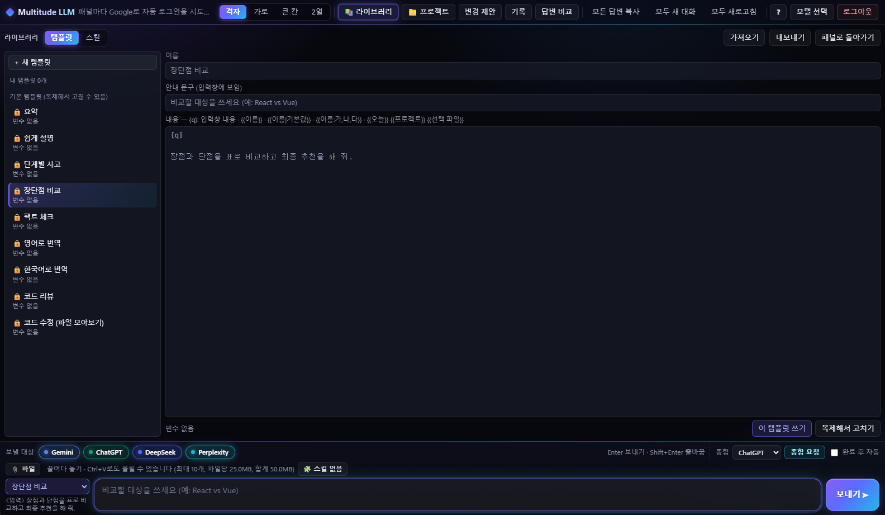

# multitude_llm_ai

Gemini · ChatGPT · Claude · DeepSeek · Perplexity · Grok · Mistral · Qwen · Z.ai · Genspark · Duck.ai 웹 채팅 중 **최대 6개**(처음 값 4개)를 한 화면에 띄워 같은 질문(과 이미지·문서 파일)을 동시에 보내고 답변을 비교합니다. 로컬 프로젝트 폴더를 열어 **코드 작업**(맥락 보내기 → 수정안 비교 → 적용·되돌리기)도 함께 할 수 있고, 답변의 파일 코드를 **📋 파일 모아보기**로 모아 바로 복사할 수도 있습니다.

- **Windows 앱** (Electron) — 로그인은 Google 계정 하나로 합니다. [설치](#설치-windows) · [직접 빌드](#설치-파일-직접-만들기-windows)
- **크롬 확장 프로그램** — 크롬에 이미 로그인된 각 서비스 계정을 그대로 씁니다. [설치](#크롬-확장-프로그램)

API 키 없이 각 서비스의 무료 웹 채팅을 그대로 씁니다. 처음 고른 모델은 Gemini · ChatGPT · DeepSeek · Perplexity이고, 격자 · 가로 · 큰 칸 · 2열 배치를 고를 수 있습니다.


## 버전별 변경 사항

| 버전 | 내용 |
|---|---|
| **v0.11.0** | **답변 비교에 분석 · 차이 강조**: 답변 비교 화면에 **답변 \| 분석** 탭. **분석 요청**을 누르면 종합 담당 AI가 정해진 형식(공통 의견 / 이견 표 / 근거 부족 / 최종 답변)으로 답하고, 앱이 이를 **이견 표**(쟁점 · AI별 입장 · 판단)와 카드로 그림. 이견 칸이나 AI 이름을 누르면 그 AI 답변 칸으로 이동. 형식이 깨진 답은 글 그대로 보여 줌. 결과는 기록에 저장되고 기록 화면에도 표로 나옴. **차이 강조**를 켜면 기준 답변(고를 수 있음)과 다른 문장만 형광으로 표시하고 칸마다 `다름 N%` ([답변 비교](#5-답변-비교)) |
| **v0.10.1** | **안정성 · 보안**: 로그인 팝업은 주소의 도메인이 허용 목록(공용 로그인 도메인 · 그 서비스의 로그인 도메인 · 서비스 자기 도메인)과 **정확히 같을 때만** 앱 안에서 열고, 팝업 안에서 다른 곳으로 이동해도 같은 검사 — 허용 밖은 기본 브라우저로. 크롬 확장 프로젝트가 **이름이 같은 두 폴더**를 따로 저장(예전에는 상태 저장이 제대로 되지 않던 문제도 함께 고침). 프로젝트 업로드 묶음 파일을 **글자 수가 아니라 바이트**로 나눠 한글 파일도 한도 안에, 큰 파일 하나도 나눔. 창 크기를 끌 때 화면 갱신을 묶어 덜 버벅임. 첨부 조각 항상 정리, 원격 셀렉터는 리다이렉트 거부, 파일 쓰기 직전 실제 경로 재확인 ([보안](#보안)) |
| **v0.10.0** | **화면 디자인 개편**: 어두운 바탕에 보라·청록 네온 빛과 유리(반투명) 질감. 버튼을 **주요(그라데이션) · 일반(유리) · 보조(테두리 없음) · 위험(붉은 톤)** 4단계로 나누고, 마우스를 올리면 떠오르며 빛나고 누르면 꾹 눌리는 반응. 공통 입력창은 누르면 빛나는 테두리, 보낼 대상 칩은 서비스 색으로 빛남. **답변 비교 · 기록**은 채팅처럼 내 질문은 오른쪽 말풍선, AI 답변은 말풍선 카드로 하나씩 스르륵 등장. 모델 선택 화면에 **이렇게 씁니다** 설명 카드 3장과 2열 모델 카드. 화면 전환 페이드인, 답변 중 상태 점 물결. Windows의 "애니메이션 효과"를 끄면 움직임도 꺼짐 ([디자인](#화면-디자인)) |
| **v0.9.4** | **패널에서 바로 적용**: 프로젝트 모드에서 답변에 수정안이 있으면 패널 아래 **변경 바**(파일 수 · +/− · 파일 이름) → **적용 (N)** 한 번에 씀 (실행 영향 파일·삭제는 빼고 `⚠ 확인 필요` 표시, **변경 보기**로 골라 적용). 적용하면 `✓ 적용됨` + **되돌리기**, 다른 AI의 바는 지금 파일 기준으로 다시 계산. 파일 트리에 `M`/`A` 표시. 미리보기 창은 Enter · Ctrl+Enter로 적용. 변경 제안 화면에서 이미 적용한 수정안은 `✓ 적용됨` |
| **v0.9.3** | **📋 파일 모아보기**: 답변에 파일 코드(`파일: 경로` 코드 블록 · diff · `DELETE_FILES`)가 있으면 패널 머리줄에 버튼이 눈에 띄게 나타나고(튀어나옴 · 반짝임), 누르면 파일마다 **새 파일 / 수정 / 삭제** 표시와 전체 코드를 모아 **경로 복사 · 코드 복사 · 전체 복사**. 파일에는 쓰지 않으며 프로젝트를 열지 않아도 씀. 새 기본 템플릿 **코드 수정 (파일 모아보기)**. `.md`처럼 안에 ```` ``` ````가 든 파일이 **여러 코드 블록으로 쪼개지던 문제** 수정 (답변 규칙에 "한 파일은 블록 하나 · 바깥 울타리는 백틱 4개" 추가, 답변을 읽을 때 더 긴 울타리 사용) |
| **v0.9.2** | AI 압축 수정: 압축 답변을 기다리는 동안 패널 등 다른 화면으로 가면 기다리기가 취소되어 **압축본을 가져오지 못하던 문제**를 고침 (이제 다른 화면에서도 계속 기다렸다가 넣어 두고 알림). 압축 화면에 **패널에서 다시 읽기** 버튼. 답변에서 압축본을 꺼낼 때 가장 긴 코드 블록·닫히지 않은 블록도 처리 |
| **v0.9.1** | **스킬 최대 3개 동시 적용**(켠 순서 = 우선순위, 🧩 칩 줄, 대화 중간에 바꾸면 바뀐 점만 알림, 합계 3만 자). 보내는 글 **규칙 기반 정리**(주석·꾸밈·빈 줄·반복, 선택: 예시 절 빼기)와 **AI로 압축**(열린 패널에 압축 요청 → 답변을 읽어 그 스킬의 압축본으로 저장, 저장 전 미리보기). **압축 권장 표시**(스킬 하나 5,000 / 10,000자, 합계 8,000 / 15,000자, 기준 변경 가능) |
| **v0.9.0** | **📚 라이브러리**: 내 템플릿 만들기·고치기·복제·즐겨찾기와 **변수**(`{{이름}}` · `{{이름\|기본값}}` · `{{이름:가,나,다}}` · `{{오늘}}` `{{프로젝트}}` `{{선택 파일}}`) — 보낼 때 변수 입력 화면에서 채움(마지막 값 기억). **스킬**: SKILL.md를 가져오거나 직접 써서 고르면, 각 패널의 새 대화 첫 질문(또는 매 질문) 앞에 지침을 붙여 보냄. 라이브러리 .json 내보내기·가져오기, 스킬 SKILL.md 내보내기 |
| **v0.8.0** | **git 콘솔** (Windows 앱): 프로젝트 사이드바 **⌥ git 콘솔**에서 그 폴더의 git 명령만 실행 (셸 없이 실행, 허용한 하위 명령만, 위험한 옵션 차단, 되돌리기 어려운 명령은 확인 창, 출력의 토큰 가림, 저장소의 git 훅 알림). **터미널 열기**로 그 폴더에서 Windows 터미널을 엶 |
| **v0.7.1** | **최대 6개** 패널(처음 값은 그대로 4개)과 배치 4가지: **격자**(4개 2×2 · 5개 위 3·아래 2 · 6개 3×2) · **가로** · **큰 칸**(첫 패널 크게 + 나머지 오른쪽) · **2열**(2개 위아래 · 6개 2×3). 패널 머리줄 **⤢**(또는 머리줄 더블클릭)로 그 패널만 크게 보고 **⤡**로 돌아옴 |
| **v0.7.0** | **Claude**(`claude.ai/new`) · **Z.ai**(`chat.z.ai`) 추가 — 11개 서비스. 프로젝트 모드: 서비스마다 **프로젝트 파일 보내지 않기**(그 서비스에는 질문 글만), 프로젝트 파일을 처음 올리는 서비스가 있으면 어디로 가는지 확인 |
| **v0.6.3** | 보안 보강: AI 수정안·편집기·삭제가 **`.git` 안쪽**(훅·설정)에는 쓰지 못하게 막음 (Windows 짧은 이름 `GIT~1` 포함). `.gitmodules` 변경은 `⚠` 실행 영향 파일로 표시 |
| **v0.6.2** | 보안 보강: 메인 창이 끌어다 놓은 링크 등으로 다른 페이지로 이동하지 않게 막음. 패널이 서비스 밖 사이트에 가 있으면 질문·프로젝트 내용·첨부를 넣지 않고 자동 로그인도 그 서비스 로그인 화면에서만. 크롬 확장은 페이지 스크립트의 쿠키 쓰기로 HttpOnly 쿠키를 바꾸지 못하게 하고, 패널 연결 주소를 크롬이 알려 주는 값으로 확인 |
| **v0.6.1** | 프로젝트 파일 **인앱 편집기**: 사이드바 트리에서 파일 이름을 누르면 편집 화면이 열림. **저장**(Ctrl+S)은 로컬 파일에 쓰고 적용 기록(`직접 편집`)에 남겨 되돌릴 수 있음. **저장하고 AI에 보내기**는 그 파일을 받은 적 있는 AI 탭에 바뀐 내용을 바로 보냄 |
| **v0.6.0** | 프로젝트 모드·코드 리뷰 답변 형식을 **파일별 전체 내용**으로 바꿈 (diff 대신 `파일: 경로` + 수정한 전체 내용 코드 블록 하나, 지울 파일은 `DELETE_FILES:`). 사이드바 ⟳ 뒤 AI에게 보낸 뒤 로컬에서 바뀐 파일이 있으면 **⇪ 바뀐 파일 N개 → AI에 보내기**로 그 탭들에 바로 보냄 |
| **v0.5.0** | 프로젝트 모드가 파일을 **업로드**로 보냄: 사이드바에서 **묶음 파일**(기본, 경로가 붙은 `.md`) / **개별 파일**(파일마다, 이름에 경로) 선택. 첫 질문·📂 요청 파일 보내기·전체 파일 다시 요청 모두 적용. 업로드를 못 하면 본문으로 보냄 |
| **v0.4.6** | Qwen 로그인이 `auth.qwen.ai`로 옮겨 간 것에 맞춤: 그 도메인 접근 권한 추가 → 패널 안 로그인 화면이 뜨고, 로그인 확인 요청에 로그인 쿠키가 붙음 |
| **v0.4.5** | Qwen 토큰 다리가 `refresh_token` 쿠키(로그인 시 Qwen이 두는 30일짜리 토큰)도 쓰도록 수정. 패널에 아직 유효한 토큰이 있으면 건드리지 않음 |
| **v0.4.4** | 크롬 확장 **Qwen 로그인 문제 실제 원인 수정**: Qwen은 쿠키가 아니라 `localStorage.token`으로 로그인을 확인하는데, 확장 탭 안 iframe의 저장소가 일반 탭과 분리돼 토큰이 없었음. 크롬이 가진 Qwen `token` 쿠키 값을 그 iframe의 localStorage에 넣고 한 번 새로고침 |
| **v0.4.3** | 크롬 확장에서 **Qwen**이 크롬에 로그인돼 있어도 로그아웃 화면으로 뜨던 문제 수정 (iframe 안 화면 스크립트가 로그인 쿠키를 읽지 못하던 크롬 동작 보완) |
| **v0.4.2** | **Genspark** 추가, **Poe** 제거. 크롬 확장에서 Grok이 "네트워크에서 Grok을 차단" 오류로 대화를 시작하지 못하던 문제 수정 (iframe 안 WebSocket 연결에 로그인 쿠키가 빠지던 크롬 동작 보완) |
| **v0.4.1** | **보안 보강**: 앱 탭을 떠나면 iframe 허용 규칙을 즉시 해제, 요청 파일·다시 요청에 확인과 검사, 실행 영향 파일과 삭제는 기본 체크 해제, 원격 설정 범위 축소, iframe 범위·권한 축소, 임시 파일·Windows 경로 정리 ([보안](#보안)) |
| **v0.4.0** | **프로젝트 모드**: 로컬 폴더를 열어 구조·파일을 AI에게 보내고(3단계 제외 규칙·비밀 정보 검사), `NEED_FILES` 요청에 답하고, 코드 수정안을 비교·미리보기·적용·되돌리기. Windows 앱과 크롬 확장 모두 |
| **v0.3.0** | Mistral(`chat.mistral.ai/work`) 추가 — 9개 서비스. 공통 입력창 **파일 첨부**(끌어다 놓기 · Ctrl+V · 📎). 크롬 확장에서 Perplexity처럼 서비스 워커가 있는 사이트가 패널에 안 뜨던 문제 수정 |
| **v0.2.0** | Groq → **Grok**(grok.com). **Perplexity · Qwen · Poe · Duck.ai** 추가, **최대 4개 선택**(처음 값 Gemini · ChatGPT · DeepSeek · Perplexity). **크롬 확장 프로그램** 추가 |
| v0.1.0 | Gemini · ChatGPT · DeepSeek · Groq 4개, Windows 앱 첫 배포 |

자세한 내용은 [docs/release-notes](docs/release-notes)를 보세요.

## 한눈에 보기

> 스크린샷의 패널 안은 실제 서비스 화면이 아니라 **테스트용 채팅 페이지와 예시 답변**입니다. 앱 화면(툴바·패널 머리줄·공통 입력창·비교·기록·설정)은 실제 앱 그대로입니다.
> 실제로는 각 패널에 해당 서비스의 웹 채팅이 그대로 열립니다.
> 9 · 10번(프로젝트 모드 · 크롬 확장) 스크린샷은 v0.10.0 디자인 개편 전 화면입니다. 기능은 같고 색·버튼 모양만 다릅니다.

### 1. 모델 고르기

위쪽 설명 카드 3장(모델 고르기 → 한 번에 질문 → 비교·종합)으로 쓰는 순서를 먼저 보여 주고, 아래 2열 카드에서 쓸 모델을 11개 중 최대 6개까지 고릅니다. 고른 카드는 서비스 색으로 빛납니다. 6개를 고르면 나머지는 선택이 막히고 "6 / 6 선택"이 표시됩니다 (5개부터는 메모리 안내가 붙음). 고른 모델만 패널로 열리고, Windows 앱은 각 서비스에 "Google로 계속하기"로 자동 로그인합니다.


### 2. 한 번에 질문하기

아래 공통 입력창에 쓰면 켜 둔 AI 모두에게 동시에 보냅니다. 왼쪽 아래 **템플릿**(예: 장단점 비교, 또는 변수가 있는 내 템플릿)을 고르면 질문을 자동으로 감싸 주고, 위의 **🧩 스킬**(최대 3개)을 켜면 지침을 붙여 보냅니다 ([라이브러리](#라이브러리-내-템플릿--스킬)). 패널마다 "답변 중… → 답변 완료 · N자"가 표시됩니다. 위쪽 **격자 / 가로 / 큰 칸 / 2열**로 배치를 바꾸고, 패널 머리줄 **⤢**로 한 패널만 크게 봅니다.


### 3. 파일 첨부

이미지·문서를 공통 입력창에 **끌어다 놓거나**, **Ctrl+V**로 붙여 넣거나(스크린샷), **📎 파일** 버튼으로 올리면 보낼 대상 패널마다 첨부해서 보냅니다. 받지 않는 종류가 있는 서비스는 올릴 때 미리 알려 주고(예: "Duck.ai은(는) 문서 빼고 보냄"), 보낸 뒤 패널 머리줄에 `📎 일부 파일은 빼고 보냄` · `📎 첨부 없이 보냄`으로 표시합니다. [자세히](#파일-첨부)


### 4. 교차검토(종합)

**종합 요청**을 누르면 다른 AI들의 답변을 모아, 고른 AI 하나(여기서는 Gemini)에게 오류·빠진 내용·최종 답변을 정리해 달라고 보냅니다. "완료 후 자동"을 켜면 모든 답변이 끝나는 순간 알아서 요청합니다. 종합 요청에는 첨부 파일을 다시 보내지 않습니다.


### 5. 답변 비교

**답변 비교**(Ctrl+Shift+D)는 마지막 질문(오른쪽 말풍선)과 각 AI의 최신 답변(말풍선 카드, 왼쪽부터 차례로 등장)을 칸별로 나란히 보여 줍니다. 칸마다 Markdown(표·코드 블록 유지)으로 복사할 수 있습니다.

- **차이 강조** (v0.11.0): 위쪽 **차이 강조**를 켜면 기준 답변(처음엔 첫 칸, `기준:` 목록에서 바꿈)에 없는 문장만 노란 형광으로 표시합니다. 칸 머리줄에 `기준` 또는 `다름 N%`가 붙습니다. 띄어쓰기·줄바꿈만 다른 문장은 같은 것으로 봅니다. 다시 누르면 끕니다.
- **분석 탭** (v0.11.0): **분석 요청**을 누르면 입력창 아래 **종합** 목록에서 고른 AI(판정 AI)에게 답변들을 보내고, 정해진 형식으로 답하게 합니다.

  | 칸 | 내용 |
  |---|---|
  | **이견** | 쟁점마다 AI별 입장과 판단을 표로. 칸이나 AI 이름을 누르면 **답변** 탭의 그 AI 칸으로 이동해 잠깐 빛납니다. 이견이 없으면 "이견이 없습니다" |
  | **공통 의견** | 대부분의 AI가 같은 내용 |
  | **근거 부족** | 근거 없이 주장했거나 확인이 필요한 내용 (AI 이름 표시) |
  | **최종 답변** | 분석을 반영한 최종 답변 (복사 버튼) |

  판정 AI가 형식을 지키지 않으면 "정해진 형식이 아니라서 글 그대로 보여 줍니다"와 함께 답변 글을 그대로 보여 줍니다. 분석 결과는 질문 기록에 함께 저장되고, **기록** 화면에서도 같은 표로 보입니다 (목록에 `분석 1`). 탭 위치와 차이 강조 켜짐은 다음에도 기억합니다.


### 6. 기록

**기록**(Ctrl+H)에는 보낸 질문과 각 답변·종합 결과, 첨부한 파일 이름이 저장됩니다(파일 내용은 저장하지 않음). 검색, Markdown 복사, 질문 다시 쓰기를 할 수 있습니다. 기록은 이 PC에만 저장됩니다.


### 7. 설정 · 단축키

`?`(Ctrl+/) 화면에서 답변 대기 시간, 사이트 셀렉터 자동 갱신을 설정하고 단축키를 볼 수 있습니다.


### 8. 라이브러리 (내 템플릿 · 스킬)

**📚 라이브러리**에서 변수가 있는 내 템플릿과 스킬(SKILL.md)을 만들고 고칩니다. 왼쪽 목록에서 고른 항목은 보라빛으로 표시됩니다. [자세히](#라이브러리-내-템플릿--스킬)



### 9. 프로젝트 모드 (로컬 코드 작업)

툴바의 **📁 프로젝트**로 로컬 폴더를 열면 왼쪽에 파일 트리가 뜹니다. 빼야 할 파일은 `L1`·`L2`·`L3` 표시와 이유(예: `.gitignore 1행 (dist/)`)가 붙고, 비밀 정보로 보이는 파일은 `⚠ 비밀?`로 경고합니다. 질문을 보내면 프로젝트 구조와 고른 파일 내용이 **파일 업로드**로 함께 갑니다 (사이드바 아래 `올리는 방식`: 묶음 파일 / 개별 파일). AI가 답변 끝에 `NEED_FILES:`로 파일을 요청하면 패널 머리줄에 **📂 요청 파일 N개 보내기** 버튼이 생깁니다. [자세히](#프로젝트-모드)


답변에 수정안이 있으면 그 패널 아래에 **변경 바**가 올라옵니다. **적용 (N)** 을 누르면 바로 파일에 쓰고(실행 영향 파일·삭제는 빼고 `⚠ 확인 필요`로 표시), 바가 `✓ 적용됨 · 되돌리기`로 바뀝니다. **변경 보기**로 바뀌는 줄을 먼저 보고 골라 적용할 수도 있습니다.

여러 AI의 안을 나란히 보려면 **변경 제안**(Ctrl+Shift+P)에서 AI마다 낸 수정안을 파일별로 비교하고, **미리보기·적용**으로 바뀌는 줄을 확인한 뒤 고른 파일만 씁니다. AI는 바꾼 파일마다 전체 내용을 주고, 그래도 diff로 와서 맞지 않으면 **전체 파일 다시 요청**으로, 여러 안은 **종합으로 합치기**로 처리합니다. 적용한 것은 **적용 기록**에서 되돌릴 수 있습니다.

파일에 바로 쓰지 않고 직접 붙여 넣고 싶으면, 답변이 끝났을 때 패널 머리줄에 반짝이며 나타나는 **📋 파일 N개 모아보기**를 누릅니다. 파일마다 새 파일·수정·삭제 표시와 전체 코드가 모이고, 경로·코드를 하나씩 또는 한 번에 복사합니다. 프로젝트를 열지 않아도 됩니다. [자세히](#파일-모아보기)


### 10. 크롬 확장 프로그램

같은 화면을 크롬 탭 하나에서 씁니다. 각 서비스는 크롬에 로그인된 계정을 그대로 쓰고, 로그인이 필요한 패널은 머리줄의 **로그인 탭**으로 일반 탭에서 로그인합니다. [설치 방법](#크롬-확장-프로그램)


## 크롬 확장 프로그램

스토어에 올리지 않은 상태라 **압축해제된 확장 프로그램**으로 직접 추가합니다.

1. 이 저장소를 받습니다 (`git clone` 또는 GitHub의 **Code → Download ZIP** 후 압축 풀기).
2. 크롬 주소창에 `chrome://extensions`를 엽니다.
3. 오른쪽 위 **개발자 모드**를 켭니다.
4. **압축해제된 확장 프로그램을 로드합니다**를 누르고 저장소 안의 `extension` 폴더를 고릅니다.
5. 툴바의 퍼즐 아이콘에서 **Multitude LLM**을 고정(📌)하고 누르면 앱 탭이 열립니다.

처음 쓸 때:

- 각 서비스는 **크롬에 로그인된 계정을 그대로** 씁니다. 로그인이 안 된 서비스는 패널 머리줄의 **로그인 탭**을 눌러 새 탭에서 로그인한 뒤, 패널의 ↻로 새로고침하세요.
  Google 로그인 화면은 다른 페이지 안에 뜨지 않으므로 로그인은 꼭 일반 탭에서 합니다.
- Duck.ai는 로그인이 없고, 처음 열면 이용 동의 화면을 한 번 눌러야 합니다.
- 코드를 받아 새 버전으로 바꾼 뒤에는 `chrome://extensions`에서 Multitude LLM의 **새로고침(↻)** 을 누릅니다.

확장 프로그램에서만 다른 점:

- 크롬이 페이지에 넘겨주지 않는 키 두 가지는 바꿔 씁니다: 모두 새 대화 `Alt+Shift+N`, N번째 보낼 대상 켜기/끄기 `Alt+Shift+1~6`.
- 로그아웃 버튼과 패널 개발자 도구 버튼이 없습니다 (크롬 자체 로그인 상태를 씀, 패널은 F12 개발자 도구의 프레임 선택으로 봅니다).
- 기록·설정은 크롬 프로필의 확장 프로그램 저장소에 저장됩니다 (Windows 앱과 따로).
- 앱 탭을 오래 백그라운드에 두면 크롬이 타이머를 늦춰 "답변 완료" 표시가 늦을 수 있습니다.

어떻게 동작하나요: 앱 탭 안에 각 서비스를 iframe으로 띄우고, 그 탭 안의 iframe에 한해서만 사이트의 iframe 차단 헤더(`X-Frame-Options`, CSP)를 지웁니다(`declarativeNetRequest` 세션 규칙). 같은 사이트를 일반 탭으로 열 때는 아무것도 바뀌지 않습니다. 질문 입력·답변 읽기는 각 iframe 안의 content script(`extension/content.js`)가 합니다.
사이트가 서비스 워커(PWA)를 등록해 두면 그 서비스 워커가 페이지를 대신 받아 와 이 규칙을 피해 가므로, 패널을 열거나 새로고침할 때마다 그 서비스의 **서비스 워커 등록만** 지웁니다(`browsingData` 권한, 로그인·저장 데이터는 그대로).

패널에 회색 "연결 거부" 아이콘이 뜨면: 패널의 ↻를 누르세요. 그래도 그대로면 `chrome://extensions`에서 확장 프로그램을 ↻(새로고침)한 뒤 앱 탭을 다시 엽니다.

## 설치 (Windows)

[Releases](https://github.com/dyj02056/multitude_llm_ai/releases)의 `MultitudeLLM-Setup-<버전>.exe`를 실행합니다.
코드 서명이 없어서 처음 실행할 때 Windows SmartScreen 경고가 뜰 수 있습니다 ("추가 정보" → "실행").

> `dist` 폴더의 설치 파일은 GitHub에 올라가지 않습니다(`.gitignore`). 코드를 새로 받았다면 아래처럼 **다시 빌드해야** 새 버전이 들어간 설치 파일이 생깁니다. 파일 이름의 버전은 `package.json`의 `version`을 따릅니다.

## 설치 파일 직접 만들기 (Windows)

저장소 폴더에서 연 **PowerShell** 창에서 차례로 실행합니다.

```powershell
# 1) 최신 코드 받기
git pull origin claude/magical-pasteur-ksk533

# 2) 예전 빌드 결과(0.1.0 등) 지우기
Remove-Item -Recurse -Force dist -ErrorAction SilentlyContinue

# 3) 의존성 맞추기
npm install

# 4) 이 창에서만 스크립트 실행을 허용하고 빌드 실행
Set-ExecutionPolicy -Scope Process -ExecutionPolicy Bypass
.\scripts\build-win.ps1
```

- 1번의 브랜치 이름은 작업 중인 브랜치입니다. main에 병합한 뒤에는 `git pull origin main`을 씁니다.
- 결과물은 `dist\MultitudeLLM-Setup-<버전>.exe`입니다 (지금 버전: 0.9.2). 처음에는 Electron을 내려받느라 몇 분 걸릴 수 있습니다.
- 4번의 실행 허용은 그 PowerShell 창을 닫으면 사라집니다 (PC 설정은 바뀌지 않음).
- `powershell -ExecutionPolicy Bypass -File ...` 형태는 PATH에 `powershell`이 없는 PC에서 `'powershell' 용어가 ... 인식되지 않습니다` 오류가 납니다. 위 4번처럼 열린 창에서 직접 실행하세요. 그래도 빌드 중 같은 오류가 나면 전체 경로로 실행합니다.

  ```powershell
  & "$env:SystemRoot\System32\WindowsPowerShell\v1.0\powershell.exe" -ExecutionPolicy Bypass -File scripts\build-win.ps1
  ```
- 아이콘은 `node scripts/make-icon.js`로 다시 만들 수 있습니다.
- 태그(`v0.5.0` 등)를 푸시하면 GitHub Actions가 설치 파일과 확장 프로그램 zip을 만들어 Releases에 올립니다 (`.github/workflows/release.yml`).

## 코드 구조

| 폴더 | 내용 |
|---|---|
| `src/shared/` | Windows 앱과 확장 프로그램이 **같이 쓰는** 코드: 서비스 목록·셀렉터(`services.js`), 패널 배치(`layout.js`), 템플릿 변수·스킬(`prompt-lib.js`), 질문 보내기·종합(`rounds.js`), 답변 감시, 페이지 주입 함수, 기록, 셀렉터 원격 갱신, 단축키, 프로젝트 모드(`project-ignore.js` 제외 규칙, `secret-scan.js`, `project-context.js`, `project-upload.js` 업로드 파일 만들기, `patch.js`) |
| `src/shared/vendor/` | 포함한 외부 라이브러리: [ignore](https://github.com/kaelzhang/node-ignore) 7.0.12 (MIT), [jsdiff](https://github.com/kpdecker/jsdiff) 9.0.0 (BSD-3-Clause) — 라이선스 파일 함께 |
| `src/main/`, `src/preload/` | Windows 앱(Electron) 전용 (`project.js`: 프로젝트 폴더 읽기·쓰기, `git-rules.js`·`gitconsole.js`: git 콘솔 명령 검사·실행) |
| `src/renderer/` | 화면 (두 쪽이 같은 파일을 씀) |
| `test/` | 공통 모듈 단위 테스트 (`npm test`) |
| `extension/` | 크롬 확장 프로그램. 직접 고치는 파일은 `host.js`·`project-fs.js`·`content.js`·`cookie-shim.js`·`cookie-bridge.js`·`background.js`·`ext.css`뿐이고, 나머지(`manifest.json`, `app.html`, `lib/`, `icons/`)는 생성 파일 |

`src/shared/`나 `src/renderer/`를 고친 뒤에는 확장 프로그램 폴더를 다시 만들어 함께 커밋합니다.

```bash
npm run build:ext   # extension/ 다시 만들기
npm run check:ext   # extension/ 이 src/와 맞는지 확인
npm test            # 공통 모듈 단위 테스트 (제외 규칙·비밀 검사·맥락·diff 적용)
```

## 실행 (개발)

```bash
npm install
npm start
```

1. Google 계정으로 로그인합니다.
2. 사용할 모델을 고릅니다 (최대 6개).
3. 각 패널이 "Google로 계속하기"로 자동 로그인합니다 (Google 계정 선택·동의, 캡차는 직접).
4. 아래 공통 입력창에 질문을 쓰고 보냅니다.

## 기능

- 11개 서비스 중 최대 6개를 골라 질문 동시 전송 (대상 켜기/끄기), 격자·가로·큰 칸·2열 배치, 패널 하나 크게 보기(⤢)
- 프로젝트 모드: 로컬 폴더의 구조·파일을 함께 보내고, AI 수정안을 비교·미리보기·적용·되돌리기 ([자세히](#프로젝트-모드))
- 📋 파일 모아보기: 답변의 파일 코드를 새 파일·수정·삭제로 나눠 모으고 경로·코드·전체 복사 — 프로젝트 없이도 씀 ([자세히](#파일-모아보기))
- 파일 첨부: 공통 입력창에 끌어다 놓기 · Ctrl+V(스크린샷) · 📎 버튼 → 보낼 대상 패널마다 첨부해서 보냄 ([자세히](#파일-첨부))
- 답변 완료 감지, 패널별·전체 답변 복사 (Markdown — 표·코드 블록·목록 서식 유지)
- 사이트 셀렉터 원격 갱신: 서비스 화면이 바뀌면 [remote/selectors.json](remote/README.md)만 고쳐 바로잡음 (6시간마다 확인, 설정에서 끄기 가능)
- 답변 대기 시간 설정(기본 20분, `?` 화면), 기다린 시간 표시, 시간 초과 뒤에도 계속 지켜보다가 늦게 끝나면 완료로 갱신
- 패널별·전체 새 대화, 로그아웃(모든 로그인 정보 삭제)
- 교차검토(종합): 다른 AI 답변을 모아 한 AI에게 비교·정리 요청, 완료 후 자동 종합
- 답변 비교 화면 (차이 강조 · 일치/이견 분석 탭), 질문 템플릿(요약·쉽게 설명·단계별 사고·장단점 비교·팩트 체크·번역·코드 리뷰·코드 수정(파일 모아보기))
- 질문·답변 기록: 자동 저장(최근 500개), 검색, Markdown 복사, 질문 다시 쓰기 — 이 PC의 앱 데이터 폴더에만 저장

## 화면 디자인

v0.10.0부터 Windows 앱과 크롬 확장이 같은 디자인을 씁니다 ([src/renderer/styles.css](src/renderer/styles.css) 하나).

| 부분 | 어떻게 보이나 |
|---|---|
| 바탕 · 카드 | 아주 어두운 남색 바탕에 보라 · 청록 빛이 은은하게 번지고, 패널 · 카드 · 툴바 · 입력창은 반투명 유리판처럼 떠 보입니다. 패널 머리줄에는 서비스 고유 색이 번집니다 |
| 버튼 4단계 | **주요**(보내기 · 선택한 모델 열기 · 저장 · 적용): 빛나는 보라→청록 그라데이션 · **일반**(기록 · 답변 비교 등): 유리 버튼 · **보조**(모든 답변 복사 · 새 대화 · 새로고침, 패널 머리줄 ← ⌂ ↻): 평소엔 테두리 없음 · **위험**(로그아웃 · 삭제): 붉은 톤. 지금 연 화면의 툴바 버튼은 보라빛으로 켜집니다 |
| 버튼 반응 | 마우스를 올리면 1~2px 떠오르며 그림자 · 빛이 생기고, 누르면 살짝 작아지며 꾹 눌립니다. 키보드(Tab)로 고르면 청록 테두리가 보입니다 |
| 채팅 느낌 | 공통 입력창은 둥근 입력칸 · 누르면 빛나는 테두리 · `보내기 ➤`. 답변 비교 · 기록에서 내 질문은 오른쪽 말풍선, AI 답변은 말풍선 카드로 하나씩 스르륵 나타납니다 |
| 설명 카드 | 모델 선택 화면의 "이렇게 씁니다" 카드 3장, 설정 화면의 설정 카드와 왼쪽 보라 줄 안내 문구, 키캡 모양 단축키 |
| 움직임 | 화면(비교 · 기록 · 라이브러리 · 설정 …)이 켜질 때 페이드인, 모델 카드 · 기록 목록은 차례로 등장, 답변 중이면 상태 점이 물결처럼 퍼지고 상태 글이 천천히 깜빡임 |
| 움직임 줄이기 | Windows 설정 › 접근성 › 시각 효과 › **애니메이션 효과**를 끄면(`prefers-reduced-motion`) 모든 움직임이 꺼집니다 |

패널 안의 AI 웹페이지는 각 서비스 화면 그대로라 이 디자인이 적용되지 않습니다. 툴바(44px) · 공통 입력창(132px) · 패널 머리줄(28px) · 변경 바(33px) 높이는 본체가 웹페이지를 얹는 자리와 맞물려 있어 그대로입니다.

## 라이브러리 (내 템플릿 · 스킬)

툴바의 **📚 라이브러리**(또는 템플릿·스킬 고르기 목록 맨 아래 "라이브러리 열기")에서 만들고 고칩니다. 이 PC에만 저장됩니다 (Windows 앱: 앱 데이터 폴더 `library.json` / 크롬 확장: 확장 저장소).

### 내 템플릿과 변수

기본 템플릿(🔒)은 그대로 두고 **복제해서 고치기**로 내 템플릿을 만듭니다. ☆로 즐겨찾기하면 템플릿 목록 맨 위에 나옵니다.

| 쓰는 법 | 뜻 |
|---|---|
| `{q}` | 입력창에 쓴 내용 (없으면 맨 뒤에 붙음) |
| `{{언어}}` | 보낼 때 입력받는 칸 |
| `{{관점\|보안}}` | 비워 두면 기본값 `보안` |
| `{{톤:간결,자세히}}` | 고르기 목록 (처음 값이 기본) |
| `{{오늘}}` · `{{프로젝트}}` · `{{선택 파일}}` | 앱이 채움: 오늘 날짜, 열린 프로젝트 이름, 프로젝트에서 고른 파일 목록 |

변수가 있는 템플릿으로 보내면 **변수 입력** 화면이 뜹니다. 칸을 채우면 보낼 글 미리보기가 바로 바뀌고, Enter로 보내고 Esc로 취소합니다 (입력창 내용은 남음). 템플릿마다 마지막에 넣은 값을 기억해 다음에 미리 채웁니다.

### 스킬

스킬은 AI에게 줄 **역할·규칙 지침**입니다. 입력창 위 **🧩** 버튼을 누르면 첨부 줄 자리에 스킬 칩이 펼쳐지고, 눌러서 **최대 3개**까지 켭니다. **켠 순서가 우선순위**입니다 (①②③). 보낼 때 각 패널의 글 앞에 이렇게 붙습니다.

```
### 지침 (스킬 2개 — 위에 있는 것이 우선)
이 대화가 끝날 때까지 아래 지침을 모두 따라 답해 줘. 서로 부딪히면 먼저 나온 지침을 따라. …

#### 1. 코드 리뷰어
(지침 본문)

#### 2. 보안 점검표
(지침 본문)

### 질문

(질문)
```

- **붙이는 때**(라이브러리 스킬 탭)
  - **새 대화 첫 질문에만**(기본): 패널마다 이 대화에 받은 스킬을 기억합니다. 같은 대화에서는 다시 붙이지 않고, ＋ · ⌂ · 모두 새 대화를 누르면 다시 붙입니다.
  - 대화 중간에 스킬을 바꾸면 다음 질문에 **바뀐 점만** 붙입니다 ("지금부터 ○○ 지침은 따르지 마" / 새로 켠 지침 본문). 가장 깔끔한 방법은 새 대화를 여는 것입니다.
  - **매 질문마다**: 긴 대화에서 지침을 잊는 경우.
- 라이브러리 스킬 탭 맨 위 **켠 스킬** 묶음에서 ▲▼로 우선순위를 바꾸고 끕니다. 한 번에 붙이는 지침은 합계 **3만 자**까지입니다 (넘으면 보내지 않고 알림).
- **SKILL.md 가져오기**: Claude 스킬과 같은 형식(맨 위 `---` 사이에 `name` · `description`, 아래가 지침 본문)의 `.md` 파일을 여러 개 한 번에 가져옵니다 (파일당 100KB, 본문 2만 자까지). **SKILL.md 내보내기**로 다시 파일로 저장합니다.
- 각 서비스의 계정 설정(Gems · 프로젝트 등)은 건드리지 않고, 질문 글에 넣어 보내는 방식이라 11개 서비스에 똑같이 적용됩니다. 대신 대화가 아주 길어지면 효과가 약해질 수 있습니다.
- 종합 요청 · 요청 파일 보내기에는 붙이지 않습니다.

### 보내는 글 줄이기 (정리 · AI 압축 · 압축 권장 표시)

**규칙 기반 정리 (자동)**: 보낼 때 앱이 주석(`<!-- -->`), 구분선, 굵게 표시(`**`), 연속 빈 줄, 같은 문장 반복을 걷어 냅니다. 코드 블록 안은 그대로입니다. 스킬마다 **예시 절 빼기**를 켜면 "예시 · Example" 제목 아래 절도 뺍니다.

**AI로 압축**: 스킬 편집기의 **AI로 압축** → 맡길 AI(열린 패널)와 목표 길이(기본: 원문의 30%)를 고르고 **압축 요청**을 누릅니다.
1. 앱이 그 패널에서 새 대화를 열고(끌 수 있음) "규칙·조건·금지 사항·출력 형식은 빠뜨리지 말고 N자 이내로" 압축을 요청합니다.
2. 답변이 끝나면 패널 화면의 답변 글(코드 블록 안)을 읽어 **압축본 칸**에 넣습니다. 파일로 내려받지 않습니다.
3. 원문과 나란히 보고 고친 뒤 **저장**하면 그 스킬 항목에 압축본으로 들어갑니다 (원문은 그대로). 이후 보낼 때는 압축본을 씁니다 ("보낼 때: 압축본 / 원문"으로 바꿈).
- 답변을 기다리는 동안 패널로 가서 봐도 됩니다. 답변이 끝나면 압축본 칸에 넣어 두고 입력창 아래에 알립니다 (다시 **AI로 압축**을 누르면 이어서 봄).
- 자동으로 못 가져왔거나 답변을 고쳤으면 **패널에서 다시 읽기**로 그 패널의 최신 답변을 다시 가져옵니다. 직접 복사해 붙여 넣어도 됩니다.
- 압축 요청과 답변은 기록에 남기지 않습니다.
- 원문을 고치면 `⚠ 압축본이 원문보다 오래됨`으로 표시합니다. AI가 규칙을 빠뜨렸을 수 있으니 저장 전에 꼭 확인하세요.

**압축 권장 표시** (보내는 글 기준 — 정리 후, 압축본이 있으면 압축본)

| 기준 | 표시 |
|---|---|
| 스킬 하나 2,000자 이상 | 글자 수만 |
| 스킬 하나 **5,000자 이상** | 🟡 압축 권장 (목록 · 편집기 · 🧩 칩) |
| 스킬 하나 **10,000자 이상** | 🟠 압축 강력 권장 + 켤 때 한 번 확인 (확인하면 그 스킬은 다시 묻지 않음) |
| 켠 스킬 합계 **8,000자 이상** | 🧩 버튼에 🟡 |
| 켠 스킬 합계 **15,000자 이상** | 보내기 전에 한 번 확인 (압축본이 없는 스킬과 길이를 보여 줌, 그 실행 동안 다시 묻지 않음) |
| 합계 30,000자 초과 | 보내지 않음 |

- "매 질문마다"면 기준을 0.6배(스킬 하나 3,000자 · 합계 5,000자)로 낮춥니다.
- 기준값은 라이브러리 스킬 탭 위 **압축 권장: 스킬 하나 / 합계**에서 바꿉니다. 스킬마다 **압축 권장 알림 끄기**도 있습니다.

### 내보내기 · 가져오기

**내보내기**는 내 템플릿과 스킬을 `.json` 파일 하나로 저장합니다 (변수 마지막 값 · 고른 스킬은 넣지 않음). **가져오기**는 그 파일의 항목을 지금 것에 더합니다.
템플릿·스킬은 질문과 함께 AI 서비스로 보내지므로, 저장·가져오기 때 비밀 정보로 보이는 문자열이 있으면 확인을 묻습니다. 남이 준 파일은 내용을 확인하고 가져오세요 (지침에 엉뚱한 지시가 들어 있을 수 있음).

## 파일 첨부

공통 입력창에 이미지·문서·파일을 올리면 보낼 대상 패널마다 첨부한 뒤 질문을 보냅니다. 글 없이 파일만 보낼 수도 있습니다.

- 올리는 방법: 입력창 쪽으로 **끌어다 놓기**, 입력창에서 **Ctrl+V**(스크린샷·복사한 파일), **📎 파일** 버튼
  (서비스 패널 위에 끌어다 놓으면 그 사이트에만 올라갑니다)
- 한도: 최대 **10개**, 파일당 **25MB**, 합계 **50MB**. 넘는 파일은 올릴 때 바로 빼고 이유를 보여 줍니다. 실제 한도는 각 서비스 제한도 따릅니다.
- 사이트마다 사람이 하는 방법(붙여넣기 → 파일 선택 칸 → 끌어다 놓기)을 차례로 시도합니다. Windows 앱은 그래도 안 되면 크롬 개발자 프로토콜로 파일 선택 칸에 직접 넣습니다.
- 첨부에 실패한 패널은 **글만 보내고** 패널 머리줄에 `📎 첨부 없이 보냄`을 표시합니다 (마우스를 올리면 이유).
  받지 않는 종류(예: Duck.ai의 문서)는 빼고 보내며 `📎 일부 파일은 빼고 보냄`으로 알립니다. 올릴 때 미리 알려 줍니다.
- 기록에는 첨부 파일의 이름·크기만 남고 내용은 저장하지 않습니다. 종합 요청에는 첨부를 다시 보내지 않습니다.

## 파일 모아보기

AI 답변에서 **고칠 파일과 새로 만들 파일**을 찾아 경로와 전체 코드를 한 화면에 모읍니다. 직접 복사해서 내 편집기에 붙여 넣는 용도이고, **파일에는 쓰지 않습니다** (파일에 바로 쓰려면 프로젝트 모드의 [변경 바 · 변경 제안](#프로젝트-모드). 프로젝트를 열어 두면 이 버튼은 패널 아래 변경 바 안의 **📋** 로 들어갑니다).

1. 답변이 끝났을 때 답변 안에 파일 코드가 있으면 그 패널 머리줄에 **📋 파일 N개 모아보기** 버튼이 나타납니다. 처음 나타날 때 튀어나오고 몇 번 반짝인 뒤, 누를 때까지 테두리가 은은하게 빛납니다 (Windows의 "애니메이션 효과 줄이기"를 켜면 움직이지 않음). 변경 제안 화면의 AI별 칸에도 **📋 모아보기**가 있습니다.
2. 누르면 파일마다 표시 · 경로 · 전체 코드가 나옵니다. 파일마다 **경로 복사** · **코드 복사**, 아래 **전체 복사**는 파일 목록과 `파일: 경로` + 코드 블록을 한 번에 복사합니다 (지울 파일은 `DELETE_FILES:` 한 줄).

| 표시 | 뜻 |
|---|---|
| **새 파일** | 프로젝트에 없는 파일 |
| **수정** | 있는 파일. AI가 바뀐 부분만(diff) 줘도 지금 파일과 합친 **완성된 전체 코드**로 보여 줌 |
| **변경 없음** | 지금 파일과 내용이 같음 |
| **삭제** | 답변의 `DELETE_FILES:` |
| **전체 코드** | 프로젝트를 열지 않아 새 파일인지 수정인지 모름 — AI가 준 코드 그대로 |
| **바뀐 부분(diff)** | 프로젝트를 열지 않았거나 지금 파일과 맞지 않아 전체 코드로 바꾸지 못함 — diff 그대로 |

**잡히는 답변 형식**: 코드 블록 바로 앞 줄에 `파일: 경로`(또는 `**경로**` · `### 경로`)가 있는 블록, ```` ```diff ```` 블록, 코드 블록 밖의 `DELETE_FILES:` 줄. 프로젝트 모드로 보낸 질문에는 이 형식을 요구하는 답변 규칙이 자동으로 붙고, 프로젝트 없이 물을 때는 기본 템플릿 **코드 수정 (파일 모아보기)** 를 쓰면 됩니다. 이 템플릿은 AI에게 다음을 요구합니다.

- 맨 앞에 바뀌는 파일 목록을 `[새 파일]` / `[수정]` / `[삭제]`로 표시
- 파일마다 `파일: 경로` 한 줄 + 전체 내용 코드 블록 하나 (diff 금지)
- 코드 생략 금지 (`... 기존과 동일` 같은 줄 없이 그대로 붙여 넣을 수 있는 전체 파일)
- 한 파일은 길어도 **코드 블록 하나**, 설명은 블록 밖에
- `.md` · `.txt`처럼 안에 ```` ``` ````가 든 파일은 바깥 울타리를 ````` ```` ````` (백틱 4개)로 — 안쪽 ```` ``` ````에서 블록이 끊기지 않게
- 지울 파일은 `DELETE_FILES: 경로1, 경로2`

AI가 규칙을 어기고 백틱 3개로 감싸 서비스 화면에서 이미 블록이 쪼개졌다면 앱이 되살릴 수 없습니다. "백틱 4개로 감싸서 다시 줘"라고 한 번 더 요청하세요.

## 프로젝트 모드

로컬 프로젝트 폴더를 열어 여러 AI와 함께 코드 작업을 합니다. 웹 채팅의 AI가 폴더를 직접 열어 보는 것이 아니라, **앱이 고른 내용만 대화에 넣어 주고**, AI 답변의 수정안을 **사용자가 확인한 뒤** 파일에 씁니다.

| 단계 | 하는 일 |
|---|---|
| 1. 열기 | 툴바 **📁 프로젝트** → 폴더 선택. 왼쪽 사이드바(300px)에 파일 트리. `package.json`·`README` 같은 핵심 파일은 처음부터 골라 둠 |
| 2. 고르기 | 체크한 파일의 내용과, 제외 규칙을 통과한 **전체 구조(파일 이름 목록)** 를 보냄. 입력창 오른쪽 `📁 이름 · 파일 N개 포함`을 끄면 맥락 없이 보냄 |
| 3. 보내기 | 구조와 파일 내용은 **파일로 업로드**하고, 본문에는 질문과 답변 규칙(바꾸거나 새로 만든 파일마다 `파일: 경로` + **전체 내용** 코드 블록 하나 — 생략 금지, 한 파일은 블록 하나, 안에 ```` ``` ````가 든 파일은 백틱 4개 울타리 — 지울 파일은 `DELETE_FILES:`, 더 볼 파일은 `NEED_FILES:`)만 넣음. 올리는 방식은 아래 표 |
| 4. 요청 파일 | 답변 끝에 `NEED_FILES: a.js, b.ts`가 있으면 패널에 **📂 요청 파일 N개 보내기** → 그 패널에만 업로드 (제외 규칙·비밀 검사 그대로 적용, 못 보낸 파일은 이유를 함께 알림) |
| 4-1. 바뀐 파일 | AI마다 받은 파일 내용을 기억해 두고, 사이드바 **⟳** 때 로컬 파일과 비교. 직접 고쳤거나 다른 AI의 수정안을 적용해 달라진 파일이 있으면 **⇪ 바뀐 파일 N개 → AI N곳에 보내기** → 그 탭들에 지금 내용(지운 파일은 목록)을 업로드하고 "확인만" 부탁. 비밀 검사 그대로 적용. 패널에서 새 대화를 열면 그 AI의 기록은 지움 |
| 4-2. 직접 편집 | 사이드바 트리에서 **파일 이름**을 누르면 편집 화면(사이드바는 그대로). **저장**(Ctrl+S)은 로컬 파일에 쓰고 적용 기록에 `직접 편집`으로 남김. 연 뒤 다른 곳에서 파일이 바뀌었으면 덮어쓸지 물음. 원래 줄바꿈(CRLF/LF) 유지, Tab은 파일의 들여쓰기로 넣음. **저장하고 AI에 보내기**는 저장 뒤 그 파일을 받은 적 있는 AI 탭에 지금 내용을 보냄. 앱 내장 제외(L1) 파일은 열지 않음 |
| 5. 변경 바 | 답변에 수정안이 있으면 패널 아래 바: 파일 수 · +/− · 파일 이름 (마우스를 올리면 파일별). **적용 (N)** = 미리보기 창의 기본 체크 파일만 바로 씀, 실행 영향 파일·삭제는 `⚠ N개 확인 필요` → **변경 보기**에서 골라 적용. 적용하면 `✓ 적용됨` + **되돌리기**, 다른 AI의 바는 지금 파일 기준으로 다시 계산. 트리에 `M`(수정)·`A`(새 파일). 새 질문·새 대화면 바를 내림 |
| 5-1. 변경 제안 | **변경 제안**(Ctrl+Shift+P, 확장 Alt+Shift+P) — AI별 수정안 목록(수정·새 파일·삭제, +/− 줄 수). 맞지 않으면 `⚠ 적용 불가` + **전체 파일 다시 요청**. 직접 붙여 넣으려면 **📋 모아보기** ([파일 모아보기](#파일-모아보기)) |
| 6. 적용 | **미리보기·적용**(바의 **변경 보기**) → 파일별 diff 확인 → 체크한 파일만 씀 (Enter · Ctrl+Enter). 쓰기 직전에 파일이 바뀌었으면 다시 계산. 앱 내장 제외 경로(`.env`, `.git`, `node_modules` 등)에는 쓰지 않음 |
| 7. 되돌리기 | **적용 기록**(최근 20개)에서 되돌리기 — 적용 전 내용으로 복구, 새로 만든 파일은 지움. 그 뒤에 다시 바뀐 파일이 있으면 확인을 받음. git은 건드리지 않음 |

### 올리는 방식 (사이드바 아래 `올리는 방식`)

| 방식 | 올리는 것 | 본문 |
|---|---|---|
| **묶음 파일** (기본) | 첫 질문 `project-context.md`, 요청 파일 `requested-files.md`, 바뀐 파일 `updated-files.md`, 다시 요청 `refetch-<이름>.md`. 안에는 `[파일: 경로]` + 코드 블록. **100만 바이트**(UTF-8, 한글은 한 글자 3바이트)나 서비스의 파일 하나 한도를 넘으면 `-1.md`, `-2.md`로 나눔 (v0.10.1부터 바이트 기준. 파일 하나가 그보다 크면 그 파일도 `1/2`, `2/2` 조각으로 나눔) | 질문·답변 규칙과 짧은 안내 |
| **개별 파일** | 파일마다 하나씩. 이름에 경로를 넣음 (`src/a/index.js` → `src__a__index.js`), 자주 안 받는 형식·확장자 없는 파일은 `.txt`를 붙임 (`Dockerfile.txt`) | "올린 이름 → 실제 경로" 목록, 프로젝트 구조, 질문·답변 규칙 |

- 개별 파일이 첨부 한도(직접 올린 파일 포함 10개, 합계 50MB)를 넘으면 그번만 묶음 파일로 보냅니다. AI가 `src__a__index.js` 같은 올린 이름으로 `NEED_FILES`를 요청해도 실제 경로로 찾아 줍니다.
- **업로드를 못 할 때(내부 예비 경로):** 문서 첨부를 받지 않는 서비스(Duck.ai)와 업로드에 실패한 패널에는 같은 내용을 본문에 넣어 보냅니다 (10만 자에서 자름). 패널에 `📎 업로드 실패 → 본문으로 보냄`이 뜹니다.
- 서비스에 따라 긴 첨부 문서는 전부 읽지 않고 필요한 부분만 찾아 읽을 수 있습니다.

### 3단계 제외 규칙

| 단계 | 기본 | 대상 | 직접 체크 |
|---|---|---|---|
| **L1 항상 제외** | 항상 | 앱 내장: `.git/` `node_modules/` `.env*`(`.env.example` 제외) 키·인증서(`*.pem` `*.key` `id_rsa*` …) 자격 증명(`credentials*.json` `.npmrc` `.aws/` `.ssh/` …) 바이너리·미디어·압축·문서(`*.png` `*.pdf` `*.zip` `*.exe` …) 1MB 초과 파일, 바로가기 링크 | 불가 |
| **L2 기본 적용** | 켜짐 | `.gitignore`(하위 폴더 것 포함), `.git/info/exclude`, git 전역 제외 파일(Windows 앱만), AI 전용 `.cursorignore` `.aiexclude` `.geminiignore` `.codeiumignore`, 이 앱 전용 `.mlaignore` | 가능 |
| **L3 선택 적용** | 꺼짐 | `.dockerignore` `.npmignore` `.eslintignore` `.prettierignore` `.vercelignore` `.gcloudignore` `.helmignore` `.slugignore` — 사이드바 **제외 규칙**에서 켬 ("켜면 N개 더 제외" 표시) | 가능 |

- `.dockerignore`·`.npmignore`는 이미지·배포 크기를 줄이려고 테스트·문서까지 빼는 경우가 많아 기본으로 쓰지 않습니다. `.dockerignore`는 루트 기준 문법이라 그에 맞게 해석합니다.
- 같은 단계 안에서는 git처럼 나중 규칙이 이깁니다. `.mlaignore`가 가장 나중이라 `!경로`로 `.gitignore`에 걸린 것을 다시 넣을 수 있습니다 (L1은 불가).
- 트리의 `L1`·`L2`·`L3` 표시에 마우스를 올리면 어느 파일 몇째 줄 때문에 빠졌는지 보입니다.

`.mlaignore` 예 (`.gitignore`와 같은 문법):

```gitignore
# AI에게 보내지 않을 것
legal/
*.sql
# .gitignore에 걸려도 보내고 싶은 것
!src/generated/api-types.ts
```

### 비밀 정보 검사

파일을 고를 때와 보낼 때 개인 키, AWS·GitHub·GitLab·Slack·Google·Stripe 키, `sk-` API 키, JWT, `password = "…"` 같은 대입을 찾습니다. 걸린 파일은 `⚠ 비밀?`로 표시하고 확인을 받아야만 보냅니다 (오탐이 있을 수 있음).

### Windows 앱과 크롬 확장의 차이

| | Windows 앱 | 크롬 확장 |
|---|---|---|
| 폴더 접근 | 폴더 선택 창, 다음 실행 때 자동으로 다시 엶 | File System Access API. 앱 탭을 새로 열 때마다 사이드바의 **폴더 접근 허용**을 한 번 눌러야 함 (크롬 정책) |
| git 전역 제외 파일 | 읽음 (`core.excludesFile`, `~/.config/git/ignore`) | 읽지 못함 |
| 상태 저장 | 앱 데이터 폴더 `projects/` (폴더 경로별) | 크롬 확장 저장소 (폴더를 처음 열 때 만든 고유 id별 — 이름이 같은 폴더도 따로. 같은 폴더인지는 크롬의 `isSameEntry()`로 확인, v0.10.1) |
| git 콘솔 · 터미널 열기 | 있음 | 없음 (확장 프로그램은 프로그램을 실행할 수 없음) |

### git 콘솔 (Windows 앱)

프로젝트 사이드바 아래 **⌥ git 콘솔**을 누르면 그 폴더에서 git 명령을 실행하는 화면이 열립니다. `status`·`diff --stat`·`log`·`branch` 버튼, ↑↓로 이전 명령, **중지**, **터미널 열기**(그 폴더에서 Windows 터미널, 없으면 PowerShell)가 있습니다.

- **git 명령만**: 셸을 거치지 않고 git.exe를 바로 실행하므로 `;`·`&&`·`|` 같은 글자는 그냥 git 인자가 됩니다. git.exe는 PATH의 절대 경로 폴더에서만 찾습니다 (프로젝트 안의 가짜 `git.exe`는 쓰지 않음).
- **쓸 수 있는 하위 명령**: status · log · diff · show · blame · shortlog · reflog · ls-files · rev-parse · describe · add · rm · mv · restore · reset · commit · revert · cherry-pick · branch · switch · checkout · merge · tag · stash · fetch · pull · push · remote · init · config(읽기만) · version
- **막는 것**: git 앞 옵션(`-c`, `-C`, `--git-dir` …), `clean`·`rebase`·`submodule`·`grep`·`difftool`·`help` 등, 외부 프로그램을 띄우는 옵션(`--upload-pack`, `--exec`, `--ext-diff`), 다른 파일에 쓰는 `--output`, 대화형 옵션(`add -p`, `-i` …), 설정 쓰기, 메시지 없는 `commit`(편집기를 열 수 없음)
- **항상 붙이는 것**: `--no-pager`, `core.fsmonitor=false`, `core.editor=:`, `protocol.ext.allow=never` / 비밀번호는 터미널로 묻지 않음(`GIT_TERMINAL_PROMPT=0`, Git 자격 증명 관리자 창은 뜰 수 있음)
- **확인 창**: `reset --hard`, `push --force`·`+브랜치`·`:브랜치`, `branch -D`, `checkout -- 경로`·`-f`, `restore`, `stash drop/clear`, `rm`, `tag -d`, `remote remove/set-url`
- 한 번에 하나, 시간 제한(fetch·pull·push 2분, 나머지 1분), 출력 2MB까지. 출력과 입력 줄의 `https://아이디:토큰@` 주소와 알려진 키 모양은 가립니다.
- 콘솔을 열면 이 저장소의 **git 훅**(commit 등에서 실행되는 프로그램)이 있는지 알려 줍니다. AI 수정안은 `.git` 안쪽을 쓸 수 없으므로(v0.6.3) AI가 훅을 심을 수는 없습니다.

## 보안

이 앱이 데이터를 다루는 방식과, 확장 프로그램으로 쓸 때 막아 둔 것들입니다.

**데이터가 가는 곳**
- 질문·첨부 파일·프로젝트 코드는 **사용자가 켠 AI 서비스에만** 각 사이트의 웹 채팅으로 보냅니다. 프로젝트 파일은 처음 올리는 서비스마다 확인하고, 사이드바 "프로젝트 파일을 보낼 서비스"에서 끈 서비스에는 질문 글만 보냅니다 (서비스마다 운영 회사·서버 위치·학습 정책이 다릅니다). 이 앱의 서버는 없고, 아무것도 따로 모으지 않습니다.
- 기록·설정·라이브러리(내 템플릿·스킬)·적용 기록(되돌리기용 원본 포함)은 **이 PC에만** 암호화 없이 저장됩니다 (Windows 앱: 앱 데이터 폴더 / 크롬 확장: 확장 저장소). 필요하면 기록 화면의 "기록 전체 삭제"로 지웁니다.
- 받아 오는 것은 GitHub의 `remote/selectors.json`(셀렉터·정규식 문자열)뿐이며 코드는 받지도 실행하지도 않습니다.

**막아 둔 것 (v0.4.1)**

| 위험 | 대응 |
|---|---|
| 앱 탭에서 다른 사이트로 이동한 뒤, 그 사이트가 로그인된 AI 사이트를 iframe에 넣어 클릭을 유도 | iframe 허용 규칙은 앱 화면이 열려 있는 동안만 있음. 화면이 사라지면(이동·닫기·새로고침) 백그라운드가 즉시 지우고, 백그라운드가 다시 깨어날 때 남은 규칙도 정리 |
| AI가 민감한 파일을 요청하거나(프롬프트 인젝션) 엉터리 diff로 파일 내용을 다시 받아 가기 | NEED_FILES는 보낼 파일·보내지 않을 파일과 이유를 확인 창으로 먼저 보여 줌. "전체 파일 다시 요청"도 제외 규칙(L1 차단, L2·L3 확인)과 비밀 검사를 거침 |
| 수정안에 섞인 실행 파일 변경을 무심코 적용 | CI 설정, git 훅, `.vscode`, Makefile, Dockerfile, 스크립트 파일, `package.json` 실행 항목(`scripts` 등) 변경과 파일 삭제는 `⚠` 표시 + 기본 체크 해제 |
| 원격 설정이 털려 엉뚱한 버튼을 누르거나 피싱 주소로 보내기 | 버튼·파일 넣기 셀렉터는 원격으로 바꾸지 않음. 새 대화 주소는 그 서비스 도메인만. 위험한 정규식 거절 |
| 앱 탭에 엉뚱한 사이트가 iframe으로 뜸 | 앱 페이지 CSP `frame-src`를 서비스 도메인으로 한정 |
| iframe 안 사이트가 클립보드를 읽음 | iframe 권한은 클립보드 쓰기·마이크만 (마이크는 쓸 때 크롬이 다시 물음) |
| 첨부 임시 파일이 남음 (Windows 앱) | 앱 전용 임시 폴더를 시작·종료 때 정리 |
| `a.txt:stream`, `CON` 같은 Windows 특수 경로로 엉뚱한 곳에 쓰기 | 경로에서 `:`·예약 이름·끝의 점/공백을 거절 |
| git 콘솔에서 셸 명령 끼워 넣기·설정으로 프로그램 실행·실수로 기록 지우기 (v0.8.0) | 셸 없이 git.exe만, 허용한 하위 명령·옵션만, 검사와 확인 창은 메인 프로세스에서 ([git 콘솔](#git-콘솔-windows-앱)) |
| 수정안이 `.git/hooks/*`·`.git/config`를 써서 다음 git 명령 때 코드 실행 (v0.6.3) | `.git`(과 짧은 이름 `GIT~1`) 안쪽 경로는 수정안에서 빼고, 쓰기·지우기 함수도 거절. `.gitmodules`는 `⚠` 표시 |
| 패널 페이지가 `evil.com/login`처럼 주소에 login이 들어간 피싱 창을 앱 안 로그인 팝업으로 띄움 (v0.10.1) | 주소의 도메인이 허용 목록과 **정확히 같을 때만** 팝업을 앱 안에서 엶 (`x.com.evil.com`·`sub.accounts.google.com` 거부, https만). 허용 목록: 공용 로그인 도메인(`accounts.google.com` · `appleid.apple.com` · `login.microsoftonline.com` · `login.live.com` · `github.com` · `x.com` 등) + 그 서비스의 로그인 도메인 + 서비스 자기 도메인. 팝업 안에서 이동·리다이렉트할 때도 같은 검사, 허용 밖은 막고 기본 브라우저로 |
| 원격 셀렉터 주소가 다른 곳으로 리다이렉트 (v0.10.1) | 리다이렉트를 따라가지 않고 실패로 보고 지금 값(캐시·내장)을 유지 |
| 파일 쓰기 사이에 폴더가 밖을 가리키는 링크로 바뀜 (Windows 앱, v0.10.1) | 쓰기·지우기 바로 직전에 상위 폴더의 실제 위치를 다시 확인하고, 대상이 링크면 거절 |

**크롬 확장 권한과 쓰는 이유**

| 권한 | 이유 |
|---|---|
| 11개 서비스 사이트 접근 (+ `duckduckgo.com`: duck.ai가 그 주소로 열리기도 함) | 앱 탭 안 iframe에서 질문 입력·답변 읽기 (content script는 앱 탭 안 iframe일 때만 동작하고, 일반 탭에서는 아무것도 하지 않음) |
| `declarativeNetRequest` | 앱 탭 안 서비스 iframe에서만 X-Frame-Options·CSP 헤더를 지워 화면에 띄움 (그 탭·그 도메인에 한정, 일반 탭 영향 없음) |
| `browsingData` | 패널을 막는 해당 서비스의 서비스 워커 등록만 지움 (쿠키·저장 데이터는 그대로) |
| `cookies` + 서비스 `wss://` 접근 | 크롬은 확장 탭 안 iframe의 WebSocket 연결에 로그인 쿠키를 붙이지 않아 Grok 등이 대화를 시작하지 못함. 앱 탭 안·서비스 도메인·WebSocket 요청에 한해 크롬이 가진 그 사이트 쿠키를 붙이는 규칙을 걸고, 앱 탭을 떠나면 지움 (쿠키 값은 메모리의 세션 규칙에만 있고 밖으로 보내지 않음).<br>Qwen처럼 화면 스크립트가 로그인 쿠키를 직접 읽는 사이트는, 그 사이트의 HttpOnly가 아닌 쿠키를 **이 확장 탭 안 iframe에서만 보이는 칸(partitioned 쿠키)**에 복사해 둠. 일반 탭의 그 사이트에는 보이지도 붙지도 않고, 쿠키를 밖으로 보내지 않음.<br>Qwen·Z.ai는 로그인 토큰을 localStorage에서 읽으므로, 크롬이 가진 그 사이트의 `token`(Qwen은 없으면 `refresh_token`) 쿠키 값을 **앱 탭 안 그 사이트 iframe에만** 알려 주어 그 iframe의 localStorage에 넣음 (다른 사이트·일반 탭에는 주지 않음) |
| `storage`, `unlimitedStorage` | 설정·기록·프로젝트 상태 저장 |
| `clipboardWrite` | 답변 복사 |

## 단축키

서비스 패널 안에 커서가 있어도 동작합니다. 앱에서 `Ctrl+/`로 전체 목록을 볼 수 있습니다.

| 키 | 동작 |
|---|---|
| `Ctrl+L` | 공통 입력창으로 이동 |
| `Ctrl+Shift+N` (확장 프로그램: `Alt+Shift+N`) | 모두 새 대화 |
| `Ctrl+Shift+S` | 종합 요청 |
| `Ctrl+Shift+C` | 모든 답변 복사 (Markdown) |
| `Ctrl+Shift+D` / `Ctrl+H` | 답변 비교 / 기록 화면 |
| `Ctrl+Shift+P` (확장 프로그램: `Alt+Shift+P`) | 변경 제안 화면 (프로젝트 모드) |
| `Ctrl+1~9` (확장 프로그램: `Alt+Shift+1~6`) / `Alt+1~9` | N번째 보낼 대상 켜기·끄기 / N번째 패널로 이동 |
| `Esc` | 비교·기록·도움말 화면에서 패널로 돌아가기 |

## 개발 옵션

환경 변수로 켜며, 일반 실행에는 영향이 없습니다. 자세한 내용은 [src/main/dev.js](src/main/dev.js)를 참고하세요.

| 변수 | 설명 |
|---|---|
| `MLA_DEBUG=1` | 페이지 이동·자동 로그인·전송·답변 감지 로그를 터미널에 출력 |
| `MLA_START=pick` / `chat` | 로그인 확인을 건너뛰고 모델 선택 / 채팅 화면으로 시작 |
| `MLA_PROFILE=<폴더>` | 별도 프로필 폴더로 실행 (실행 중인 앱과 따로 띄울 때) |
| `MLA_DRY_SEND=1` | 질문 입력·보내기 버튼 찾기까지만 하고 실제로 보내지 않음 |
| `MLA_REMOTE_URL=<주소 또는 파일>` | 셀렉터 원격 갱신을 GitHub 대신 이 주소·로컬 파일에서 받음 |
| `MLA_ANSWER_TIMEOUT_MS` / `MLA_ANSWER_START_MS` | 답변 시간 초과 / 시작 대기 시간을 이 값(ms)으로 (시험용) |

PowerShell 예:

```powershell
$env:MLA_DEBUG = '1'; npm start -- --remote-debugging-port=9333
```

`--remote-debugging-port`를 주면 `http://127.0.0.1:9333/json`에서 각 패널 페이지를 DevTools 프로토콜로 살펴볼 수 있습니다.

확장 프로그램은 앱 탭의 개발자 도구 콘솔에서 `localStorage.setItem('mla.debug', '1')` 후 새로고침하면 전송·답변 로그를 볼 수 있습니다.

계획과 진행 상황은 [PLAN.md](PLAN.md)를 참고하세요.
