# Multitude LLM (multitude_llm_ai)

[](https://github.com/dyj02056/multitude_llm_ai/actions/workflows/release.yml)


**여러 AI 웹 채팅을 한 화면에 띄워 같은 질문을 동시에 보내고, 답을 비교 · 종합하는 앱입니다.** Gemini · ChatGPT · Claude 등 11개 서비스 중 최대 6개를 나란히 띄웁니다. 로컬 프로젝트 폴더를 열어 **코드 수정안을 비교 · 적용 · 되돌리기**까지 할 수 있습니다. 각 서비스의 무료 웹 채팅을 그대로 쓰므로 API 키가 필요 없습니다.

**[설치](#빠른-시작)** · **[기능](#기능)** · **[문서 지도](#문서-지도)** · **[변경 사항](docs/changelog.md)**

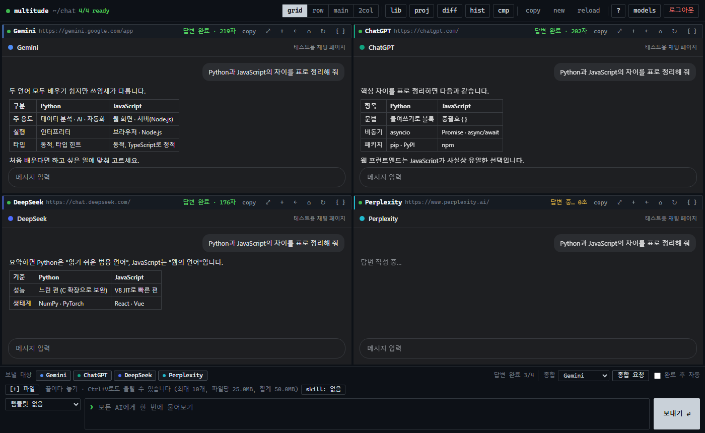

## 한눈에 보기

| | |
|---|---|
| **쓸 수 있는 AI** | Gemini · ChatGPT · Claude · DeepSeek · Perplexity · Grok · Mistral · Qwen · Z.ai · Genspark · Duck.ai (11개) + 이 PC의 로컬 LLM(선택) |
| **동시에 띄우기** | 최대 6개 패널, 배치 4가지(grid · row · main · 2col), 패널 하나 크게 보기 |
| **묻기** | 한 입력창으로 동시 질문, 파일 첨부, 템플릿(변수) · 스킬(SKILL.md) 붙이기 |
| **답 다루기** | 답변 비교(차이 강조 · 이견 분석 표), 한 AI에게 종합 맡기기, 기록 · 검색, MD · HTML 내보내기 |
| **코드 작업** | 프로젝트 폴더 맥락 보내기 → AI별 수정안 비교 → 미리보기 · 테스트 실행 · 적용 · 되돌리기, 잘린 답변 막기 |
| **브라우저에서** | 크롬 확장: 같은 앱을 탭 하나로, 오른쪽 클릭으로 웹페이지 질문, **사이드탭**(보고 있는 페이지 옆에 AI 2개) |
| **실행 형태** | Windows 앱(Electron, Google 계정 하나로 로그인, 자동 업데이트) · 크롬 확장(크롬에 로그인된 계정 그대로) |
| **디자인** | 터미널(CLI) 느낌의 검정 단색 · 고정폭 글꼴 화면 (v0.19.0~) |

## 구조

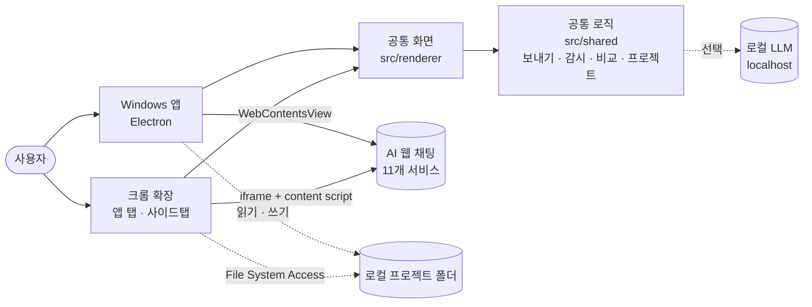

- 각 AI는 **원래 사이트 화면 그대로** 패널 안에 뜹니다. 앱은 입력창에 글을 넣고 보내기를 누르고 답을 읽는 일만 합니다.
- Windows 앱과 크롬 확장은 **같은 화면 · 같은 로직**을 씁니다. 확장 폴더는 `npm run build:ext`로 `src/`에서 만듭니다.
- 이 앱의 서버는 없습니다. 질문은 사용자가 켠 AI 서비스로만 가고, 기록은 이 PC에만 남습니다 → [보안](docs/security.md)

## 기능

| 영역 | 기능 | 한 줄 설명 | 자세히 |
|---|---|---|---|
| **묻기** | 동시 질문 | 켠 패널 모두에 한 번에 보내고 `답변 중… → 완료 · N자` 표시 | [사용 안내](docs/guide.md#2-한-번에-질문하기) |
| | 파일 첨부 | 끌어다 놓기 · Ctrl+V · `[+] 파일`, 서비스마다 받는 형식에 맞춰 첨부 | [파일 첨부](docs/guide.md#파일-첨부) |
| | 템플릿 · 스킬 | `{{변수}}` 템플릿, SKILL.md 스킬 최대 3개, AI 압축 · 압축 권장 표시 | [라이브러리](docs/guide.md#라이브러리-내-템플릿--스킬) |
| **답 다루기** | 종합 | 다른 AI 답을 모아 한 AI에게 오류 · 빠진 점 · 최종 답 정리 요청 | [종합](docs/guide.md#4-교차검토종합) |
| | 답변 비교 · 분석 | 칸별 비교, 기준과 다른 문장 강조, 공통 의견 · 이견 표 · 근거 부족 · 최종 답 | [답변 비교](docs/guide.md#5-답변-비교) |
| | 기록 · 내보내기 | 질문 · 답 자동 저장(최근 500개) · 검색, MD · HTML(→PDF) 저장 | [기록](docs/guide.md#6-기록) · [내보내기](docs/guide.md#내보내기) |
| | 응답 통계 · 자가진단 | AI별 완료율 · 응답 시간 · 사용 한도 감지, 사이트 화면이 바뀌면 알림 → 자가진단 창(셀렉터 지금 확인 · 진단 정보 복사) | [응답 통계](docs/guide.md#응답-통계) · [자가진단](docs/guide.md#셀렉터-자가진단) |
| **코드 작업** | 프로젝트 모드 | 폴더 구조 · 고른 파일 업로드(3단계 제외 규칙 · 비밀 정보 검사), `NEED_FILES` 요청 처리 | [프로젝트 모드](docs/project-mode.md#프로젝트-모드) |
| | 수정안 적용 | 패널 아래 변경 바로 바로 적용, AI별 비교 · 덩어리 단위 적용 · 되돌리기 | [단계](docs/project-mode.md#프로젝트-모드) |
| | 잘린 답변 막기 | 끊긴 · 생략된 코드는 적용 막기, 긴 파일은 찾기/바꾸기, 이어서 받기(자동 가능), 계획 먼저 · 파일별로 받기(바로 시작 가능), 보낼 양 토큰 어림 | [잘린 답변 막기](docs/project-mode.md#잘린-답변-막기) |
| | 파일 모아보기 | 답변의 파일 코드를 새 파일 · 수정 · 삭제로 모아 복사 (프로젝트 없이도) | [파일 모아보기](docs/project-mode.md#파일-모아보기) |
| | 테스트 실행 · git 콘솔 | 적용 전/후 `npm test` 비교, 그 폴더의 git 명령만 실행 (Windows 앱) | [테스트 실행](docs/project-mode.md#테스트-실행-windows-앱) · [git 콘솔](docs/project-mode.md#git-콘솔-windows-앱) |
| **확장 · 기타** | 사이드탭 | 크롬 사이드 패널에 AI 2개, 보고 있는 페이지 본문을 자동으로 함께 보냄 | [사이드탭](docs/chrome-extension.md#사이드탭-크롬-확장) |
| | 웹페이지로 질문 | 오른쪽 클릭 › 선택한 글 · 이 페이지 본문을 앱에 넣기 | [웹페이지로 질문](docs/chrome-extension.md#보고-있는-웹페이지로-질문-크롬-확장) |
| | 로컬 LLM | Ollama · LM Studio 등 이 PC의 OpenAI 호환 서버를 패널로 (밖으로 안 나감) | [로컬 LLM](docs/guide.md#로컬-llm-패널) |
| | 셀렉터 원격 갱신 | 사이트 화면이 바뀌면 `remote/selectors.json`만 고쳐 바로잡음 | [remote/README.md](remote/README.md) |

## 화면

| 답변 비교 · 분석 | 프로젝트 모드 · 수정안 미리보기 |
|---|---|
| 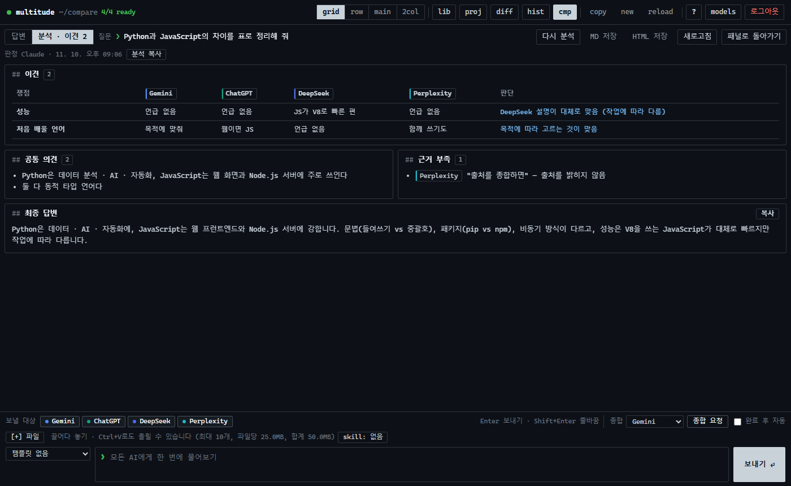 | 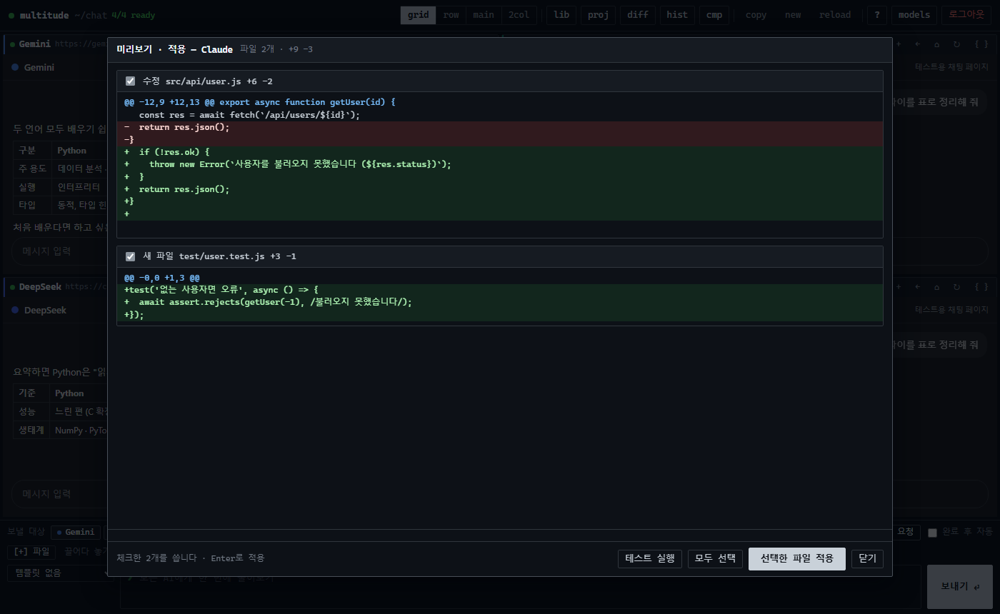 |

<details>
<summary>화면 더 보기</summary>

| 모델 고르기 | 종합 | 기록 |
|---|---|---|
| 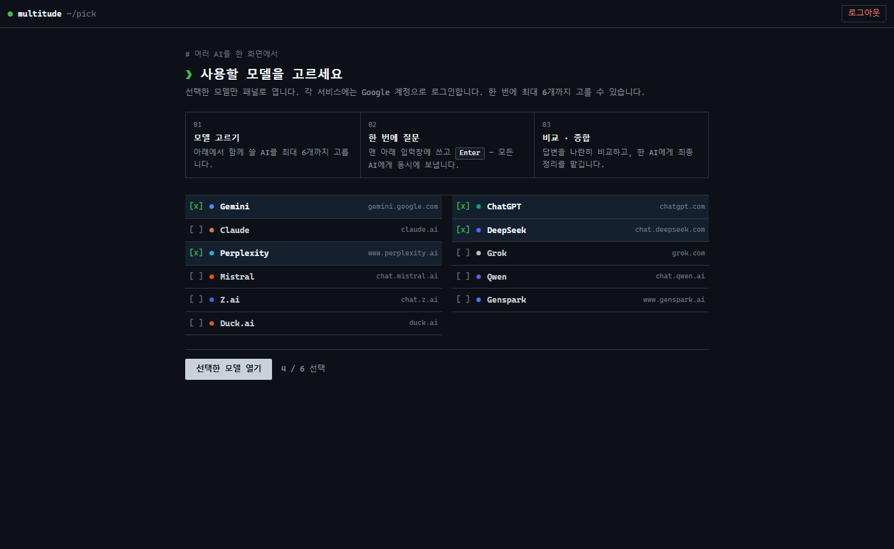 | 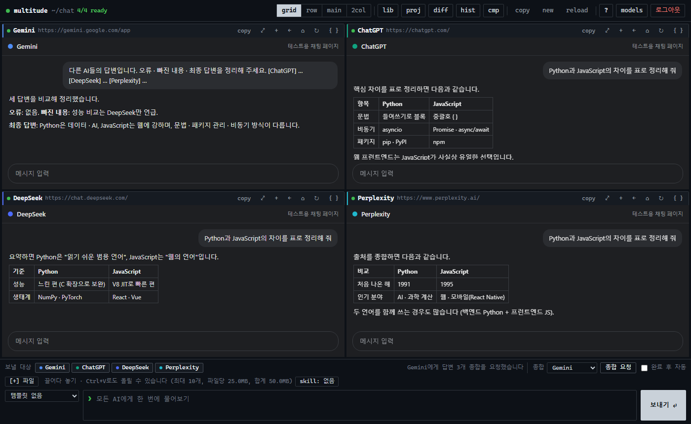 | 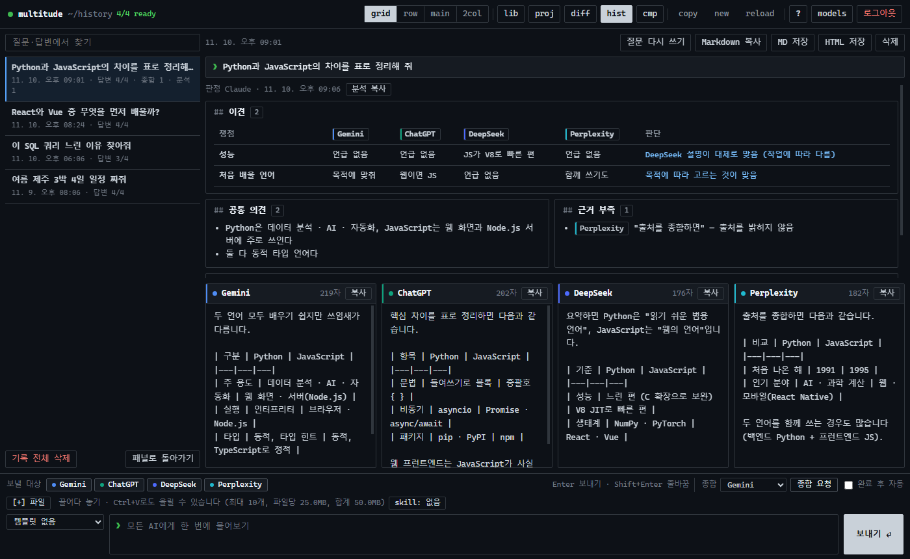 |
| **파일 첨부** | **라이브러리** | **변경 제안** |
| 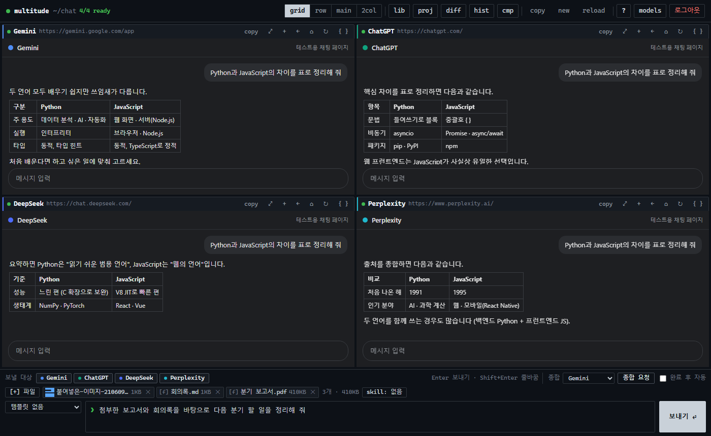 | 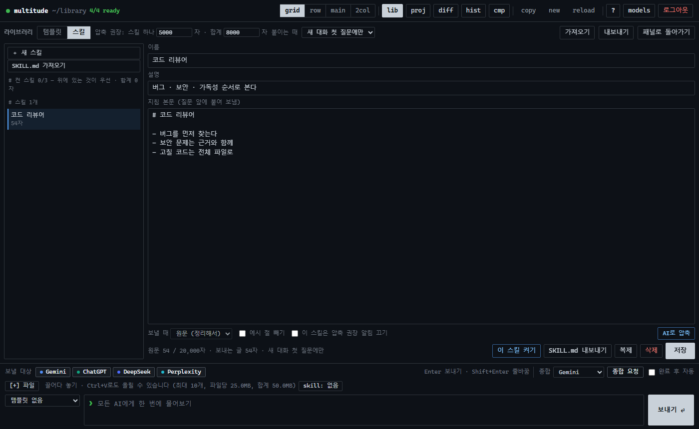 | 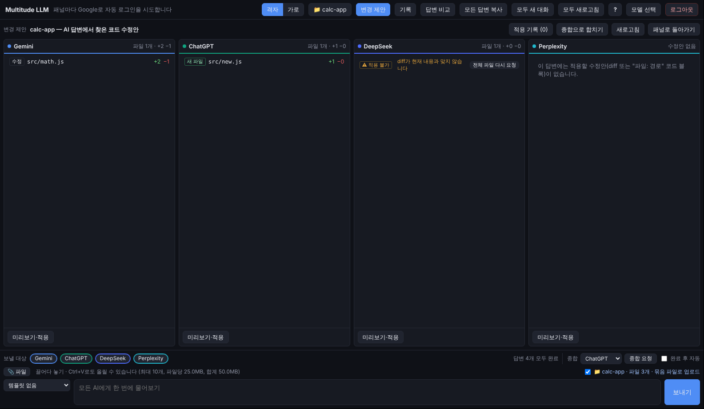 |
| **차이 강조** | **로컬 LLM** | **사이드탭** |
|  | 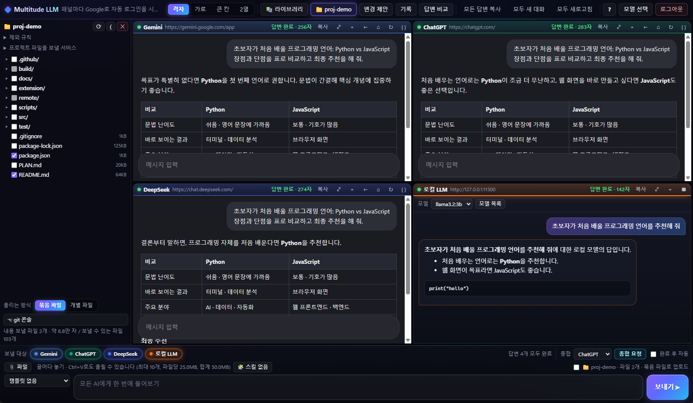 | 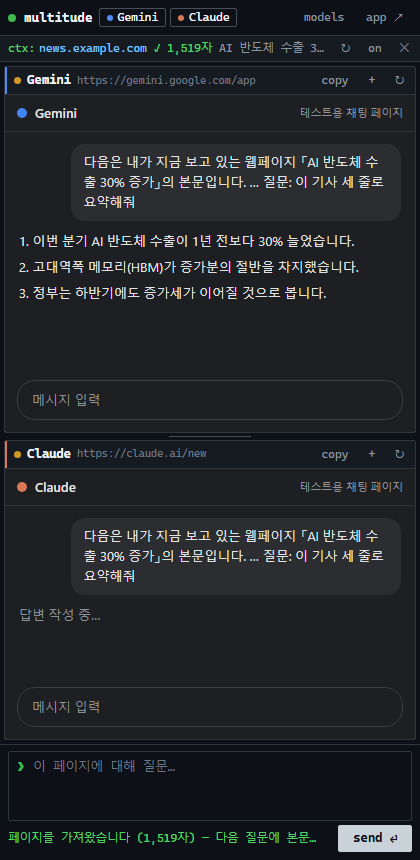 |

</details>

> 스크린샷은 `npm run screenshots`로 찍은 지금 화면이고, 패널 안은 실제 서비스가 아니라 **테스트용 채팅 페이지**입니다. 프로젝트 모드 일부(09 · 10 · 16 · 21~23)와 크롬 확장 탭(08)은 아직 예전 디자인 화면입니다.

## 기술 스택

| 영역 | 사용 기술 |
|---|---|
| Windows 앱 | Electron (`WebContentsView`로 서비스 페이지, preload IPC), electron-builder (NSIS 설치 파일) |
| 크롬 확장 | Manifest V3, iframe + content script, `declarativeNetRequest` 세션 규칙, Side Panel API, File System Access API |
| 공통 | 순수 JavaScript (빌드 도구 없음), [ignore](https://github.com/kaelzhang/node-ignore) · [jsdiff](https://github.com/kpdecker/jsdiff) (`src/shared/vendor/`) |
| 테스트 · 배포 | `node --test`, GitHub Actions (태그 푸시 → 설치 파일 · 확장 zip을 Releases에) |

## 빠른 시작

**Windows 앱** — [Releases](https://github.com/dyj02056/multitude_llm_ai/releases)의 `MultitudeLLM-Setup-<버전>.exe`를 실행합니다. 코드 서명이 없어 SmartScreen 경고가 뜨면 "추가 정보 → 실행". v0.20.0부터는 새 버전이 나오면 앱이 알려 주고, 설정 › 업데이트에서 받아 설치합니다.

**크롬 확장**

1. 이 저장소를 받습니다 (`git clone` 또는 **Code → Download ZIP**).
2. `chrome://extensions` → 오른쪽 위 **개발자 모드** 켜기 → **압축해제된 확장 프로그램을 로드합니다** → `extension` 폴더 선택.
3. 툴바에서 **Multitude LLM**을 고정하고 누르면 앱 탭이 열립니다. 로그인이 안 된 서비스는 패널의 **로그인 탭**에서 로그인한 뒤 ↻.
4. 사이드탭은 `Alt+Shift+S`(또는 앱 툴바의 `side`). 맥락 줄의 **자동 읽기 켜기**를 한 번 허용하면 보고 있는 페이지를 자동으로 함께 보냅니다.

**개발 실행**

```bash
git clone https://github.com/dyj02056/multitude_llm_ai.git
cd multitude_llm_ai
npm install
npm start            # Windows 앱 (Google 계정으로 로그인 → 모델 고르기)
```

설치 파일 직접 빌드, 개발 환경 변수(`MLA_DEBUG` 등)는 **[docs/setup.md](docs/setup.md)** 에 있습니다.

## 테스트 · 점검

```bash
npm test             # 단위 테스트 (공통 로직 · 확장 background 규칙 · 매니페스트 권한)
npm run build:ext    # src/ → extension/ 다시 만들기 (src/를 고쳤으면 함께 커밋)
npm run check:ext    # extension/이 src/와 맞는지 확인 (릴리스 워크플로도 검사)
```

- 실제 AI 사이트에 접속하지 않고, 보내기 · 답변 감시 · 비교 · 프로젝트 적용 · 권한 규칙을 가짜 입력으로 검사합니다.
- 사이트 화면이 바뀌어 입력창 · 답변을 못 찾으면 앱의 `?` › **서비스 화면 상태**에서 확인합니다.

## 프로젝트 구조

```
multitude_llm_ai/
├── src/
│   ├── main/        # Windows 앱 본체 (창 · 패널 배치 · 자동 로그인 · 프로젝트 폴더 · git 콘솔 · 테스트 실행)
│   ├── preload/     # 화면 ↔ 본체 연결 (window.host)
│   ├── renderer/    # 화면 (HTML · CSS · 화면 로직) — Windows 앱과 크롬 확장이 같이 씀
│   └── shared/      # 공통 로직 (서비스 목록 · 보내기 · 답변 감시 · 분석 · 프로젝트 · 사이드탭 계산 …)
├── extension/       # 크롬 확장 (host.js · background.js · content.js · sidepanel.* 는 직접, 나머지는 build:ext로 생성)
├── remote/          # 원격 셀렉터 (selectors.json) — 사이트 화면이 바뀌면 여기만 고침
├── scripts/         # 확장 빌드 · 아이콘 · Windows 빌드
├── test/            # node --test 단위 테스트
└── docs/            # 상세 문서 · 릴리스 노트 · 스크린샷
```

파일별 역할은 **[docs/setup.md › 코드 구조](docs/setup.md#코드-구조)** 에 있습니다.

## 문서 지도

| 이런 분은 | 여기부터 보세요 |
|---|---|
| 처음 쓰는 분 | 이 README → [사용 안내](docs/guide.md) (모델 고르기 → 질문 → 비교 → 기록 순서) |
| 크롬에서 쓰려는 분 | [크롬 확장 · 사이드탭](docs/chrome-extension.md) |
| 코드 작업을 하려는 분 | [프로젝트 모드 · 코드 작업](docs/project-mode.md) |
| 템플릿 · 스킬을 만들려는 분 | [라이브러리](docs/guide.md#라이브러리-내-템플릿--스킬) |
| 단축키를 찾는 분 | [단축키](docs/guide.md#단축키) |
| 데이터가 어디로 가는지, 권한이 왜 필요한지 궁금한 분 | [보안](docs/security.md) |
| 빌드 · 개발하려는 분 | [설치 · 빌드 · 개발](docs/setup.md) · [PLAN.md](PLAN.md) |
| 사이트 화면이 바뀌어 고치려는 분 | [remote/README.md](remote/README.md) |
| 버전별로 뭐가 바뀌었는지 | [변경 사항](docs/changelog.md) · [릴리스 노트](docs/release-notes) |

## 최근 변경

| 버전 | 내용 |
|---|---|
| **v0.22.0** | 큰 작업 자동 시작 · 잘리면 자동 이어받기 · 보낼 양 토큰 어림 |
| **v0.21.1** | 자가진단 창 — 셀렉터 지금 확인 · 처음 화면으로 · 진단 정보 복사 |
| **v0.21.0** | 사이드탭 ↔ 앱 탭 — 기록 공유, `app ↗`로 질문 · 페이지 넘기기, 템플릿 · 스킬 |
| **v0.20.1** | 문서 스크린샷을 지금 화면으로 — `npm run screenshots` 한 번으로 다시 찍기 |

전체 기록은 **[docs/changelog.md](docs/changelog.md)** 에 있습니다.

## 알려진 제한사항

- **사이트 화면이 바뀌면** 입력 · 답변 읽기가 깨질 수 있습니다. 패널의 `⚠`를 눌러 **셀렉터 지금 확인**을 해 보고, 원격 셀렉터로 고치기 전까지는 패널에서 직접 입력하세요.
- **각 서비스의 무료 사용 한도 · 약관**을 그대로 따릅니다. 한도에 걸리면 패널에 `[limit]`이 뜹니다.
- **크롬 확장**은 앱 탭을 새로 열 때마다 프로젝트 폴더 접근을 다시 허용해야 하고, git 콘솔 · 테스트 실행이 없습니다.
- **사이드탭**은 폭이 좁아 AI 사이트가 모바일 화면으로 뜹니다. 비교 · 종합 · 분석은 `app ↗`로 앱 탭에 넘겨서 합니다. 자동 읽기를 허용하지 않으면 `Alt+Shift+S` · 오른쪽 클릭으로 가져온 탭만 씁니다.
- **기록 · 설정은 이 PC에 암호화 없이** 저장됩니다. Windows 앱과 크롬 확장의 기록은 따로입니다.
- 프로젝트 모드 일부와 크롬 확장 탭 스크린샷은 예전 디자인 화면입니다 (프로젝트 폴더가 있어야 하는 장면이라 아직 자동으로 찍지 않음).
