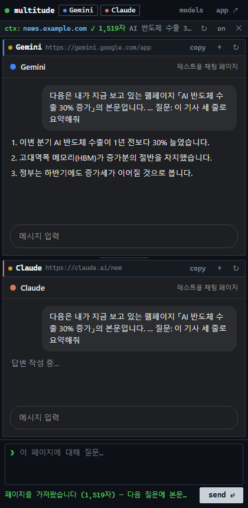

# 크롬 확장 프로그램 · 사이드탭

[← README](../README.md)

## 크롬 확장 프로그램

스토어에 올리지 않은 상태라 **압축해제된 확장 프로그램**으로 직접 추가합니다.

1. 이 저장소를 받습니다 (`git clone` 또는 GitHub의 **Code → Download ZIP** 후 압축 풀기).
2. 크롬 주소창에 `chrome://extensions`를 엽니다.
3. 오른쪽 위 **개발자 모드**를 켭니다.
4. **압축해제된 확장 프로그램을 로드합니다**를 누르고 저장소 안의 `extension` 폴더를 고릅니다.
5. 툴바의 퍼즐 아이콘에서 **Multitude LLM**을 고정(📌)하고 누르면 앱 탭이 열립니다.

처음 쓸 때:

- 각 서비스는 **크롬에 로그인된 계정을 그대로** 씁니다. 로그인이 안 된 서비스는 패널 머리줄의 **로그인 탭**을 눌러 새 탭에서 로그인한 뒤, 패널의 ↻로 새로고침하세요.
  Google 로그인 화면은 다른 페이지 안에 뜨지 않으므로 로그인은 꼭 일반 탭에서 합니다.
- Duck.ai는 로그인이 없고, 처음 열면 이용 동의 화면을 한 번 눌러야 합니다.
- 코드를 받아 새 버전으로 바꾼 뒤에는 `chrome://extensions`에서 Multitude LLM의 **새로고침(↻)** 을 누릅니다.

### 보고 있는 웹페이지로 질문 (크롬 확장)

v0.15.0부터 아무 웹페이지에서 **오른쪽 클릭 › Multitude LLM에 묻기**로 그 페이지의 글을 질문에 넣습니다.

| 메뉴 | 하는 일 |
|---|---|
| **— 선택한 글** (글을 고른 채 오른쪽 클릭) | 크롬이 넘겨주는 선택한 글을 그대로, 출처(제목 · 주소)와 함께 공통 입력창에 넣습니다. 끝의 `질문: ` 뒤에 이어 쓰면 됩니다 (최대 5만 자) |
| **— 이 페이지 본문** | 그 페이지의 본문 글을 `page.md`(제목 · 출처 · 가져온 때 + 본문, 최대 30만 자)로 만들어 첨부하고, 입력창에 안내 한 줄을 넣습니다 |

- 둘 다 앱 탭을 열거나(없으면 새로) 앞으로 가져옵니다. 모델을 고르는 화면이면 채팅 화면에 들어갈 때 넣습니다. 2분 넘게 지난 요청은 버립니다.
- 넣기 전에 [비밀 정보 검사](project-mode.md#비밀-정보-검사)를 하고, 키 · 토큰처럼 보이는 것이 있으면 확인을 받습니다 (취소하면 넣지 않음). 넣은 뒤에도 보내기 전까지 입력창 · 첨부에서 지울 수 있습니다.
- **권한**: `contextMenus`(메뉴) · `activeTab`(메뉴를 누른 그 탭 한 번만) · `scripting`(그 탭의 본문 글 읽기)만 더했습니다. **모든 사이트 권한은 받지 않으며**, 세 권한 모두 업데이트 때 새 권한 확인 창을 띄우지 않습니다. 페이지 글은 **"이 페이지 본문"을 누른 그때만** 읽습니다.
- 읽은 글은 브라우저를 닫으면 사라지는 확장 저장소에 앱 탭이 가져갈 때까지만 두고, 가져가면 지웁니다.
- Windows 앱에는 이 메뉴가 없습니다 (웹페이지 글은 복사해서 붙여 넣으세요).

### 사이드탭 (크롬 확장)

v0.19.0부터 크롬 오른쪽 **사이드 패널**에 AI 웹 채팅을 띄워, 보고 있는 페이지 옆에서 바로 묻습니다 (Gemini의 사이드 패널처럼).

| 여는 방법 | |
|---|---|
| **Alt+Shift+S** | 사이드탭을 열고, 지금 탭의 본문을 가져옵니다 (`chrome://extensions/shortcuts`에서 바꿀 수 있음 — 업데이트로 받으면 지정되지 않을 때가 있어, 그때는 맥락 줄에 안내가 뜹니다) |
| 오른쪽 클릭 › **사이드탭에서 이 페이지로 묻기** | 위와 같음 |
| 앱 탭 툴바의 **side** | 사이드탭만 엽니다 |

- **모델 최대 2개**: 위쪽 `models`에서 고릅니다 (`[x]` 켜기 · 3번째는 안 켜짐 · 마지막 하나는 안 꺼짐). 2개면 위/아래로 나뉘고, 가운데 선을 끌어 비율을 바꿉니다(두 번 누르면 반반). 고른 모델 · 비율은 기억합니다.
- **맥락 줄** `ctx:` — 가져온 페이지의 주소 · 글자 수 · 제목. 켜 두면(`on`) 그 패널에 **처음 보낼 때만** 본문을 함께 보냅니다 — 3만 자 이하면 **질문 글에 바로 넣고**(v0.19.1), 더 길면 `page.md`로 첨부합니다(첨부에 실패하면 앞 5만 자를 글에 넣음). 같은 페이지로 이어 묻는 질문은 글만 보냅니다. 보낸 뒤 아래 줄에 `페이지 본문 N자 포함` 또는 `페이지 없이`가 뜹니다. `✕`로 지우고, `off`로 잠시 끕니다.
- **자동 읽기 (v0.19.2, 권장)**: 맥락 줄의 **자동 읽기 켜기**를 한 번 누르고 크롬이 묻는 "사이트 데이터 읽기"를 허용하면, 보고 있는 탭을 탭을 옮길 때 · 페이지가 다 열릴 때 · **보낼 때마다** 자동으로 읽습니다. 따로 가져올 필요가 없습니다. 읽을 수 없는 탭(크롬 설정 · 웹 스토어 · 빈 탭)에서는 페이지 없이 보냅니다.
- 자동 읽기를 켜지 않으면: 다른 탭으로 옮길 때 `다른 탭을 보는 중`이라고 알려 줍니다. 그 탭에서 **Alt+Shift+S**를 누르면 새로 가져옵니다. `↻`는 단축키 · 메뉴로 가져온 그 탭에서만 다시 읽을 수 있습니다.
- 페이지 본문을 처음 보내기 전에 [비밀 정보 검사](project-mode.md#비밀-정보-검사)를 하고, 키 · 토큰처럼 보이는 것이 있으면 확인을 받습니다.
- 패널 머리줄: `copy`(최신 답변 복사) · `+`(새 대화) · `↻`(새로고침), 보낸 뒤 `답변 중… → 완료 · N자`. 로그인이 필요하면 **로그인 탭**.
- 사이드탭에서 보낸 질문은 앱의 기록 · 비교 · 종합에 들어가지 않습니다. 여러 AI 비교 · 프로젝트 작업은 `app ↗`로 앱 탭을 여세요.
- **권한**: `sidePanel`을 더했습니다(확인 창 없음). 설치할 때 받는 권한에는 모든 사이트 권한이 없습니다. 단축키 · 메뉴로는 **그 탭에서 그때만** 읽습니다(`activeTab`). 자동 읽기의 사이트 읽기 권한(`http://*/*` · `https://*/*`)은 **선택 권한**이라 **자동 읽기 켜기**를 누를 때만 묻고, `chrome://extensions` › 세부정보 › 사이트 액세스에서 언제든 끌 수 있습니다.
- 동작: 사이드 패널 안 iframe 요청은 어느 탭 소속도 아니어서(`tabId -1`), 사이드 패널이 열려 있는 동안에만 "탭 없음 + 이 확장(또는 그 서비스 페이지)이 띄운 서비스 iframe"에 한해 iframe 차단 헤더를 지우는 규칙을 겁니다. 마지막 사이드 패널이 닫히면 바로 지웁니다. 질문 넣기 · 답 읽기는 iframe 안의 content script가 사이드 패널과 연결선(port)으로 주고받습니다.
- 사이드 패널은 폭이 좁아 AI 사이트가 모바일 화면으로 바뀝니다 (대화 목록이 ☰ 메뉴로 접힘).

확장 프로그램에서만 다른 점:

- 크롬이 페이지에 넘겨주지 않는 키는 바꿔 씁니다: 모두 새 대화 `Alt+Shift+N`, 변경 제안 `Alt+Shift+P`, N번째 보낼 대상 켜기/끄기 `Alt+Shift+1~6`. 사이드탭은 `Alt+Shift+S`.
- 로그아웃 버튼과 패널 개발자 도구 버튼이 없습니다 (크롬 자체 로그인 상태를 씀, 패널은 F12 개발자 도구의 프레임 선택으로 봅니다).
- 기록·설정은 크롬 프로필의 확장 프로그램 저장소에 저장됩니다 (Windows 앱과 따로).
- 앱 탭을 오래 백그라운드에 두면 크롬이 타이머를 늦춰 "답변 완료" 표시가 늦을 수 있습니다.

어떻게 동작하나요: 앱 탭 안에 각 서비스를 iframe으로 띄우고, 그 탭 안의 iframe에 한해서만 사이트의 iframe 차단 헤더(`X-Frame-Options`, CSP)를 지웁니다(`declarativeNetRequest` 세션 규칙). 같은 사이트를 일반 탭으로 열 때는 아무것도 바뀌지 않습니다. 질문 입력·답변 읽기는 각 iframe 안의 content script(`extension/content.js`)가 합니다.
사이트가 서비스 워커(PWA)를 등록해 두면 그 서비스 워커가 페이지를 대신 받아 와 이 규칙을 피해 가므로, 패널을 열거나 새로고침할 때마다 그 서비스의 **서비스 워커 등록만** 지웁니다(`browsingData` 권한, 로그인·저장 데이터는 그대로).

패널에 회색 "연결 거부" 아이콘이 뜨면: 패널의 ↻를 누르세요. 그래도 그대로면 `chrome://extensions`에서 확장 프로그램을 ↻(새로고침)한 뒤 앱 탭을 다시 엽니다.

