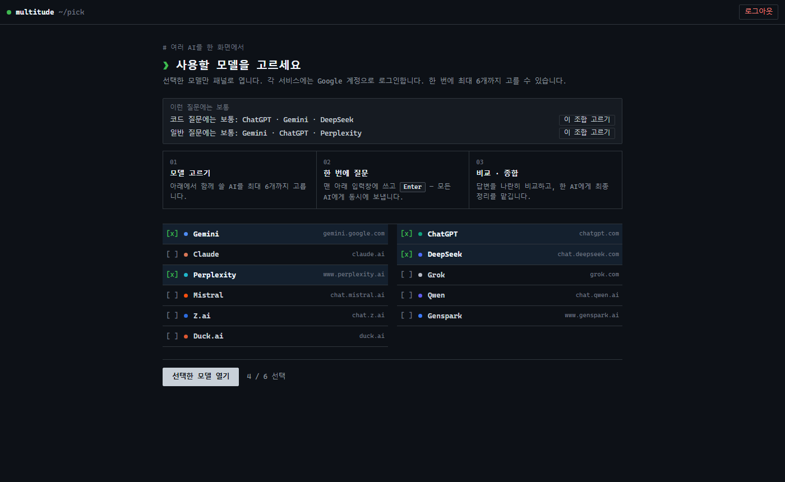
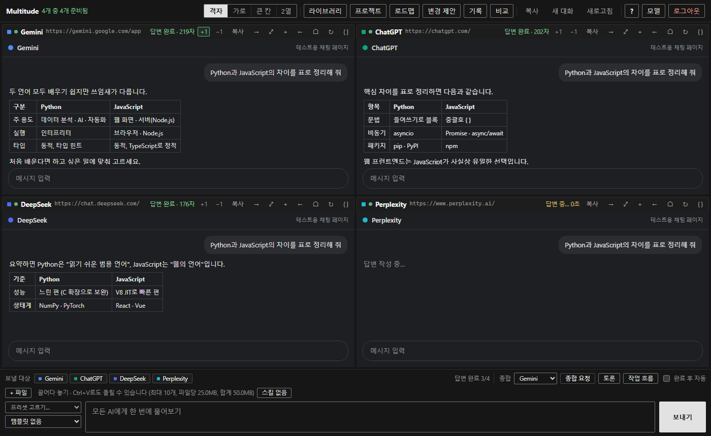
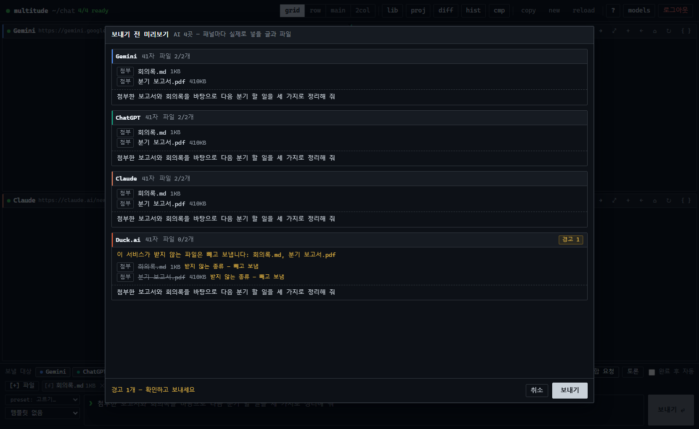
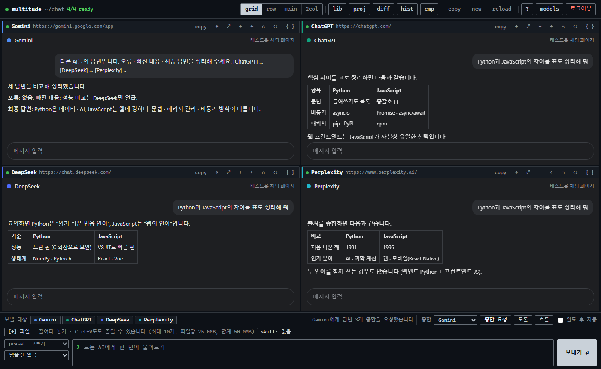
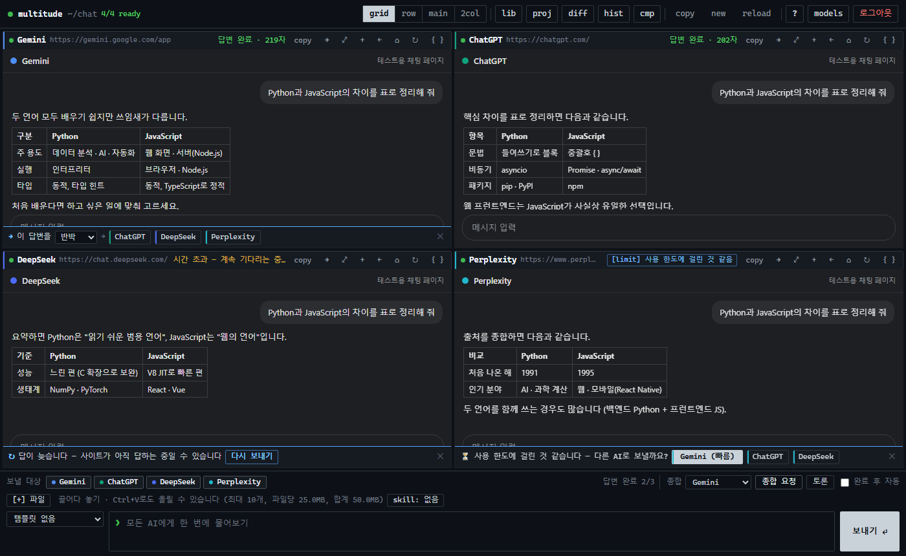
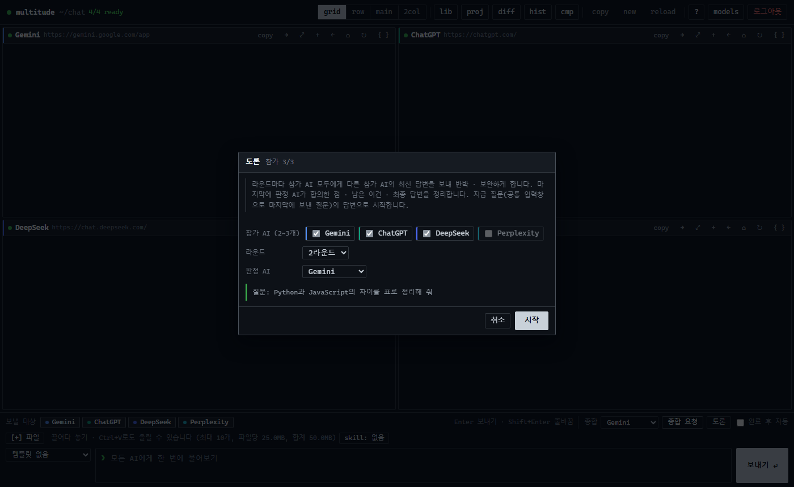
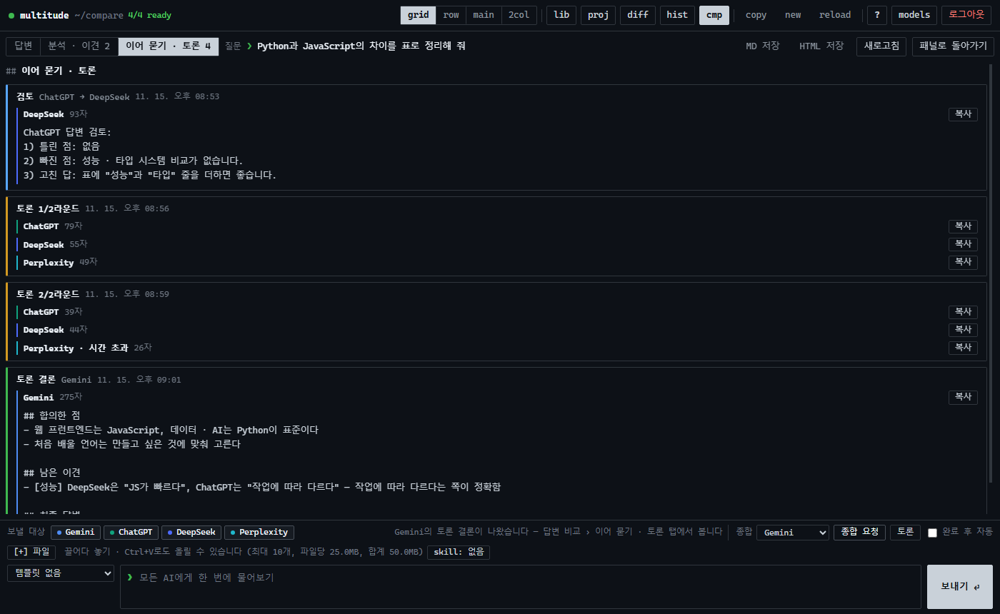
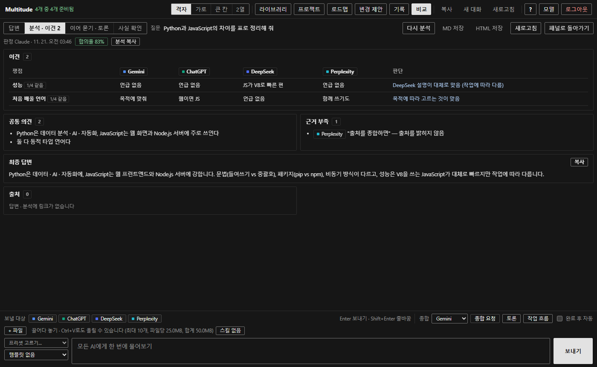
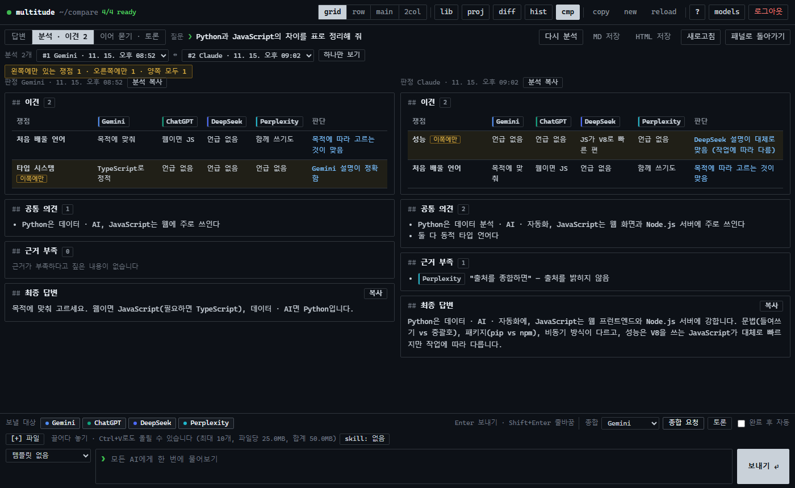
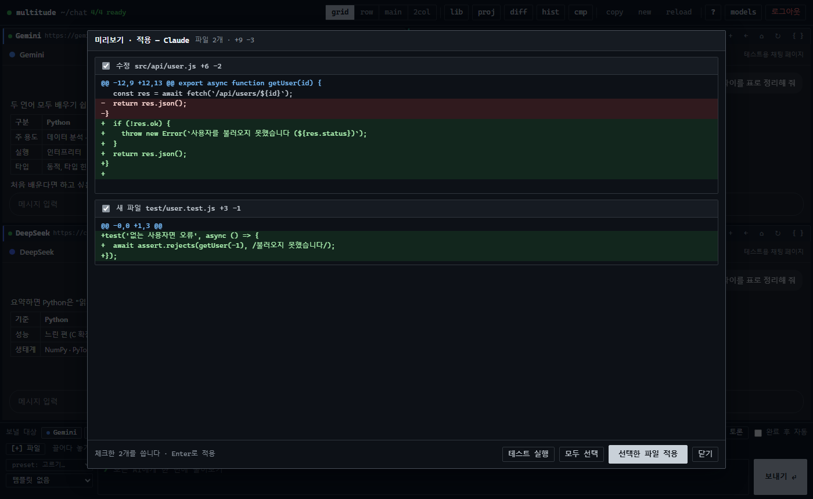

# Multitude LLM — User guide

[← README](../../README.en.md) · [한국어 사용 안내](../guide.md)

The app's screens are in Korean for now. This guide gives the **Korean label you will see** next to each control, so you can follow along.

> Screenshots show the real app screens; the chat inside each panel is a test page with sample answers.

## 1. Pick your AIs

On first launch you see a checklist of 11 AIs (`[x] Gemini` …). Choose up to **6**. Only the chosen ones open as panels.

- **Windows app:** sign in once with Google; the app signs in to each service with "Continue with Google".
- **Chrome extension:** each service uses the account already signed in to Chrome. If a panel is not signed in, click **로그인 탭** (login tab) in its header, sign in in the normal tab, then press **↻** in the panel. Google sign-in pages cannot open inside another page, so always sign in in a normal tab.

Change the selection later with **models** in the toolbar.

## 2. Ask all at once

Type in the input box at the bottom (`모든 AI에게 한 번에 물어보기`) and press **Enter** or **보내기** (Send). `Shift+Enter` adds a new line. Each panel header shows `답변 중…` (answering) then `답변 완료 · N자` (done · N characters).

| Control | Korean label | What it does |
|---|---|---|
| Targets | `보낼 대상` chips | Turn individual AIs on/off for the next question |
| Layout | `grid · row · main · 2col` | Panel arrangement |
| Focus | `⤢` in a panel header | Show one panel large |
| Template | `템플릿` dropdown | Wrap the question (summary, step-by-step, pros & cons, fact check, translate, code review…) |
| Skill | `skill:` | Add up to 3 SKILL.md instruction sets |

### Attach files

Drag files onto the input box, paste a screenshot with **Ctrl+V**, or click **[+] 파일**. Up to 10 files, 25 MB each, 50 MB total. If a service does not accept a file type the app tells you before sending, and the panel shows `[+] 일부 파일은 빼고 보냄` (some files skipped) or `[+] 첨부 없이 보냄` (sent without attachments).

### Preview before sending (v0.25.0)

**Shift+click** **보내기** (Send) or press **Ctrl+Shift+Enter** in the input box to see, before anything is sent, exactly what each AI will get: the final text (skill instructions + project context + question), your attachments, project file uploads and the character count. File types a service does not accept, files over the service's size limit and very long text (over 100,000 characters) are flagged in yellow. **보내기** sends exactly what is shown; **취소** (Cancel) sends nothing and keeps your input. To preview every time, turn on **보내기 전 미리보기** (preview before sending) in settings (off by default).

### Notifications (v0.25.0)

While you are working in another window, the app shows a Windows / Chrome notification when all answers are in (e.g. `답변 4개 완료 (시간 초과 1)` = 4 answers finished, 1 timed out), when a usage limit is hit, when sending fails, and when a synthesis or analysis is ready. Nothing is shown while you are looking at the app window (the app tab in the extension). Notifications contain counts and service names only, never your question or the answers. Click one to return to the app (to the compare view after an analysis). Each kind can be turned off under **알림** (notifications) in settings.

## 3. Rate answers

When a panel finishes answering a question you sent from the input box, **`[+1]`** (good) and **`[-1]`** (not good) appear in its header. Click again to clear. Ratings feed the **만족도** (satisfaction) column in the stats table (section 7). A new question resets the buttons.

## 4. Merge the answers (synthesis)

Choose the judging AI in the `종합` dropdown and press **종합 요청** (Request synthesis). The app sends the other AIs' answers to that AI and asks for mistakes, missing points and a final answer. Tick **완료 후 자동** to request it automatically when all answers are done.

### Hand-offs and debate (v0.26.0)

- **Hand-off**: press **→** in a panel header. A bar appears under the panel: pick what to ask — **검토** (review: errors and omissions), **반박** (counter-argue) or **이어서** (continue: go deeper, next steps) — and click the AI that should receive it. Only that AI gets the original question plus this panel's latest answer. The reply is kept in history as a hand-off.
- **Debate**: press **토론** (Debate) next to the synthesis controls. Pick **2–3** participants, **1–3** rounds (default 2) and a judge AI (default: the synthesis target), then **시작** (Start). Each round every participant gets the other participants' latest answers and is asked to rebut and refine; at the end the judge writes agreements, remaining disagreements and a final answer. The debate starts from the answers to the current question, so send a question first.
- Progress shows under the input box (`Debate round 1/2 — waiting for …`); **토론 멈추기** (Stop debate) ends it at any time (finished rounds are kept). A notification is shown when it ends.
- Results appear in **Compare › Hand-offs · Debate** and in **History** (expand the hand-offs line), and are included in MD/HTML exports.
- A debate sends one extra message per participant per round (2 rounds × 3 AIs = 6, plus 1 for the judge). Use fewer rounds on services with tight usage limits.

## 5. Compare answers

**cmp** (`Ctrl+Shift+D`) shows the last question and each AI's latest answer in columns. Each column can be copied as Markdown.

- **차이 강조** (Highlight differences): sentences that are not in the reference answer are highlighted; each column shows `새 내용 N%` (new content %). Pick the reference with `기준:`.
- **분석** (Analysis) tab → **분석 요청**: the judging AI answers in a fixed format, which the app draws as:

| Section | Korean | Contents |
|---|---|---|
| Disagreements | `이견` | One row per issue: each AI's position and a verdict. Click a cell to jump to that answer; the paragraph (or table/list line) most related to the issue is highlighted (v0.26.0) |
| Agreements | `공통 의견` | What most AIs agree on |
| Weak claims | `근거 부족` | Claims without support, by AI |
| Final answer | `최종 답변` | The merged answer, with a copy button |

Run the analysis again (also with another judge) and earlier analyses are kept: with two or more, pick two to see them **side by side**; issues found by only one of them are marked `이쪽에만` (only here) (v0.26.0).

### Retry and fallback (v0.26.0)

- If sending to a panel fails, the app tries **once more** after 1.5 s (`?` › **실패하면 한 번 다시 보내기**, on by default). Usage limits and closed panels are not retried.
- Timeouts and "no answer" are **not** re-sent automatically (the site may still be answering); a **다시 보내기** (Send again) button appears under the panel instead.
- When a usage limit is detected, the panel asks **다른 AI로 보낼까요?** (send to another AI?) with buttons for open panels that are not limited, fastest first by your stats. Nothing is sent until you click; the chosen AI gets the same text and attachments.

## 6. History and export

**hist** (`Ctrl+H`) keeps the last 500 questions (change it in `?` › History size: 100–2000) with every answer, synthesis and analysis (file names only, not file contents). Search, copy as Markdown, reuse a question, or save as **MD 저장** (Markdown) / **HTML 저장** (a self-contained report; print it to PDF).

History stays on this PC. Questions sent from the extension's side panel appear with a `side` tag.

## 7. Settings, stats and shortcuts

**?** (`Ctrl+/`) opens settings: answer wait time, automatic selector updates, local LLM, updates (Windows app), and:

- **AI별 응답 통계** (response stats per AI): questions, completed (%), timeouts / no answer, send failures, usage limits hit, median time to first response and to completion, average length, **만족도** (satisfaction, e.g. `75% (3/4)`).
- **서비스 화면 상태** (site status): whether the app can still find each site's input box, send button and answer area. If a site changes its layout, the panel shows `⚠ 화면이 바뀐 것 같음`; click it to open the self-check window (`셀렉터 지금 확인` = re-check selectors now, `진단 정보 복사` = copy diagnostics without your content).

| Shortcut | Action |
|---|---|
| `Ctrl+L` | Focus the input box |
| `Ctrl+Shift+N` (extension: `Alt+Shift+N`) | New chat in all panels |
| `Ctrl+Shift+S` | Request synthesis |
| `Ctrl+Shift+C` | Copy all answers (Markdown) |
| `Ctrl+Shift+R` | Reload all panels |
| `Ctrl+Shift+D` / `Ctrl+H` | Compare / history |
| `Ctrl+Shift+P` (extension: `Alt+Shift+P`) | Proposed changes (project mode) |
| `Ctrl+1–9` (extension: `Alt+Shift+1–6`) / `Alt+1–9` | Toggle the Nth target / focus the Nth panel |
| `Esc` | Back to the panels |
| `Alt+Shift+S` (extension) | Open the side panel with the current page |

## 8. Library: templates and skills

**lib** opens your library.

- **Templates** can contain variables like `{{language}}` or `{{tone|friendly}}` (with a default). `{q}` marks where your question goes. Before sending, the app asks for the variable values.
- **Skills** are SKILL.md-style instruction sets (up to 3 at once). They are added in front of the first question of each chat. Long skills can be shortened with **AI로 압축** (compress with AI).
- Import / export the library as JSON.

## 9. Project mode (code work)

**proj** opens a local folder. The left sidebar shows the file tree.

1. **Choose files.** Files excluded by the built-in rules (`.env`, keys, `node_modules`…), `.gitignore`, or your own rules are marked `L1` / `L2` / `L3` with the reason. Files that look like they contain secrets show `⚠ 비밀?`.
2. **Ask.** The folder structure and chosen files are uploaded with your question (as one bundled `project-context.md`, or one attachment per file). If an AI asks for more files with `NEED_FILES:`, a **[+] 요청 파일 N개 보내기** button appears.
3. **Only changed files on follow-ups** (`바뀐 파일만 보내기`, on by default): later questions upload only files that changed since that panel last saw them, and list the rest as unchanged. Optional: `이어지는 질문에 지난 파일 목록 붙이기` attaches the list of previously sent files to follow-up questions.
4. **Apply.** When an answer contains code changes, a bar appears under that panel: **적용 (N)** (apply), **변경 보기** (preview). Risky files (CI config, git hooks, scripts, `package.json` scripts) and deletions are unchecked and marked `⚠`. If any file in a batch fails to write, the files already written are restored.
5. **Compare across AIs** with **diff** (`Ctrl+Shift+P`), preview line by line, choose hunks, and **undo** from the apply log.
6. **Test run** (Windows app): runs your `npm test` before and after the proposed changes and shows both results, then restores the files.

Cut-off protection: if an answer was cut off or abbreviated (`... existing code ...`), the change is blocked or flagged. Long files are requested as find/replace blocks; `↪ 이어서 받기` (continue) asks the same AI for the rest. **큰 작업** (big task) mode asks for a plan first and then one file at a time.

## 10. Chrome extension extras

- **Side panel** (`Alt+Shift+S`, or right-click › `사이드탭에서 이 페이지로 묻기`): up to 2 AIs in Chrome's side panel. The page you are reading is sent with your first question. Turn on **자동 읽기** (auto-read) once to read the current tab automatically; this asks for an optional site-access permission that you can revoke anytime in `chrome://extensions`.
- **Ask about a page**: right-click › `Multitude LLM에 묻기 — 선택한 글` (selected text) or `— 이 페이지 본문` (page text). Text is checked for secrets first.
- **app ↗** in the side panel moves your question and page to the full app tab.

## 11. Local LLM (optional)

Run an OpenAI-compatible server on your PC (Ollama `http://localhost:11434`, LM Studio `http://localhost:1234`, llama.cpp…). In **?** › `로컬 LLM`, turn it on, press `연결 확인` (test connection) and choose a model. Then pick **로컬 LLM** in the model list. Only `localhost` / `127.0.0.1` addresses are accepted, so nothing leaves your PC.

In the Chrome extension, Ollama must allow extension requests: set the environment variable `OLLAMA_ORIGINS=chrome-extension://*` and restart Ollama.

## Privacy in short

No Multitude LLM server, no analytics. Questions go only to the AI services you open; history stays on your PC. Details: [PRIVACY.md](../../PRIVACY.md).
