# Multitude LLM — User guide

[← README](../../README.en.md) · [한국어 사용 안내](../guide.md)

**Language (v0.30.0):** the app's screens are available in English and Korean. With **Language** set to *Automatic* (the default) you get Korean on a Korean Windows / Chrome and English otherwise; change it in **?** (Settings) › **Language (언어)** — *Automatic · 한국어 · English*. The change applies on the spot (open panels and your work stay as they are; a few texts such as panel status lines switch the next time they update). In the Chrome extension the side panel and the right-click menu follow the same setting.

This guide was written when the screens were Korean only, so it still quotes the **Korean label** next to many controls — useful if you run the Korean interface; in the English interface the same control carries the English name given in brackets or a close equivalent.

Since v0.31.0 the requests the app writes for the AIs (**synthesis, analysis, debate, hand-off, project mode, skills compression and the built-in templates**) follow the interface language, so in the English interface they go out in English. Your own questions, templates and skills are sent as you wrote them. Still Korean: the sample questions and answers in the screenshots.

**First start (v0.31.0):** the first time a new installation opens its panels, a four-step **Getting started** window explains asking, comparing, synthesis and where the rest lives. **Skip** or `Esc` closes it for good; reopen it from **?** (Settings) › **Show again**. People who already used an earlier version do not see it.

> Screenshots show the real app screens in English; the chat inside each panel is a test page with (Korean) sample answers.

**Accessibility (v0.30.0):** every action is reachable with the keyboard, focus is shown with a blue outline, dialogs keep focus inside and close with `Esc`, icon-only buttons have spoken names, and text contrast meets WCAG AA. What was checked and what is still missing: [docs/accessibility.md](../accessibility.md) (Korean).

## 1. Pick your AIs

On first launch you see a checklist of 11 AIs (`[x] Gemini` …). Choose up to **6**. Only the chosen ones open as panels.

- **Windows app:** sign in once with Google; the app signs in to each service with "Continue with Google".
- **Chrome extension:** each service uses the account already signed in to Chrome. If a panel is not signed in, click **로그인 탭** (login tab) in its header, sign in in the normal tab, then press **↻** in the panel. Google sign-in pages cannot open inside another page, so always sign in in a normal tab.

Change the selection later with **models** in the toolbar.

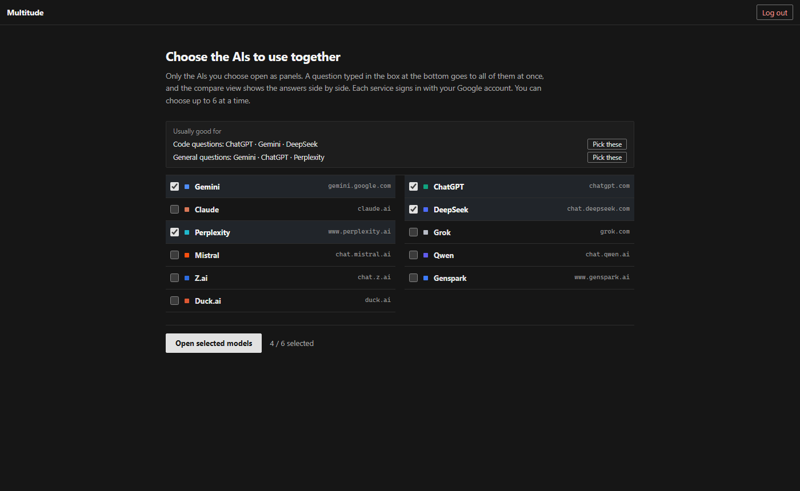

## 2. Ask all at once

Type in the input box at the bottom (`모든 AI에게 한 번에 물어보기`) and press **Enter** or **보내기** (Send). `Shift+Enter` adds a new line. Each panel header shows `답변 중…` (answering) then `답변 완료 · N자` (done · N characters).

| Control | Korean label | What it does |
|---|---|---|
| Targets | `보낼 대상` chips | Turn individual AIs on/off for the next question |
| Layout | `grid · row · main · 2col` | Panel arrangement |
| Focus | `⤢` in a panel header | Show one panel large |
| Template | `템플릿` dropdown | Wrap the question (summary, step-by-step, pros & cons, fact check, translate, code review…) |
| Skill | `skill:` | Add up to 3 SKILL.md instruction sets |

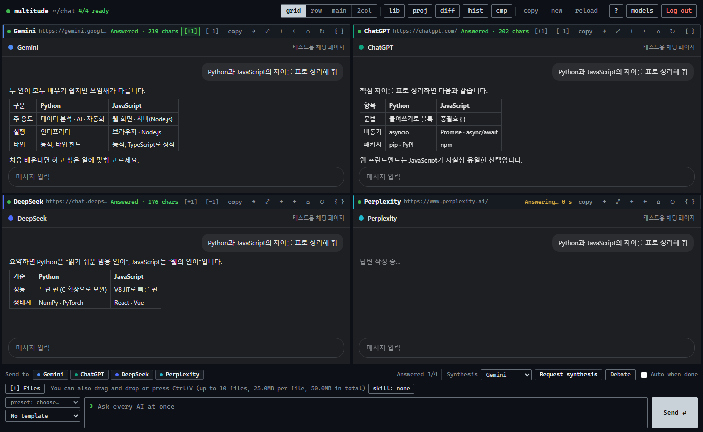

### Attach files

Drag files onto the input box, paste a screenshot with **Ctrl+V**, or click **[+] 파일**. Up to 10 files, 25 MB each, 50 MB total. If a service does not accept a file type the app tells you before sending, and the panel shows `[+] 일부 파일은 빼고 보냄` (some files skipped) or `[+] 첨부 없이 보냄` (sent without attachments).

### Preview before sending (v0.25.0)

**Shift+click** **보내기** (Send) or press **Ctrl+Shift+Enter** in the input box to see, before anything is sent, exactly what each AI will get: the final text (skill instructions + project context + question), your attachments, project file uploads and the character count. File types a service does not accept, files over the service's size limit and very long text (over 100,000 characters) are flagged in yellow. **보내기** sends exactly what is shown; **취소** (Cancel) sends nothing and keeps your input. To preview every time, turn on **보내기 전 미리보기** (preview before sending) in settings (off by default).

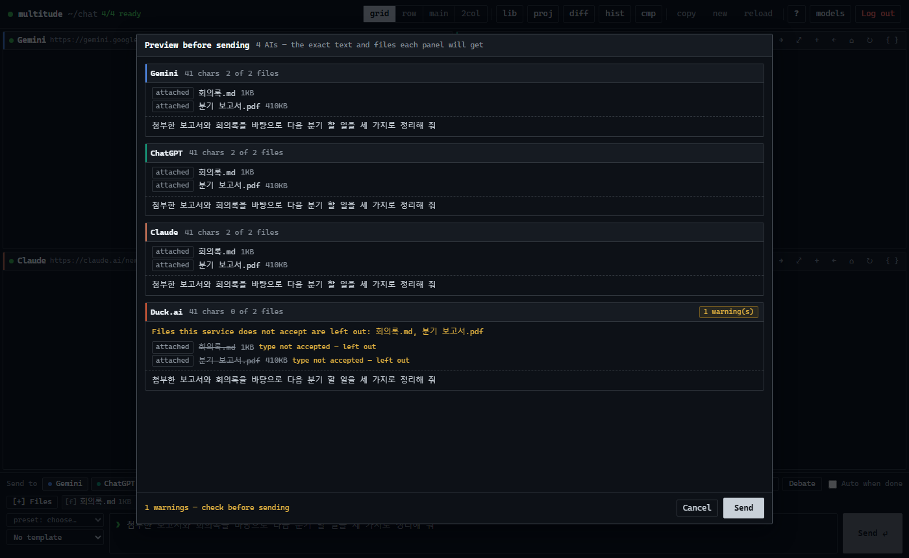

### Notifications (v0.25.0)

While you are working in another window, the app shows a Windows / Chrome notification when all answers are in (e.g. `답변 4개 완료 (시간 초과 1)` = 4 answers finished, 1 timed out), when a usage limit is hit, when sending fails, and when a synthesis or analysis is ready. Nothing is shown while you are looking at the app window (the app tab in the extension). Notifications contain counts and service names only, never your question or the answers. Click one to return to the app (to the compare view after an analysis). Each kind can be turned off under **알림** (notifications) in settings.

## 3. Rate answers

When a panel finishes answering a question you sent from the input box, **`[+1]`** (good) and **`[-1]`** (not good) appear in its header. Click again to clear. Ratings feed the **만족도** (satisfaction) column in the stats table (section 7). A new question resets the buttons.

## 4. Merge the answers (synthesis)

Choose the judging AI in the `종합` dropdown and press **종합 요청** (Request synthesis). The app sends the other AIs' answers to that AI and asks for mistakes, missing points and a final answer. Tick **완료 후 자동** to request it automatically when all answers are done.

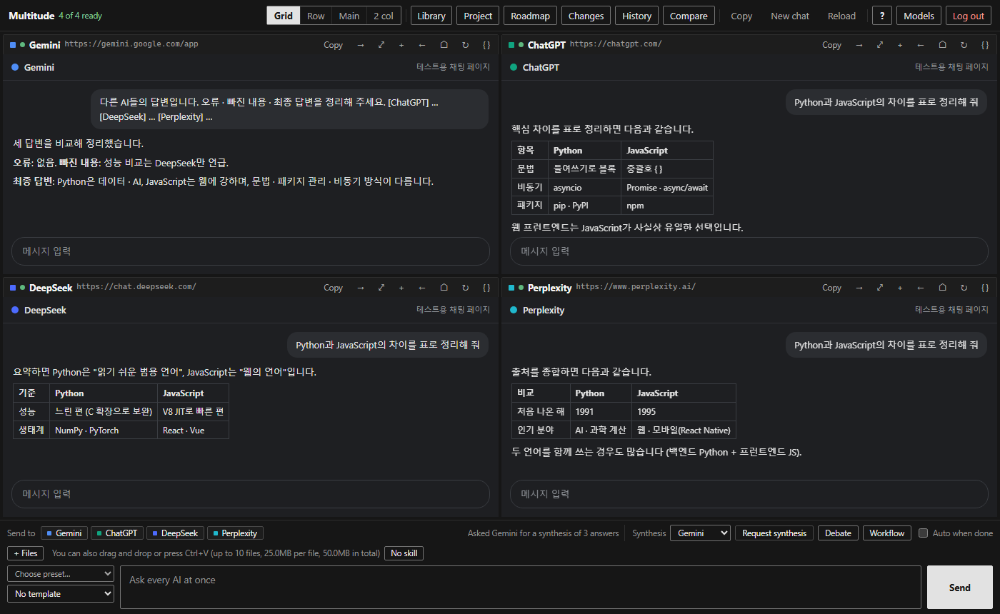

### Hand-offs and debate (v0.26.0)

- **Hand-off**: press **→** in a panel header. A bar appears under the panel: pick what to ask — **검토** (review: errors and omissions), **반박** (counter-argue) or **이어서** (continue: go deeper, next steps) — and click the AI that should receive it. Only that AI gets the original question plus this panel's latest answer. The reply is kept in history as a hand-off.
- **Debate**: press **토론** (Debate) next to the synthesis controls. Pick **2–3** participants, **1–3** rounds (default 2) and a judge AI (default: the synthesis target), then **시작** (Start). Each round every participant gets the other participants' latest answers and is asked to rebut and refine; at the end the judge writes agreements, remaining disagreements and a final answer. The debate starts from the answers to the current question, so send a question first.
- **Roles** (v0.32.0): next to each participant you can pick **Pro / Con / Rebuttal only**. An AI with a role argues from that side for the whole debate (a rebuttal-only AI looks for weaknesses and counterexamples instead of giving its own conclusion), and the judge is told roles were given. Roles are optional.
- **Note between rounds** (v0.32.0): tick **Pause between rounds so I can add a note** and, after every round except the last, the debate pauses and a window opens. What you write is added to the **next** round's request for every participant (`Add and continue`, or leave it empty / `Just continue`; `Ctrl+Enter` sends). `Esc` only closes the window — the debate stays paused and the **Add note** button under the input box reopens it. Notes are kept in history and exports as "My note" before that round.
- **Saving the setup** (v0.32.0): participants, rounds, judge, **roles and the pause setting** are saved in a work preset; picking the preset opens the debate window with them.
- Progress shows under the input box (`Debate round 1/2 — waiting for …`); **토론 멈추기** (Stop debate) ends it at any time (finished rounds are kept). A notification is shown when it ends.
- Results appear in **Compare › Hand-offs · Debate** and in **History** (expand the hand-offs line), and are included in MD/HTML exports.
- A debate sends one extra message per participant per round (2 rounds × 3 AIs = 6, plus 1 for the judge). Use fewer rounds on services with tight usage limits.

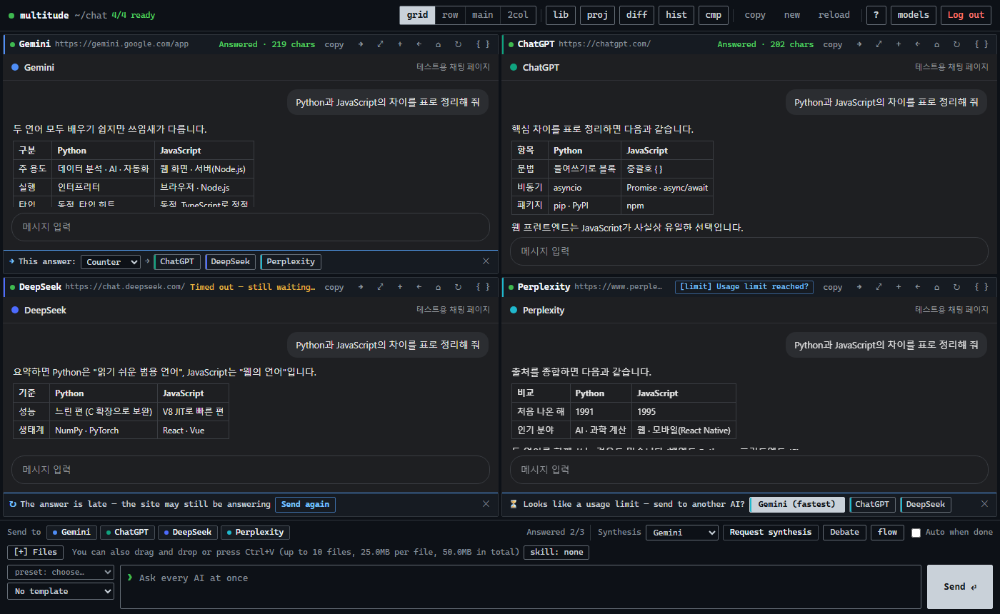

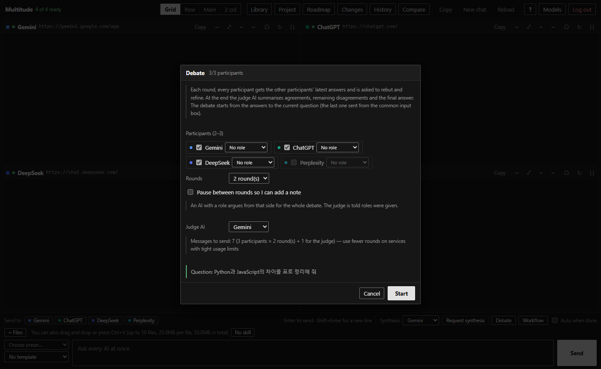

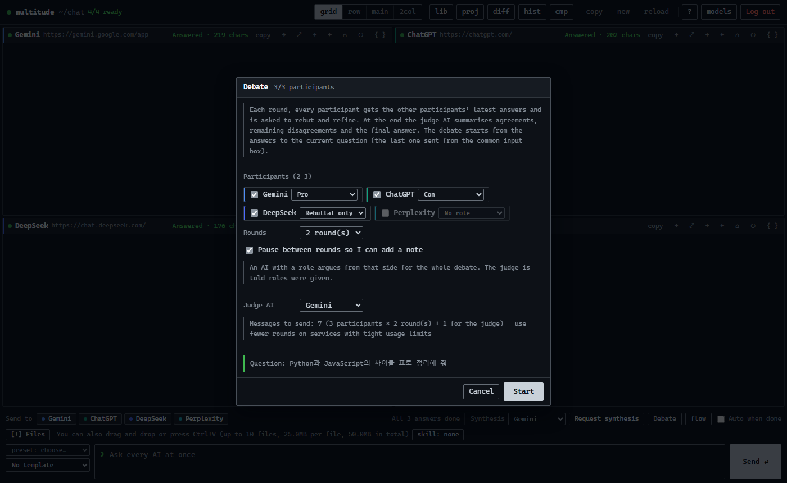

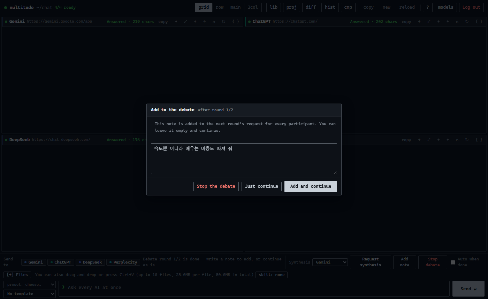

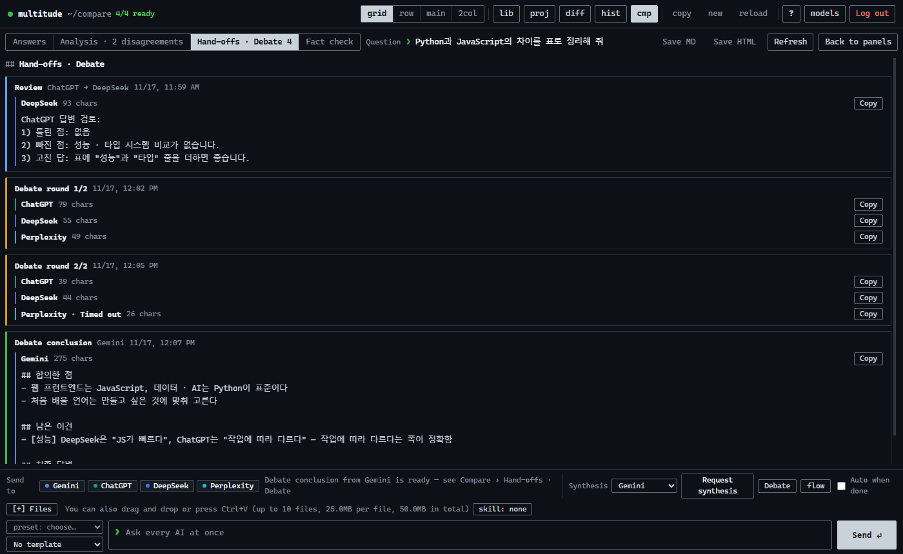

### Workflow (v0.33.0)

Have several AIs work **one after another in an order you set**, e.g. A drafts → B critiques → A revises → C verifies. Press **flow** under the input box.

- **2–6 steps.** Pick what each step does and which AI does it; **Fill in an example** sets draft → critique → revise → verify. The same AI may take several steps.

  | Task | What it does | Takes from earlier steps |
  |---|---|---|
  | **draft** | (first step only) uses the AI's existing answer to this question **without sending again**, or sends the question | — |
  | **critique** | asks for errors, omissions, weak claims and a better answer (the same request as Hand-off › review) | result |
  | **counter** | asks it to argue against the result (Hand-off › counter) | result |
  | **revise** | gives the result and the latest feedback (critique / counter / verify) and asks for a full rewrite | result + feedback |
  | **verify** | asks whether the result is right, as verification · remaining problems · verdict (pass / needs changes) | result |
  | **continue** | asks it to take the result further (Hand-off › continue) | result |

  The "result" is the latest answer from a draft, revise or continue step. Rules: the first step is a draft; critique, counter, verify and continue need a result before them; revise needs feedback before it. A rule violation is shown in the window and **Start** stays disabled.
- **Pause after each step**: when on, it stops after every step and shows **Next step**, **Skip next step** and **Stop flow** under the input box (it pauses after a skipped step too). **Stop flow** works any time.
- **Messages to send**: shown before you start, e.g. "3 (ChatGPT 1 · Gemini 1 · DeepSeek 1)"; a draft is not counted if the AI already answered. Use fewer steps on services with tight usage limits.
- If a step gets no answer (timeout, no answer, error) the flow stops and **the steps already received stay in history**. A notification is shown at the end.
- Results appear step by step in **Compare › Hand-offs · Debate** and in history ("Workflow 2/4 · critique → ChatGPT") and in exports. The order can be saved in a work preset.

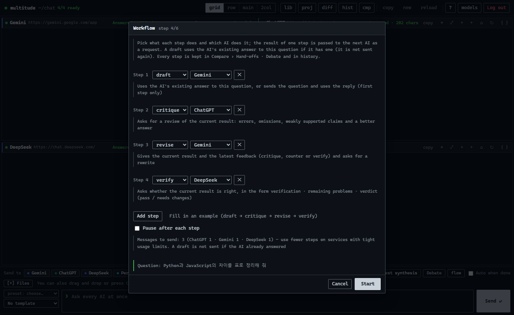

## 5. Compare answers

**Fact check** tab (v0.33.0): an AI checks the facts in an answer with web search. Choose the **text to check** (one AI's answer or the analysis's final answer), the **AI that picks the claims** (a local LLM works too) and the **AI that checks** (a searching AI such as Perplexity or Genspark is recommended), then **Run fact check**. The AI that picks claims returns up to **10 checkable claims** (numbers, dates, names, cause and effect — not opinions); the checking AI is asked about **all claims in one message** and answers with a table, shown per claim as **Confirmed / Refuted / Partly / No source** (refuted in red, partly in yellow). Source links can be copied (the app does not open links). It costs **2 messages** (shown before you start). This is what an AI found, not a guarantee — open the links yourself for anything important.

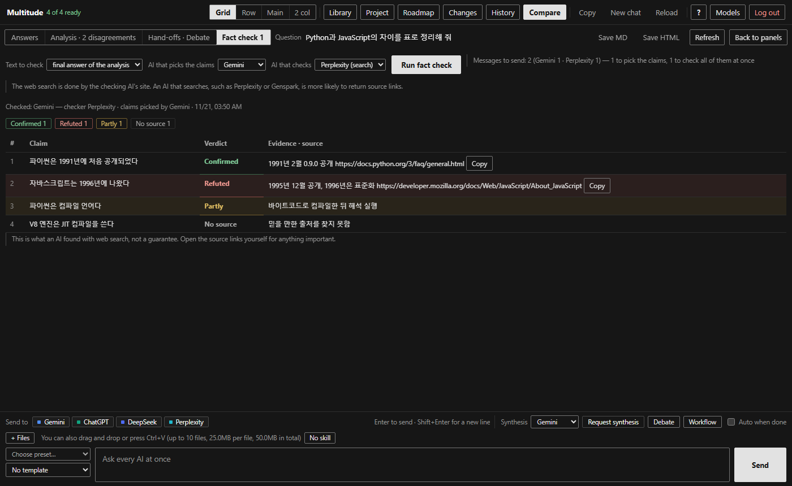

**cmp** (`Ctrl+Shift+D`) shows the last question and each AI's latest answer in columns. Each column can be copied as Markdown.

- **View mode** (v0.32.0, drop-down at the top; remembered): the answer text does not change, only how it is laid out.
  - **Side by side** (default): the whole answer per column.
  - **Align paragraphs**: one row per paragraph of the baseline answer (the `Baseline:` list), with the **similar paragraph of every other AI on the same row**, paired one-to-one by word and character overlap. Paragraphs with no counterpart get a yellow row (only that AI has it); paired paragraphs that overlap little are tinted blue. Table lines are shown as `a · b`.
  - **Code only**: just the code blocks per AI, with the language name; with **Highlight differences** on, lines missing from the baseline's code are highlighted.
  - **Compare tables**: Markdown tables are matched by the **first column (the item)** and compared cell by cell; values that are not alike (or whose numbers differ) are marked `differs`, items that only some AIs' tables have are marked `missing in some`. The table with the most rows per AI is used.

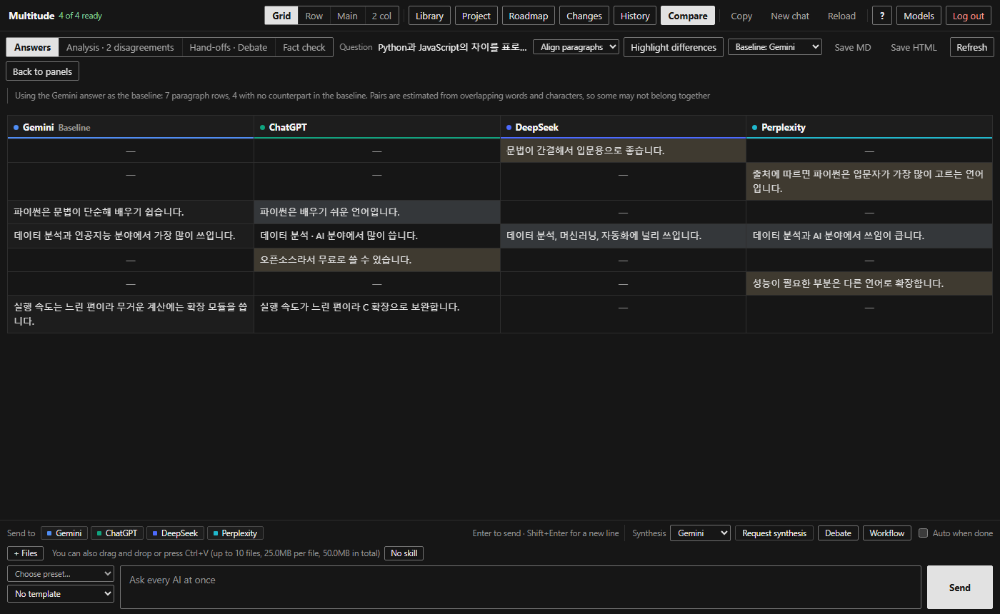

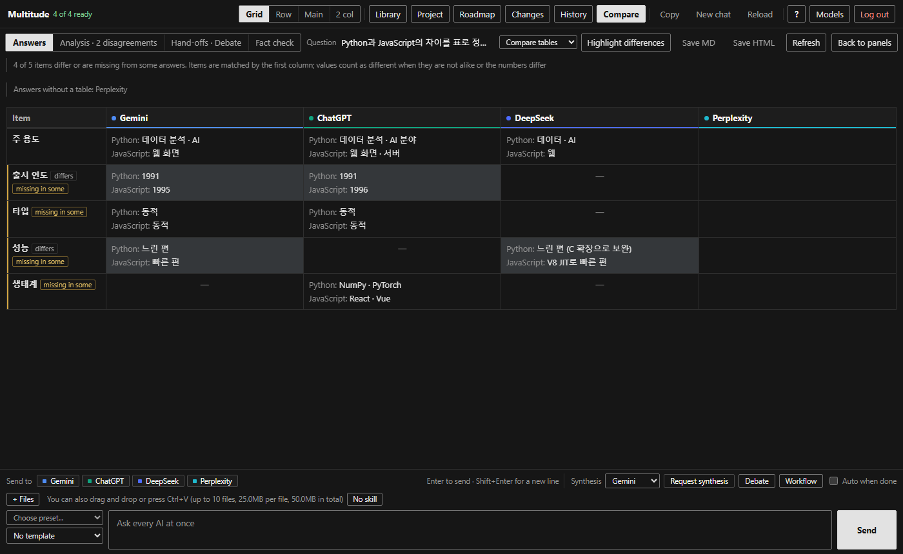

- **차이 강조** (Highlight differences): sentences that are not in the reference answer are highlighted; each column shows `새 내용 N%` (new content %). Pick the reference with `기준:`.
- **분석** (Analysis) tab → **분석 요청**: the judging AI answers in a fixed format, which the app draws as:

| Section | Korean | Contents |
|---|---|---|
| Disagreements | `이견` | One row per issue: each AI's position and a verdict. Click a cell to jump to that answer; the paragraph (or table/list line) most related to the issue is highlighted (v0.26.0) |
| Agreements | `공통 의견` | What most AIs agree on |
| Sources (v0.32.0) | — | Links found in the answers and the analysis, by address (query tracking values, `#fragments` and trailing punctuation removed); AI name tags show who used each link, links used by several AIs come first. The app only **copies** links, it does not open them |
| Weak claims | `근거 부족` | Claims without support, by AI |
| Final answer | `최종 답변` | The merged answer, with a copy button |

The header shows an **agreement** figure (v0.32.0): each common point counts as full agreement and each disagreement row counts by the share of position-stating AIs that hold a similar position; averaged. The `2/4 agree` badge on a row means 2 of the 4 compared AIs hold a similar position. "Similar" is estimated from text overlap (same numbers, many shared characters and words), not meaning, so treat the figures as estimates; cells such as "not mentioned" are not counted as positions.

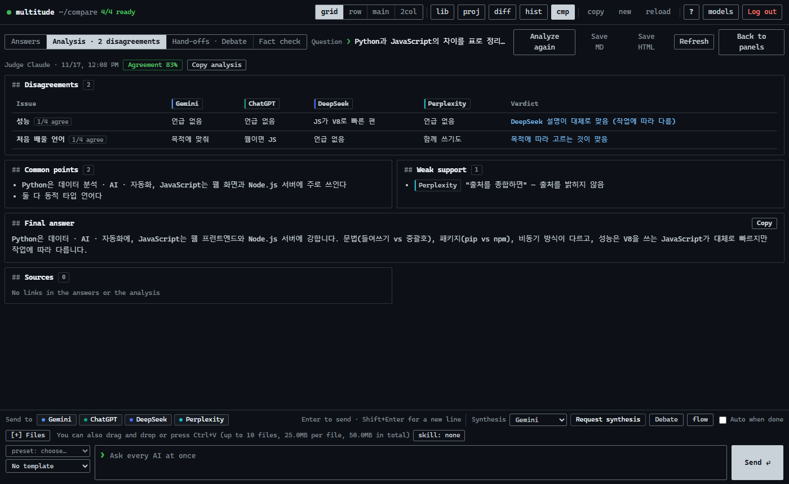

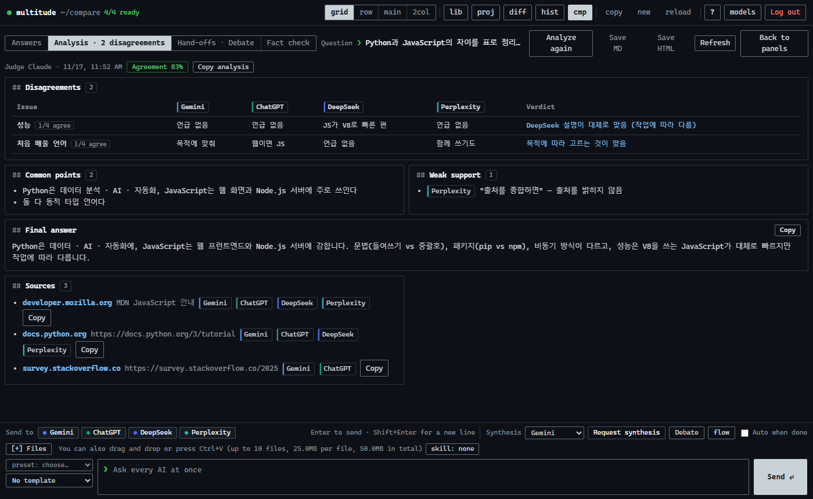

Run the analysis again (also with another judge) and earlier analyses are kept: with two or more, pick two to see them **side by side**; issues found by only one of them are marked `이쪽에만` (only here) (v0.26.0).

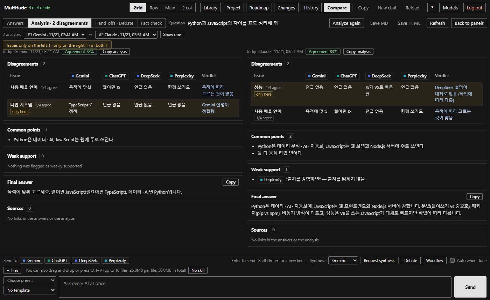

### Retry and fallback (v0.26.0)

- If sending to a panel fails, the app tries **once more** after 1.5 s (`?` › **실패하면 한 번 다시 보내기**, on by default). Usage limits and closed panels are not retried.
- Timeouts and "no answer" are **not** re-sent automatically (the site may still be answering); a **다시 보내기** (Send again) button appears under the panel instead.
- When a usage limit is detected, the panel asks **다른 AI로 보낼까요?** (send to another AI?) with buttons for open panels that are not limited, fastest first by your stats. Nothing is sent until you click; the chosen AI gets the same text and attachments.

## 6. History and export

**hist** (`Ctrl+H`) keeps the last 500 questions (change it in `?` › History size: 100–2000) with every answer, synthesis and analysis (file names only, not file contents). Search, copy as Markdown, reuse a question, or save as **MD 저장** (Markdown) / **HTML 저장** (a self-contained report; print it to PDF).

**Archive (v0.35.0).** In settings, **Move overflow records to archive files instead of deleting them** (off by default) sends the oldest records beyond the maximum to monthly archive files (Windows app: `history-archive/archive-YYYY-MM.json` in the user data folder, encrypted; extension: extension storage) instead of deleting them. Turn on **Include archived records** in the filters to search them too (rows are tagged `archived`; view and delete only). **Clear history** also deletes the archive; stats and recommendations do not count archived records.

**Transfer picked records (v0.35.0).** Tick records in the list, then **To transfer file** → optional password (8+ chars, twice) → a `.mla-history.json` file. On another PC or in the other app / extension use **Import records…**: it shows "N records, M already exist and will be skipped" and only adds them when you press **Import**. This is a different file from the settings transfer file (settings files never contain history) and is only made when you click. Side-panel records are not transferred. The file holds your questions and answers as plain text, so a password is recommended. Up to 2000 records / about 18 MB per file.

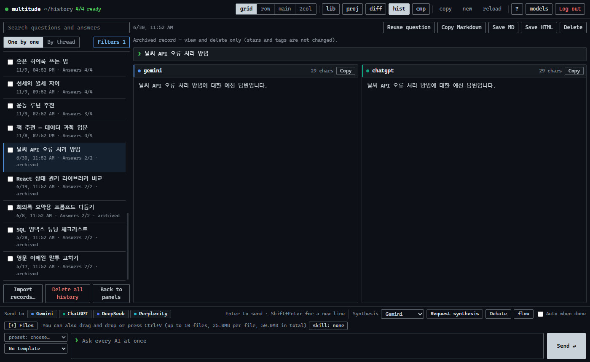

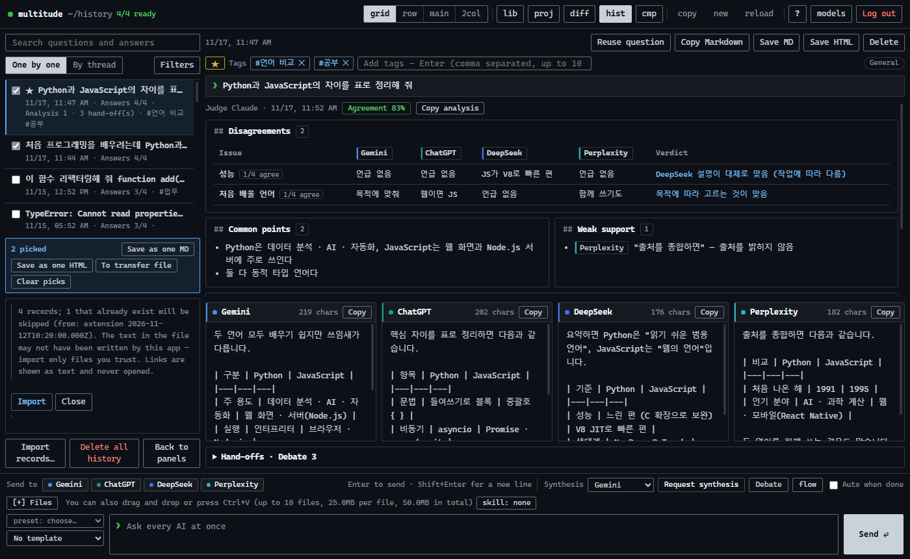

History stays on this PC. Questions sent from the extension's side panel appear with a `side` tag.

**Filters, tags and stars (v0.27.0).** **필터** (Filters) under the search box opens: period (all · today · 7 days · 30 days · date range), rating (`+1` / `−1` / not rated), sent from (app / side panel, extension only), tag, AI (any of), and checkboxes for starred, with project, synthesis, analysis, hand-offs/debates. In the record detail, **☆** stars a record and the tag box adds tags (Enter, comma separated; up to 10 tags of 30 characters). Tick the boxes in the list to save several records as **one** MD/HTML document (**MD로 묶어 저장** / **HTML로 묶어 저장**), oldest first.

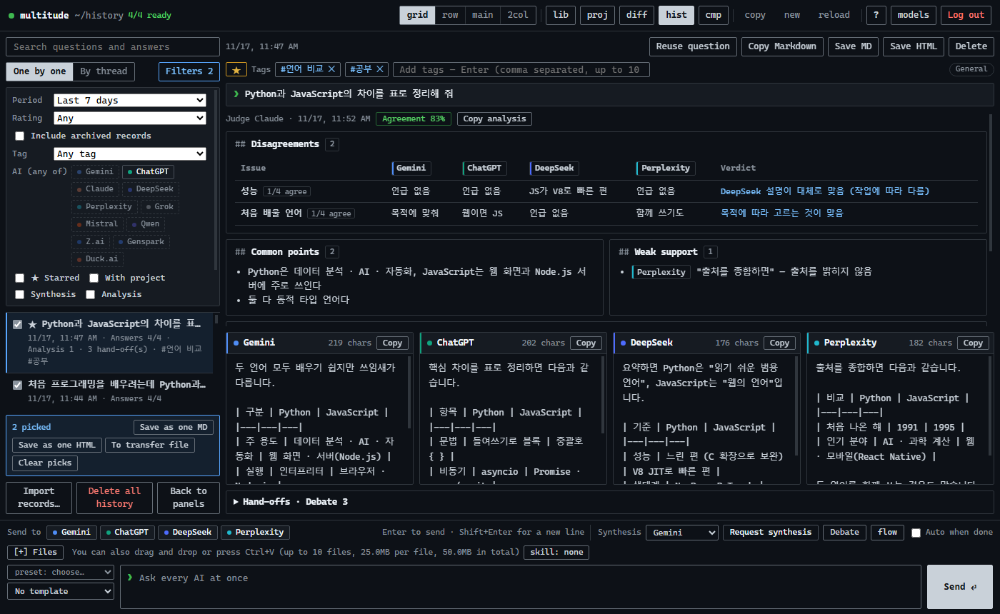

**Conversation threads (v0.27.0).** Questions that continue the same conversation share a thread: if at least one target panel received the previous question and was not reset since (new chat, home, clearing the local LLM chat, closing the panel, logging out), the new question joins that thread. **대화 줄기로** (by thread) groups them; open a thread to read its questions in order and save the whole thread as one file. Starting a new chat inside the site itself is not visible to the app, and records from before v0.27.0 have no thread.

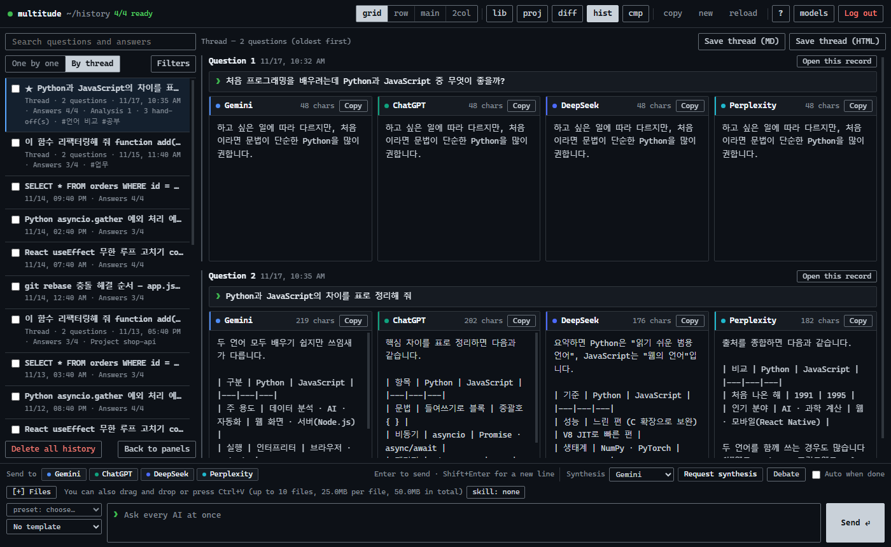

## 7. Settings, stats and shortcuts

**?** (`Ctrl+/`) opens settings: answer wait time, automatic selector updates, local LLM, updates (Windows app), and:

- **AI별 응답 통계** (response stats per AI): questions, completed (%), timeouts / no answer, send failures, usage limits hit, median time to first response and to completion, average length, **만족도** (satisfaction, e.g. `75% (3/4)`).
- **질문 종류별 추천** (suggestions by question kind, v0.27.0): questions are labelled project / code / long text / general. Per kind and AI the app counts only facts — answers, completion rate, median time to finish, satisfaction of rated answers — never an accuracy score, and suggests up to 3 AIs with at least 5 answers of that kind. Shown on the model picker (`코드 질문에는 보통: A · B · C`, "pick these" only ticks boxes) and in settings. **추천 조합 자동 선택** (off by default) only shows a **추천 조합으로 바꾸기** chip when the typed question's suggested set differs from your targets; targets change only when you click it.
- **Recommendation order and speed by time of day** (v0.35.0): choose what comes first when ranking suggestions — completion (default), your ratings, or speed. Ratings now include a half "good" vote for finished answers you did not rate in records you starred ★. A table shows the median time to finish per AI by time of day sent (night 0–5, morning 6–11, afternoon 12–17, evening 18–23; cells with fewer than 3 answers show `·`).
- **Fix selectors by hand** (v0.35.0): in the diagnosis window (the ⚠ badge, or **Diagnose** in the site status table) you can type the input, answer-reading and stop-button selectors for a site, one per line. They are tried first, the built-in and remote ones stay behind them, and they are saved on this PC only (never sent anywhere). Send / login buttons and file inputs cannot be edited (app updates only). **Open GitHub issue** opens an issue form filled with the same diagnostic info as *Copy diagnostic info* plus your selectors — it shows the text first, contains no questions or answers, and you can edit it on GitHub.
- **서비스 화면 상태** (site status): whether the app can still find each site's input box, send button and answer area. If a site changes its layout, the panel shows `⚠ 화면이 바뀐 것 같음`; click it to open the self-check window (`셀렉터 지금 확인` = re-check selectors now, `진단 정보 복사` = copy diagnostics without your content).

| Shortcut | Action |
|---|---|
| `Ctrl+L` | Focus the input box |
| `Ctrl+Shift+N` (extension: `Alt+Shift+N`) | New chat in all panels |
| `Ctrl+Shift+S` | Request synthesis |
| `Ctrl+Shift+C` | Copy all answers (Markdown) |
| `Ctrl+Shift+R` | Reload all panels |
| `Ctrl+Shift+D` / `Ctrl+H` | Compare / history |
| `Ctrl+Shift+P` (extension: `Alt+Shift+P`) | Proposed changes (project mode) |
| `Ctrl+1–9` (extension: `Alt+Shift+1–6`) / `Alt+1–9` | Toggle the Nth target / focus the Nth panel |
| `Ctrl+/` | Settings and shortcuts |
| `Ctrl++` / `Ctrl+-` / `Ctrl+0` (Windows app, v0.31.0) | Zoom the app screens in / out / back to normal (8 steps, 80%–200%, remembered). AI site panels keep their own size. In the Chrome extension use the browser's zoom |
| `Esc` | Back to the panels |
| `Alt+Shift+S` (extension) | Open the side panel with the current page |

In the project sidebar the file tree is one tab stop: `↑` `↓` move, `→` expands (or enters) a folder, `←` collapses (or goes to the parent), `Home` `End` jump, `Enter` opens a file or toggles a folder, `Space` ticks the file to send (v0.31.0).

## 8. Library: templates and skills

**lib** opens your library.

- **Templates** can contain variables like `{{language}}` or `{{tone|friendly}}` (with a default). `{q}` marks where your question goes. Before sending, the app asks for the variable values.
- **Skills** are SKILL.md-style instruction sets (up to 3 at once). They are added in front of the first question of each chat. Long skills can be shortened with **AI로 압축** (compress with AI).
- Import / export the library as JSON. **Share file** (v0.35.0) saves one template, skill or preset as a `.mla.json` file (a preset brings its skills and template; skill version history is left out; the file is not encrypted). The receiver opens it with Library › Import or Settings › Move settings › Import.
- **Work presets** (v0.29.0): `preset:` left of the input, or the **프리셋** tab. A preset stores the template (with variable values), active skills in order, panels, targets, layout, synthesis judge + auto synthesis and debate settings, and applies them in one click. If the panels differ, you confirm before the panels are reopened.
- **Skill versions** (v0.29.0): every save keeps the previous body (up to 10). Under the editor, **이전 버전** shows a diff against the current body and **이 버전으로 되돌리기** restores it as a new save.

### Move settings (v0.29.0)

**?** › `설정 옮기기` exports settings (models, layout, synthesis, timeout, notifications, preview, retry, recommendations, history size, local LLM) and the library (templates, skills with versions, presets) as one `.mla.json` file. History, projects and cookies are never included. With a password (8+ chars) the file is encrypted with PBKDF2-SHA256 (250,000 iterations) + AES-GCM. Importing shows which settings change and lets you choose **overwrite** or **keep both** for items with the same id before anything is applied.

## 9. Project mode (code work)

**proj** opens a local folder. The left sidebar shows the file tree.

1. **Choose files.** Files excluded by the built-in rules (`.env`, keys, `node_modules`…), `.gitignore`, or your own rules are marked `L1` / `L2` / `L3` with the reason. Files that look like they contain secrets show `⚠ 비밀?`.
2. **Ask.** The folder structure and chosen files are uploaded with your question (as one bundled `project-context.md`, or one attachment per file). If an AI asks for more files with `NEED_FILES:`, a **[+] 요청 파일 N개 보내기** button appears.
3. **Only changed files on follow-ups** (`바뀐 파일만 보내기`, on by default): later questions upload only files that changed since that panel last saw them, and list the rest as unchanged. Optional: `이어지는 질문에 지난 파일 목록 붙이기` attaches the list of previously sent files to follow-up questions.
4. **Apply.** When an answer contains code changes, a bar appears under that panel: **적용 (N)** (apply), **변경 보기** (preview). Risky files (CI config, git hooks, scripts, `package.json` scripts) and deletions are unchecked and marked `⚠`. If any file in a batch fails to write, the files already written are restored.
5. **Compare across AIs** with **diff** (`Ctrl+Shift+P`), preview line by line, choose hunks, and **undo** from the apply log.
6. **Test run** (Windows app): runs your `npm test` before and after the proposed changes and shows both results, then restores the files. Since v0.28.0 you can also tick `lint`, `typecheck` and `build` when they exist in `package.json`.
7. **Mix and apply** (v0.28.0): **섞어서 적용** on the diff screen lets you pick, per file, which AI's change to use (one AI per file; a warning appears when files from different AIs are mixed). Applied as one batch with one undo entry.
8. **Commit after applying** (Windows app, v0.28.0): **커밋하기…** on the applied bar or in the preview commits only the applied files (`git add -A -- paths`, `git commit -m msg -- paths`; files you staged yourself stay staged). The message is prefilled; **AI에게 메시지 요약 부탁** asks the AI for a one-line summary. Nothing is pushed. Turn the offer off in settings (`적용 후 커밋 제안`).
9. **Pick up where you left off** (v0.28.0): which files each AI already has, file-by-file progress and continuation counts are saved with the project. Reopening the project restores them; after an app restart the panels open new chats, so the sidebar shows **지난 실행의 작업** — reopen the old conversation in the panel to continue automatically, or click **이어 쓰기**. A paused file-by-file run shows **▶ 이어서 계속**.

10. **More checks** (Windows app, v0.34.0): with `pyproject.toml`, `Cargo.toml` or `go.mod` in the project root, **test run** also offers `pytest`, `cargo-test` and `go-test` (only those that apply). Exactly three fixed commands run (`python -m pytest -q`, `cargo test`, `go test ./...`), without a shell, and the executable is looked up only in absolute PATH folders. Files that change how a check runs (`conftest.py`, `build.rs`, `go.mod`…) are flagged with ⚠ in the confirm dialog.
11. **Send the failure log back** (v0.34.0): when a check fails after applying, **실패 로그를 ○○에게 돌려 다시 받기 (n/max)** sends that check's output (secrets masked, trimmed) to the same AI as a follow-up. The reply appears as a new change bar to preview and test again. **Nothing is applied automatically.** Default 2 rounds, maximum 3 (0–3, remembered); the counter resets on a new question or an apply.
12. **Find related files** (v0.34.0): `관련 파일 찾기` in the sidebar follows `import` / `require` / `from … import` from your chosen files up to **2 levels** and suggests files worth sending along — tick and **add**. JS/TS (relative paths) and Python only; `@/…` aliases and computed paths are not found. Works in the Chrome extension too.
13. **Apply on a new branch** (Windows app, v0.34.0): tick `새 브랜치에 적용` in the preview and the app runs `git switch -c mla/<date>-<AI>` right before writing (name editable, always `mla/…`, letters/digits/`. _ -`). An existing name is refused. **Nothing is committed or pushed.**

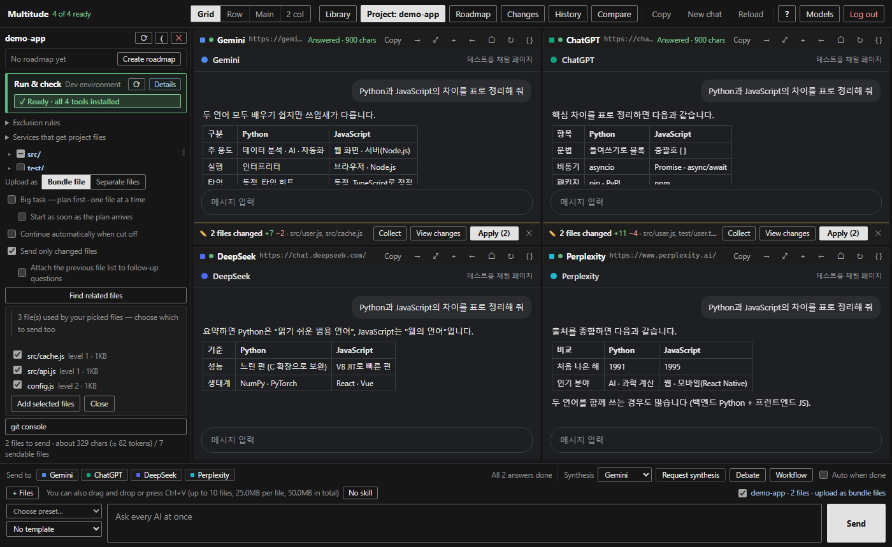

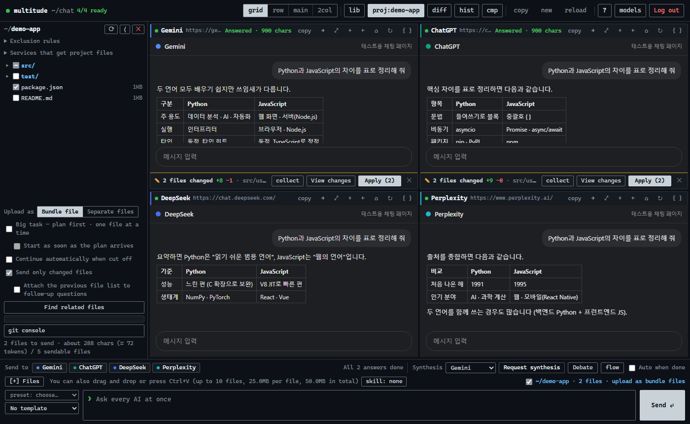

Cut-off protection: if an answer was cut off or abbreviated (`... existing code ...`), the change is blocked or flagged. Long files are requested as find/replace blocks; `↪ 이어서 받기` (continue) asks the same AI for the rest. **큰 작업** (big task) mode asks for a plan first and then one file at a time.

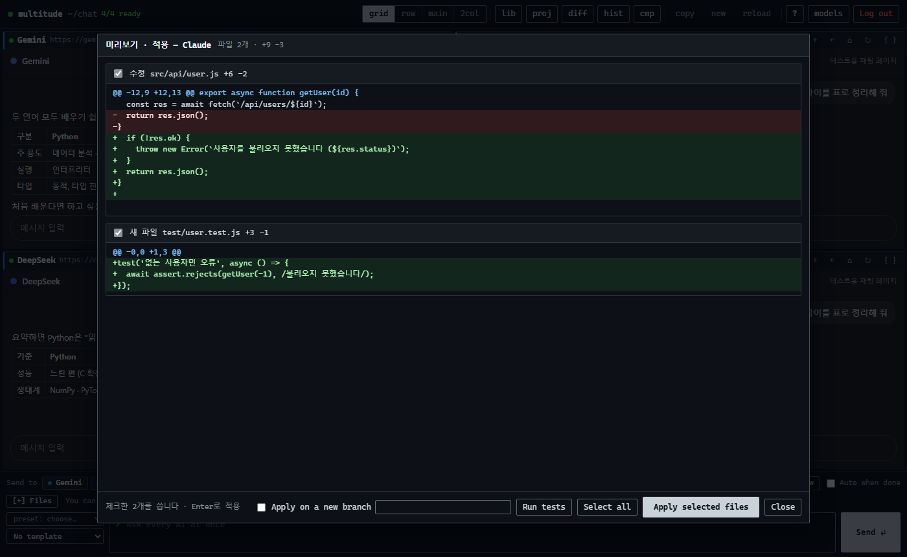

## 10. Chrome extension extras

- **Side panel** (`Alt+Shift+S`, or right-click › `사이드탭에서 이 페이지로 묻기`): up to 2 AIs in Chrome's side panel. The page you are reading is sent with your first question. Turn on **자동 읽기** (auto-read) once to read the current tab automatically; this asks for an optional site-access permission that you can revoke anytime in `chrome://extensions`.
- **Ask about a page**: right-click › `Multitude LLM에 묻기 — 선택한 글` (selected text) or `— 이 페이지 본문` (page text). Text is checked for secrets first.
- **app ↗** in the side panel moves your question and page to the full app tab.
- **One-click prompts** (v0.29.0): **요약 · 번역 · 핵심만 · 쉽게 설명** (summary, translate Korean↔English by page language, key points, explain simply) send right away with the captured page.
- **Earlier questions on this page** (v0.29.0): when the side-panel history has questions for the same URL (ignoring `#…` and tracking parameters such as `utm_*`), a line shows how many; open it to see them, their saved answers and **다시 묻기**.

## 11. Local LLM (optional)

Run an OpenAI-compatible server on your PC (Ollama `http://localhost:11434`, LM Studio `http://localhost:1234`, llama.cpp…). In **?** › `로컬 LLM`, turn it on, press `연결 확인` (test connection) and choose a model. Then pick **로컬 LLM** in the model list. Only `localhost` / `127.0.0.1` addresses are accepted, so nothing leaves your PC.

Since v0.29.0 the local LLM can also be the synthesis / analysis / debate judge and the skill compressor **without an open panel** (`로컬 LLM (패널 없이)`): it is asked in a separate temporary conversation so the visible panel chat is not touched; open the synthesis result with **결과 보기**. Set **로컬 모델 컨텍스트 한도** (2k–128k tokens, default 8k): answers fed to a local judge are trimmed proportionally with a note, other questions only show a warning in the panel and the pre-send preview.

In the Chrome extension, Ollama must allow extension requests: set the environment variable `OLLAMA_ORIGINS=chrome-extension://*` and restart Ollama.

### Several panels, text files and semantic search (v0.36.0)

- **Up to 3 local panels**: **?** › Local LLM › *Local panels* (1–3). The model picker then offers `Local LLM 2` and `Local LLM 3`, each with **its own model** (chosen in settings or in the panel header), so you can ask different models on the same server at once and compare the answers. Lowering the count closes the extra panels (their models are remembered). Synthesis, judging and skill compression use the first model.
- **Text file attachments**: a local panel inserts files it can read as text (`.txt` `.md` `.csv` `.json` `.log`, code, subtitles…) **into the request**. The bubble shows only your question and `📎 file name`; the file text stays in the conversation for follow-ups. Beyond 80% of the **context limit** (settings) the later files / the end of a file are cut and the text says so (`(partly)`). Images still go separately (vision models); **PDFs and other documents are left out** and the pre-send preview says so. Up to 200,000 characters per file.
- **Semantic history search (find by meaning)**: type an embedding model name in Local LLM › *Embedding model* (e.g. `nomic-embed-text` on Ollama) and press **Build index**. The local server's `/v1/embeddings` turns the start of each question and answer into numbers stored on this PC (you can stop and resume; only changed records are redone). Then turn on **Find by meaning** under the History search box: records with a similar meaning appear in order of `match 82%` even when the words differ (up to 24 new records are indexed just before each search; filters still apply). **Your text never leaves this PC (localhost only)**; archived records are not indexed, changing the model rebuilds from scratch, and Clear history clears the index too.

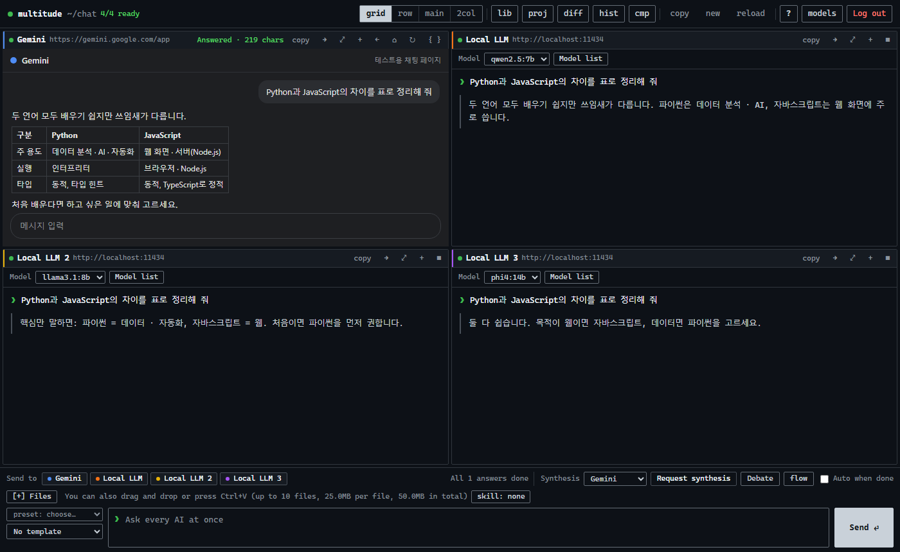

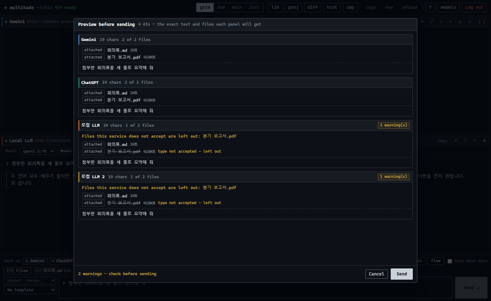

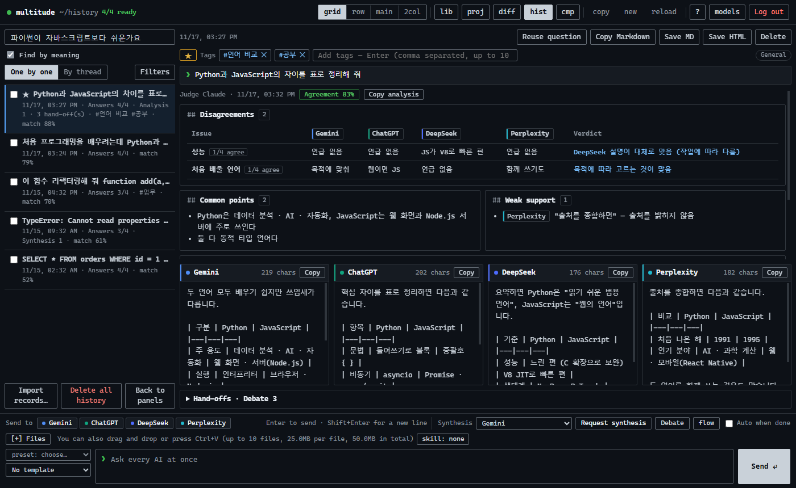

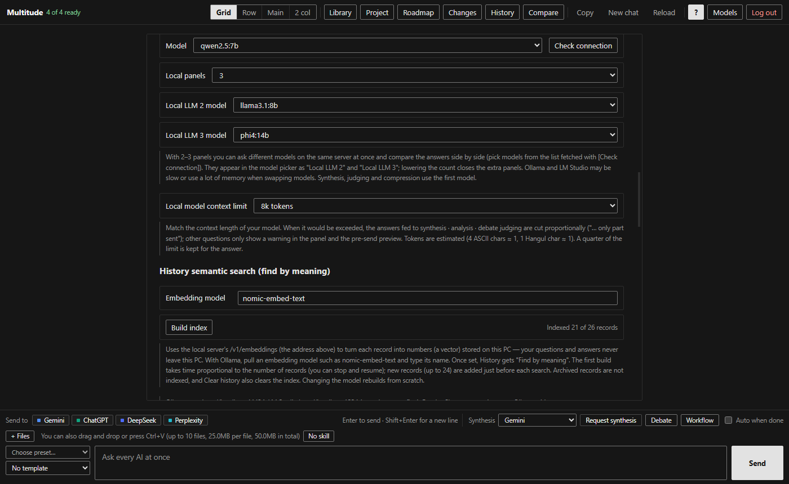

## Privacy in short

No Multitude LLM server, no analytics. Questions go only to the AI services you open; history stays on your PC. Details: [PRIVACY.md](../../PRIVACY.md).
