# 사용 안내

[← README](../README.md)

## 한눈에 보기

> 스크린샷의 패널 안은 실제 서비스 화면이 아니라 **테스트용 채팅 페이지와 예시 답변**입니다. 앱 화면(툴바·패널 머리줄·공통 입력창·비교·기록·설정)은 실제 앱 그대로입니다.
> 실제로는 각 패널에 해당 서비스의 웹 채팅이 그대로 열립니다.
> 스크린샷은 v0.19.0 CLI 디자인 개편 전 화면입니다 (9 · 10번은 v0.10.0 전). 기능은 같고 색 · 버튼 이름 · 모양만 다릅니다 — 지금 버튼 이름은 [화면 디자인](#화면-디자인)의 표를 보세요.

### 1. 모델 고르기

위쪽 `01 · 02 · 03` 세 칸(모델 고르기 → 한 번에 질문 → 비교·종합)으로 쓰는 순서를 보여 주고, 아래 `[x] Gemini` 체크 목록(2열)에서 쓸 모델을 11개 중 최대 6개까지 고릅니다. 6개를 고르면 나머지는 선택이 막히고 "6 / 6 선택"이 표시됩니다 (5개부터는 메모리 안내가 붙음). 고른 모델만 패널로 열리고, Windows 앱은 각 서비스에 "Google로 계속하기"로 자동 로그인합니다.

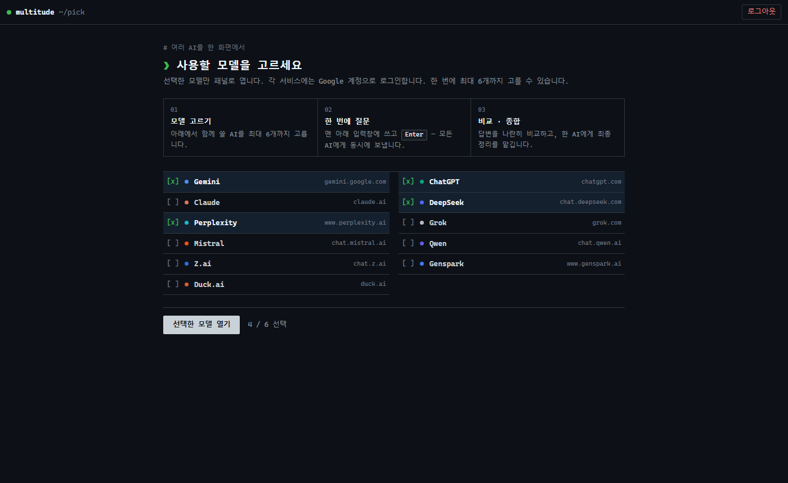

### 2. 한 번에 질문하기

아래 공통 입력창에 쓰면 켜 둔 AI 모두에게 동시에 보냅니다. 왼쪽 아래 **템플릿**(예: 장단점 비교, 또는 변수가 있는 내 템플릿)을 고르면 질문을 자동으로 감싸 주고, 위의 **skill:** 버튼으로 스킬(최대 3개)을 켜면 지침을 붙여 보냅니다 ([라이브러리](#라이브러리-내-템플릿--스킬)). 패널마다 "답변 중… → 답변 완료 · N자"가 표시됩니다. 툴바의 **grid · row · main · 2col**(격자 · 가로 · 큰 칸 · 2열)로 배치를 바꾸고, 패널 머리줄 **⤢**로 한 패널만 크게 봅니다.

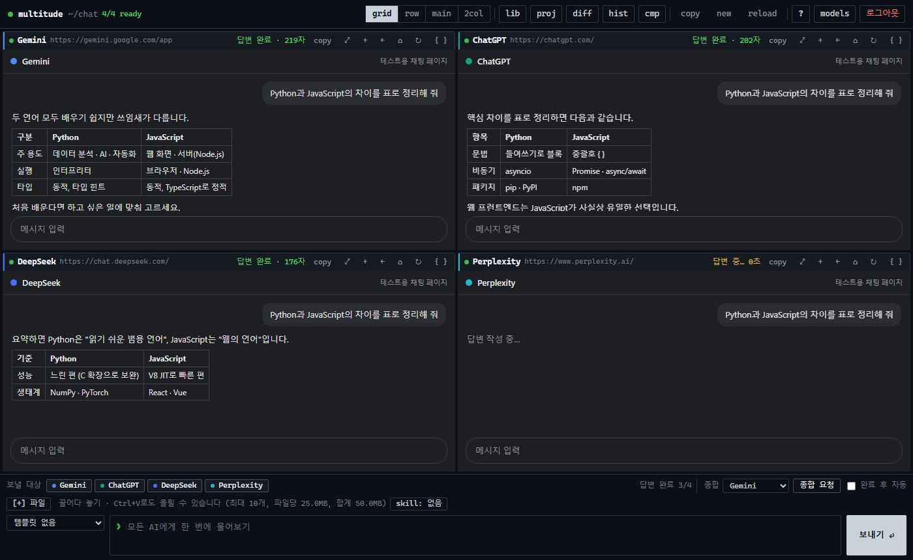

### 3. 파일 첨부

이미지·문서를 공통 입력창에 **끌어다 놓거나**, **Ctrl+V**로 붙여 넣거나(스크린샷), **[+] 파일** 버튼으로 올리면 보낼 대상 패널마다 첨부해서 보냅니다. 받지 않는 종류가 있는 서비스는 올릴 때 미리 알려 주고(예: "Duck.ai은(는) 문서 빼고 보냄"), 보낸 뒤 패널 머리줄에 `[+] 일부 파일은 빼고 보냄` · `[+] 첨부 없이 보냄`으로 표시합니다. [자세히](#파일-첨부)

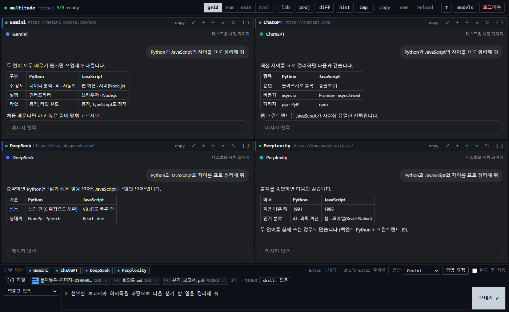

### 4. 교차검토(종합)

**종합 요청**을 누르면 다른 AI들의 답변을 모아, 고른 AI 하나(여기서는 Gemini)에게 오류·빠진 내용·최종 답변을 정리해 달라고 보냅니다. "완료 후 자동"을 켜면 모든 답변이 끝나는 순간 알아서 요청합니다. 종합 요청에는 첨부 파일을 다시 보내지 않습니다.

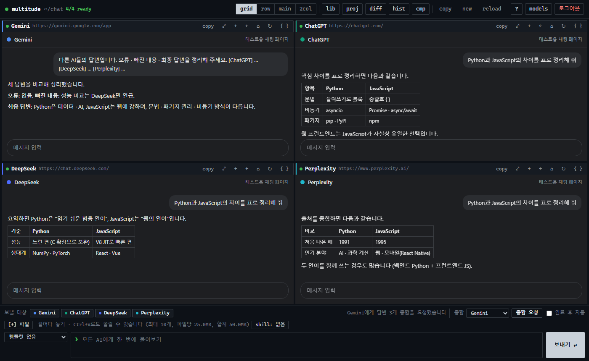

### 5. 답변 비교

**답변 비교**(Ctrl+Shift+D)는 마지막 질문(`❯ 질문` 한 줄)과 각 AI의 최신 답변 칸을 칸별로 나란히 보여 줍니다. 칸마다 Markdown(표·코드 블록 유지)으로 복사할 수 있습니다.

- **차이 강조** (v0.11.0): 위쪽 **차이 강조**를 켜면 기준 답변(처음엔 첫 칸, `기준:` 목록에서 바꿈)에 없는 문장만 노란 형광으로 표시합니다. 칸 머리줄에 `기준` 또는 `새 내용 N%`가 붙습니다. 띄어쓰기·줄바꿈만 다른 문장, 표현만 조금 다른 문장(글자 겹침이 많은 문장)은 같은 것으로 봅니다 — 단 숫자가 다르면(940만 · 950만) 새 내용입니다 (v0.12.1). 다시 누르면 끕니다.
- **분석 탭** (v0.11.0): **분석 요청**을 누르면 입력창 아래 **종합** 목록에서 고른 AI(판정 AI)에게 답변들을 보내고, 정해진 형식으로 답하게 합니다.

  | 칸 | 내용 |
  |---|---|
  | **이견** | 쟁점마다 AI별 입장과 판단을 표로. 칸이나 AI 이름을 누르면 **답변** 탭의 그 AI 칸으로 이동해 잠깐 빛납니다. 이견이 없으면 "이견이 없습니다" |
  | **공통 의견** | 대부분의 AI가 같은 내용 |
  | **근거 부족** | 근거 없이 주장했거나 확인이 필요한 내용 (AI 이름 표시) |
  | **최종 답변** | 분석을 반영한 최종 답변 (복사 버튼) |

  판정 AI가 형식을 지키지 않으면 "정해진 형식이 아니라서 글 그대로 보여 줍니다"와 함께 답변 글을 그대로 보여 줍니다. 분석 결과는 질문 기록에 함께 저장되고, **기록** 화면에서도 같은 표로 보입니다 (목록에 `분석 1`). 탭 위치와 차이 강조 켜짐은 다음에도 기억합니다.

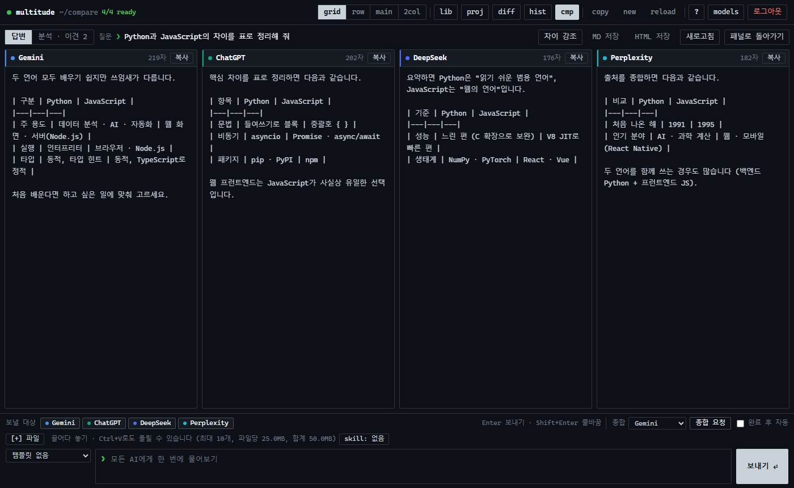


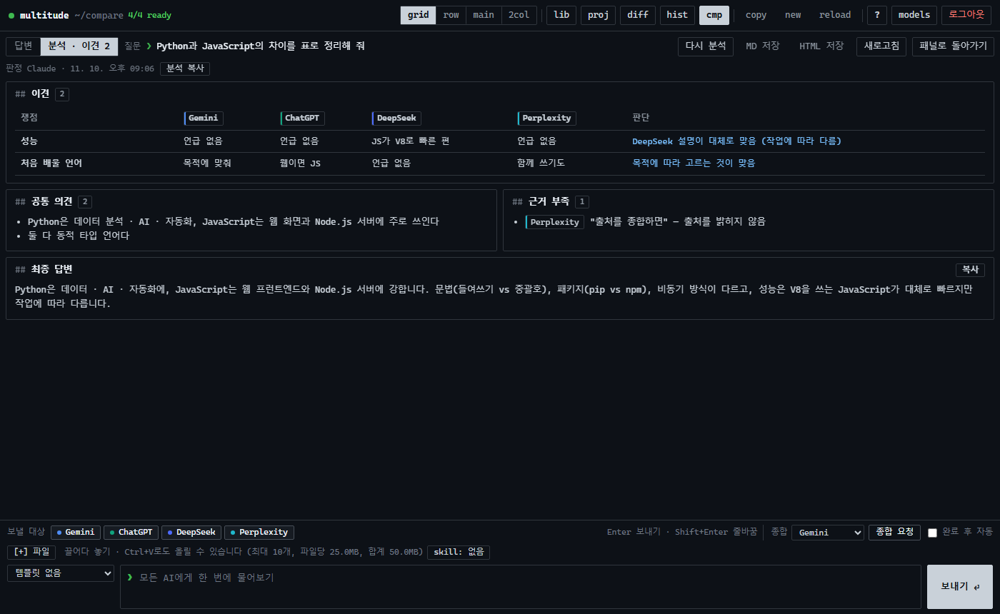

### 6. 기록

**기록**(Ctrl+H)에는 보낸 질문과 각 답변·종합 결과, 첨부한 파일 이름이 저장됩니다(파일 내용은 저장하지 않음). 검색, Markdown 복사, 질문 다시 쓰기, **MD · HTML 파일로 저장**([내보내기](#내보내기))을 할 수 있습니다. 기록은 이 PC에만 저장됩니다.

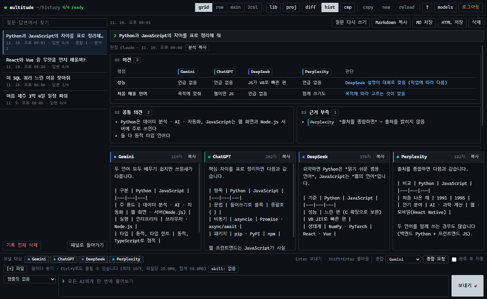

### 7. 설정 · 단축키

`?`(Ctrl+/) 화면에서 답변 대기 시간, 사이트 셀렉터 자동 갱신을 설정하고, [서비스 화면 상태](#셀렉터-자가진단) · [AI별 응답 통계](#응답-통계)와 단축키를 볼 수 있습니다.

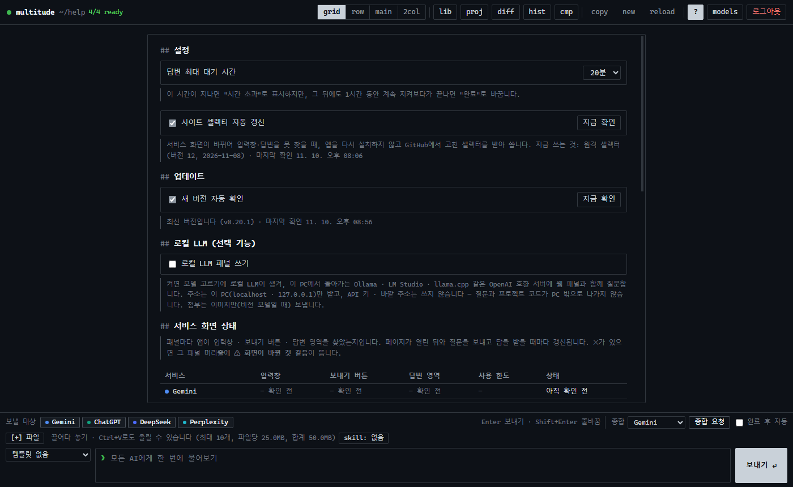

### 8. 라이브러리 (내 템플릿 · 스킬)

**lib**(라이브러리)에서 변수가 있는 내 템플릿과 스킬(SKILL.md)을 만들고 고칩니다. 왼쪽 목록에서 고른 항목은 파란 줄로 표시됩니다. [자세히](#라이브러리-내-템플릿--스킬)

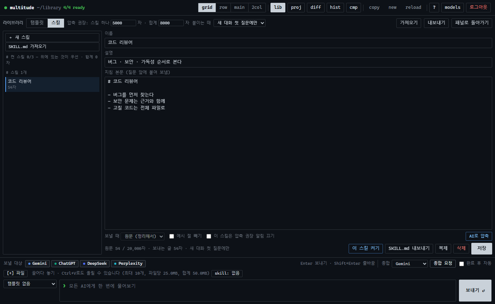

### 9. 프로젝트 모드 (로컬 코드 작업)

툴바의 **proj**(프로젝트)로 로컬 폴더를 열면 왼쪽에 파일 트리가 뜹니다. 빼야 할 파일은 `L1`·`L2`·`L3` 표시와 이유(예: `.gitignore 1행 (dist/)`)가 붙고, 비밀 정보로 보이는 파일은 `⚠ 비밀?`로 경고합니다. 질문을 보내면 프로젝트 구조와 고른 파일 내용이 **파일 업로드**로 함께 갑니다 (사이드바 아래 `올리는 방식`: 묶음 파일 / 개별 파일). AI가 답변 끝에 `NEED_FILES:`로 파일을 요청하면 패널 머리줄에 **[+] 요청 파일 N개 보내기** 버튼이 생깁니다. [자세히](project-mode.md#프로젝트-모드)

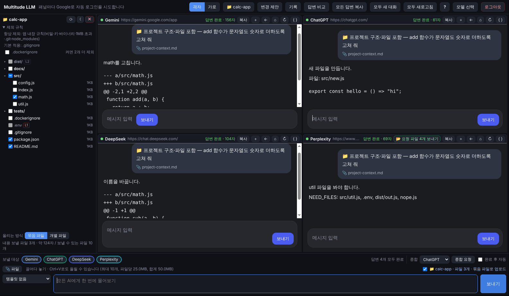

답변에 수정안이 있으면 그 패널 아래에 **변경 바**가 올라옵니다. **적용 (N)** 을 누르면 바로 파일에 쓰고(실행 영향 파일·삭제는 빼고 `⚠ 확인 필요`로 표시), 바가 `✓ 적용됨 · 되돌리기`로 바뀝니다. **변경 보기**로 바뀌는 줄을 먼저 보고 골라 적용할 수도 있습니다.

여러 AI의 안을 나란히 보려면 **변경 제안**(Ctrl+Shift+P)에서 AI마다 낸 수정안을 파일별로 비교하고, **미리보기·적용**으로 바뀌는 줄을 확인한 뒤 고른 파일만 씁니다. AI는 바꾼 파일마다 전체 내용을 주고, 그래도 diff로 와서 맞지 않으면 **전체 파일 다시 요청**으로, 여러 안은 **종합으로 합치기**로 처리합니다. 적용한 것은 **적용 기록**에서 되돌릴 수 있습니다.

파일에 바로 쓰지 않고 직접 붙여 넣고 싶으면, 답변이 끝났을 때 패널 머리줄에 노란 테두리로 깜빡이며 나타나는 **파일 N개 모아보기**를 누릅니다. 파일마다 새 파일·수정·삭제 표시와 전체 코드가 모이고, 경로·코드를 하나씩 또는 한 번에 복사합니다. 프로젝트를 열지 않아도 됩니다. [자세히](project-mode.md#파일-모아보기)

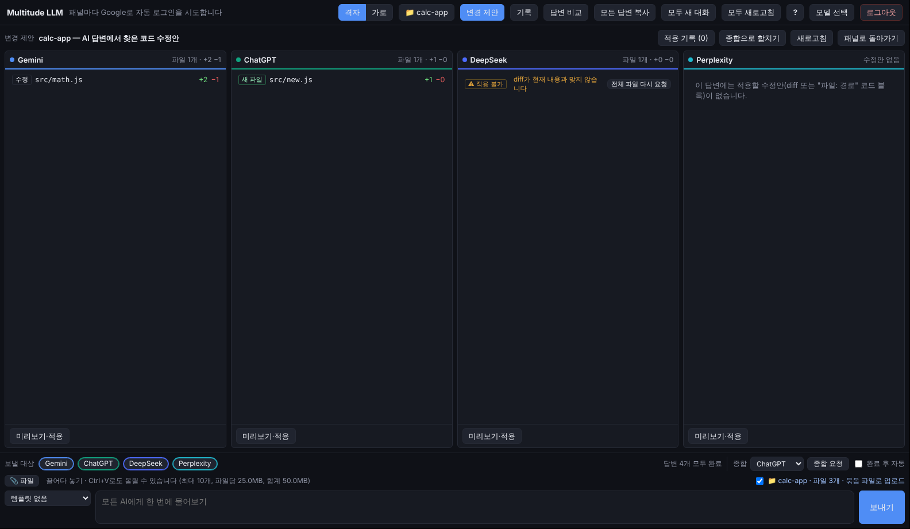

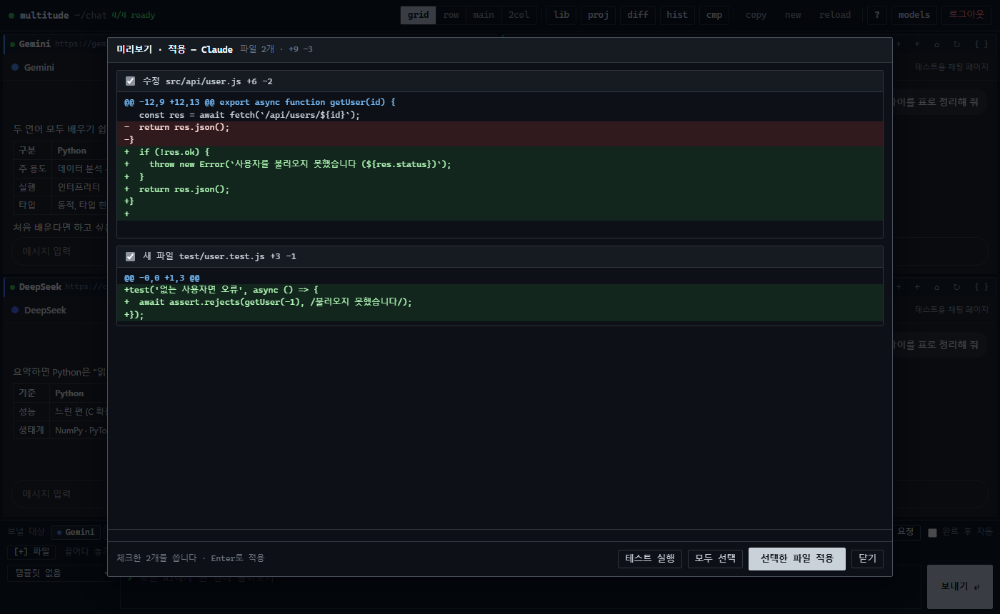

### 10. 크롬 확장 프로그램

같은 화면을 크롬 탭 하나에서 씁니다. 각 서비스는 크롬에 로그인된 계정을 그대로 쓰고, 로그인이 필요한 패널은 머리줄의 **로그인 탭**으로 일반 탭에서 로그인합니다. [설치 방법](chrome-extension.md#크롬-확장-프로그램)

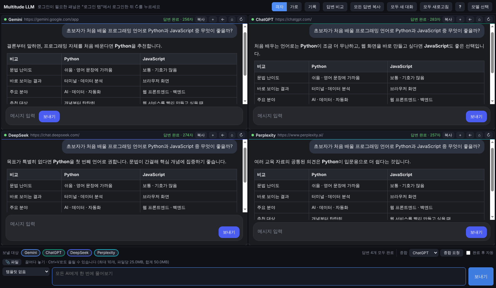

## 기능

- 11개 서비스 중 최대 6개를 골라 질문 동시 전송 (대상 켜기/끄기), 격자·가로·큰 칸·2열 배치, 패널 하나 크게 보기(⤢)
- 프로젝트 모드: 로컬 폴더의 구조·파일을 함께 보내고, AI 수정안을 비교·미리보기·적용·되돌리기 ([자세히](project-mode.md#프로젝트-모드))
- 파일 모아보기: 답변의 파일 코드를 새 파일·수정·삭제로 나눠 모으고 경로·코드·전체 복사 — 프로젝트 없이도 씀 ([자세히](project-mode.md#파일-모아보기))
- 파일 첨부: 공통 입력창에 끌어다 놓기 · Ctrl+V(스크린샷) · **[+] 파일** 버튼 → 보낼 대상 패널마다 첨부해서 보냄 ([자세히](#파일-첨부))
- 답변 완료 감지, 패널별·전체 답변 복사 (Markdown — 표·코드 블록·목록 서식 유지)
- 사이트 셀렉터 원격 갱신: 서비스 화면이 바뀌면 [remote/selectors.json](../remote/README.md)만 고쳐 바로잡음 (6시간마다 확인, 설정에서 끄기 가능)
- 답변 대기 시간 설정(기본 20분, `?` 화면), 기다린 시간 표시, 시간 초과 뒤에도 계속 지켜보다가 늦게 끝나면 완료로 갱신
- 패널별·전체 새 대화, 로그아웃(모든 로그인 정보 삭제)
- 교차검토(종합): 다른 AI 답변을 모아 한 AI에게 비교·정리 요청, 완료 후 자동 종합
- 답변 비교 화면 (차이 강조 · 일치/이견 분석 탭), 질문 템플릿(요약·쉽게 설명·단계별 사고·장단점 비교·팩트 체크·번역·코드 리뷰·코드 수정(파일 모아보기))
- 질문·답변 기록: 자동 저장(최근 500개), 검색, Markdown 복사, 질문 다시 쓰기 — 이 PC의 앱 데이터 폴더에만 저장

## 화면 디자인

v0.19.0부터 Windows 앱 · 크롬 확장 · 사이드탭이 **터미널(CLI) 창 느낌**의 같은 디자인을 씁니다 ([src/renderer/styles.css](../src/renderer/styles.css) 하나, 사이드탭은 [extension/sidepanel.css](../extension/sidepanel.css)를 더함).

| 부분 | 어떻게 보이나 |
|---|---|
| 바탕 · 선 · 글꼴 | 검정 단색 바탕(`#0d1117`), 1px 회색 선, 고정폭 글꼴(Cascadia Mono → D2Coding → Consolas → 맑은 고딕), 각진 모서리(2~4px). 그라데이션 · 빛 번짐 · 흐림 효과 · 그림자는 쓰지 않습니다 |
| 색 | 상태에만 씁니다: 준비 초록 · 답변 중 노랑 · 오류 빨강, 강조는 파랑 하나. 서비스 고유 색은 패널 머리줄 왼쪽 2px 줄과 작은 점에만 |
| 툴바 | `● multitude ~/chat 2/3 ready` — 이름 옆에 지금 화면 경로와 쓸 수 있는(로그인된) 패널 수. 버튼은 짧은 명령어이고 마우스를 올리면 한글 설명이 뜹니다 |
| 버튼 4단계 | **주요**(보내기 · 열기 · 저장 · 적용): 글자색과 바탕을 뒤집은 반전 블록 · **일반**: 1px 테두리 · **보조**: 평소엔 테두리 없음 · **위험**: 빨간 글자. 지금 연 화면의 툴바 버튼도 반전 블록 |
| 입력 · 질문 | 공통 입력창 앞 `❯`, 보내기 `⏎`. 답변 비교 · 기록에서 내 질문은 `❯ 질문` 한 줄, 로컬 LLM 답은 왼쪽 회색 줄 |
| 목록 | 모델 고르기는 `[x] Gemini` / `[ ] ChatGPT` 체크 목록, 사용 순서는 `01 · 02 · 03` 세 칸, 설정 · 분석 제목은 `## 제목` |
| 움직임 | 화면이 켜질 때 0.12초 페이드인과 답변 중 깜빡임만. 움직임 줄이기(`prefers-reduced-motion`)를 켜면 모두 꺼집니다 |

툴바 버튼 이름:

| 버튼 | 하는 일 | 버튼 | 하는 일 |
|---|---|---|---|
| `grid · row · main · 2col` | 패널 배치 (격자 · 가로 · 큰 칸 · 2열) | `copy` | 모든 답변 복사 |
| `lib` | 라이브러리 (내 템플릿 · 스킬) | `new` | 모두 새 대화 |
| `proj` | 프로젝트 (로컬 폴더) | `reload` | 모두 새로고침 |
| `diff` | 변경 제안 | `side` | 사이드탭 열기 (크롬 확장만) |
| `hist` | 질문 · 답변 기록 | `?` | 설정 · 단축키 |
| `cmp` | 답변 비교 | `models` | 모델 다시 고르기 |

패널 안의 AI 웹페이지는 각 서비스 화면 그대로라 이 디자인이 적용되지 않습니다. 툴바(44px) · 공통 입력창(132px) · 패널 머리줄(28px) · 변경 바(33px) 높이는 본체가 웹페이지를 얹는 자리와 맞물려 있어 그대로입니다.

## 라이브러리 (내 템플릿 · 스킬)

툴바의 **lib**(라이브러리, 또는 템플릿·스킬 고르기 목록 맨 아래 "라이브러리 열기")에서 만들고 고칩니다. 이 PC에만 저장됩니다 (Windows 앱: 앱 데이터 폴더 `library.json` / 크롬 확장: 확장 저장소).

### 내 템플릿과 변수

기본 템플릿(`[기본]`)은 그대로 두고 **복제해서 고치기**로 내 템플릿을 만듭니다. ☆로 즐겨찾기하면 템플릿 목록 맨 위에 나옵니다.

| 쓰는 법 | 뜻 |
|---|---|
| `{q}` | 입력창에 쓴 내용 (없으면 맨 뒤에 붙음) |
| `{{언어}}` | 보낼 때 입력받는 칸 |
| `{{관점\|보안}}` | 비워 두면 기본값 `보안` |
| `{{톤:간결,자세히}}` | 고르기 목록 (처음 값이 기본) |
| `{{오늘}}` · `{{프로젝트}}` · `{{선택 파일}}` | 앱이 채움: 오늘 날짜, 열린 프로젝트 이름, 프로젝트에서 고른 파일 목록 |

변수가 있는 템플릿으로 보내면 **변수 입력** 화면이 뜹니다. 칸을 채우면 보낼 글 미리보기가 바로 바뀌고, Enter로 보내고 Esc로 취소합니다 (입력창 내용은 남음). 템플릿마다 마지막에 넣은 값을 기억해 다음에 미리 채웁니다.

### 스킬

스킬은 AI에게 줄 **역할·규칙 지침**입니다. 입력창 위 **skill:** 버튼을 누르면 첨부 줄 자리에 스킬 칩이 펼쳐지고, 눌러서 **최대 3개**까지 켭니다. **켠 순서가 우선순위**입니다 (①②③). 보낼 때 각 패널의 글 앞에 이렇게 붙습니다.

```
### 지침 (스킬 2개 — 위에 있는 것이 우선)
이 대화가 끝날 때까지 아래 지침을 모두 따라 답해 줘. 서로 부딪히면 먼저 나온 지침을 따라. …

#### 1. 코드 리뷰어
(지침 본문)

#### 2. 보안 점검표
(지침 본문)

### 질문

(질문)
```

- **붙이는 때**(라이브러리 스킬 탭)
  - **새 대화 첫 질문에만**(기본): 패널마다 이 대화에 받은 스킬을 기억합니다. 같은 대화에서는 다시 붙이지 않고, 패널의 `+` · `⌂`나 툴바의 `new`(모두 새 대화)를 누르면 다시 붙입니다.
  - 대화 중간에 스킬을 바꾸면 다음 질문에 **바뀐 점만** 붙입니다 ("지금부터 ○○ 지침은 따르지 마" / 새로 켠 지침 본문). 가장 깔끔한 방법은 새 대화를 여는 것입니다.
  - **매 질문마다**: 긴 대화에서 지침을 잊는 경우.
- 라이브러리 스킬 탭 맨 위 **켠 스킬** 묶음에서 ▲▼로 우선순위를 바꾸고 끕니다. 한 번에 붙이는 지침은 합계 **3만 자**까지입니다 (넘으면 보내지 않고 알림).
- **SKILL.md 가져오기**: Claude 스킬과 같은 형식(맨 위 `---` 사이에 `name` · `description`, 아래가 지침 본문)의 `.md` 파일을 여러 개 한 번에 가져옵니다 (파일당 100KB, 본문 2만 자까지). **SKILL.md 내보내기**로 다시 파일로 저장합니다.
- 각 서비스의 계정 설정(Gems · 프로젝트 등)은 건드리지 않고, 질문 글에 넣어 보내는 방식이라 11개 서비스에 똑같이 적용됩니다. 대신 대화가 아주 길어지면 효과가 약해질 수 있습니다.
- 종합 요청 · 요청 파일 보내기에는 붙이지 않습니다.

### 보내는 글 줄이기 (정리 · AI 압축 · 압축 권장 표시)

**규칙 기반 정리 (자동)**: 보낼 때 앱이 주석(`<!-- -->`), 구분선, 굵게 표시(`**`), 연속 빈 줄, 같은 문장 반복을 걷어 냅니다. 코드 블록 안은 그대로입니다. 스킬마다 **예시 절 빼기**를 켜면 "예시 · Example" 제목 아래 절도 뺍니다.

**AI로 압축**: 스킬 편집기의 **AI로 압축** → 맡길 AI(열린 패널)와 목표 길이(기본: 원문의 30%)를 고르고 **압축 요청**을 누릅니다.
1. 앱이 그 패널에서 새 대화를 열고(끌 수 있음) "규칙·조건·금지 사항·출력 형식은 빠뜨리지 말고 N자 이내로" 압축을 요청합니다.
2. 답변이 끝나면 패널 화면의 답변 글(코드 블록 안)을 읽어 **압축본 칸**에 넣습니다. 파일로 내려받지 않습니다.
3. 원문과 나란히 보고 고친 뒤 **저장**하면 그 스킬 항목에 압축본으로 들어갑니다 (원문은 그대로). 이후 보낼 때는 압축본을 씁니다 ("보낼 때: 압축본 / 원문"으로 바꿈).
- 답변을 기다리는 동안 패널로 가서 봐도 됩니다. 답변이 끝나면 압축본 칸에 넣어 두고 입력창 아래에 알립니다 (다시 **AI로 압축**을 누르면 이어서 봄).
- 자동으로 못 가져왔거나 답변을 고쳤으면 **패널에서 다시 읽기**로 그 패널의 최신 답변을 다시 가져옵니다. 직접 복사해 붙여 넣어도 됩니다.
- 압축 요청과 답변은 기록에 남기지 않습니다.
- 원문을 고치면 `⚠ 압축본이 원문보다 오래됨`으로 표시합니다. AI가 규칙을 빠뜨렸을 수 있으니 저장 전에 꼭 확인하세요.

**압축 권장 표시** (보내는 글 기준 — 정리 후, 압축본이 있으면 압축본)

| 기준 | 표시 |
|---|---|
| 스킬 하나 2,000자 이상 | 글자 수만 |
| 스킬 하나 **5,000자 이상** | `[!]` 압축 권장 (목록 · 편집기 · 스킬 칩) |
| 스킬 하나 **10,000자 이상** | `[!!]` 압축 강력 권장 + 켤 때 한 번 확인 (확인하면 그 스킬은 다시 묻지 않음) |
| 켠 스킬 합계 **8,000자 이상** | `skill:` 버튼에 `[!]` |
| 켠 스킬 합계 **15,000자 이상** | 보내기 전에 한 번 확인 (압축본이 없는 스킬과 길이를 보여 줌, 그 실행 동안 다시 묻지 않음) |
| 합계 30,000자 초과 | 보내지 않음 |

- "매 질문마다"면 기준을 0.6배(스킬 하나 3,000자 · 합계 5,000자)로 낮춥니다.
- 기준값은 라이브러리 스킬 탭 위 **압축 권장: 스킬 하나 / 합계**에서 바꿉니다. 스킬마다 **압축 권장 알림 끄기**도 있습니다.

### 내보내기 · 가져오기

**내보내기**는 내 템플릿과 스킬을 `.json` 파일 하나로 저장합니다 (변수 마지막 값 · 고른 스킬은 넣지 않음). **가져오기**는 그 파일의 항목을 지금 것에 더합니다.
템플릿·스킬은 질문과 함께 AI 서비스로 보내지므로, 저장·가져오기 때 비밀 정보로 보이는 문자열이 있으면 확인을 묻습니다. 남이 준 파일은 내용을 확인하고 가져오세요 (지침에 엉뚱한 지시가 들어 있을 수 있음).

## 파일 첨부

공통 입력창에 이미지·문서·파일을 올리면 보낼 대상 패널마다 첨부한 뒤 질문을 보냅니다. 글 없이 파일만 보낼 수도 있습니다.

- 올리는 방법: 입력창 쪽으로 **끌어다 놓기**, 입력창에서 **Ctrl+V**(스크린샷·복사한 파일), **[+] 파일** 버튼
  (서비스 패널 위에 끌어다 놓으면 그 사이트에만 올라갑니다)
- 한도: 최대 **10개**, 파일당 **25MB**, 합계 **50MB**. 넘는 파일은 올릴 때 바로 빼고 이유를 보여 줍니다. 실제 한도는 각 서비스 제한도 따릅니다.
- 사이트마다 사람이 하는 방법(붙여넣기 → 파일 선택 칸 → 끌어다 놓기)을 차례로 시도합니다. Windows 앱은 그래도 안 되면 크롬 개발자 프로토콜로 파일 선택 칸에 직접 넣습니다.
- 첨부에 실패한 패널은 **글만 보내고** 패널 머리줄에 `[+] 첨부 없이 보냄`을 표시합니다 (마우스를 올리면 이유).
  받지 않는 종류(예: Duck.ai의 문서)는 빼고 보내며 `[+] 일부 파일은 빼고 보냄`으로 알립니다. 올릴 때 미리 알려 줍니다.
- 기록에는 첨부 파일의 이름·크기만 남고 내용은 저장하지 않습니다. 종합 요청에는 첨부를 다시 보내지 않습니다.

## 셀렉터 자가진단

AI 사이트가 화면을 바꾸면 앱이 입력창 · 보내기 버튼 · 답변 영역을 못 찾을 수 있습니다. v0.12.0부터 패널마다 이것을 기록해 알려 줍니다 (Windows 앱 · 크롬 확장).

| 항목 | 언제 확인하나 | 못 찾았을 때 |
|---|---|---|
| 입력창 | 로그인된 페이지가 열린 뒤(30초에 한 번까지), 질문을 보낼 때 | 보낼 때 못 찾으면 ✕ 못 찾음. 페이지를 살펴보기만 했을 때는 △ 주의까지 (오류 페이지 · 점검 안내 · 팝업처럼 셀렉터와 상관없이 안 보일 때가 많아서, v0.12.1). 페이지 불러오기에 실패한 패널은 살펴보지 않음 |
| 보내기 버튼 | 질문을 보낼 때 | 버튼 대신 Enter 키로 보냈으면 △ 주의 (보내기는 됨) |
| 답변 영역 | 답변을 기다린 뒤 | 보냈는데 답변이 잡히지 않은 일이 **2번 연달아** 있으면 ✕ 못 찾음 (한 번은 △) |

- ✕가 하나라도 있으면 패널 머리줄에 **⚠ 화면이 바뀐 것 같음**이 뜹니다. 마우스를 올리면 무엇을 못 찾았는지와 안내(① ⌂로 처음 화면 ② 설정의 **사이트 셀렉터 자동 갱신 › 지금 확인** ③ 계속되면 패널에서 직접 입력하고 앱 업데이트 기다리기)가 보이고, 누르면 설정 화면으로 갑니다.
- 설정(`?`) 화면의 **서비스 화면 상태** 표에서 열린 패널마다 ✓ 찾음 · △ 다른 방법으로 됨 · ✕ 못 찾음 · – 확인 전을 봅니다.
- 원격 셀렉터를 새 버전으로 받으면 기록을 지우고 다시 확인합니다. 시간 초과는 셀렉터 문제로 보지 않습니다.
- 기록은 앱을 켜 둔 동안만 메모리에 있습니다.

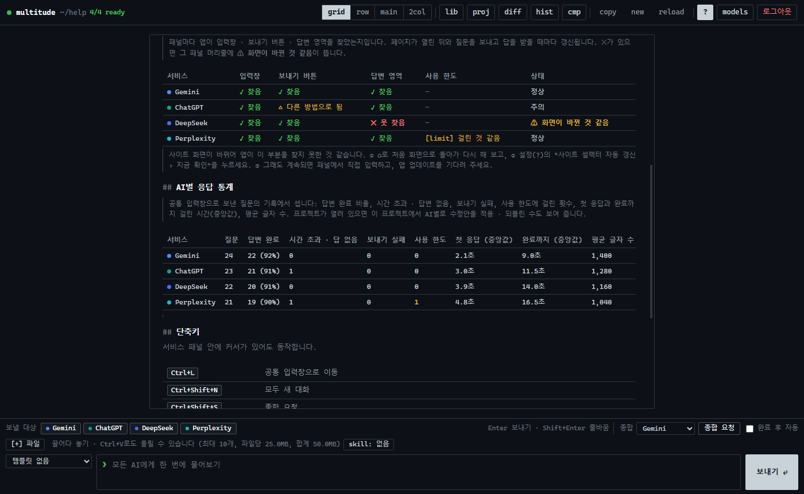

## 응답 통계

v0.13.0부터 공통 입력창으로 보낸 질문의 답변마다 **숫자만** 기록에 함께 남기고, 설정(`?`) 화면의 **AI별 응답 통계** 표로 보여 줍니다 (Windows 앱 · 크롬 확장).

| 열 | 뜻 |
|---|---|
| 질문 · 답변 완료 | 그 AI에 보낸 질문 수와 답변이 끝난 수(비율) |
| 시간 초과 · 답 없음 | 정한 시간 안에 끝나지 않았거나, 보낸 뒤 답변이 시작되지 않은 수 (마우스를 올리면 나눠서) |
| 보내기 실패 | 입력창을 못 찾는 등 보내지 못한 수 |
| 사용 한도 | 한도 안내 문구를 찾은 수 (아래) |
| 첫 응답 · 완료까지 | 보낸 뒤 답변이 시작될 때까지 · 끝날 때까지 걸린 시간의 **중앙값** |
| 평균 글자 수 | 끝난 답변의 평균 글자 수 |
| 수정안 적용 · 되돌림 | 프로젝트가 열려 있을 때, 이 프로젝트의 적용 기록에서 AI별로 센 적용 수 · 그중 되돌린 수 |

- **정확도는 재지 않습니다.** 맞는 답인지는 앱이 알 수 없어서, 사실인 숫자(보내기 · 완료 · 시간 · 글자 수)만 셉니다.
- 통계는 기록(최근 500개)에서 계산합니다. **기록을 지우면 통계도 함께 지워지고**, 이 PC에만 있습니다. 답변 글은 원래 기록에 있던 것 외에 더 남기지 않습니다 (한도 안내 문구도 "걸렸는지"만).
- v0.13.0 이전 기록에는 시간 정보가 없어 `–`로 나옵니다.

### 사용 한도 감지

답변이 **끝나지 않았거나**(답변 없음 · 시간 초과 · 보내기 실패) **아주 짧게(400자 미만) 끝났을 때만** 화면 글에서 한도 안내 문구(예: `You've reached your usage limit`, `한도에 도달했습니다`, `요청이 너무 많습니다`)를 찾습니다. 한도에 관한 질문의 긴 정상 답변을 한도로 잘못 보지 않기 위해서입니다.

- 찾으면 그 패널 머리줄에 **[limit] 사용 한도에 걸린 것 같음**(파랑)이 뜨고, 마우스를 올리면 찾은 문구와 안내(잠시 뒤 다시 · 다른 AI 답 쓰기)가 보입니다. 설정의 서비스 화면 상태 표에도 `사용 한도` 열로 나옵니다.
- 그 패널의 다음 답변이 정상으로 끝나면 지웁니다.
- 서비스 문구가 바뀌면 원격 셀렉터의 `limitText`(정규식)로 고칩니다 ([remote/README.md](../remote/README.md)).


## 로컬 LLM 패널

v0.16.0부터 이 PC에서 돌아가는 LLM을 웹 패널과 나란히 씁니다 (**선택 기능**, 기본은 꺼짐).

1. 로컬 LLM 서버를 켭니다: **Ollama**(`ollama serve`, 기본 `http://localhost:11434`) · **LM Studio**(Developer › Start Server, `http://localhost:1234`) · llama.cpp `llama-server` 등 **OpenAI 호환 API**(`/v1/models`, `/v1/chat/completions`)를 주는 서버면 됩니다.
2. 설정(`?`) › **로컬 LLM (선택 기능)** › **로컬 LLM 패널 쓰기**를 켜고, 주소를 확인한 뒤 **연결 확인** → 모델을 고릅니다.
3. **모델 선택**에서 **로컬 LLM**을 다른 AI와 함께 고릅니다 (최대 6개에 포함).

| 항목 | 동작 |
|---|---|
| 대화 | 패널 안에 터미널처럼: 내 질문은 `❯ 질문` 줄, 답은 그 아래 왼쪽 회색 줄이 있는 칸(제목 · 목록 · 표 · 코드 블록). 답이 오는 대로 이어 그립니다(스트리밍). 앞 대화(최근 40개 메시지)를 함께 보냅니다 |
| 머리줄 | 모델 고르기 · **모델 목록**(다시 받기), **＋** 새 대화(대화 지우기), **■** 답 그만 받기. 뒤로 · 새로고침 같은 웹페이지 버튼은 없습니다 |
| 다른 기능 | 공통 입력창 동시 질문, 종합 · 분석(판정 AI로 골라도 됨), 답변 비교 · 차이 강조, 기록, 응답 통계(사용 한도 감지는 없음), 내보내기 — 웹 패널과 같습니다. 셀렉터 자가진단은 쓰지 않습니다 |
| 첨부 | **이미지만** 보냅니다(비전 모델일 때). 문서는 보내지 않고, 프로젝트 모드의 파일 내용은 **본문으로** 보냅니다 |
| 대화 보관 | 앱을 닫으면 패널의 대화는 사라집니다. 질문 · 답변은 기록에 남습니다 |

- **이 PC 밖으로 나가지 않습니다**: 주소는 `localhost` · `127.0.0.1` · `[::1]`의 http(s)만 받고(경로 · 계정이 붙은 주소, 다른 PC 주소는 거부), API 키를 받지 않습니다. 그래서 프로젝트 파일을 로컬 LLM에 보낼 때는 "회사 서버에 올린다"는 확인을 묻지 않습니다.
- **크롬 확장**: 켤 때 크롬이 이 PC 주소(`http://localhost/*`, `http://127.0.0.1/*`) 접근 허용을 한 번 묻습니다 (선택 권한 — 설치 · 업데이트 때는 묻지 않음). Ollama는 확장 프로그램에서 오는 요청을 막으므로 **`OLLAMA_ORIGINS=chrome-extension://*`** 환경 변수를 넣고 Ollama를 다시 켜야 합니다 (Windows: 시스템 환경 변수에 추가 → Ollama 종료 후 다시 실행). Windows 앱은 이 설정이 필요 없습니다.
- 끄면 열린 로컬 패널을 닫고 고른 목록 · 종합 담당에서도 뺍니다.

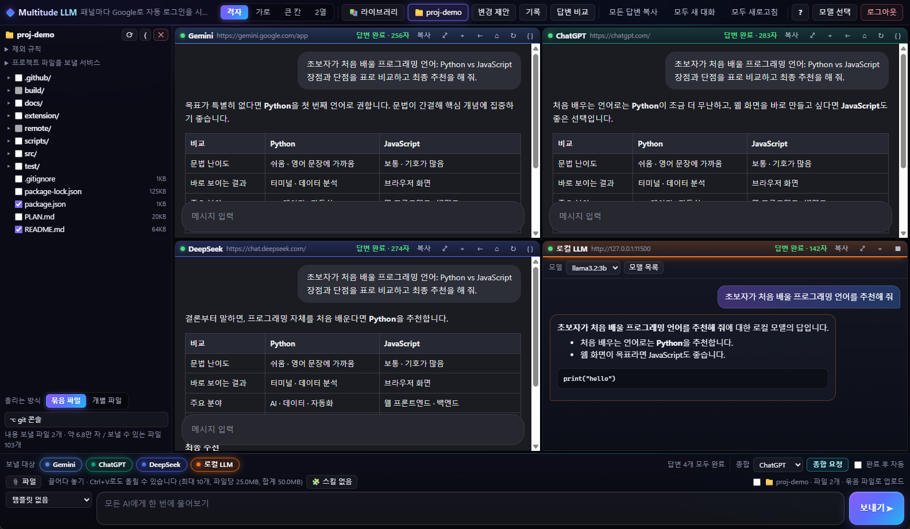

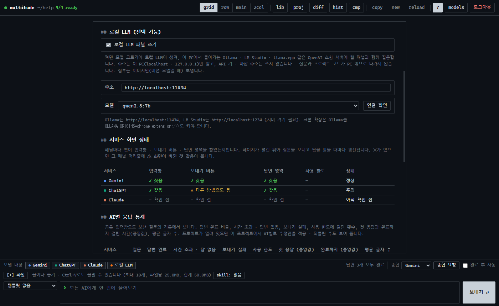

## 내보내기

v0.14.0부터 질문과 답변을 파일로 저장합니다.

| 어디서 | 담기는 것 |
|---|---|
| **기록** 화면 › 고른 기록의 **MD 저장** · **HTML 저장** | 그 질문, 첨부 파일 이름, AI별 답변, 종합 결과, 마지막 분석 |
| **답변 비교** 화면 위쪽 **MD 저장** · **HTML 저장** | 지금 질문, 열린 패널의 최신 답변, 이번 질문의 분석 |

- **Markdown(.md)**: 메모 앱 · 문서에 그대로 붙여 넣기 좋게. 분석은 판정 AI가 답한 형식 그대로.
- **HTML(.html)**: 브라우저로 열면 밝은 보고서 모양입니다. 분석은 **이견 표**(쟁점 · AI별 입장 · 판단) · 공통 의견 · 근거 부족 · 최종 답변으로, 답변의 제목 · 목록 · 표 · 코드 블록은 살립니다. **인쇄(Ctrl+P) › PDF로 저장**하면 PDF가 됩니다.
- HTML 파일 하나로 완결됩니다 — 바깥 글꼴 · 그림 · 스크립트를 쓰지 않고, 답변 속 태그(`<script>` 등)는 모두 글자로 바꿔 넣으며, 스크립트를 막는 보안 설정(CSP)을 넣습니다.
- 파일 이름은 `날짜 질문 앞부분.md`처럼 정해 두고, 바꿀 수 있습니다.
- 저장 방법: Windows 앱은 저장 창(처음 위치는 다운로드 폴더), 크롬 확장은 크롬의 다운로드로 받습니다 (다운로드 권한을 더 받지 않음).

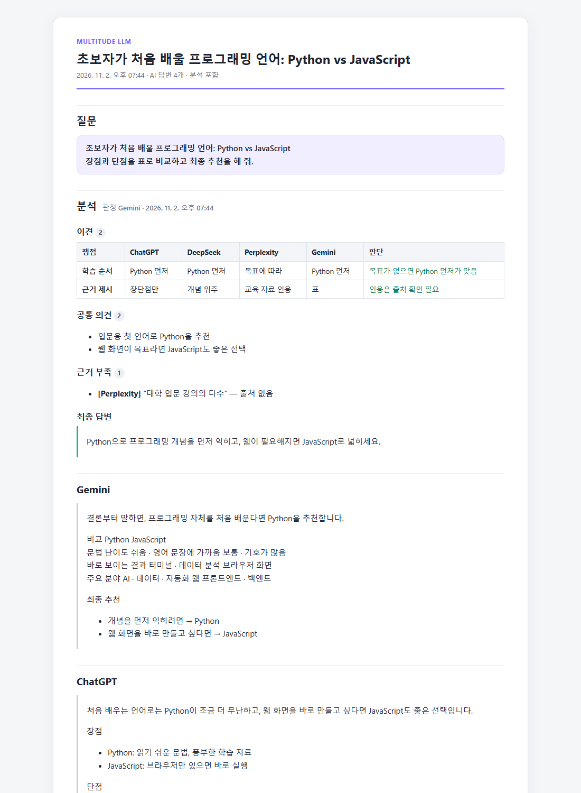

## 단축키

서비스 패널 안에 커서가 있어도 동작합니다. 앱에서 `Ctrl+/`로 전체 목록을 볼 수 있습니다.

| 키 | 동작 |
|---|---|
| `Ctrl+L` | 공통 입력창으로 이동 |
| `Ctrl+Shift+N` (확장 프로그램: `Alt+Shift+N`) | 모두 새 대화 |
| `Ctrl+Shift+S` | 종합 요청 |
| `Ctrl+Shift+C` | 모든 답변 복사 (Markdown) |
| `Ctrl+Shift+R` | 모두 새로고침 |
| `Ctrl+Shift+D` / `Ctrl+H` | 답변 비교 / 기록 화면 |
| `Ctrl+Shift+P` (확장 프로그램: `Alt+Shift+P`) | 변경 제안 화면 (프로젝트 모드) |
| `Ctrl+1~9` (확장 프로그램: `Alt+Shift+1~6`) / `Alt+1~9` | N번째 보낼 대상 켜기·끄기 / N번째 패널로 이동 |
| `Ctrl+/` | 설정 · 단축키 화면 |
| `Esc` | 비교 · 변경 제안 · 파일 편집 · git 콘솔 · 라이브러리 · 기록 · 도움말 화면에서 패널로 돌아가기 (변수 입력은 취소) |
| `Alt+Shift+S` (크롬 확장) | 사이드탭 열기 · 지금 페이지 가져오기 ([사이드탭](chrome-extension.md#사이드탭-크롬-확장)) |

