# 사용 안내

[← README](../README.md)

## 한눈에 보기

> 스크린샷의 패널 안은 실제 서비스 화면이 아니라 **테스트용 채팅 페이지와 예시 답변**입니다. 앱 화면(툴바·패널 머리줄·공통 입력창·비교·기록·설정)은 실제 앱 그대로입니다.
> 실제로는 각 패널에 해당 서비스의 웹 채팅이 그대로 열립니다.
> 스크린샷은 `npm run screenshots`(v0.20.1)로 찍은 지금 화면입니다. 9 · 10번(프로젝트 모드)과 크롬 확장 화면은 예전 디자인이며, 기능은 같고 색 · 버튼 이름만 다릅니다 — 지금 버튼 이름은 [화면 디자인](#화면-디자인)의 표를 보세요.

### 1. 모델 고르기

위쪽 `01 · 02 · 03` 세 칸(모델 고르기 → 한 번에 질문 → 비교·종합)으로 쓰는 순서를 보여 주고, 아래 `[x] Gemini` 체크 목록(2열)에서 쓸 모델을 11개 중 최대 6개까지 고릅니다. 6개를 고르면 나머지는 선택이 막히고 "6 / 6 선택"이 표시됩니다 (5개부터는 메모리 안내가 붙음). 고른 모델만 패널로 열리고, Windows 앱은 각 서비스에 "Google로 계속하기"로 자동 로그인합니다.

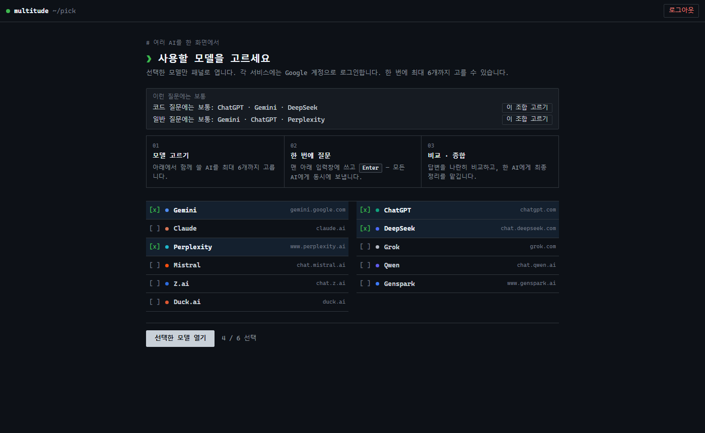

### 2. 한 번에 질문하기

아래 공통 입력창에 쓰면 켜 둔 AI 모두에게 동시에 보냅니다. 왼쪽 아래 **템플릿**(예: 장단점 비교, 또는 변수가 있는 내 템플릿)을 고르면 질문을 자동으로 감싸 주고, 위의 **skill:** 버튼으로 스킬(최대 3개)을 켜면 지침을 붙여 보냅니다 ([라이브러리](#라이브러리-내-템플릿--스킬)). 패널마다 "답변 중… → 답변 완료 · N자"가 표시됩니다. 툴바의 **grid · row · main · 2col**(격자 · 가로 · 큰 칸 · 2열)로 배치를 바꾸고, 패널 머리줄 **⤢**로 한 패널만 크게 봅니다.

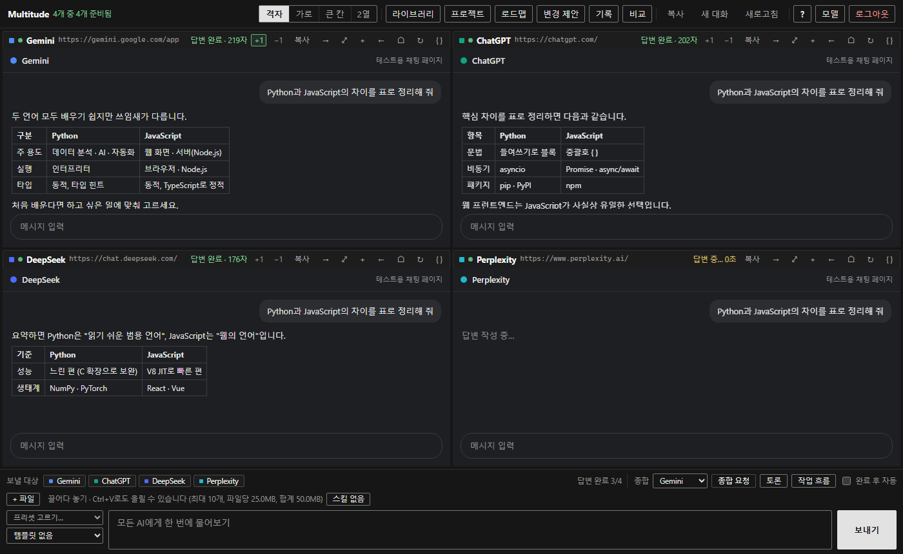

**보내기 전 미리보기 (v0.25.0)**: **보내기**를 Shift+클릭하거나 입력창에서 **Ctrl+Shift+Enter**를 누르면, 보내기 전에 AI마다 실제로 들어갈 글(스킬 지침 + 프로젝트 맥락 + 질문) · 직접 올린 첨부 · 프로젝트 파일 업로드 · 글자 수를 보여 줍니다. 받지 않는 파일 종류, 서비스 한도보다 큰 파일, 아주 긴 글(10만 자 넘음)은 노란 경고로 알립니다. **보내기**를 누르면 보여 준 그대로 보내고, **취소**하면 보내지 않고 입력 내용을 남깁니다. 매번 보려면 설정(`?`) › **보내기 전 미리보기**를 켭니다 (기본 꺼짐).

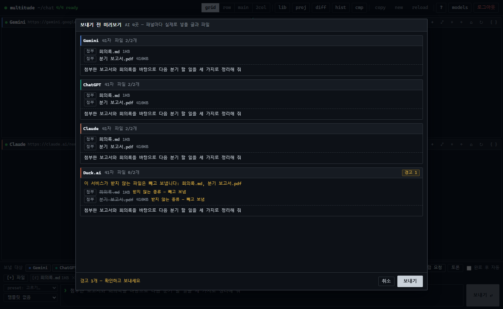

**알림 (v0.25.0)**: 다른 창을 보고 있는 동안 답변이 모두 끝나면(예: `답변 4개 완료 (시간 초과 1)`) Windows · 크롬 알림이 뜹니다. 사용 한도에 걸렸을 때, 보내기에 실패했을 때, 종합 · 분석이 끝났을 때도 알립니다. 앱 창(확장은 앱 탭)을 보고 있으면 띄우지 않고, 알림에는 질문 · 답변 글 없이 개수와 서비스 이름만 들어갑니다. 알림을 누르면 앱으로 돌아갑니다(분석이 끝났으면 답변 비교 화면). 종류마다 설정(`?`) › **알림**에서 끌 수 있습니다.

### 3. 파일 첨부

이미지·문서를 공통 입력창에 **끌어다 놓거나**, **Ctrl+V**로 붙여 넣거나(스크린샷), **[+] 파일** 버튼으로 올리면 보낼 대상 패널마다 첨부해서 보냅니다. 받지 않는 종류가 있는 서비스는 올릴 때 미리 알려 주고(예: "Duck.ai은(는) 문서 빼고 보냄"), 보낸 뒤 패널 머리줄에 `[+] 일부 파일은 빼고 보냄` · `[+] 첨부 없이 보냄`으로 표시합니다. [자세히](#파일-첨부)

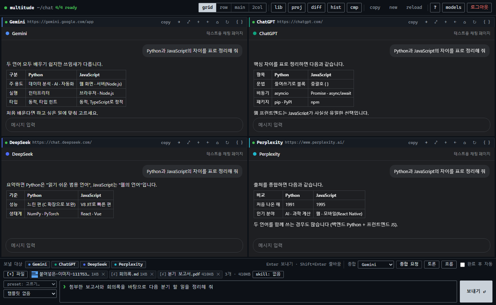

### 4. 교차검토(종합)

**종합 요청**을 누르면 다른 AI들의 답변을 모아, 고른 AI 하나(여기서는 Gemini)에게 오류·빠진 내용·최종 답변을 정리해 달라고 보냅니다. "완료 후 자동"을 켜면 모든 답변이 끝나는 순간 알아서 요청합니다. 종합 요청에는 첨부 파일을 다시 보내지 않습니다.

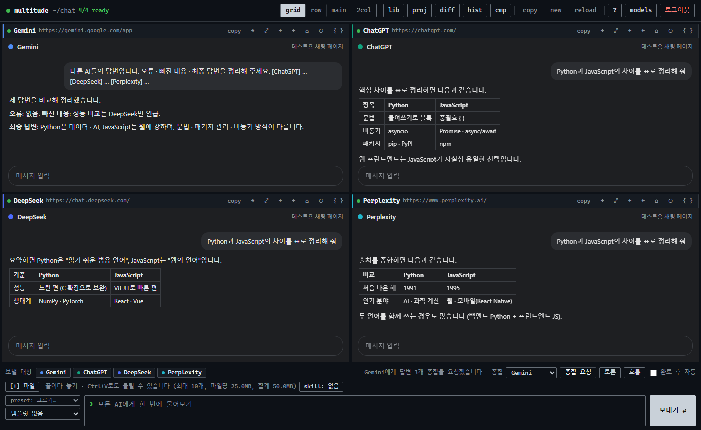

#### AI끼리 넘기기 · 토론 (v0.26.0)

- **넘기기**: 패널 머리줄의 **→** 를 누르면 패널 아래에 `→ 이 답변을 [검토 ▾] → [ChatGPT] [Claude] …` 줄이 뜹니다. 부탁할 일(**검토** 틀린 점 · 빠진 점 찾기 / **반박** 반례 · 다른 관점 / **이어서** 더 깊이 · 다음 단계)을 고르고 받을 AI 이름을 누르면, 원래 질문과 이 패널의 최신 답변을 그 AI에게만 보냅니다. 받은 답은 기록의 **이어 묻기**에 남습니다.
- **토론**: 입력창 아래 종합 옆의 **토론**을 누르면 설정 창이 뜹니다. 참가 AI **2~3개**, 라운드 **1~3**(기본 2), 판정 AI(기본: 종합 담당)를 고르고 **시작**. 라운드마다 참가 AI 모두에게 다른 참가 AI의 최신 답변을 보내 반박 · 보완하게 하고, 끝나면 판정 AI가 **합의한 점 · 남은 이견 · 최종 답변**을 정리합니다. 지금 질문(공통 입력창으로 마지막에 보낸 질문)의 답변으로 시작하므로 먼저 질문을 보내 답을 받아 두세요.
- **역할** (v0.32.0): 참가 AI 이름 옆 고르기에서 **찬성 · 반대 · 반론 전담**을 줄 수 있습니다. 역할을 준 AI는 토론 내내 그 쪽에서 답하고(반론 전담은 자기 결론보다 다른 답의 약점 · 반례를 찾음), 판정 AI에게는 "역할이 있었으니 근거로 판정해 달라"고 알립니다. 역할은 안 줘도 됩니다(없으면 예전과 같음).
- **라운드 사이 끼어들기** (v0.32.0): 설정 창의 **라운드 사이에 내가 한마디 끼워 넣기**를 켜면, 마지막 라운드 전까지 라운드가 끝날 때마다 토론이 멈추고 **끼어들기 창**이 뜹니다. 쓴 말은 **다음 라운드** 요청에만 붙어 참가 AI 모두에게 갑니다 (`끼워 넣고 계속`, 비워 두거나 `그냥 계속`도 됨, `Ctrl+Enter`로 보냄). 창을 `Esc`로 닫아도 토론은 멈춘 채 그대로이며 입력창 아래 **끼어들기** 단추로 다시 엽니다. 끼어든 말은 기록 · MD · HTML에 "내가 끼워 넣은 말"로 그 라운드 앞에 남습니다.
- **토론 틀 저장** (v0.32.0): 참가 AI · 라운드 · 판정 · **역할 · 끼어들기 설정**까지 [작업 프리셋](#작업-프리셋-v0290)에 저장되고, 프리셋을 고르면 토론 창이 그 값으로 열립니다.
- 진행은 입력창 아래에 `토론 1/2라운드 — ChatGPT, Claude 답변을 기다리는 중…`처럼 보이고, **토론 멈추기**로 언제든 끝낼 수 있습니다(이미 받은 라운드는 남음). 끝나면 알림(설정 › 알림 › 종합 · 분석 끝)을 띄웁니다.
- 결과는 **답변 비교 › 이어 묻기 · 토론** 탭과 **기록**(아래 **이어 묻기 · 토론** 줄을 펼침)에 일어난 순서대로 남고, MD · HTML 저장에도 들어갑니다.
- 토론은 라운드마다 참가 AI 수만큼 질문을 더 보냅니다(2라운드 · 3개면 6번 + 판정 1번). 설정 창에 **보낼 횟수**가 보이고(v0.33.0), 사용 한도가 빠듯한 서비스는 라운드를 줄이세요.

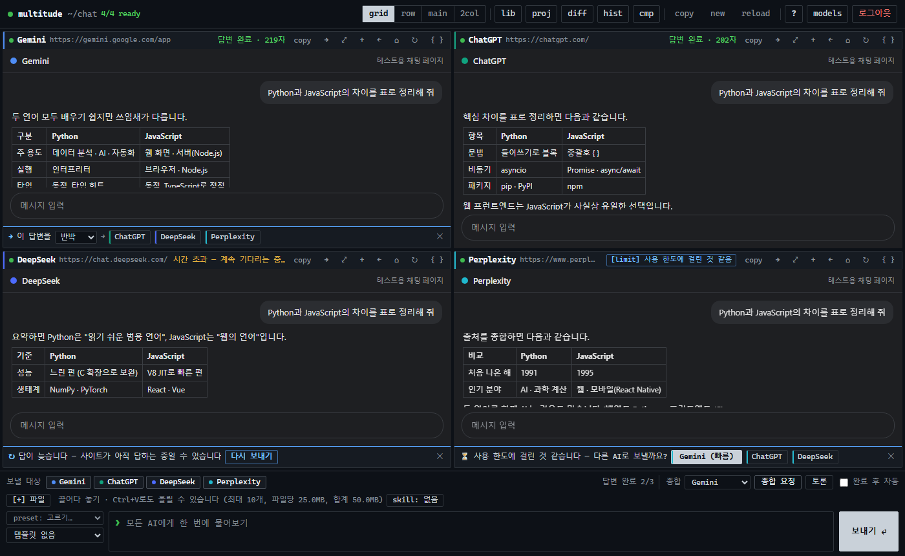

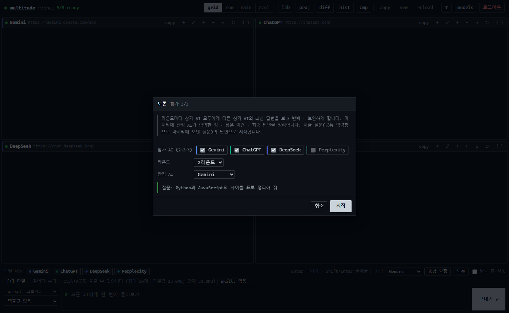

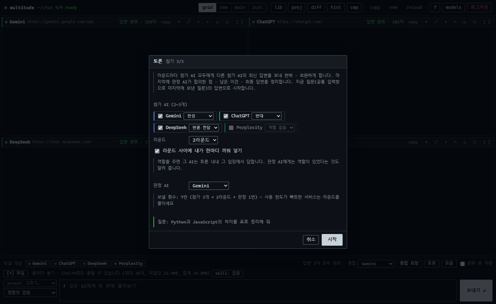

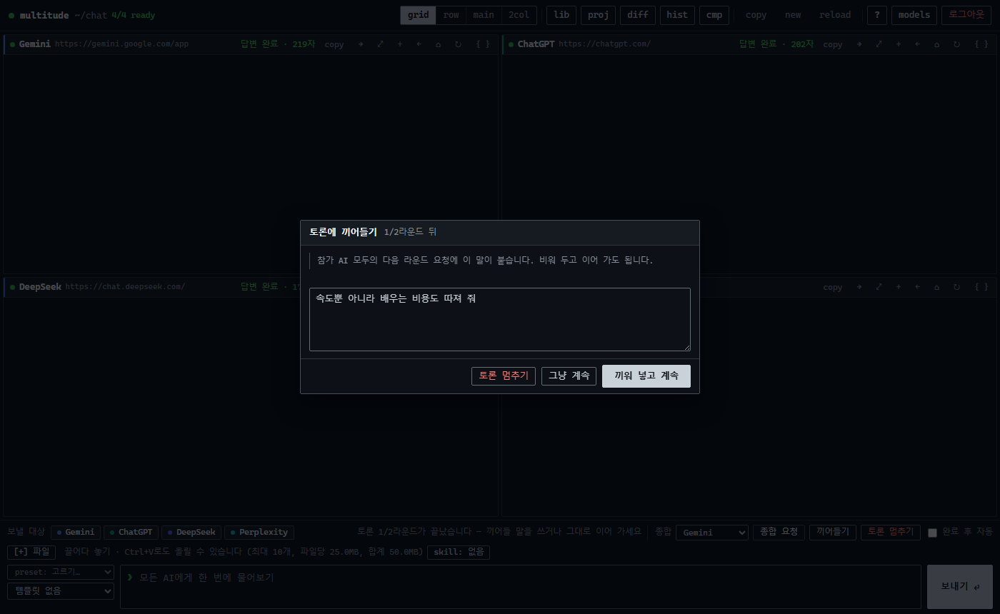

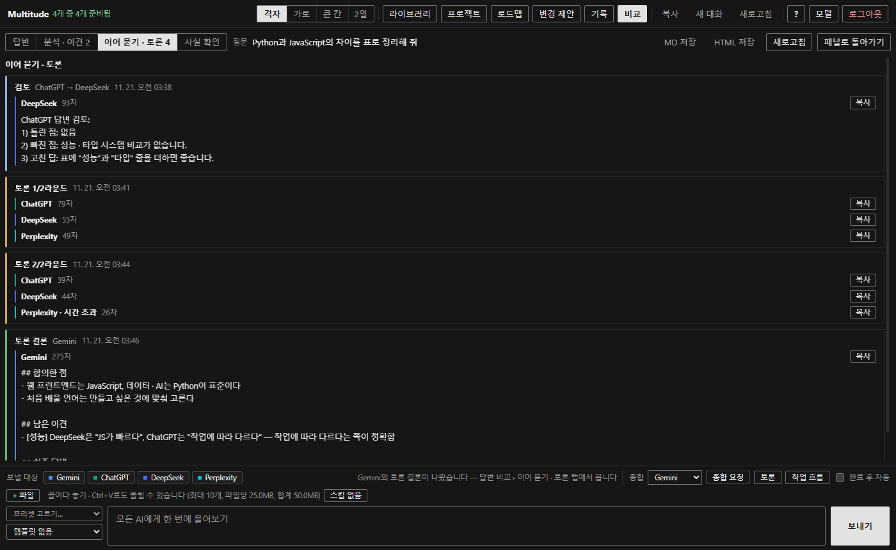

#### 작업 흐름 (v0.33.0)

"A가 초안 → B가 비판 → A가 고쳐 쓰기 → C가 검증"처럼 **정한 순서대로** AI 여러 개에게 차례로 일을 시킵니다. 입력창 아래 `흐름`을 누르면 설정 창이 뜹니다.

- **걸음** 2~6개. 걸음마다 일의 종류와 맡을 AI를 고르고, `예시로 채우기`로 초안 → 비판 → 고쳐 쓰기 → 검증을 한 번에 채웁니다. 같은 AI를 여러 걸음에 써도 됩니다.

  | 일 | 하는 일 | 앞 걸음에서 받는 것 |
  |---|---|---|
  | **초안** | (첫 걸음에만) 그 AI가 이 질문에 이미 답했으면 **그 답을 쓰고 다시 보내지 않음**, 없으면 질문을 보냄 | — |
  | **비판** | 결과물을 검토해 틀린 점 · 빠진 점 · 약한 주장 · 더 나은 답을 달라고 함 (넘기기 › 검토와 같은 글) | 결과물 |
  | **반박** | 반례 · 다른 관점으로 반박하게 함 (넘기기 › 반박) | 결과물 |
  | **고쳐 쓰기** | 결과물과 가장 최근의 지적(비판 · 반박 · 검증)을 주고 반영해 처음부터 끝까지 다시 쓰게 함 | 결과물 + 지적 |
  | **검증** | 맞는지 `검증 결과 · 남은 문제 · 판정(통과 / 수정 필요)` 형식으로 확인하게 함 | 결과물 |
  | **이어서** | 결과물을 이어받아 더 발전시키게 함 (넘기기 › 이어서) | 결과물 |

  "결과물"은 가장 최근의 초안 · 고쳐 쓰기 · 이어서의 답입니다. 규칙: 첫 걸음은 초안, 비판 · 반박 · 검증 · 이어서는 앞에 결과물이, 고쳐 쓰기는 앞에 지적이 있어야 하며, 규칙에 어긋나면 창에서 바로 알려 주고 `시작`을 막습니다.
- **걸음마다 멈춰서 확인하기**: 켜면 걸음이 끝날 때마다 멈추고 입력창 아래에 `다음 걸음` · `다음 걸음 건너뛰기` · `흐름 멈추기`가 나옵니다. 건너뛴 걸음 뒤에도 똑같이 멈춥니다. 꺼 두면 끝까지 이어 갑니다. `흐름 멈추기`는 언제든 됩니다.
- **보낼 횟수**: 창에서 시작 전에 "보낼 횟수: 3번 (ChatGPT 1 · Gemini 1 · DeepSeek 1)"처럼 보여 줍니다 — 초안은 이미 받은 답이 있으면 빼고 셉니다. 무료 사용 한도가 빠듯한 서비스는 걸음을 줄이세요.
- 한 걸음의 답을 받지 못하면(시간 초과 · 답변 없음 · 오류) 흐름을 멈추고, **받은 걸음까지는 기록에 남습니다.** 끝나면 알림(설정 › 알림 › 종합 · 분석 끝)을 띄웁니다.
- 결과는 **답변 비교 › 이어 묻기 · 토론** 탭과 **기록**에 걸음마다 "작업 흐름 2/4 · 비판 → ChatGPT"로 남고 MD · HTML에도 들어갑니다. 순서는 [작업 프리셋](#작업-프리셋-v0290)에 저장됩니다.

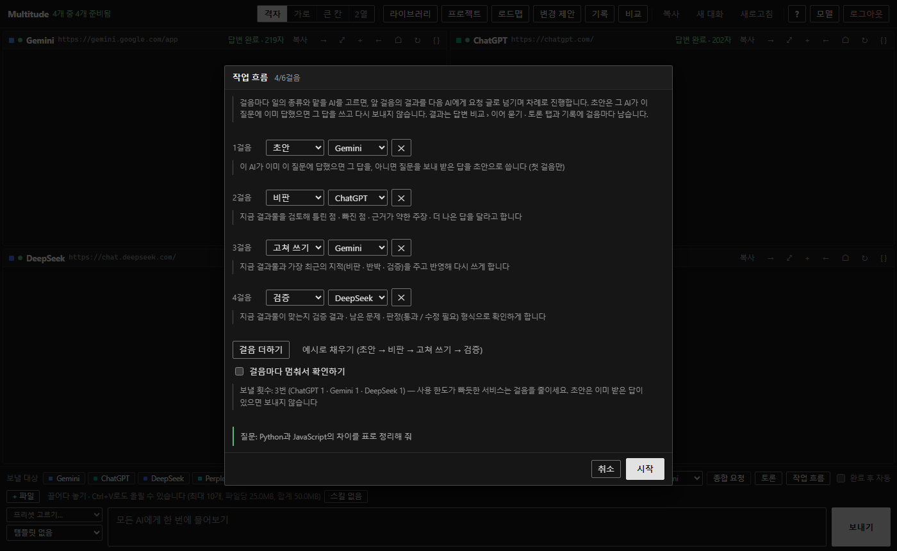

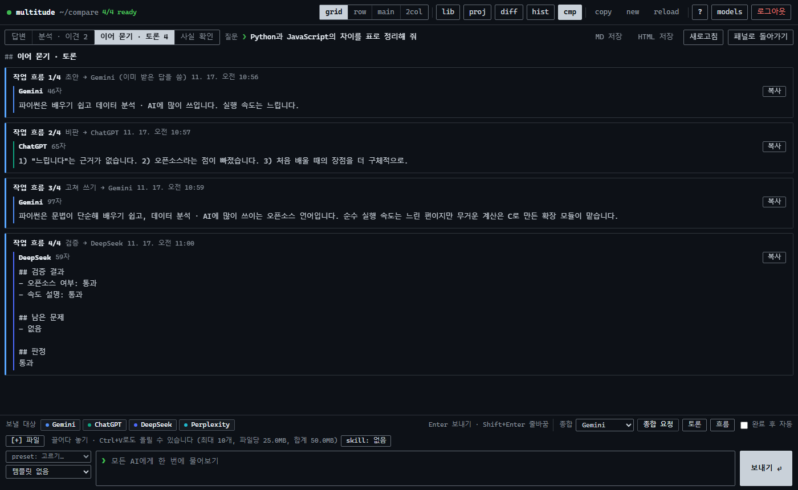

### 5. 답변 비교

**답변 비교**(Ctrl+Shift+D)는 마지막 질문(`❯ 질문` 한 줄)과 각 AI의 최신 답변 칸을 칸별로 나란히 보여 줍니다. 칸마다 Markdown(표·코드 블록 유지)으로 복사할 수 있습니다.

- **차이 강조** (v0.11.0): 위쪽 **차이 강조**를 켜면 기준 답변(처음엔 첫 칸, `기준:` 목록에서 바꿈)에 없는 문장만 노란 형광으로 표시합니다. 칸 머리줄에 `기준` 또는 `새 내용 N%`가 붙습니다. 띄어쓰기·줄바꿈만 다른 문장, 표현만 조금 다른 문장(글자 겹침이 많은 문장)은 같은 것으로 봅니다 — 단 숫자가 다르면(940만 · 950만) 새 내용입니다 (v0.12.1). 다시 누르면 끕니다.
- **분석 탭** (v0.11.0): **분석 요청**을 누르면 입력창 아래 **종합** 목록에서 고른 AI(판정 AI)에게 답변들을 보내고, 정해진 형식으로 답하게 합니다.

  | 칸 | 내용 |
  |---|---|
  | **이견** | 쟁점마다 AI별 입장과 판단을 표로. 칸이나 AI 이름을 누르면 **답변** 탭의 그 AI 칸으로 이동해 잠깐 빛나고, 그 답변에서 쟁점과 가장 관련 있는 문단(표 · 목록은 줄)을 파랗게 강조합니다 (v0.26.0). 이견이 없으면 "이견이 없습니다" |
  | **공통 의견** | 대부분의 AI가 같은 내용 |
  | **출처** (v0.32.0) | 답변 · 분석 글에 나온 링크를 주소별로 모음 (마크다운 링크 · 맨 주소, 끝 문장부호 · `#조각` · `utm_` 값은 뗌). 몇 AI가 같은 링크를 썼는지 이름표로 보이고, 여러 AI가 쓴 링크가 앞. 앱 안에서는 링크를 열지 않고 **복사**만 합니다 |
  | **근거 부족** | 근거 없이 주장했거나 확인이 필요한 내용 (AI 이름 표시) |
  | **최종 답변** | 분석을 반영한 최종 답변 (복사 버튼) |

  **합의율 · 같은 입장 수** (v0.32.0): 분석 머리줄의 `합의율 83%`는 공통 의견 하나를 "모두 같음", 이견 하나를 "입장을 쓴 AI 중 같은 입장인 AI의 비율"로 세어 낸 평균이고, 이견 줄의 `2/4 같음`은 비교한 AI 4개 중 비슷한 입장이 2개라는 뜻입니다 (입장 글이 서로 비슷하면 — 숫자가 같고 글자 · 낱말이 많이 겹치면 — 같은 입장으로 어림함; 뜻을 읽는 것이 아니므로 **어림값**이고, "언급 없음" 칸은 입장으로 세지 않음). 입장 글이 없는 이견(글머리표만)은 알 수 없어 줄 표시가 없고 합의율에서는 0으로 셉니다. 마우스를 올리면 계산이 보입니다.

  판정 AI가 형식을 지키지 않으면 "정해진 형식이 아니라서 글 그대로 보여 줍니다"와 함께 답변 글을 그대로 보여 줍니다. **다시 분석**(다른 판정 AI로도)하면 지난 분석도 남아, 분석이 2개 이상이면 두 분석을 골라 **나란히** 보고 한쪽에만 있는 쟁점에 `이쪽에만` 표시가 붙습니다 (v0.26.0, **하나만 보기**로 최신 분석만). 분석 결과는 질문 기록에 함께 저장되고, **기록** 화면에서도 같은 표로 보입니다 (목록에 `분석 1`). 탭 위치와 차이 강조 켜짐은 다음에도 기억합니다.

- **사실 확인 탭** (v0.33.0): 답에 나온 사실을 AI가 웹 검색으로 확인한 결과입니다. 위쪽에서 **확인할 글**(한 AI의 답 또는 분석의 최종 답변) · **주장을 뽑는 AI**(로컬 LLM도 됨) · **확인하는 AI**(검색형 Perplexity · Genspark 권장)를 고르고 `사실 확인 요청`.
  1. 주장을 뽑는 AI에게 답을 주고 **확인할 수 있는 주장을 최대 10개** 번호 목록으로 받습니다 (숫자 · 날짜 · 이름 · 인과 관계 같은 것만, 의견 · 추천은 뺌).
  2. 확인하는 AI에게 **주장 전체를 한 번에** 묻고 `번호 | 판정 | 근거 · 출처` 표로 받아 주장마다 **확인 · 반박 · 일부 · 출처 없음**으로 보여 줍니다 (반박은 붉게, 일부는 노랗게). 근거에 나온 링크는 `복사`로 가져갑니다 (앱 안에서는 링크를 열지 않음).
  보낼 횟수는 **2번**(추출 1 + 확인 1)이고 시작 전에 보여 줍니다. 판정을 읽지 못한 주장은 따로 알리고, 결과는 질문마다 기록에 남습니다. **AI가 확인한 것이지 보증이 아니니**, 중요한 것은 근거 링크를 직접 열어 확인하세요.

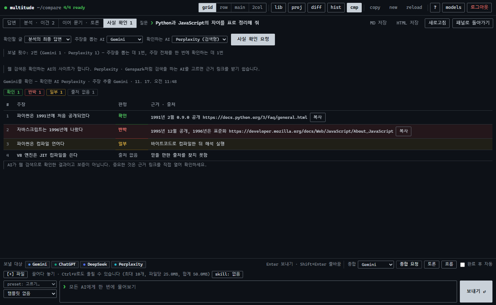

- **보기 방식** (v0.32.0): 위쪽 `보기 방식` 고르기. 답변 글은 그대로고 보여 주는 모양만 바뀝니다. 고른 방식은 기억합니다.
  - **나란히**(기본): 칸마다 답변 전체.
  - **문단 맞추기**: `기준:` 답변의 문단마다 한 줄, 다른 AI의 **비슷한 문단을 같은 줄**에 놓습니다 (낱말 · 글자 겹침으로 어림해 하나씩만 짝지음). 기준에 짝이 없는 문단은 노란 줄(그 AI에만 있음), 짝은 맺었지만 겹침이 적은 문단은 푸른 바탕으로 표시합니다. 표의 줄은 `a · b`로, 구분 줄은 빼서 보입니다.
  - **코드만**: 답변마다 코드 블록만 모아 언어 이름과 함께 보여 줍니다. `차이 강조`를 켜면 `기준:` 답변의 코드에 없는 줄을 강조합니다.
  - **표 비교**: 마크다운 표로 답한 것을 **첫 칸(항목 이름)** 으로 맞춰 칸 단위로 보여 줍니다. 값이 비슷하지 않거나 숫자가 다르면 `다름`, 일부 AI의 표에만 있는 항목은 `일부 답변에 없음`. AI마다 행이 가장 많은 표 하나를 씁니다.

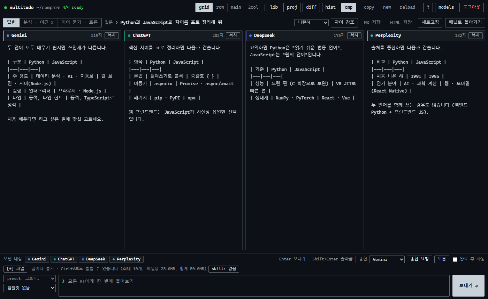

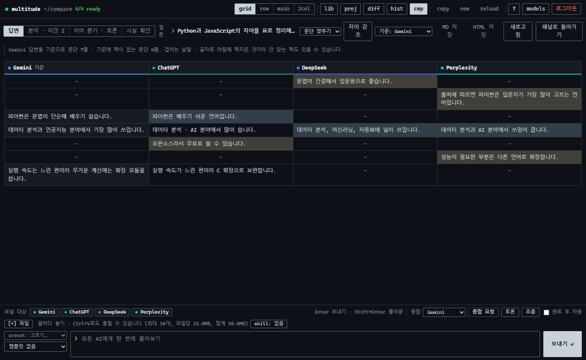

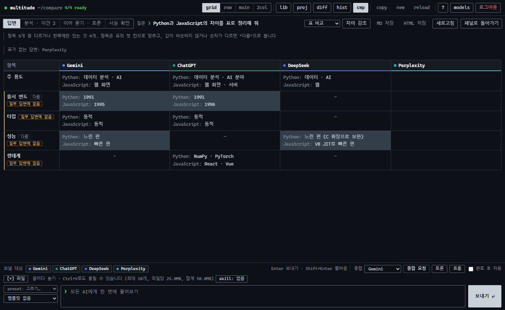

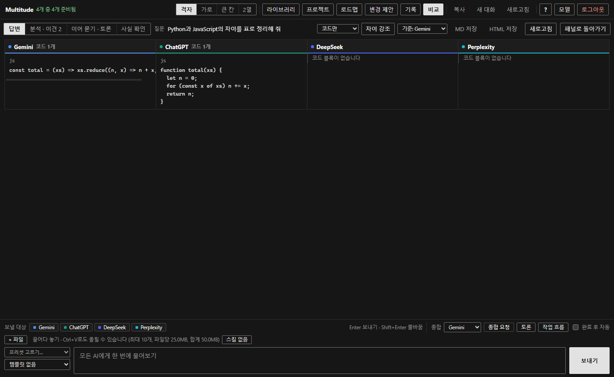

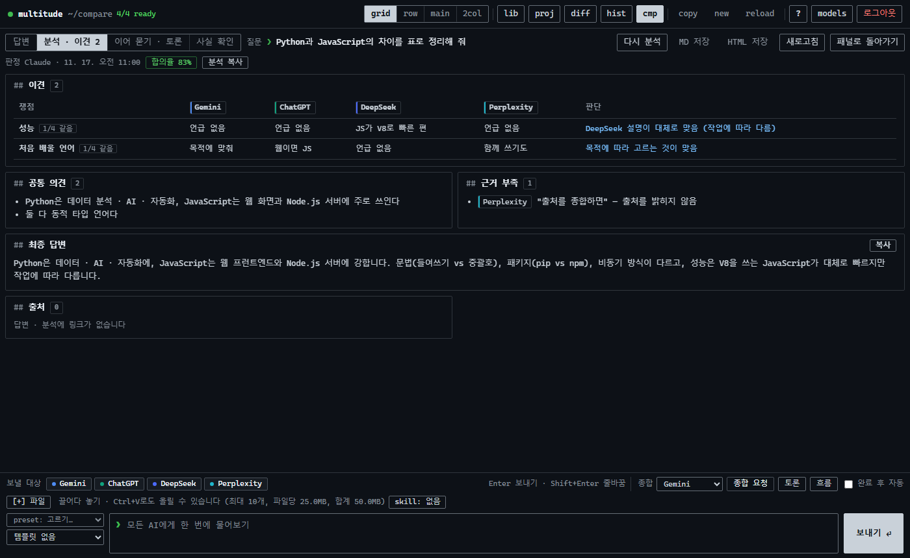

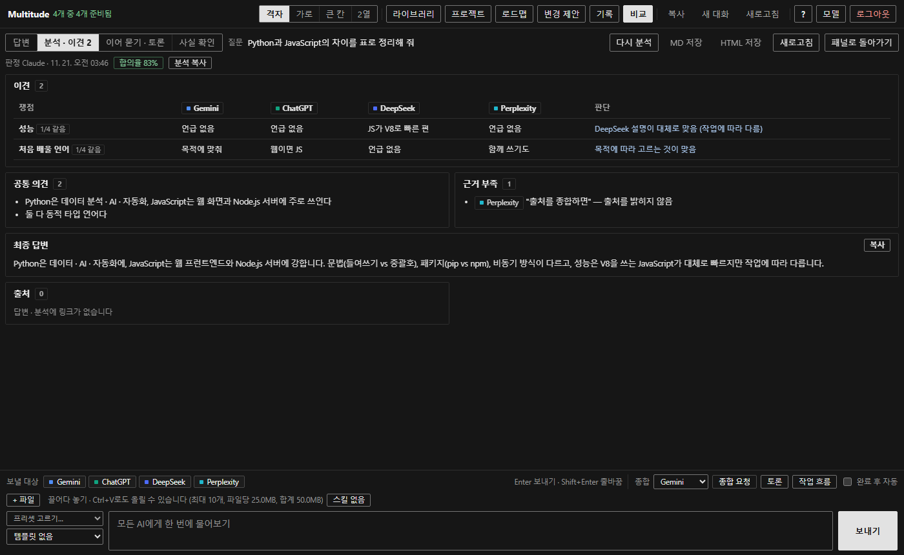

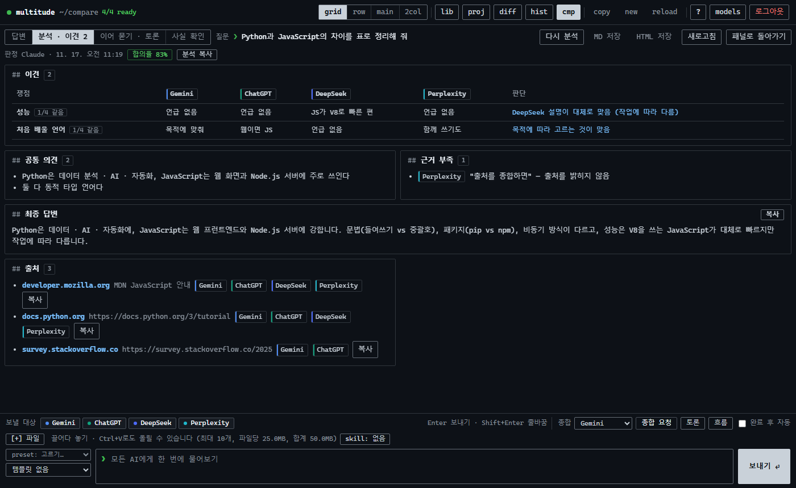

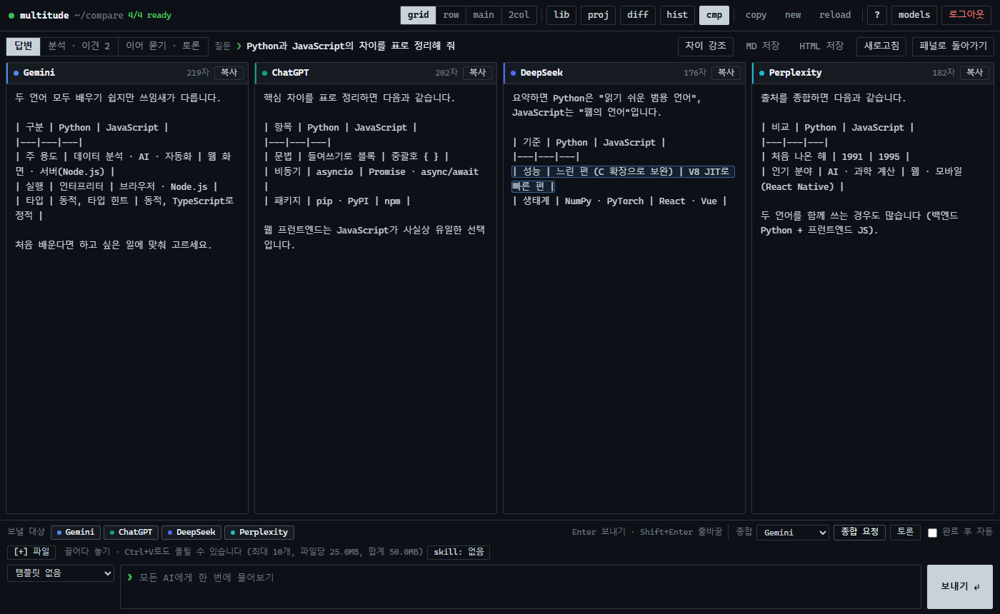

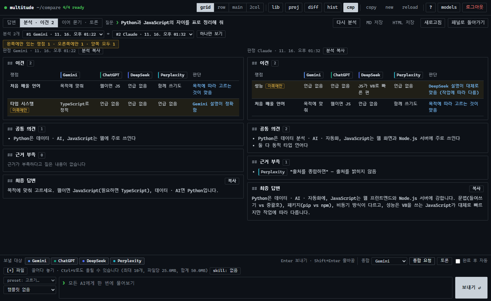

### 6. 기록

**기록**(Ctrl+H)에는 보낸 질문과 각 답변·종합 결과, 첨부한 파일 이름이 저장됩니다(파일 내용은 저장하지 않음). 크롬 확장에서는 사이드탭에서 보낸 질문도 `side` 표시와 함께 나옵니다 (v0.21.0). 검색, Markdown 복사, 질문 다시 쓰기, **MD · HTML 파일로 저장**([내보내기](#내보내기))을 할 수 있습니다. 기록은 이 PC에만 저장됩니다.

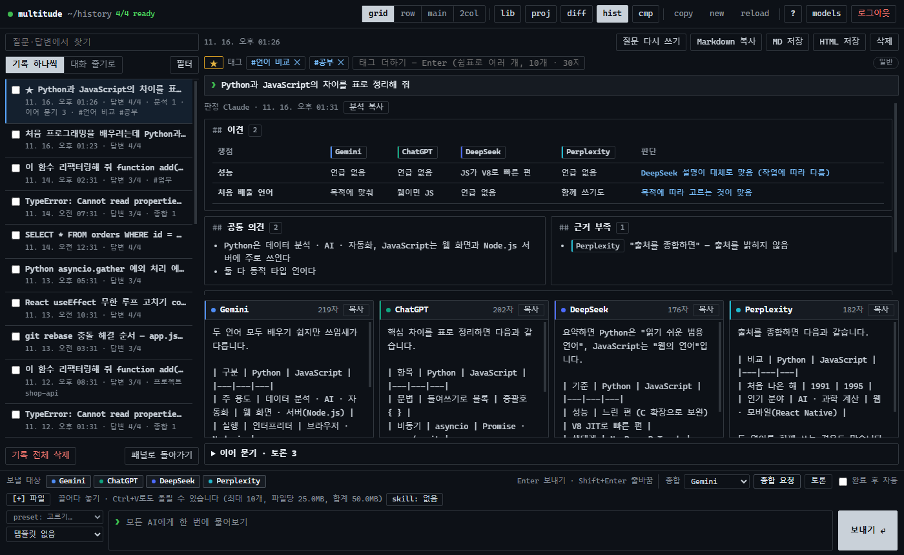

#### 필터 · 태그 · 즐겨찾기 (v0.27.0)

- 검색칸 아래 **필터**를 누르면 거르기 칸이 펼쳐집니다: **기간**(전체 · 오늘 · 7일 · 30일 · 날짜 지정), **평가**(`+1 있음` · `−1 있음` · `평가 없음`), **보낸 곳**(앱 · 사이드탭, 크롬 확장만), **태그**, **AI (하나라도)**, **★ 즐겨찾기** · **프로젝트 포함** · **종합** · **분석** · **이어 묻기 · 토론**. 검색어와 함께 쓰고, 켠 수가 `필터 2`처럼 보입니다. **필터 지우기**로 한 번에 끕니다.
- 기록 상세 위 줄에서 **☆**를 누르면 즐겨찾기(★), **태그 더하기** 칸에 쓰고 Enter(쉼표로 여러 개)면 태그가 붙습니다. `#태그 ✕`로 뺍니다. 태그는 기록 하나에 10개 · 하나 30자까지입니다. 검색은 태그 글도 찾습니다. 사이드탭 기록은 바꿀 수 없습니다.
- 목록 줄 왼쪽 체크 칸으로 기록을 여러 개 고르면 아래에 **MD로 묶어 저장 · HTML로 묶어 저장**이 뜹니다. 고른 기록을 오래된 것부터 번호를 붙여 문서 하나로 저장합니다.

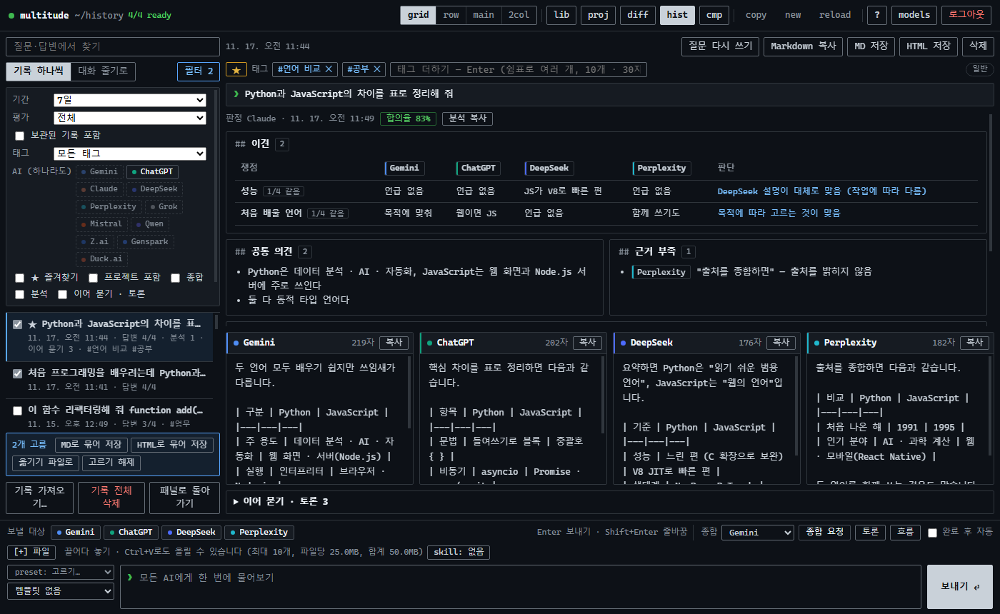

#### 대화 줄기 (v0.27.0)

같은 대화로 이어 보낸 질문은 **대화 줄기**로 묶입니다. 보내는 패널 중 하나라도 지난 질문을 받은 뒤 새 대화를 열지 않았으면(＋ 새 대화 · ⌂ 처음 주소 · 로컬 LLM 대화 지우기 · 패널 닫기 · 로그아웃이 없었으면) 같은 줄기입니다. 기록 화면 위 **대화 줄기로**를 누르면 질문이 2개 이상인 줄기가 한 줄(`대화 줄기 · 질문 3개`)로 묶이고, 누르면 질문을 오래된 것부터 답변과 함께 차례로 보여 줍니다. **줄기 MD 저장 · 줄기 HTML 저장**은 줄기 전체를 문서 하나로, **이 기록만 보기**는 그 질문의 상세로 갑니다.

- 사이트 안에서 직접 "새 채팅"을 누른 것은 앱이 모르므로 줄기가 이어져 보일 수 있습니다. v0.27.0 전 기록은 줄기 정보가 없어 하나씩 나옵니다.

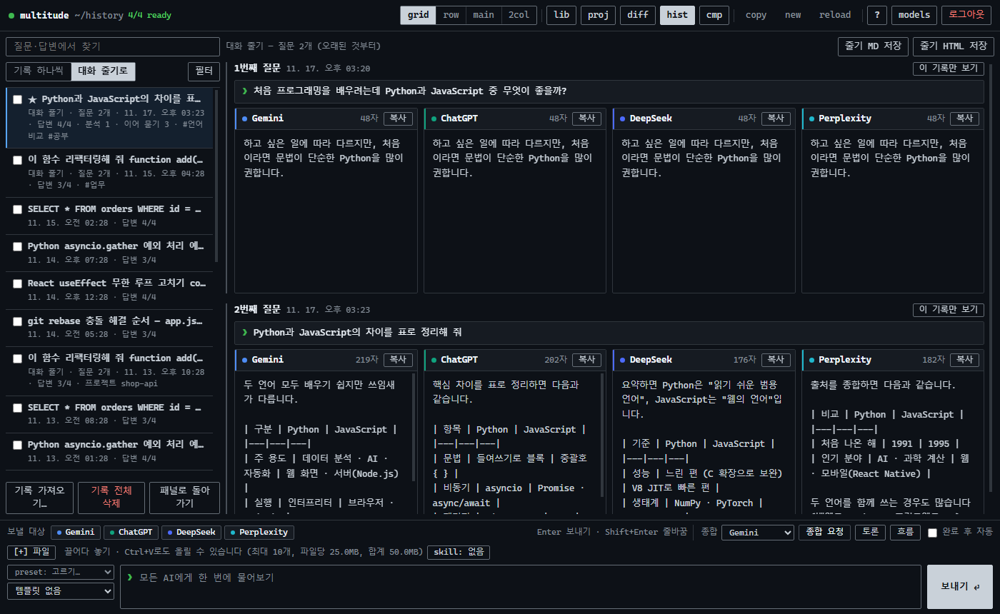

#### 기록 보관 · 기록 옮기기 (v0.35.0)

- **기록 보관**: 설정(`?`) › 기록 최대 개수 아래 **넘친 기록은 지우지 않고 보관 파일로 옮기기**(기본 끔)를 켜면, 최대 개수를 넘은 가장 오래된 기록이 달별 보관 파일로 갑니다 (Windows 앱: 사용자 데이터 폴더의 `history-archive/archive-YYYY-MM.json`, 암호화 · 크롬 확장: 확장 저장소의 `history:a:YYYY-MM`). 기록 화면 **필터 › 보관된 기록 포함**을 켜면 함께 찾고, 목록에 `보관됨`이 붙습니다. 보관된 기록은 보기 · 지우기만 됩니다(별표 · 태그는 바꾸지 않음). **기록 전체 삭제**는 보관된 기록도 같이 지우고, 응답 통계 · 추천은 보관 기록을 세지 않습니다. 한 달 묶음은 3000개까지 둡니다.
- **기록 옮기기**: 목록 왼쪽 체크 칸으로 기록을 고르면 아래 줄의 **옮기기 파일로** → 비밀번호(선택, 8자 이상, 두 번) → `.mla-history.json` 저장. 다른 PC · Windows 앱 ↔ 크롬 확장의 기록 화면 아래 **기록 가져오기…**로 파일을 고르면(암호화됐으면 비밀번호) "기록 N개, 이미 있는 M개는 건너뜁니다"를 보여 주고 **가져오기**를 눌러야 더합니다. 설정 옮기기(`.mla.json`)와 **다른 파일**이고 — 설정 파일에는 기록을 넣지 않습니다 — 누를 때만 만들어집니다. 사이드탭 기록은 옮기지 않습니다. 파일에는 질문 · 답변 글이 그대로 들어가니 비밀번호를 거는 것을 권합니다. 최대 개수를 넘으면 가장 오래된 것부터 보관(켜 둔 경우) 또는 삭제됩니다. 한 파일에 2000개 · 18MB쯤까지.

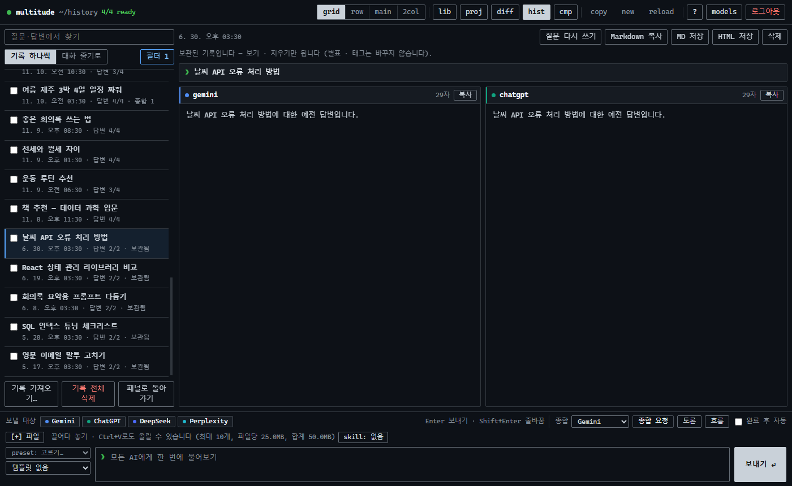

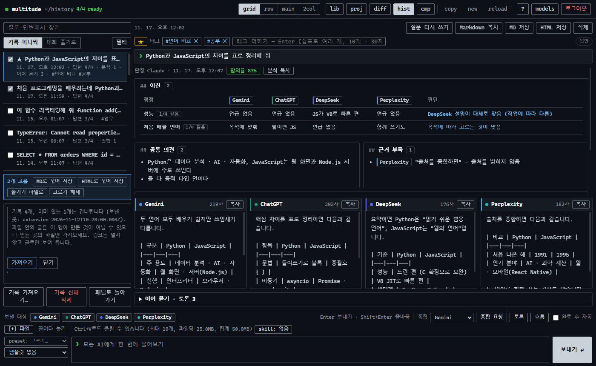

### 첫 사용 안내 (v0.31.0)

새로 설치하고 처음 패널 화면에 들어오면 **처음 사용 안내** 창이 한 번 뜹니다 — ① 한 번에 묻기 ② 답 비교하기 ③ 종합 · 넘기기 · 토론 ④ 더 해 볼 것(lib · proj · hist · ?). `다음` · `이전`(또는 `←` `→`)으로 넘기고, `건너뛰기` · `Esc` · 끝의 `시작하기`로 닫으면 다시 뜨지 않습니다. 설정(`?`) 맨 아래 **처음 사용 안내 › 다시 보기**로 다시 볼 수 있습니다. 예전 버전부터 쓰던 사람(저장된 설정이 있음)에게는 띄우지 않습니다. 설정 옮기기 파일에는 넣지 않습니다.

### 7. 설정 · 단축키

`?`(Ctrl+/) 화면에서 답변 대기 시간, 사이트 셀렉터 자동 갱신을 설정하고, [서비스 화면 상태](#셀렉터-자가진단) · [AI별 응답 통계](#응답-통계)와 단축키를 볼 수 있습니다.


#### 언어 (v0.30.0)

설정 맨 위 **언어 (Language)** 에서 화면 글의 언어를 고릅니다: **자동**(기본) · **한국어** · **English**.

- **자동**은 Windows(크롬 확장은 크롬)의 표시 언어가 한국어면 한국어, 아니면 영어로 보입니다.
- 바꾸면 **그 자리에서** 바뀝니다. 열어 둔 패널 · 프로젝트 · 쓰던 글은 그대로입니다. 패널 머리줄의 상태 글처럼 본체가 알려 주는 글은 다음에 바뀔 때 새 언어로 나옵니다.
- Windows 앱은 본체가 띄우는 창(저장 · 테스트 실행 확인)과 OS 알림도, 크롬 확장은 사이드탭과 오른쪽 클릭 메뉴도 같은 설정을 따릅니다. [설정 옮기기](#설정-옮기기-v0290) 파일에도 들어갑니다.
- **AI에게 보내는 글은 아직 한국어입니다** — 종합 · 분석 · 토론 요청, 프로젝트 모드의 답변 규칙, 넘기기 문구. 그래서 영어 화면에서도 그 답은 한국어로 올 수 있습니다. 내 질문은 쓴 그대로 갑니다.

#### 접근성 (v0.30.0)

- **키보드**: Tab으로 모든 버튼 · 목록 줄 · 파일 이름에 닿고, 지금 있는 곳이 파란 테두리로 보입니다. 창(미리보기 · 토론 · 설정 가져오기 등)은 열리면 포커스가 안으로 들어가 Tab이 창 안에서만 돌고, `Esc`로 닫으면 원래 버튼으로 돌아옵니다.
- **화면 읽기 프로그램**: 기호만 있는 버튼(`→ ⤢ ↻ ✕` 등)과 입력칸에 이름이 있고, 보내기 결과 · 준비 상태 같은 안내는 바뀔 때 읽어 줍니다.
- **글자 대비**: 흐린 보조 글 색을 밝혀 모든 글자가 WCAG AA(4.5:1)를 넘습니다. 시스템의 "움직임 줄이기"를 따릅니다.
- 확인한 것과 아직 모자란 것(AI 사이트 안쪽 · 선 대비 · 화면 읽기 프로그램 실제 확인 등)은 [접근성](accessibility.md)에 있습니다.

### 8. 라이브러리 (내 템플릿 · 스킬)

**lib**(라이브러리)에서 변수가 있는 내 템플릿과 스킬(SKILL.md)을 만들고 고칩니다. 왼쪽 목록에서 고른 항목은 파란 줄로 표시됩니다. [자세히](#라이브러리-내-템플릿--스킬)

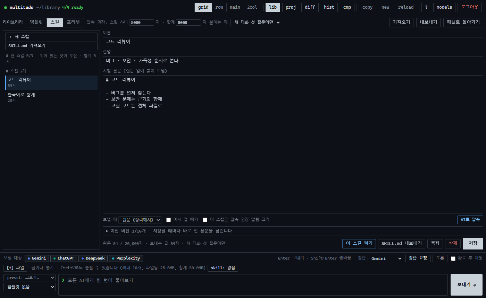

### 9. 프로젝트 모드 (로컬 코드 작업)

툴바의 **proj**(프로젝트)로 로컬 폴더를 열면 왼쪽에 파일 트리가 뜹니다. 빼야 할 파일은 `L1`·`L2`·`L3` 표시와 이유(예: `.gitignore 1행 (dist/)`)가 붙고, 비밀 정보로 보이는 파일은 `⚠ 비밀?`로 경고합니다. 질문을 보내면 프로젝트 구조와 고른 파일 내용이 **파일 업로드**로 함께 갑니다 (사이드바 아래 `올리는 방식`: 묶음 파일 / 개별 파일). AI가 답변 끝에 `NEED_FILES:`로 파일을 요청하면 패널 머리줄에 **[+] 요청 파일 N개 보내기** 버튼이 생깁니다. [자세히](project-mode.md#프로젝트-모드)

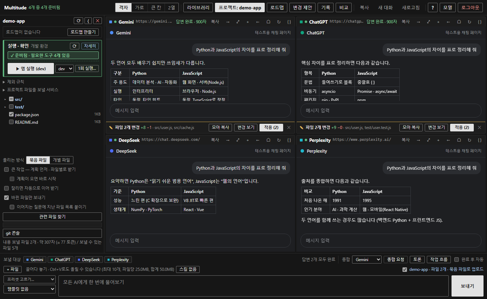

답변에 수정안이 있으면 그 패널 아래에 **변경 바**가 올라옵니다. **적용 (N)** 을 누르면 바로 파일에 쓰고(실행 영향 파일·삭제는 빼고 `⚠ 확인 필요`로 표시), 바가 `✓ 적용됨 · 되돌리기`로 바뀝니다. **변경 보기**로 바뀌는 줄을 먼저 보고 골라 적용할 수도 있습니다.

여러 AI의 안을 나란히 보려면 **변경 제안**(Ctrl+Shift+P)에서 AI마다 낸 수정안을 파일별로 비교하고, **미리보기·적용**으로 바뀌는 줄을 확인한 뒤 고른 파일만 씁니다. AI는 바꾼 파일마다 전체 내용을 주고, 그래도 diff로 와서 맞지 않으면 **전체 파일 다시 요청**으로, 여러 안은 **종합으로 합치기**로 처리합니다. 적용한 것은 **적용 기록**에서 되돌릴 수 있습니다.

파일에 바로 쓰지 않고 직접 붙여 넣고 싶으면, 답변이 끝났을 때 패널 머리줄에 노란 테두리로 깜빡이며 나타나는 **파일 N개 모아보기**를 누릅니다. 파일마다 새 파일·수정·삭제 표시와 전체 코드가 모이고, 경로·코드를 하나씩 또는 한 번에 복사합니다. 프로젝트를 열지 않아도 됩니다. [자세히](project-mode.md#파일-모아보기)

여러 AI가 같은 파일을 서로 다르게 고쳤으면 **변경 제안**의 **섞어서 적용**으로 파일마다 어느 AI 것을 쓸지 고릅니다 (v0.28.0). Windows 앱은 적용 뒤 **커밋하기…**로 적용한 파일만 커밋할 수 있고(push는 하지 않음), 미리보기 창의 **테스트 실행**에서 `lint` · `typecheck` · `build`도 함께 돌려 볼 수 있습니다. 앱을 다시 켜도 사이드바의 **지난 실행의 작업**에서 파일별로 받기 등을 이어 갑니다. [자세히](project-mode.md#섞어서-적용-v0280)

v0.34.0: 테스트 실행에 Python `pytest` · Rust `cargo test` · Go `go test`(해당 파일이 있을 때만)가 더해졌고, 적용 후 실패한 검사의 로그를 같은 AI에게 돌려 **다시 받기**(기본 2번 · 최대 3번 · 자동 적용 없음)를 할 수 있습니다. 사이드바 **관련 파일 찾기**는 고른 파일이 부르는 파일을 깊이 2까지 따라가 함께 보낼 파일을 제안하고, 미리보기 창 **새 브랜치에 적용**(Windows 앱)은 `mla/날짜-AI` 브랜치를 만들어 거기에 적용합니다(커밋 · push 없음). [자세히](project-mode.md#다른-언어-검사--고쳐-받기--관련-파일--새-브랜치-v0340)

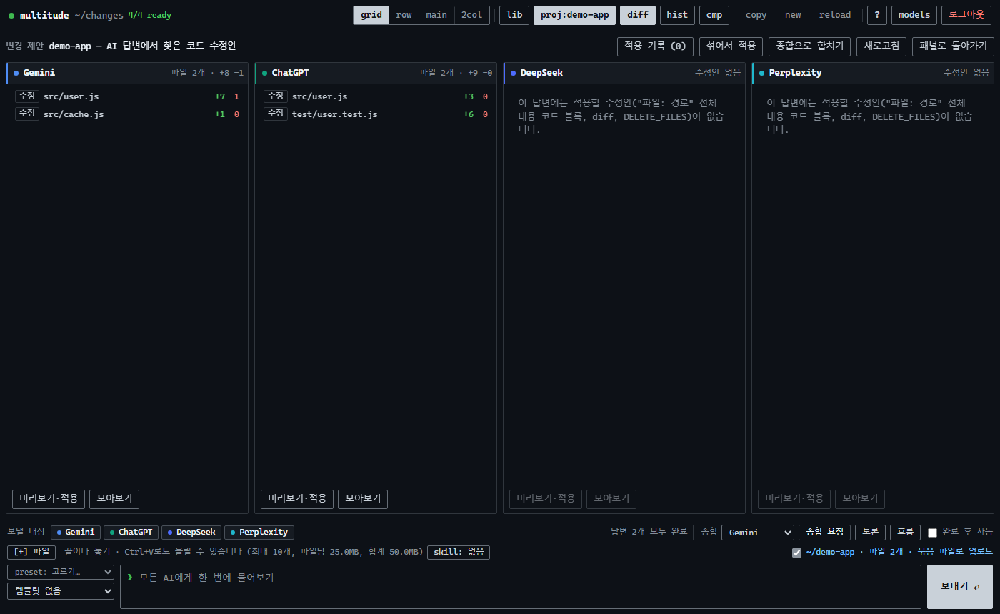

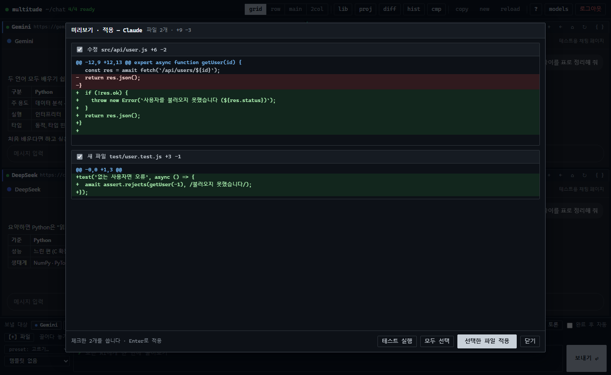

#### 실행 · 확인 — 개발 환경 점검 (v0.41.0)

프로젝트를 열면 사이드바의 **실행 · 확인** 칸이 이 프로젝트에 필요한 도구(node · npm · python · JDK · gcc · cmake · docker …)가 이 PC에 있는지, 버전이 맞는지를 색으로 보여 줍니다 — 초록 준비됨 · 노랑 확인 필요 · 빨강 없는 도구. **자세히**를 누르면 도구마다 버전 · 필요한 버전 · 이유와 **설치 명령 복사** · **설치 안내 ↗**, 그리고 `node_modules` 없음 · `.env` 없음 · 포트 사용 중 같은 준비 상태가 나옵니다. 앱은 설치하지 않고 명령만 알려 줍니다. [자세히](project-mode.md#실행--확인-v0410)

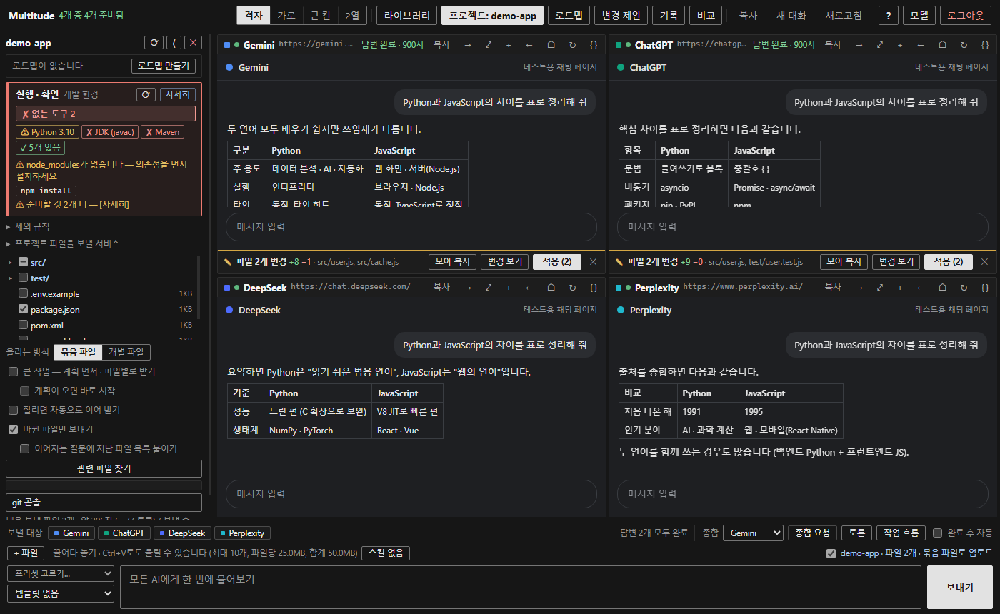

v0.43.0: 칸 아래 **▶ 앱 실행 (dev)** 을 누르면 확인 창 뒤 `npm run dev`(또는 start · serve · preview)를 띄우고, 찾은 주소 `http://localhost:5173`을 초록 단추로 보여 줍니다. **로그** · **■ 중지**. [자세히](project-mode.md#앱-실행--개발-서버-v0430-windows-앱)

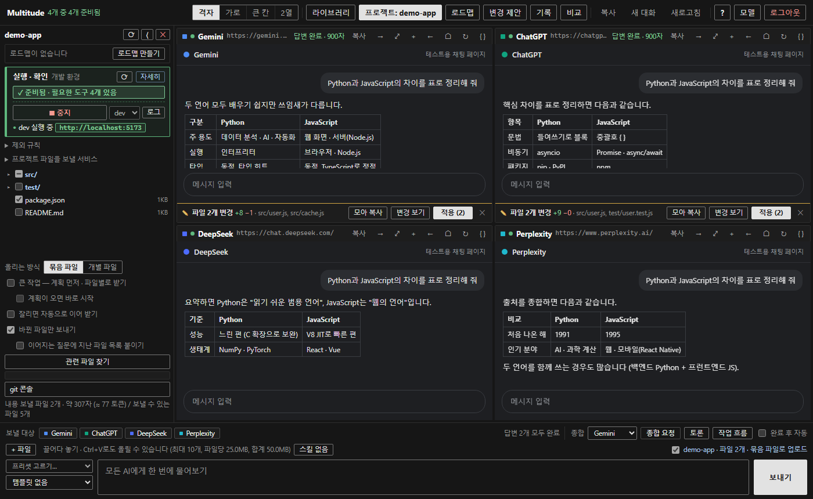

v0.44.0: 주소를 찾으면 앱 안의 **미리보기 창**이 열려 화면을 눈으로 보고, 콘솔 오류 · 실패한 요청 · 빈 화면을 자동으로 점검해 초록 · 노랑 · 빨강으로 알려 줍니다. [자세히](project-mode.md#미리보기-창--자동-점검-v0440-windows-앱)

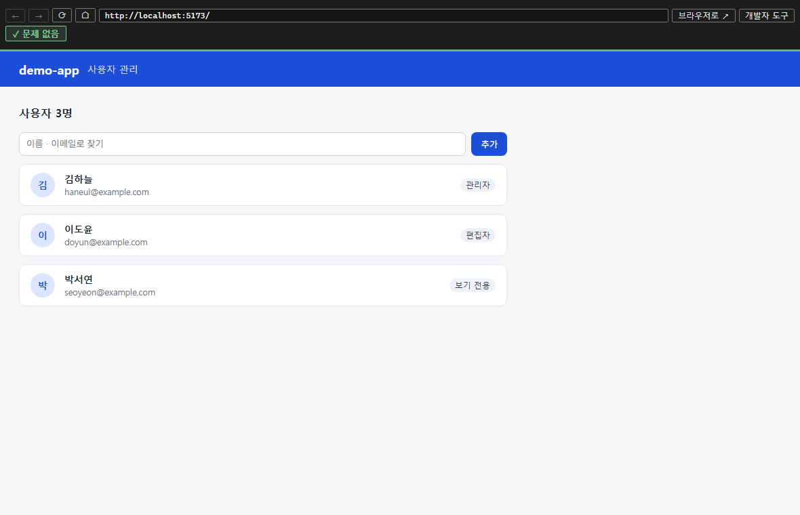

v0.45.0: **화면 캡처**로 미리보기 화면을 찍어, 캡처 창에서 그림 · 받을 AI · 보낼 글(지금 작업의 완료 조건 포함)을 확인한 뒤 **[보내기]**로 AI에게 "완료 조건대로 보이는지" 물어봅니다. 변경 보기 창의 **화면 비교**는 수정안을 잠깐 써 보고 적용 전 · 후 화면을 나란히 캡처한 뒤 파일을 되돌립니다. [자세히](project-mode.md#화면-캡처--ai-확인--적용-전후-비교-v0450-windows-앱)

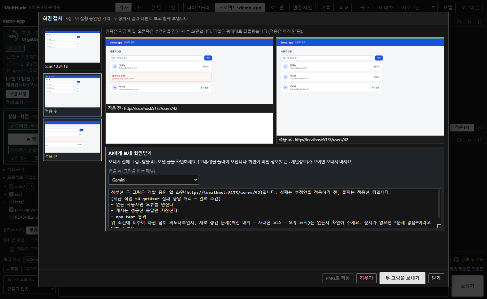

v0.46.0: 검증 중인 로드맵 작업 카드에 **▶ 실행해서 보기**와 **✓ 화면 확인함**이 생기고, 설정으로 "화면을 확인해야 완료"를 켤 수 있습니다. 서버가 아닌 CLI · Python 스크립트는 **1회 실행**으로 인자를 넣어 돌려 출력과 종료 코드를 봅니다. [자세히](project-mode.md#로드맵-카드에서-실행해서-보기-v0460-windows-앱)

v0.42.0: 프로젝트 질문에 이 PC의 도구 · 버전 한 줄을 붙여 AI가 없는 도구를 전제로 답하지 않게 하고(자세히 창에서 끔), 로드맵 작업마다 **필요한 도구**를 적어 그 도구가 없으면 카드에 경고합니다. 필요한 도구가 없으면 테스트 실행 전에 원인을 바로 알려 줍니다. [자세히](project-mode.md#ai에게-환경-알리기--작업에-필요한-도구-v0420)

#### 로드맵 (v0.38.0)

프로젝트를 연 상태에서 툴바 **로드맵**을 누르면 계획서(붙여 넣기 · `PLAN.md` · `.md` `.txt` 파일)를 AI에게 보내 **마일스톤 → 작업** 목록으로 나눠 받고, 작업마다 `대기 · 진행 중 · 검증 중 · 완료 · 막힘`을 기록합니다. **구현 요청**은 그 작업의 요청 글을 입력창에 채우고 예상 파일을 골라 줄 뿐 보내지 않습니다 — 보내기 · 적용 · 테스트는 위의 프로젝트 모드 흐름 그대로 사람이 확인합니다. **대시보드** 탭은 진행 링 · 마일스톤 막대 · 선행 관계 지도 · 번다운을 보여 주고, **문서** 탭은 프로젝트 폴더에 `docs/procedure.md`와 `README.md`(기존 README가 있으면 기본은 `README.generated.md`)를 만들어 줍니다. 진행 데이터는 `.mla/roadmap.json`에 저장되고 AI에게는 보내지 않습니다. 자세한 내용은 [로드맵 안내](roadmap.md).

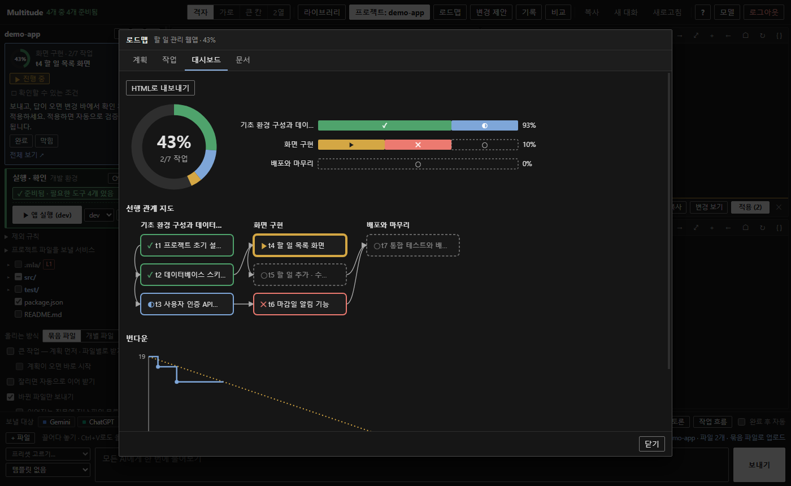

**사이드바 카드 (v0.40.0)** — 프로젝트 사이드바 맨 위의 로드맵 카드에서 창을 열지 않고 진행합니다. 카드에는 진행 링 · 지금 작업 · 완료 조건 · 그때 필요한 버튼만 보이고, 수정안을 **적용**하면 작업이 저절로 `검증 중`이 되며, 미리보기에서 테스트가 통과했으면 `완료로 바꿀까요?`를 묻습니다. 완료하면 다음 작업이 카드에 올라옵니다. 직접 누르는 것은 **구현 요청 → 보내기 → 적용 → (완료로 바꾸기)** 입니다.

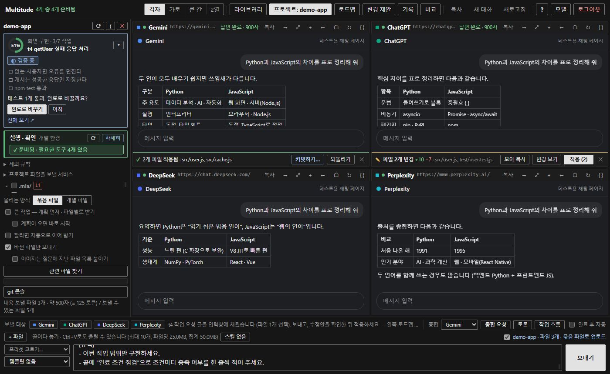

### 10. 크롬 확장 프로그램

같은 화면을 크롬 탭 하나에서 씁니다. 각 서비스는 크롬에 로그인된 계정을 그대로 쓰고, 로그인이 필요한 패널은 머리줄의 **로그인 탭**으로 일반 탭에서 로그인합니다. [설치 방법](chrome-extension.md#크롬-확장-프로그램)

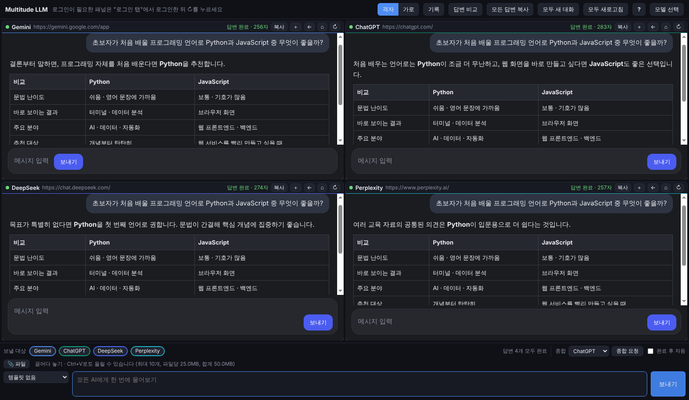

#### 사이드탭 새 기능 (v0.37.0)

- **PDF**: 보고 있는 탭이 PDF면 맥락 줄이 `PDF 8쪽`처럼 바뀝니다. 그 탭 안에서 같은 주소의 PDF를 받아 사이드 패널이 pdf.js로 쪽마다 글을 꺼내(`[3쪽]` 머리표) 본문처럼 함께 보냅니다. 150쪽 · 30MB · 30만 자까지(넘으면 앞부분), **암호가 걸린 PDF · 스캔한 PDF(글자가 그림)는 읽지 못합니다.** 내 컴퓨터의 PDF는 chrome://extensions에서 이 확장의 "파일 URL에 대한 액세스 허용"이 필요합니다. 한국어 PDF는 한국어 CMap을 같이 넣었지만 일본어 · 중국어 PDF의 일부 글꼴은 글자가 깨질 수 있습니다.
- **영상 자막**: 페이지에 **이미 떠 있는** 자막만 읽습니다 — YouTube의 열려 있는 "스크립트" 패널, 켜져 있는 HTML5 자막 트랙. 자막을 따로 내려받지 않고 자막 켜기 · 끄기도 바꾸지 않습니다. 40자 넘게 읽히면 본문 대신 자막(`시간 글` 줄)이 맥락이 되고 줄에 `자막`이 붙습니다. 자막이 안 읽히면 영상의 자막(CC)을 켜거나 "스크립트 표시"를 연 뒤 ↻.
- **번역 비교**: 페이지에서 번역할 글을 **선택**하고 `번역 비교`를 누르면 선택한 글만(페이지는 붙이지 않음) 위 · 아래 두 AI에게 번역시키고, 둘 다 끝나면 아래에 나란히 보여 줍니다. 한쪽에만 있는 문장은 표시됩니다(같은 뜻이어도 표현이 아주 다르면 표시됨). AI를 둘 열어 둔 때만.
- **한 줄 종합**: 단추를 켜 두면 두 AI의 답이 모두 끝날 때 한 문장 결론을 답 위에 붙입니다. 앱 설정에서 로컬 LLM을 켜 두었으면 그것이 만들고(밖으로 안 나감), 아니면 **위쪽 AI에게 이어서 물어** 그 답을 씁니다(그 AI의 대화에도 남음).
- **사이트별 프리셋**: 사이드탭 맨 위 `사이트` 줄에서 `이 사이트에 기억` — 지금 열어 둔 AI 2개와 고른 **기본 단추**를 그 사이트(호스트)에 저장합니다(50개까지). 그 사이트의 탭으로 가면 AI만 맞춰 주고 **질문은 저절로 보내지 않으며**, 기본 단추는 테두리로 표시되고 입력창이 빈 채 Enter를 누르면 눌립니다. `잊기`로 지웁니다.

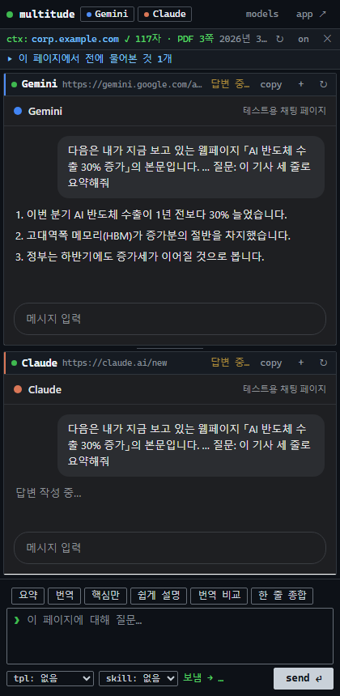

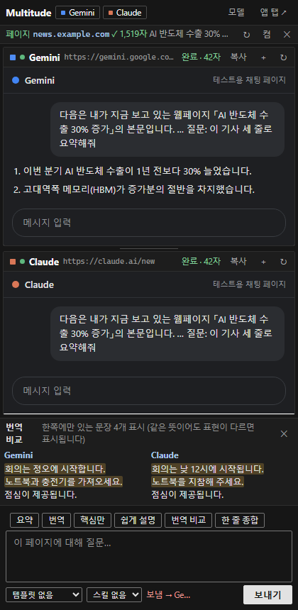

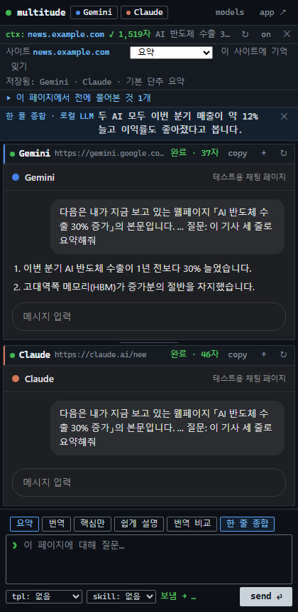

## 기능

- 11개 서비스 중 최대 6개를 골라 질문 동시 전송 (대상 켜기/끄기), 격자·가로·큰 칸·2열 배치, 패널 하나 크게 보기(⤢)
- 프로젝트 모드: 로컬 폴더의 구조·파일을 함께 보내고, AI 수정안을 비교·미리보기·적용·되돌리기 ([자세히](project-mode.md#프로젝트-모드))
- 파일 모아보기: 답변의 파일 코드를 새 파일·수정·삭제로 나눠 모으고 경로·코드·전체 복사 — 프로젝트 없이도 씀 ([자세히](project-mode.md#파일-모아보기))
- 파일 첨부: 공통 입력창에 끌어다 놓기 · Ctrl+V(스크린샷) · **[+] 파일** 버튼 → 보낼 대상 패널마다 첨부해서 보냄 ([자세히](#파일-첨부))
- 답변 완료 감지, 패널별·전체 답변 복사 (Markdown — 표·코드 블록·목록 서식 유지)
- 사이트 셀렉터 원격 갱신: 서비스 화면이 바뀌면 [remote/selectors.json](../remote/README.md)만 고쳐 바로잡음 (6시간마다 확인, 설정에서 끄기 가능)
- 답변 대기 시간 설정(기본 20분, `?` 화면), 기다린 시간 표시, 시간 초과 뒤에도 계속 지켜보다가 늦게 끝나면 완료로 갱신
- 패널별·전체 새 대화, 로그아웃(모든 로그인 정보 삭제)
- 교차검토(종합): 다른 AI 답변을 모아 한 AI에게 비교·정리 요청, 완료 후 자동 종합
- AI끼리 넘기기(검토 · 반박 · 이어서)와 토론(2~3개 AI · 1~3라운드 · 판정 AI) (v0.26.0)
- 보내기 실패면 한 번 자동으로 다시 보내기, 늦은 답은 [다시 보내기], 사용 한도면 다른 AI로 보낼지 제안 (v0.26.0)
- 답변 비교 화면 (차이 강조 · 일치/이견 분석 탭), 질문 템플릿(요약·쉽게 설명·단계별 사고·장단점 비교·팩트 체크·번역·코드 리뷰·코드 수정(파일 모아보기))
- 질문·답변 기록: 자동 저장(기본 최근 500개, 설정 › 기록 최대 개수에서 100~2000개), 검색, Markdown 복사, 질문 다시 쓰기 — 이 PC의 앱 데이터 폴더에만 저장
- 기록 필터(기간 · AI · 평가 · 보낸 곳 · 프로젝트 · 종합/분석/이어 묻기 · 태그 · ★) · 태그 · 즐겨찾기 · 여러 기록을 한 문서로 · 대화 줄기로 묶어 보기 (v0.27.0)
- 질문 종류(코드 · 긴 글 · 프로젝트 · 일반)별 추천 조합 — 사실 숫자만, 대상은 눌러야 바뀜 (v0.27.0)
- 프로젝트 모드: 테스트 실행에 lint · typecheck · build, 여러 AI 수정안 섞어서 적용, 적용한 파일만 커밋(Windows 앱), 앱을 다시 켜도 작업 이어 하기, 변경 바와 제안 바 두 줄로 (v0.28.0)

## 화면 디자인

Windows 앱 · 크롬 확장 · 사이드탭이 같은 디자인을 씁니다 ([src/renderer/styles.css](../src/renderer/styles.css) 하나, 사이드탭은 [extension/sidepanel.css](../extension/sidepanel.css)를 더함). v0.19.0의 "터미널(CLI) 창" 틀(어두운 단색 바탕 · 1px 선 · 각진 모서리 · 높이)은 그대로 두고, v0.39.0에서 기호 장식과 영문 약어를 걷어 냈습니다.

| 부분 | 어떻게 보이나 |
|---|---|
| 바탕 · 선 · 글꼴 | 푸른 기를 뺀 어두운 회색 바탕(`#161616`), 1px 회색 선, 각진 모서리(2~4px). 화면 글자는 본문용 글꼴(Pretendard가 있으면 그것, 없으면 Segoe UI · 맑은 고딕), **고정폭 글꼴은 주소 · 코드 · 파일 경로 · 숫자에만**. 그라데이션 · 빛 번짐 · 흐림 효과는 쓰지 않습니다 |
| 색 | 상태에만 씁니다: 준비 초록 · 답변 중 노랑 · 오류 빨강, 강조는 파랑 하나. 서비스 고유 색은 이름 앞 작은 사각형에만 (둥근 점은 상태) |
| 툴바 | `Multitude 4개 중 4개 준비됨` — 이름과 쓸 수 있는(로그인된) 패널 수. 버튼은 낱말(라이브러리 · 기록 …)이고 마우스를 올리면 자세한 설명이 뜹니다. 창이 좁으면(1100px 아래) 상태 글과 구분선을 숨깁니다 |
| 버튼 4단계 | **주요**(보내기 · 열기 · 저장 · 적용): 글자색과 바탕을 뒤집은 반전 블록 · **일반**: 1px 테두리 · **보조**: 평소엔 테두리 없음 · **위험**: 빨간 글자. 지금 연 화면의 툴바 버튼도 반전 블록 |
| 목록 | 모델 고르기는 진짜 체크 상자 목록, 제목 아래 설명 한 문단. 설정 · 분석 제목은 글자만 |
| 움직임 | 화면이 켜질 때 0.12초 페이드인과 답변 중 깜빡임만. 움직임 줄이기(`prefers-reduced-motion`)를 켜면 모두 꺼집니다 |

툴바 버튼 이름:

| 버튼 | 하는 일 | 버튼 | 하는 일 |
|---|---|---|---|
| 격자 · 가로 · 큰 칸 · 2열 | 패널 배치 | 복사 | 모든 답변 복사 |
| 라이브러리 | 내 템플릿 · 스킬 · 프리셋 | 새 대화 | 모두 새 대화 |
| 프로젝트 | 로컬 폴더 (열려 있으면 `프로젝트: 이름`) | 새로고침 | 모두 새로고침 |
| 로드맵 | 계획 · 작업 · 대시보드 · 문서 | 사이드탭 | 사이드탭 열기 (크롬 확장만) |
| 변경 제안 | AI별 코드 수정안 | `?` | 설정 · 단축키 |
| 기록 · 비교 | 질문 · 답변 기록, 답변 비교 | 모델 | 모델 다시 고르기 |

패널 안의 AI 웹페이지는 각 서비스 화면 그대로라 이 디자인이 적용되지 않습니다. 툴바(44px) · 공통 입력창(132px) · 패널 머리줄(28px) · 변경 바(33px) 높이는 본체가 웹페이지를 얹는 자리와 맞물려 있어 그대로입니다.

## 라이브러리 (내 템플릿 · 스킬)

툴바의 **lib**(라이브러리, 또는 템플릿·스킬 고르기 목록 맨 아래 "라이브러리 열기")에서 만들고 고칩니다. 이 PC에만 저장됩니다 (Windows 앱: 앱 데이터 폴더 `library.json` / 크롬 확장: 확장 저장소).

### 내 템플릿과 변수

기본 템플릿(`[기본]`)은 그대로 두고 **복제해서 고치기**로 내 템플릿을 만듭니다. ☆로 즐겨찾기하면 템플릿 목록 맨 위에 나옵니다.

| 쓰는 법 | 뜻 |
|---|---|
| `{q}` | 입력창에 쓴 내용 (없으면 맨 뒤에 붙음) |
| `{{언어}}` | 보낼 때 입력받는 칸 |
| `{{관점\|보안}}` | 비워 두면 기본값 `보안` |
| `{{톤:간결,자세히}}` | 고르기 목록 (처음 값이 기본) |
| `{{오늘}}` · `{{프로젝트}}` · `{{선택 파일}}` | 앱이 채움: 오늘 날짜, 열린 프로젝트 이름, 프로젝트에서 고른 파일 목록 |

변수가 있는 템플릿으로 보내면 **변수 입력** 화면이 뜹니다. 칸을 채우면 보낼 글 미리보기가 바로 바뀌고, Enter로 보내고 Esc로 취소합니다 (입력창 내용은 남음). 템플릿마다 마지막에 넣은 값을 기억해 다음에 미리 채웁니다.

### 스킬

스킬은 AI에게 줄 **역할·규칙 지침**입니다. 입력창 위 **skill:** 버튼을 누르면 첨부 줄 자리에 스킬 칩이 펼쳐지고, 눌러서 **최대 3개**까지 켭니다. **켠 순서가 우선순위**입니다 (①②③). 보낼 때 각 패널의 글 앞에 이렇게 붙습니다.

```
### 지침 (스킬 2개 — 위에 있는 것이 우선)
이 대화가 끝날 때까지 아래 지침을 모두 따라 답해 줘. 서로 부딪히면 먼저 나온 지침을 따라. …

#### 1. 코드 리뷰어
(지침 본문)

#### 2. 보안 점검표
(지침 본문)

### 질문

(질문)
```

- **붙이는 때**(라이브러리 스킬 탭)
  - **새 대화 첫 질문에만**(기본): 패널마다 이 대화에 받은 스킬을 기억합니다. 같은 대화에서는 다시 붙이지 않고, 패널의 `+` · `⌂`나 툴바의 `new`(모두 새 대화)를 누르면 다시 붙입니다.
  - 대화 중간에 스킬을 바꾸면 다음 질문에 **바뀐 점만** 붙입니다 ("지금부터 ○○ 지침은 따르지 마" / 새로 켠 지침 본문). 가장 깔끔한 방법은 새 대화를 여는 것입니다.
  - **매 질문마다**: 긴 대화에서 지침을 잊는 경우.
- 라이브러리 스킬 탭 맨 위 **켠 스킬** 묶음에서 ▲▼로 우선순위를 바꾸고 끕니다. 한 번에 붙이는 지침은 합계 **3만 자**까지입니다 (넘으면 보내지 않고 알림).
- **SKILL.md 가져오기**: Claude 스킬과 같은 형식(맨 위 `---` 사이에 `name` · `description`, 아래가 지침 본문)의 `.md` 파일을 여러 개 한 번에 가져옵니다 (파일당 100KB, 본문 2만 자까지). **SKILL.md 내보내기**로 다시 파일로 저장합니다.
- 각 서비스의 계정 설정(Gems · 프로젝트 등)은 건드리지 않고, 질문 글에 넣어 보내는 방식이라 11개 서비스에 똑같이 적용됩니다. 대신 대화가 아주 길어지면 효과가 약해질 수 있습니다.
- 종합 요청 · 요청 파일 보내기에는 붙이지 않습니다.

### 보내는 글 줄이기 (정리 · AI 압축 · 압축 권장 표시)

**규칙 기반 정리 (자동)**: 보낼 때 앱이 주석(`<!-- -->`), 구분선, 굵게 표시(`**`), 연속 빈 줄, 같은 문장 반복을 걷어 냅니다. 코드 블록 안은 그대로입니다. 스킬마다 **예시 절 빼기**를 켜면 "예시 · Example" 제목 아래 절도 뺍니다.

**AI로 압축**: 스킬 편집기의 **AI로 압축** → 맡길 AI(열린 패널)와 목표 길이(기본: 원문의 30%)를 고르고 **압축 요청**을 누릅니다.
1. 앱이 그 패널에서 새 대화를 열고(끌 수 있음) "규칙·조건·금지 사항·출력 형식은 빠뜨리지 말고 N자 이내로" 압축을 요청합니다.
2. 답변이 끝나면 패널 화면의 답변 글(코드 블록 안)을 읽어 **압축본 칸**에 넣습니다. 파일로 내려받지 않습니다.
3. 원문과 나란히 보고 고친 뒤 **저장**하면 그 스킬 항목에 압축본으로 들어갑니다 (원문은 그대로). 이후 보낼 때는 압축본을 씁니다 ("보낼 때: 압축본 / 원문"으로 바꿈).
- 답변을 기다리는 동안 패널로 가서 봐도 됩니다. 답변이 끝나면 압축본 칸에 넣어 두고 입력창 아래에 알립니다 (다시 **AI로 압축**을 누르면 이어서 봄).
- 자동으로 못 가져왔거나 답변을 고쳤으면 **패널에서 다시 읽기**로 그 패널의 최신 답변을 다시 가져옵니다. 직접 복사해 붙여 넣어도 됩니다.
- 압축 요청과 답변은 기록에 남기지 않습니다.
- 원문을 고치면 `⚠ 압축본이 원문보다 오래됨`으로 표시합니다. AI가 규칙을 빠뜨렸을 수 있으니 저장 전에 꼭 확인하세요.

**압축 권장 표시** (보내는 글 기준 — 정리 후, 압축본이 있으면 압축본)

| 기준 | 표시 |
|---|---|
| 스킬 하나 2,000자 이상 | 글자 수만 |
| 스킬 하나 **5,000자 이상** | `[!]` 압축 권장 (목록 · 편집기 · 스킬 칩) |
| 스킬 하나 **10,000자 이상** | `[!!]` 압축 강력 권장 + 켤 때 한 번 확인 (확인하면 그 스킬은 다시 묻지 않음) |
| 켠 스킬 합계 **8,000자 이상** | `skill:` 버튼에 `[!]` |
| 켠 스킬 합계 **15,000자 이상** | 보내기 전에 한 번 확인 (압축본이 없는 스킬과 길이를 보여 줌, 그 실행 동안 다시 묻지 않음) |
| 합계 30,000자 초과 | 보내지 않음 |

- "매 질문마다"면 기준을 0.6배(스킬 하나 3,000자 · 합계 5,000자)로 낮춥니다.
- 기준값은 라이브러리 스킬 탭 위 **압축 권장: 스킬 하나 / 합계**에서 바꿉니다. 스킬마다 **압축 권장 알림 끄기**도 있습니다.

#### 로컬 패널 여러 개 · 글 파일 · 의미 검색 (v0.36.0)

- **패널 여러 개**: 설정 › 로컬 LLM › **로컬 패널 수**(1~3). 늘리면 모델 고르기에 `로컬 LLM 2` · `로컬 LLM 3`이 나오고, 패널마다 **모델을 따로** 고릅니다(설정에서 또는 패널 머리줄의 모델 목록에서). 같은 서버의 서로 다른 모델에게 한 번에 물어 답을 나란히 비교할 수 있습니다. 패널을 줄이면 넘는 패널은 닫히고 보낼 대상 · 종합 담당에서도 빠지지만 고른 모델은 기억해 둡니다. 종합 · 판정 · 스킬 압축은 첫 번째 모델이 맡습니다. Ollama · LM Studio는 모델을 번갈아 올리느라 느려지거나 메모리를 많이 쓸 수 있습니다.
- **글 파일 첨부**: 로컬 패널은 글로 읽을 수 있는 파일(`.txt` `.md` `.csv` `.json` `.log` `.py` `.js` 같은 코드 · 자막 등)을 **요청 글 안에 끼워** 보냅니다. 패널의 말풍선에는 질문과 `📎 파일 이름`만 보이고, 파일 글은 이어지는 질문에도 대화에 남아 있습니다. **컨텍스트 한도**(설정)의 80%를 넘으면 뒤쪽 파일부터 · 파일 안에서는 뒷부분을 잘라 내고 "컨텍스트 한도 때문에 앞부분만 보냈습니다"를 글에 남깁니다(`(일부만)`). 이미지는 예전처럼 비전 모델일 때 따로, **PDF · 문서 파일은 빼고** 보내며 보내기 전 미리보기에서 알립니다. 글 파일은 파일 하나 20만 자까지.
- **기록 의미 검색(비슷한 뜻으로 찾기)**: 설정 › 로컬 LLM › **임베딩 모델**에 이름(예: Ollama의 `nomic-embed-text`)을 적고 **색인 만들기** — 로컬 서버(위 주소)의 `/v1/embeddings`로 기록마다 질문 · 답변 앞부분의 뜻을 숫자(벡터)로 만들어 이 PC에 저장합니다(멈췄다 이어서 가능, 글이 바뀐 기록만 다시). 만든 뒤 기록 화면 검색칸 아래 **비슷한 뜻으로 찾기**를 켜고 검색하면 단어가 달라도 뜻이 가까운 기록이 `비슷함 82%` 순으로 나옵니다(검색할 때 새 기록 24개까지는 먼저 더함, 필터도 함께 적용). **질문 · 답변 글은 이 PC(localhost) 밖으로 나가지 않으며**, 보관된 기록은 색인하지 않고, 모델을 바꾸면 처음부터 다시 만들고, 기록 전체 삭제 때 색인도 지웁니다.

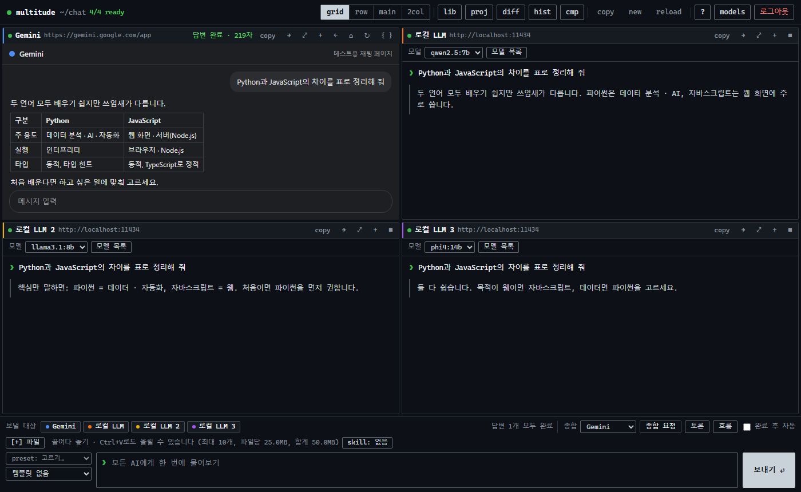

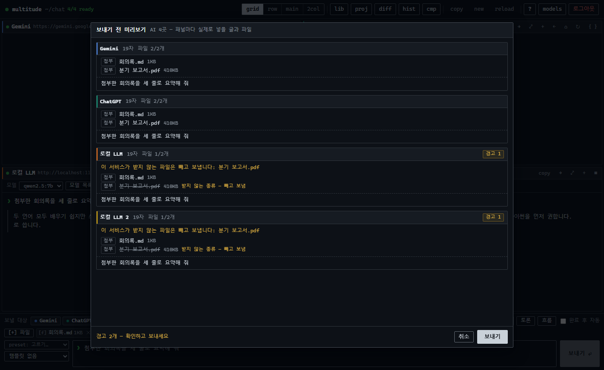

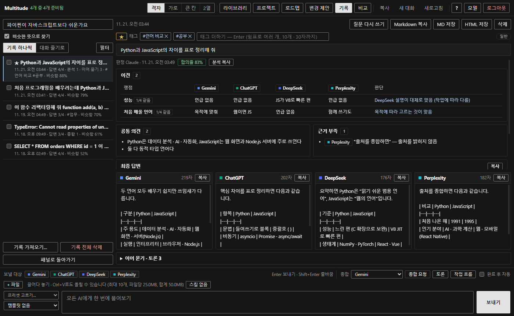

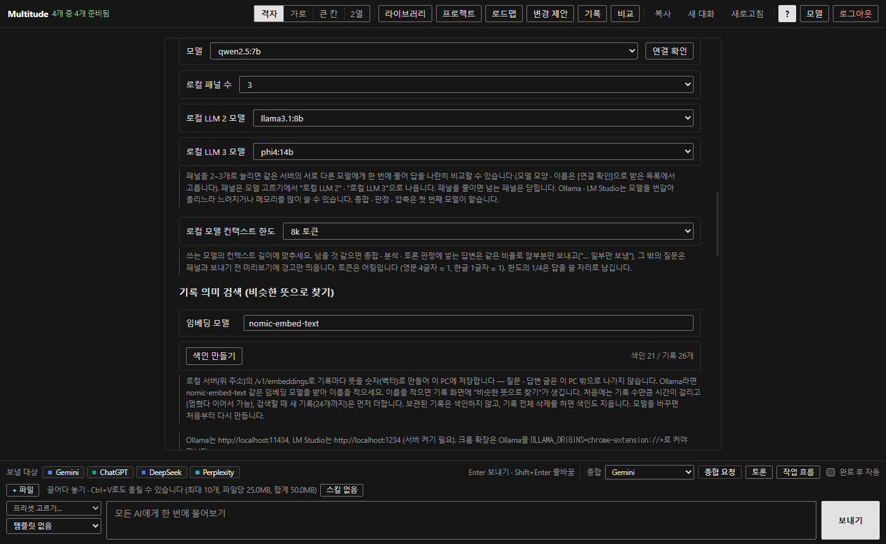

## 내보내기 · 가져오기

**내보내기**는 내 템플릿과 스킬(이전 버전 포함) · 작업 프리셋을 `.json` 파일 하나로 저장합니다 (변수 마지막 값 · 고른 스킬은 넣지 않음). 설정까지 옮기려면 [설정 옮기기](#설정-옮기기-v0290). **가져오기**는 그 파일의 항목을 지금 것에 더합니다.

**하나만 공유 (v0.35.0)**: 템플릿 · 스킬 편집기의 **공유 파일로**, 프리셋 탭의 **공유 파일로**는 그 항목 **하나**만 `.mla.json` 파일로 저장합니다. 프리셋은 쓰는 스킬 · 템플릿도 함께 담고(프리셋에는 템플릿 변수 값이 들어갑니다), 스킬의 이전 버전은 지운 글이 남아 있을 수 있어 넣지 않습니다. 암호화하지 않은 글 파일이니 비밀 정보가 없는지 확인하세요. 받는 사람은 라이브러리 **가져오기** 또는 설정 › 설정 옮기기 › **가져오기**로 엽니다 — 같은 id가 있으면 덮어쓰기 / 둘 다 남기기를 고릅니다.
템플릿·스킬은 질문과 함께 AI 서비스로 보내지므로, 저장·가져오기 때 비밀 정보로 보이는 문자열이 있으면 확인을 묻습니다. 남이 준 파일은 내용을 확인하고 가져오세요 (지침에 엉뚱한 지시가 들어 있을 수 있음).

## 파일 첨부

공통 입력창에 이미지·문서·파일을 올리면 보낼 대상 패널마다 첨부한 뒤 질문을 보냅니다. 글 없이 파일만 보낼 수도 있습니다.

- 올리는 방법: 입력창 쪽으로 **끌어다 놓기**, 입력창에서 **Ctrl+V**(스크린샷·복사한 파일), **[+] 파일** 버튼
  (서비스 패널 위에 끌어다 놓으면 그 사이트에만 올라갑니다)
- 한도: 최대 **10개**, 파일당 **25MB**, 합계 **50MB**. 넘는 파일은 올릴 때 바로 빼고 이유를 보여 줍니다. 실제 한도는 각 서비스 제한도 따릅니다.
- 사이트마다 사람이 하는 방법(붙여넣기 → 파일 선택 칸 → 끌어다 놓기)을 차례로 시도합니다. Windows 앱은 그래도 안 되면 크롬 개발자 프로토콜로 파일 선택 칸에 직접 넣습니다.
- 첨부에 실패한 패널은 **글만 보내고** 패널 머리줄에 `[+] 첨부 없이 보냄`을 표시합니다 (마우스를 올리면 이유).
  받지 않는 종류(예: Duck.ai의 문서)는 빼고 보내며 `[+] 일부 파일은 빼고 보냄`으로 알립니다. 올릴 때 미리 알려 줍니다.
- 기록에는 첨부 파일의 이름·크기만 남고 내용은 저장하지 않습니다. 종합 요청에는 첨부를 다시 보내지 않습니다.

## 셀렉터 자가진단

AI 사이트가 화면을 바꾸면 앱이 입력창 · 보내기 버튼 · 답변 영역을 못 찾을 수 있습니다. v0.12.0부터 패널마다 이것을 기록해 알려 줍니다 (Windows 앱 · 크롬 확장).

| 항목 | 언제 확인하나 | 못 찾았을 때 |
|---|---|---|
| 입력창 | 로그인된 페이지가 열린 뒤(30초에 한 번까지), 질문을 보낼 때 | 보낼 때 못 찾으면 ✕ 못 찾음. 페이지를 살펴보기만 했을 때는 △ 주의까지 (오류 페이지 · 점검 안내 · 팝업처럼 셀렉터와 상관없이 안 보일 때가 많아서, v0.12.1). 페이지 불러오기에 실패한 패널은 살펴보지 않음 |
| 보내기 버튼 | 질문을 보낼 때 | 버튼 대신 Enter 키로 보냈으면 △ 주의 (보내기는 됨) |
| 답변 영역 | 답변을 기다린 뒤 | 보냈는데 답변이 잡히지 않은 일이 **2번 연달아** 있으면 ✕ 못 찾음 (한 번은 △) |

- ✕가 하나라도 있으면 패널 머리줄에 **⚠ 화면이 바뀐 것 같음**이 뜹니다. 마우스를 올리면 무엇을 못 찾았는지와 안내(① ⌂로 처음 화면 ② 설정의 **사이트 셀렉터 자동 갱신 › 지금 확인** ③ 계속되면 패널에서 직접 입력하고 앱 업데이트 기다리기)가 보이고, 누르면 **자가진단 창**이 열립니다 (v0.21.1):
  - 입력창 · 보내기 버튼 · 답변 영역마다 찾음 / 다른 방법으로 됨 / 못 찾음, 안내, 지금 쓰는 셀렉터 버전 · 마지막 확인 · 실패 이유
  - **셀렉터 지금 확인**(GitHub에서 고친 셀렉터 받기) · **처음 화면으로** · **진단 정보 복사**(서비스 · 앱 버전 · 셀렉터 버전 · 찾은/못 찾은 항목 — 질문 · 답변 글과 대화 주소는 넣지 않음) · **전체 상태**(설정의 표)
  - `[limit] 사용 한도에 걸린 것 같음`도 같은 창에서 찾은 문구와 안내를 보여 줍니다.
- 원격 셀렉터를 새 버전으로 받으면 툴바 상태줄에 `selectors v<번호>`가 10초 동안 뜹니다. 사이트가 바뀌었을 때 고치는 순서는 [remote/README.md](../remote/README.md#사이트-화면이-바뀌었을-때-고치는-순서-v0211)에 있습니다.

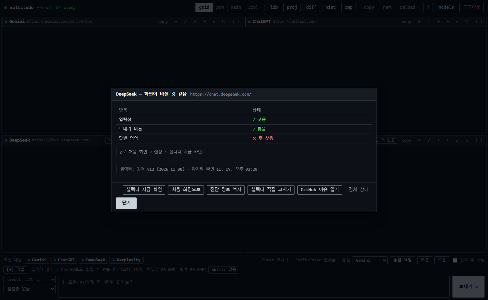

- 설정(`?`) 화면의 **서비스 화면 상태** 표에서 열린 패널마다 ✓ 찾음 · △ 다른 방법으로 됨 · ✕ 못 찾음 · – 확인 전을 봅니다.
- 원격 셀렉터를 새 버전으로 받으면 기록을 지우고 다시 확인합니다. 시간 초과는 셀렉터 문제로 보지 않습니다.
- 기록은 앱을 켜 둔 동안만 메모리에 있습니다.

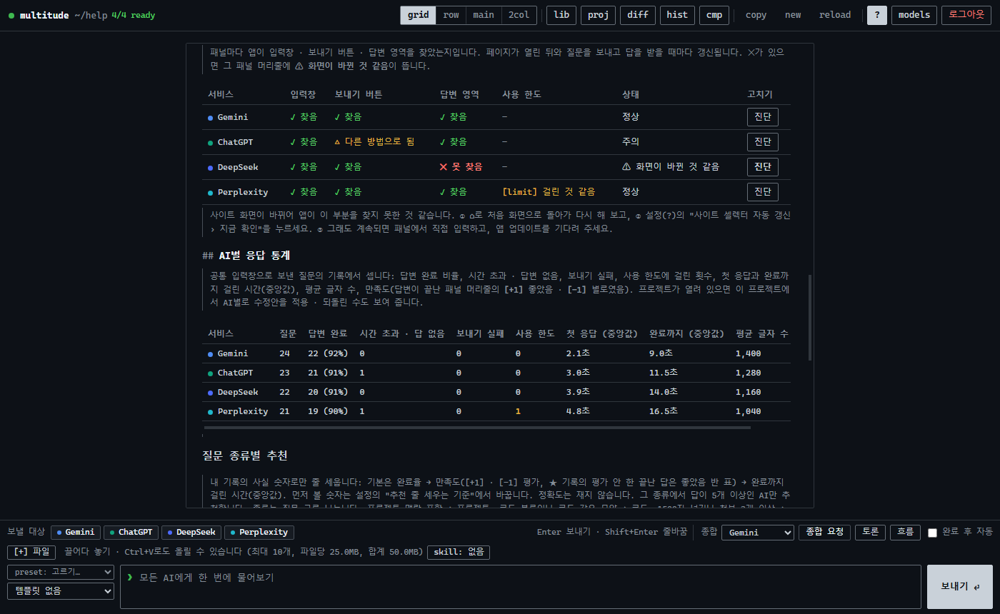

### 셀렉터 직접 고치기 · 이슈 보내기 (v0.35.0)

AI 사이트가 화면을 바꿔 **⚠ 화면이 바뀐 것 같음**이 뜨면 앱 업데이트나 원격 갱신을 기다리지 않고 직접 고칠 수 있습니다. 자가진단 창(⚠ 표시, 또는 설정 › 셀렉터 자가진단 표의 **진단**)에서:

- **셀렉터 직접 고치기**: 그 서비스의 **입력창 · 답변 읽기 · 중지 단추** 셀렉터(CSS)를 한 줄에 하나씩 적습니다. 위에 적은 것부터 찾고, 앱 · 원격 갱신에 들어 있던 값은 뒤에 그대로 남아 있어 틀려도 계속 찾을 수 있습니다(`이미 들어 있는 값`으로 보여 줌). 저장하면 바로 입력창을 다시 찾아 봅니다. 브라우저가 읽을 수 없는 셀렉터 · 300자 넘는 줄 · `{ }` · 20줄 넘는 칸은 저장되지 않습니다. **내 값 지우기**로 되돌립니다. **이 PC(이 확장)에만 저장하고 어디로도 보내지 않으며**, 원격 갱신을 끄거나 새로 받아도 남습니다.
- **보내기 · 로그인 단추 · 파일 넣기 칸은 고칠 수 없습니다** — 원격 갱신과 같은 범위입니다(엉뚱한 단추를 누르게 하지 못하도록 앱 업데이트로만 바꿈).
- **GitHub 이슈 열기**: 진단 정보 복사와 같은 글(서비스 · 앱 버전 · 찾은/못 찾은 항목 · 셀렉터 버전) + 내가 고친 셀렉터를 채운 이슈 양식을 브라우저로 엽니다. 열기 전에 내용을 보여 주고 묻습니다. 질문 · 답변 · 페이지 글 · 주소의 경로는 들어 있지 않고, GitHub에서 보내기 전에 확인 · 고칠 수 있습니다. 주소는 항상 이 저장소의 새 이슈 양식입니다.

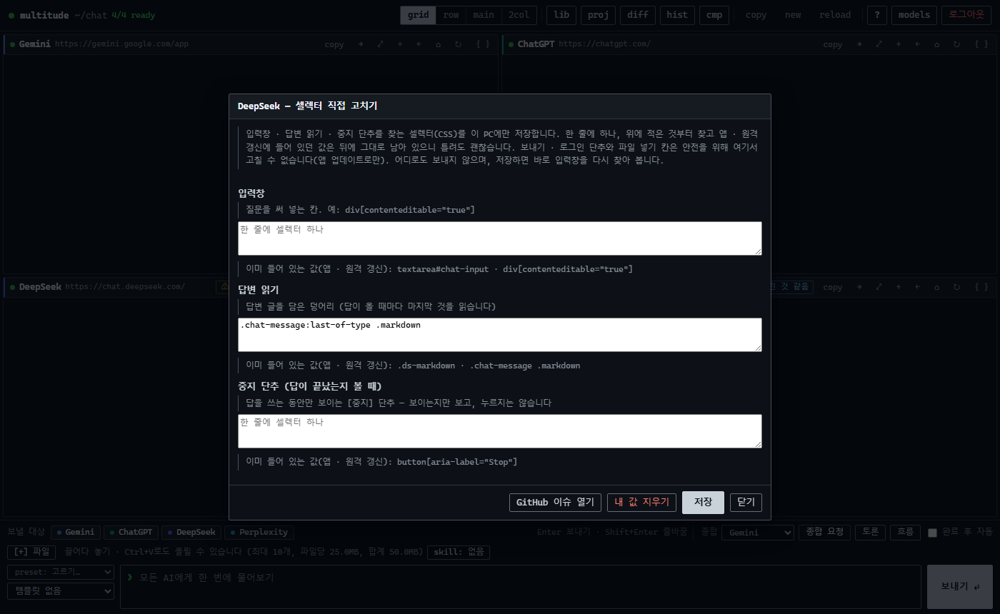

## 응답 통계

v0.13.0부터 공통 입력창으로 보낸 질문의 답변마다 **숫자만** 기록에 함께 남기고, 설정(`?`) 화면의 **AI별 응답 통계** 표로 보여 줍니다 (Windows 앱 · 크롬 확장).

| 열 | 뜻 |
|---|---|
| 질문 · 답변 완료 | 그 AI에 보낸 질문 수와 답변이 끝난 수(비율) |
| 시간 초과 · 답 없음 | 정한 시간 안에 끝나지 않았거나, 보낸 뒤 답변이 시작되지 않은 수 (마우스를 올리면 나눠서) |
| 보내기 실패 | 입력창을 못 찾는 등 보내지 못한 수 |
| 사용 한도 | 한도 안내 문구를 찾은 수 (아래) |
| 첫 응답 · 완료까지 | 보낸 뒤 답변이 시작될 때까지 · 끝날 때까지 걸린 시간의 **중앙값** |
| 평균 글자 수 | 끝난 답변의 평균 글자 수 |
| 수정안 적용 · 되돌림 | 프로젝트가 열려 있을 때, 이 프로젝트의 적용 기록에서 AI별로 센 적용 수 · 그중 되돌린 수 |
| 만족도 (v0.23.0) | 답변이 끝난 패널 머리줄의 `[+1]` 좋았음 · `[-1]` 별로였음을 센 비율 — `75% (3/4)`, 평가가 없으면 `—`. 같은 버튼을 다시 누르면 지워지고, 새 질문을 보내면 버튼이 내려감 (지금 질문에만 남길 수 있음) |

- **정확도는 재지 않습니다.** 맞는 답인지는 앱이 알 수 없어서, 사실인 숫자(보내기 · 완료 · 시간 · 글자 수)와 내가 남긴 평가(만족도)만 셉니다.
- 통계는 기록(최근 500개)에서 계산합니다. **기록을 지우면 통계도 함께 지워지고**, 이 PC에만 있습니다. 답변 글은 원래 기록에 있던 것 외에 더 남기지 않습니다 (한도 안내 문구도 "걸렸는지"만).
- v0.13.0 이전 기록에는 시간 정보가 없어 `–`로 나옵니다.

### 질문 종류별 추천 조합 (v0.27.0)

질문을 보낼 때 종류를 함께 남기고(예전 기록은 질문 글로 나눔), 종류 × AI마다 **사실 숫자만** 셉니다.

| 종류 | 이렇게 나눔 (위에서부터 먼저) |
|---|---|
| 프로젝트 | 프로젝트 맥락을 붙여 보낸 질문 |
| 코드 | 코드 블록(```), 또는 SQL 문 · 함수 정의 · 오류 이름처럼 코드 같은 모양 |
| 긴 글 | 1500자를 넘거나, 직접 올린 첨부가 3개 이상 |
| 일반 | 나머지 |

- 숫자: 결과가 남은 답 수, **완료율**, **완료까지 시간 중앙값**, 평가한 답의 **만족도**. **정확도 점수는 만들지 않습니다.** 이 숫자를 완료율 → 만족도 → 시간 → 답 수 순으로 비교해 줄 세우고, 그 종류에서 답이 **5개 이상**인 AI만 최대 3개 추천합니다.
- **모델 고르기** 화면 위에 `코드 질문에는 보통: A · B · C`(마우스를 올리면 숫자) · **이 조합 고르기**(체크만 바꿈), 설정의 응답 통계 아래 **질문 종류별 추천**(종류마다 펼치면 AI별 표).
- 설정 › **추천 조합 자동 선택**(기본 끔): 켜면 입력창에 쓰는 질문의 종류를 보고, 추천 조합이 지금 보낼 대상과 다를 때 보낼 대상 옆에 **추천 조합으로 바꾸기**만 띄웁니다. 보낼 대상은 **눌러야만** 바뀝니다.
- 글 모양만 보는 단순한 규칙이라 잘못 나눌 수 있고, 기록을 지우면 추천도 바뀝니다.

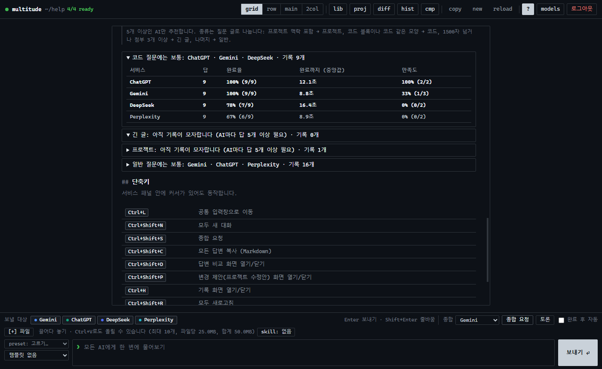

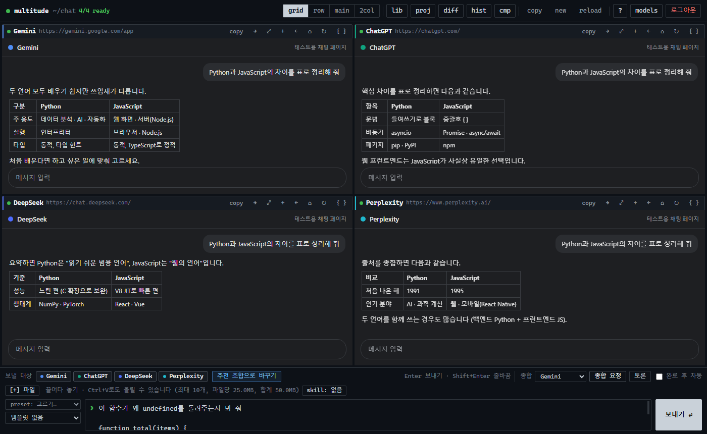

### 추천 줄 세우기 · 시간대별 응답 속도 (v0.35.0)

- **★ 반영**: ★ 표시한 기록에서 `[+1]` · `[-1]`을 따로 남기지 않은 AI의 **끝난 답**은 "좋았음" **반 표**로 만족도에 더합니다 (평가를 남겼으면 그것만 셈). 표 숫자는 `83% (좋음 5 · 별로 1 · ★2)`처럼 보입니다.
- **줄 세우는 기준**: 설정 › 추천 줄 세우는 기준 — **끝까지 답한 비율 먼저**(기본, 예전과 같음) · **내 평가 먼저**(만족도 → 완료율 → 시간) · **빠른 순 먼저**(시간 → 완료율 → 만족도). 같으면 다음 숫자를 봅니다. 점수를 새로 만들지 않고 사실 숫자만 비교합니다.
- **시간대별 응답 속도**: 설정 › 질문 종류별 추천 아래 표. 끝난 답이 "보낸 뒤 끝날 때까지" 걸린 시간의 **중앙값**(괄호는 답 수)을 AI × 시간대(새벽 0~5시 · 오전 6~11시 · 오후 12~17시 · 저녁 18~23시, 질문을 보낸 시각 · 이 PC 시간)로. 한 칸에 답이 3개보다 적으면 시간 대신 `·`로 숨깁니다. 정확도가 아니라 걸린 시간만입니다.


### 사용 한도 감지

답변이 **끝나지 않았거나**(답변 없음 · 시간 초과 · 보내기 실패) **아주 짧게(400자 미만) 끝났을 때만** 화면 글에서 한도 안내 문구(예: `You've reached your usage limit`, `한도에 도달했습니다`, `요청이 너무 많습니다`)를 찾습니다. 한도에 관한 질문의 긴 정상 답변을 한도로 잘못 보지 않기 위해서입니다.

- 찾으면 그 패널 머리줄에 **[limit] 사용 한도에 걸린 것 같음**(파랑)이 뜨고, 마우스를 올리면 찾은 문구와 안내(잠시 뒤 다시 · 다른 AI 답 쓰기)가 보입니다. 설정의 서비스 화면 상태 표에도 `사용 한도` 열로 나옵니다.
- 그 패널의 다음 답변이 정상으로 끝나면 지웁니다.
- **다른 AI로 보낼까요?** (v0.26.0): 한도에 걸린 패널 아래에 한도에 걸리지 않은 열린 패널 버튼이 뜹니다. 응답 통계에서 빠른 AI가 첫 번째(`(빠름)`)입니다. **저절로 바꿔 보내지 않고**, 누른 AI에게만 그 패널에 마지막으로 보낸 글 · 첨부를 그대로 보냅니다. 결과는 기록의 이어 묻기에 남습니다. ✕로 닫으면 같은 한도 표시에는 다시 묻지 않습니다.

### 실패하면 다시 보내기 (v0.26.0)

- **보내기 실패**(입력창을 못 찾음 · 페이지가 바뀌는 중 등)면 1.5초 뒤 **한 번만** 다시 보냅니다. 머리줄에 `보내지 못해 잠깐 뒤 한 번 다시 보내는 중…`이 보입니다. 사용 한도 · 닫힌 패널은 다시 보내지 않습니다. 설정 › **실패하면 한 번 다시 보내기**에서 끌 수 있습니다 (기본 켬).
- **시간 초과 · 답변 없음**은 사이트가 아직 답하는 중일 수 있어 저절로 다시 보내지 않고, 패널 아래에 **다시 보내기** 버튼만 띄웁니다. 누르면 그 패널에 마지막으로 보낸 글 · 첨부를 그대로 다시 보냅니다. 자동으로 다시 보낸 뒤에도 실패하면 같은 버튼이 뜹니다.
- 서비스 문구가 바뀌면 원격 셀렉터의 `limitText`(정규식)로 고칩니다 ([remote/README.md](../remote/README.md)).


### 작업 프리셋 (v0.29.0)

자주 쓰는 작업 환경을 이름 붙여 저장했다가 한 번에 바꿉니다. 프리셋 하나에 **템플릿(마지막 변수 값 포함) · 켠 스킬(순서대로) · 패널(열 모델) · 보낼 대상 · 배치 · 종합 담당과 완료 후 자동 · 토론 설정(참가 · 라운드 · 판정)** 이 들어갑니다.

- 만들기: 입력창 왼쪽 `preset:` › **＋ 지금 설정을 프리셋으로**, 또는 라이브러리 › **프리셋** 탭. 이름은 프리셋 탭에서 바꿉니다.
- 적용: `preset:`에서 고르거나 프리셋 탭의 **적용**. 패널이 다르면 "이 패널들로 다시 엽니다"를 확인한 뒤 모델 열기와 같은 길로 다시 엽니다(목록에 없는 패널은 닫혀 그 대화는 사라짐). 취소하면 패널은 두고 나머지만 바꿉니다. 지운 스킬 · 템플릿, 쓸 수 없는 서비스(꺼 둔 로컬 LLM 등)는 빼고 알려 줍니다.
- **지금 설정으로 덮어쓰기** · **삭제** · 30개까지. 라이브러리 **내보내기 · 가져오기**와 **설정 옮기기**에 함께 들어갑니다.


### 스킬 이전 버전 (v0.29.0)

스킬 본문을 고쳐 **저장**할 때마다 바로 전 본문을 남깁니다(최대 10개, 합계 6만 자). 편집기 아래 **이전 버전**을 펼쳐 버전을 고르면 그 버전 → 지금 본문의 줄 단위 차이를 보여 주고(− 그 버전에만 · + 지금에만), **이 버전으로 되돌리기**는 그 본문으로 새로 저장합니다(지금 본문은 다시 이전 버전으로 남음).


### 설정 옮기기 (v0.29.0)

설정(`?`) › **설정 옮기기**에서 다른 PC · Windows 앱 ↔ 크롬 확장으로 옮깁니다.

- **내보내기**: 고른 모델 · 배치 · 종합 담당과 자동 종합 · 답변 대기 시간 · 기록 최대 개수 · 알림 · 보내기 전 미리보기 · 다시 보내기 · 추천 조합 · 적용 후 커밋 제안 · 로컬 LLM 설정과, 라이브러리(내 템플릿 · 스킬과 이전 버전 · 프리셋)를 `.mla.json` 파일 하나로. **질문 · 답변 기록, 프로젝트, 로그인 정보(쿠키), 템플릿 변수의 마지막 값은 넣지 않습니다.**
- **비밀번호**(선택, 8자 이상, 두 번)를 넣으면 파일을 암호화합니다: PBKDF2-SHA256 25만 번으로 열쇠를 만들고 AES-GCM으로 잠급니다(무작위 salt · iv). 잊으면 풀 수 없습니다. 비밀번호가 없으면 파일은 읽을 수 있는 JSON입니다.
- **가져오기…**: 파일을 고르면(암호화됐으면 비밀번호) **바뀌는 설정 목록**(지금 → 가져올 값), 라이브러리 개수, 같은 id가 이미 있는 항목 수를 보여 주고, 겹치는 항목을 **덮어쓰기 / 둘 다 남기기**로 고른 뒤 **가져오기**를 눌러야 바꿉니다. 설정은 앱의 원래 설정 창구로 바꿔 예전과 같은 검사를 거치고, 고른 모델이 다르면 패널을 다시 엽니다. 기록 최대 개수를 줄이는 파일이면 오래된 기록이 지워진다고 경고합니다.


## 로컬 LLM 패널

v0.16.0부터 이 PC에서 돌아가는 LLM을 웹 패널과 나란히 씁니다 (**선택 기능**, 기본은 꺼짐).

1. 로컬 LLM 서버를 켭니다: **Ollama**(`ollama serve`, 기본 `http://localhost:11434`) · **LM Studio**(Developer › Start Server, `http://localhost:1234`) · llama.cpp `llama-server` 등 **OpenAI 호환 API**(`/v1/models`, `/v1/chat/completions`)를 주는 서버면 됩니다.
2. 설정(`?`) › **로컬 LLM (선택 기능)** › **로컬 LLM 패널 쓰기**를 켜고, 주소를 확인한 뒤 **연결 확인** → 모델을 고릅니다.
3. **모델 선택**에서 **로컬 LLM**을 다른 AI와 함께 고릅니다 (최대 6개에 포함).

| 항목 | 동작 |
|---|---|
| 대화 | 패널 안에 터미널처럼: 내 질문은 `❯ 질문` 줄, 답은 그 아래 왼쪽 회색 줄이 있는 칸(제목 · 목록 · 표 · 코드 블록). 답이 오는 대로 이어 그립니다(스트리밍). 앞 대화(최근 40개 메시지)를 함께 보냅니다 |
| 머리줄 | 모델 고르기 · **모델 목록**(다시 받기), **＋** 새 대화(대화 지우기), **■** 답 그만 받기. 뒤로 · 새로고침 같은 웹페이지 버튼은 없습니다 |
| 다른 기능 | 공통 입력창 동시 질문, 종합 · 분석(판정 AI로 골라도 됨), 답변 비교 · 차이 강조, 기록, 응답 통계(사용 한도 감지는 없음), 내보내기 — 웹 패널과 같습니다. 셀렉터 자가진단은 쓰지 않습니다 |
| 첨부 | **이미지만** 보냅니다(비전 모델일 때). 문서는 보내지 않고, 프로젝트 모드의 파일 내용은 **본문으로** 보냅니다 |
| 대화 보관 | 앱을 닫으면 패널의 대화는 사라집니다. 질문 · 답변은 기록에 남습니다 |

- **이 PC 밖으로 나가지 않습니다**: 주소는 `localhost` · `127.0.0.1` · `[::1]`의 http(s)만 받고(경로 · 계정이 붙은 주소, 다른 PC 주소는 거부), API 키를 받지 않습니다. 그래서 프로젝트 파일을 로컬 LLM에 보낼 때는 "회사 서버에 올린다"는 확인을 묻지 않습니다.
- **크롬 확장**: 켤 때 크롬이 이 PC 주소(`http://localhost/*`, `http://127.0.0.1/*`) 접근 허용을 한 번 묻습니다 (선택 권한 — 설치 · 업데이트 때는 묻지 않음). Ollama는 확장 프로그램에서 오는 요청을 막으므로 **`OLLAMA_ORIGINS=chrome-extension://*`** 환경 변수를 넣고 Ollama를 다시 켜야 합니다 (Windows: 시스템 환경 변수에 추가 → Ollama 종료 후 다시 실행). Windows 앱은 이 설정이 필요 없습니다.
- 끄면 열린 로컬 패널을 닫고 고른 목록 · 종합 담당에서도 뺍니다.

### 패널 없이 판정 · 압축 (v0.29.0)

로컬 LLM을 켜 두면 패널을 열지 않아도 **종합 담당**(입력창 아래 `종합`) · **토론 판정** · 스킬 **AI로 압축**의 맡길 AI에 **로컬 LLM (패널 없이)** 가 나옵니다. 고르면 보이는 패널의 대화와 따로인 **임시 대화**(그 질문 하나만)로 묻습니다 — 패널 대화를 어지럽히지 않고, 패널을 다시 배치하지 않아도 되어서 이렇게 했습니다. 답은 스트리밍 없이 한 번에 받고(최대 10분), 종합 결과는 패널이 없으므로 **결과 보기**로 기록 화면에서 엽니다(분석은 답변 비교 › 분석 탭). 로컬 LLM 패널이 열려 있으면 예전처럼 그 패널로 보냅니다.

### 컨텍스트 한도 (v0.29.0)

설정 › 로컬 LLM › **로컬 모델 컨텍스트 한도**(2k · 4k · 8k · 16k · 32k · 128k 토큰, 기본 8k)를 쓰는 모델에 맞추세요. 토큰은 어림입니다(영문 4글자 ≈ 1, 한글 1글자 ≈ 1 — 한글을 넉넉히 셈). 한도의 1/4은 답 자리로 남깁니다.

- 종합 · 분석 · 토론 판정을 로컬 LLM이 맡을 때 넘을 것 같으면 다른 AI의 답변을 **같은 비율로 앞부분만** 넣고 끝에 `(… 로컬 모델 컨텍스트 한도 때문에 일부만 보냄)`을 붙입니다. 입력창 아래 안내에 줄인 AI 이름이 나옵니다.
- 그 밖의 질문은 줄이지 않고, **보내기 전 미리보기**와 로컬 LLM 패널에 경고만 띄웁니다(패널은 지금까지 대화 전체로 셈 — 새 대화를 권함).


## 내보내기

v0.14.0부터 질문과 답변을 파일로 저장합니다.

| 어디서 | 담기는 것 |
|---|---|
| **기록** 화면 › 고른 기록의 **MD 저장** · **HTML 저장** | 그 질문, 첨부 파일 이름, AI별 답변, 종합 결과, 마지막 분석 |
| **기록** 화면 › 체크 칸으로 고른 기록들의 **MD로 묶어 저장** · **HTML로 묶어 저장** (v0.27.0) | 고른 기록 전부를 오래된 것부터 번호를 붙여 한 문서로 |
| **기록** 화면 › 대화 줄기의 **줄기 MD 저장** · **줄기 HTML 저장** (v0.27.0) | 그 대화 줄기의 질문 전부를 차례로 한 문서로 |
| **답변 비교** 화면 위쪽 **MD 저장** · **HTML 저장** | 지금 질문, 열린 패널의 최신 답변, 이번 질문의 분석 |

- **Markdown(.md)**: 메모 앱 · 문서에 그대로 붙여 넣기 좋게. 분석은 판정 AI가 답한 형식 그대로.
- **HTML(.html)**: 브라우저로 열면 밝은 보고서 모양입니다. 분석은 **이견 표**(쟁점 · AI별 입장 · 판단) · 공통 의견 · 근거 부족 · 최종 답변으로, 답변의 제목 · 목록 · 표 · 코드 블록은 살립니다. **인쇄(Ctrl+P) › PDF로 저장**하면 PDF가 됩니다.
- HTML 파일 하나로 완결됩니다 — 바깥 글꼴 · 그림 · 스크립트를 쓰지 않고, 답변 속 태그(`<script>` 등)는 모두 글자로 바꿔 넣으며, 스크립트를 막는 보안 설정(CSP)을 넣습니다.
- 파일 이름은 `날짜 질문 앞부분.md`처럼 정해 두고, 바꿀 수 있습니다.
- 저장 방법: Windows 앱은 저장 창(처음 위치는 다운로드 폴더), 크롬 확장은 크롬의 다운로드로 받습니다 (다운로드 권한을 더 받지 않음).


## 단축키

서비스 패널 안에 커서가 있어도 동작합니다. 앱에서 `Ctrl+/`로 전체 목록을 볼 수 있습니다.

**파일 나무(프로젝트 사이드바, v0.31.0)**는 Tab 한 번에 닿는 한 덩어리이고 안에서는 `↑` `↓` 이동 · `→` 폴더 펼치기(펼쳐져 있으면 첫 항목으로) · `←` 접기(접혀 있으면 부모 폴더로) · `Home` `End` 처음 · 끝 · `Enter` 파일 열기 / 폴더 펼치기 · `Space` 보낼 파일로 고르기입니다.

| 키 | 동작 |
|---|---|
| `Ctrl+L` | 공통 입력창으로 이동 |
| `Ctrl+Shift+N` (확장 프로그램: `Alt+Shift+N`) | 모두 새 대화 |
| `Ctrl+Shift+S` | 종합 요청 |
| `Ctrl+Shift+C` | 모든 답변 복사 (Markdown) |
| `Ctrl+Shift+R` | 모두 새로고침 |
| `Ctrl+Shift+D` / `Ctrl+H` | 답변 비교 / 기록 화면 |
| `Ctrl+Shift+P` (확장 프로그램: `Alt+Shift+P`) | 변경 제안 화면 (프로젝트 모드) |
| `Ctrl+1~9` (확장 프로그램: `Alt+Shift+1~6`) / `Alt+1~9` | N번째 보낼 대상 켜기·끄기 / N번째 패널로 이동 |
| `Ctrl+/` | 설정 · 단축키 화면 |
| `Ctrl` `+` / `Ctrl` `-` / `Ctrl+0` (Windows 앱, v0.31.0) | 앱 화면 크게 · 작게 · 원래 크기 (8단계 80%~200%, 기억함). AI 사이트 패널은 그 사이트의 크기 그대로. 크롬 확장은 브라우저 확대를 쓰세요 |
| `Esc` | 비교 · 변경 제안 · 파일 편집 · git 콘솔 · 라이브러리 · 기록 · 도움말 화면에서 패널로 돌아가기 (변수 입력은 취소) |
| `Alt+Shift+S` (크롬 확장) | 사이드탭 열기 · 지금 페이지 가져오기 ([사이드탭](chrome-extension.md#사이드탭-크롬-확장)) |

