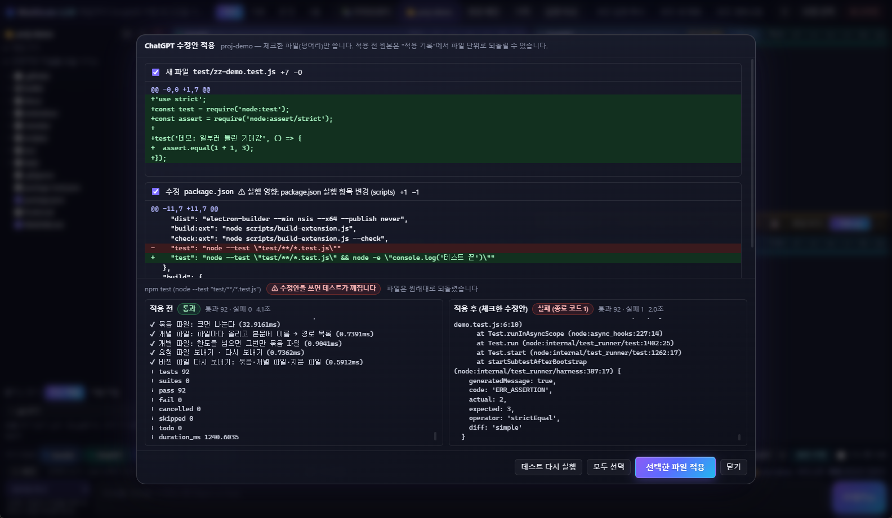
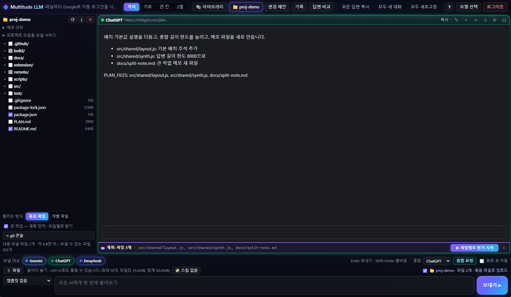
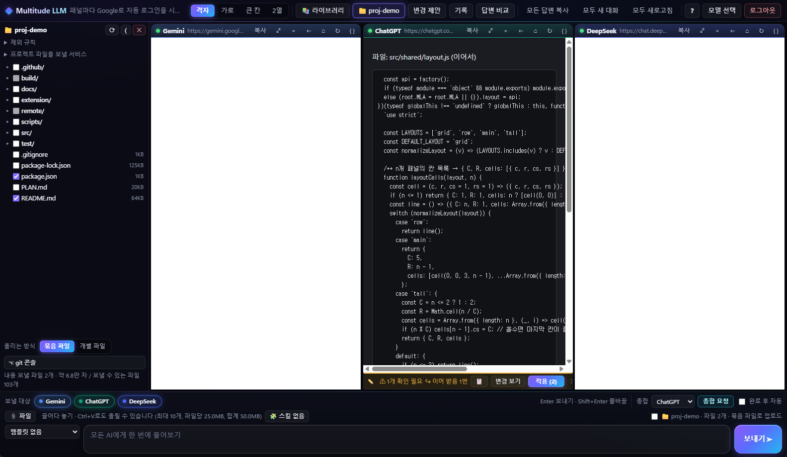
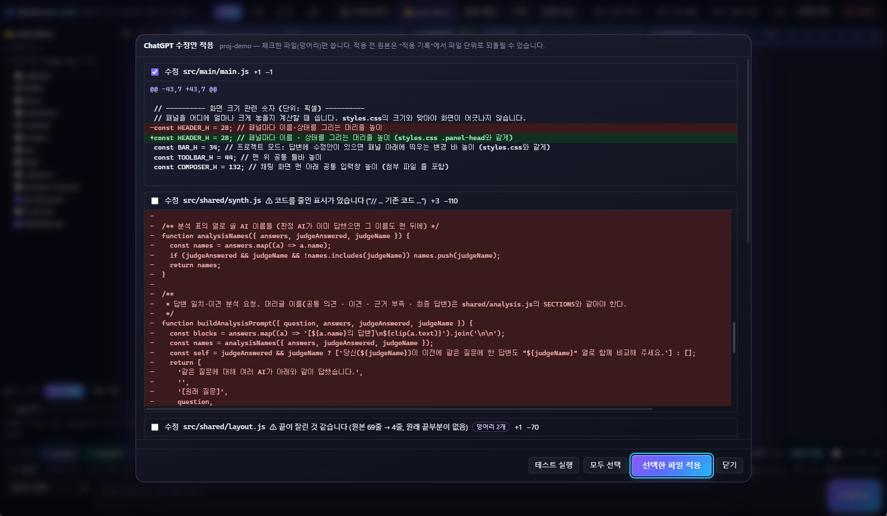

# 프로젝트 모드 · 코드 작업

[← README](../README.md)

## 프로젝트 모드

로컬 프로젝트 폴더를 열어 여러 AI와 함께 코드 작업을 합니다. 웹 채팅의 AI가 폴더를 직접 열어 보는 것이 아니라, **앱이 고른 내용만 대화에 넣어 주고**, AI 답변의 수정안을 **사용자가 확인한 뒤** 파일에 씁니다.

| 단계 | 하는 일 |
|---|---|
| 1. 열기 | 툴바 **proj**(프로젝트) → 폴더 선택. 왼쪽 사이드바(300px)에 파일 트리. `package.json`·`README` 같은 핵심 파일은 처음부터 골라 둠 |
| 2. 고르기 | 체크한 파일의 내용과, 제외 규칙을 통과한 **전체 구조(파일 이름 목록)** 를 보냄. 입력창 오른쪽 `~/이름 · 파일 N개 · …로 업로드`를 끄면 맥락 없이 보냄 |
| 3. 보내기 | 구조와 파일 내용은 **파일로 업로드**하고, 본문에는 질문과 답변 규칙(바꾸거나 새로 만든 파일마다 `파일: 경로` + **전체 내용** 코드 블록 하나 — 생략 금지, 한 파일은 블록 하나, 안에 ```` ``` ````가 든 파일은 백틱 4개 울타리 — 지울 파일은 `DELETE_FILES:`, 더 볼 파일은 `NEED_FILES:`)만 넣음. 올리는 방식은 아래 표 |
| 4. 요청 파일 | 답변 끝에 `NEED_FILES: a.js, b.ts`가 있으면 패널에 **[+] 요청 파일 N개 보내기** → 그 패널에만 업로드 (제외 규칙·비밀 검사 그대로 적용, 못 보낸 파일은 이유를 함께 알림) |
| 4-1. 바뀐 파일 | AI마다 받은 파일 내용을 기억해 두고, 사이드바 **⟳** 때 로컬 파일과 비교. 직접 고쳤거나 다른 AI의 수정안을 적용해 달라진 파일이 있으면 **⇪ 바뀐 파일 N개 → AI N곳에 보내기** → 그 탭들에 지금 내용(지운 파일은 목록)을 업로드하고 "확인만" 부탁. 비밀 검사 그대로 적용. 패널에서 새 대화를 열면 그 AI의 기록은 지움 |
| 4-2. 직접 편집 | 사이드바 트리에서 **파일 이름**을 누르면 편집 화면(사이드바는 그대로). **저장**(Ctrl+S)은 로컬 파일에 쓰고 적용 기록에 `직접 편집`으로 남김. 연 뒤 다른 곳에서 파일이 바뀌었으면 덮어쓸지 물음. 원래 줄바꿈(CRLF/LF) 유지, Tab은 파일의 들여쓰기로 넣음. **저장하고 AI에 보내기**는 저장 뒤 그 파일을 받은 적 있는 AI 탭에 지금 내용을 보냄. 앱 내장 제외(L1) 파일은 열지 않음 |
| 5. 변경 바 | 답변에 수정안이 있으면 패널 아래 바: 파일 수 · +/− · 파일 이름 (마우스를 올리면 파일별). **적용 (N)** = 미리보기 창의 기본 체크 파일만 바로 씀, 실행 영향 파일·삭제는 `⚠ N개 확인 필요` → **변경 보기**에서 골라 적용. 적용하면 `✓ 적용됨` + **되돌리기**, 다른 AI의 바는 지금 파일 기준으로 다시 계산. 트리에 `M`(수정)·`A`(새 파일). 새 질문·새 대화면 바를 내림 |
| 5-1. 변경 제안 | **변경 제안**(Ctrl+Shift+P, 확장 Alt+Shift+P) — AI별 수정안 목록(수정·새 파일·삭제, +/− 줄 수). 맞지 않거나 잘렸으면 `⚠ 적용 불가` + **다시 요청**(짧은 파일은 전체, 긴 파일은 찾기/바꾸기로, v0.17.0). 잘림 · 생략이 의심되면 `⚠ 잘림 · 생략?`. 직접 붙여 넣으려면 **모아보기** ([파일 모아보기](#파일-모아보기)) |
| 6. 적용 | **미리보기·적용**(바의 **변경 보기**) → 파일별 diff 확인 → 체크한 파일만 씀 (Enter · Ctrl+Enter). 수정하는 파일에 바뀐 곳(덩어리)이 둘 이상이면 `덩어리 N개`와 덩어리마다 체크 상자 — 고른 덩어리만 씀 (v0.12.0). 쓰기 직전에 파일이 바뀌었으면 다시 계산 (덩어리 일부만 고른 파일은 미리보기를 다시 열라고 알림). 앱 내장 제외 경로(`.env`, `.git`, `node_modules` 등)에는 쓰지 않음 |
| 6-1. 테스트 실행 | Windows 앱의 미리보기 창 **테스트 실행** → 적용 전과 체크한 수정안을 쓴 후의 `npm test` 결과를 나란히 비교한 뒤 적용 ([자세히](#테스트-실행-windows-앱)) |
| 7. 되돌리기 | **적용 기록**(최근 20개)에서 되돌리기 — 적용 전 내용으로 복구, 새로 만든 파일은 지움. 그 뒤에 다시 바뀐 파일이 있으면 확인을 받음. git은 건드리지 않음. 덩어리 일부만 적용했어도 되돌리기는 파일 단위 |

### 올리는 방식 (사이드바 아래 `올리는 방식`)

| 방식 | 올리는 것 | 본문 |
|---|---|---|
| **묶음 파일** (기본) | 첫 질문 `project-context.md`, 요청 파일 `requested-files.md`, 바뀐 파일 `updated-files.md`, 다시 요청 `refetch-<이름>.md`. 안에는 `[파일: 경로]` + 코드 블록. **100만 바이트**(UTF-8, 한글은 한 글자 3바이트)나 서비스의 파일 하나 한도를 넘으면 `-1.md`, `-2.md`로 나눔 (v0.10.1부터 바이트 기준. 파일 하나가 그보다 크면 그 파일도 `1/2`, `2/2` 조각으로 나눔) | 질문·답변 규칙과 짧은 안내 |
| **개별 파일** | 파일마다 하나씩. 이름에 경로를 넣음 (`src/a/index.js` → `src__a__index.js`), 자주 안 받는 형식·확장자 없는 파일은 `.txt`를 붙임 (`Dockerfile.txt`) | "올린 이름 → 실제 경로" 목록, 프로젝트 구조, 질문·답변 규칙 |

- 개별 파일이 첨부 한도(직접 올린 파일 포함 10개, 합계 50MB)를 넘으면 그번만 묶음 파일로 보냅니다. AI가 `src__a__index.js` 같은 올린 이름으로 `NEED_FILES`를 요청해도 실제 경로로 찾아 줍니다.
- **업로드를 못 할 때(내부 예비 경로):** 문서 첨부를 받지 않는 서비스(Duck.ai)와 업로드에 실패한 패널에는 같은 내용을 본문에 넣어 보냅니다 (10만 자에서 자름). 패널에 `[+] 업로드 실패 → 본문으로 보냄`이 뜹니다.
- 서비스에 따라 긴 첨부 문서는 전부 읽지 않고 필요한 부분만 찾아 읽을 수 있습니다.

### 3단계 제외 규칙

| 단계 | 기본 | 대상 | 직접 체크 |
|---|---|---|---|
| **L1 항상 제외** | 항상 | 앱 내장: `.git/` `node_modules/` `.env*`(`.env.example` 제외) 키·인증서(`*.pem` `*.key` `id_rsa*` …) 자격 증명(`credentials*.json` `.npmrc` `.aws/` `.ssh/` …) 바이너리·미디어·압축·문서(`*.png` `*.pdf` `*.zip` `*.exe` …) 1MB 초과 파일, 바로가기 링크 | 불가 |
| **L2 기본 적용** | 켜짐 | `.gitignore`(하위 폴더 것 포함), `.git/info/exclude`, git 전역 제외 파일(Windows 앱만), AI 전용 `.cursorignore` `.aiexclude` `.geminiignore` `.codeiumignore`, 이 앱 전용 `.mlaignore` | 가능 |
| **L3 선택 적용** | 꺼짐 | `.dockerignore` `.npmignore` `.eslintignore` `.prettierignore` `.vercelignore` `.gcloudignore` `.helmignore` `.slugignore` — 사이드바 **제외 규칙**에서 켬 ("켜면 N개 더 제외" 표시) | 가능 |

- `.dockerignore`·`.npmignore`는 이미지·배포 크기를 줄이려고 테스트·문서까지 빼는 경우가 많아 기본으로 쓰지 않습니다. `.dockerignore`는 루트 기준 문법이라 그에 맞게 해석합니다.
- 같은 단계 안에서는 git처럼 나중 규칙이 이깁니다. `.mlaignore`가 가장 나중이라 `!경로`로 `.gitignore`에 걸린 것을 다시 넣을 수 있습니다 (L1은 불가).
- 트리의 `L1`·`L2`·`L3` 표시에 마우스를 올리면 어느 파일 몇째 줄 때문에 빠졌는지 보입니다.

`.mlaignore` 예 (`.gitignore`와 같은 문법):

```gitignore
# AI에게 보내지 않을 것
legal/
*.sql
# .gitignore에 걸려도 보내고 싶은 것
!src/generated/api-types.ts
```

### 비밀 정보 검사

파일을 고를 때와 보낼 때 개인 키, AWS·GitHub·GitLab·Slack·Google·Stripe 키, `sk-` API 키, JWT, `password = "…"` 같은 대입을 찾습니다. 걸린 파일은 `⚠ 비밀?`로 표시하고 확인을 받아야만 보냅니다 (오탐이 있을 수 있음).

### Windows 앱과 크롬 확장의 차이

| | Windows 앱 | 크롬 확장 |
|---|---|---|
| 폴더 접근 | 폴더 선택 창, 다음 실행 때 자동으로 다시 엶 | File System Access API. 앱 탭을 새로 열 때마다 사이드바의 **폴더 접근 허용**을 한 번 눌러야 함 (크롬 정책) |
| git 전역 제외 파일 | 읽음 (`core.excludesFile`, `~/.config/git/ignore`) | 읽지 못함 |
| 상태 저장 | 앱 데이터 폴더 `projects/` (폴더 경로별) | 크롬 확장 저장소 (폴더를 처음 열 때 만든 고유 id별 — 이름이 같은 폴더도 따로. 같은 폴더인지는 크롬의 `isSameEntry()`로 확인, v0.10.1) |
| git 콘솔 · 터미널 열기 | 있음 | 없음 (확장 프로그램은 프로그램을 실행할 수 없음) |
| 테스트 실행 (미리보기 창) | 있음 (v0.12.0) | 없음 (같은 이유) |

### 테스트 실행 (Windows 앱)

미리보기 창(변경 제안 **미리보기·적용** · 바의 **변경 보기**) 아래 **테스트 실행**을 누르면, 수정안을 실제로 적용하기 전에 프로젝트의 테스트를 돌려 봅니다 (v0.12.0).

1. 확인 창: 실행할 스크립트(`pretest` · `test` · `posttest`)와 폴더를 보여 줍니다. **AI가 고친 코드(테스트 코드 포함)가 이 PC에서 실제로 실행됩니다.** 체크한 수정안이 `package.json`의 test 스크립트를 바꾸면 `test: 이전 → 이후`로, 실행 영향 파일(git 훅 · CI 설정 등)이 들어 있으면 그 파일과 이유를 **⚠로 따로** 보여 줍니다 — "적용 후" 실행에서는 바뀐 스크립트가 돌기 때문입니다 (v0.12.1).
2. **적용 전** — 지금 파일 그대로 `npm test`
3. **적용 후** — 체크한 파일(덩어리)을 잠깐 써 두고 `npm test`
4. 원래 파일로 되돌립니다 (성공 · 실패 · 중지와 상관없이 항상). 새로 만든 파일은 지웁니다.
5. 결과를 **적용 전 | 적용 후**로 나란히 보여 줍니다: 통과 · 실패 · 시간 초과, 통과/실패 수(node --test · jest · vitest · mocha 출력에서 찾음), 걸린 시간, 출력. 위에 한 줄 판정(`✓ 수정안이 실패하던 테스트를 고칩니다`, `⚠ 수정안을 쓰면 테스트가 깨집니다` 등)
6. 결과를 보고 **선택한 파일 적용**으로 실제로 씁니다.

- **실행하는 것**: `package.json`의 `test` 스크립트 하나뿐 (`npm test`). 없거나 npm 기본값(`no test specified`)이면 실행하지 않습니다.
- **실행 방법**: 셸(cmd.exe)을 거치지 않고 `npm-cli.js test`를 실행합니다. npm과 같은 Node 설치의 `node.exe`가 있으면 그것으로(v0.12.1), 없을 때만 앱 자신(`process.execPath`, `ELECTRON_RUN_AS_NODE=1`)으로 실행합니다 — 이 값은 테스트가 띄우는 프로그램에도 물려가 Electron을 띄우는 테스트가 오동작하기 때문입니다. Windows에서 `npm.cmd`를 셸 없이 띄우면 EINVAL로 실패하기 때문입니다. `npm-cli.js`는 PATH의 절대 경로 폴더에 있는 npm에서만 찾습니다 (`%APPDATA%\npm`, `Program Files\nodejs`도 봄). Node.js가 설치돼 있어야 합니다.
- **제한**: 한 번에 하나, 3분 시간 제한(넘으면 그 프로세스와 하위 프로세스를 끔), 출력 2MB, 토큰 · 키처럼 보이는 글자는 가림 (git 콘솔과 같은 규칙). **테스트 중지**로 멈출 수 있고, 창을 닫아도 멈춥니다.
- **실행 중에는** 다른 적용 · 편집기 저장 · 프로젝트 닫기를 받지 않습니다.
- **앱이 도중에 꺼져도**: 잠깐 쓰기 전에 원본을 앱 데이터 폴더(`devtest-recovery.json`)에 적어 두고, 다음에 그 프로젝트를 열 때 원래대로 되돌립니다 (사이드바에 알림).
- 새로 만든 파일을 지운 뒤 그 파일을 위해 만든 빈 폴더는 남을 수 있습니다.



### git 콘솔 (Windows 앱)

프로젝트 사이드바 아래 **git 콘솔**을 누르면 그 폴더에서 git 명령을 실행하는 화면이 열립니다. `status`·`diff --stat`·`log`·`branch` 버튼, ↑↓로 이전 명령, **중지**, **터미널 열기**(그 폴더에서 Windows 터미널, 없으면 PowerShell)가 있습니다.

- **git 명령만**: 셸을 거치지 않고 git.exe를 바로 실행하므로 `;`·`&&`·`|` 같은 글자는 그냥 git 인자가 됩니다. git.exe는 PATH의 절대 경로 폴더에서만 찾습니다 (프로젝트 안의 가짜 `git.exe`는 쓰지 않음).
- **쓸 수 있는 하위 명령**: status · log · diff · show · blame · shortlog · reflog · ls-files · rev-parse · describe · add · rm · mv · restore · reset · commit · revert · cherry-pick · branch · switch · checkout · merge · tag · stash · fetch · pull · push · remote · init · config(읽기만) · version
- **막는 것**: git 앞 옵션(`-c`, `-C`, `--git-dir` …), `clean`·`rebase`·`submodule`·`grep`·`difftool`·`help` 등, 외부 프로그램을 띄우는 옵션(`--upload-pack`, `--exec`, `--ext-diff`), 다른 파일에 쓰는 `--output`, 대화형 옵션(`add -p`, `-i` …), 설정 쓰기, 메시지 없는 `commit`(편집기를 열 수 없음)
- **항상 붙이는 것**: `--no-pager`, `core.fsmonitor=false`, `core.editor=:`, `protocol.ext.allow=never` / 비밀번호는 터미널로 묻지 않음(`GIT_TERMINAL_PROMPT=0`, Git 자격 증명 관리자 창은 뜰 수 있음)
- **확인 창**: `reset --hard`, `push --force`·`+브랜치`·`:브랜치`, `branch -D`, `checkout -- 경로`·`-f`, `restore`, `stash drop/clear`, `rm`, `tag -d`, `remote remove/set-url`
- 한 번에 하나, 시간 제한(fetch·pull·push 2분, 나머지 1분), 출력 2MB까지. 출력과 입력 줄의 `https://아이디:토큰@` 주소와 알려진 키 모양은 가립니다.
- 콘솔을 열면 이 저장소의 **git 훅**(commit 등에서 실행되는 프로그램)이 있는지 알려 줍니다. AI 수정안은 `.git` 안쪽을 쓸 수 없으므로(v0.6.3) AI가 훅을 심을 수는 없습니다.

## 파일 모아보기

AI 답변에서 **고칠 파일과 새로 만들 파일**을 찾아 경로와 전체 코드를 한 화면에 모읍니다. 직접 복사해서 내 편집기에 붙여 넣는 용도이고, **파일에는 쓰지 않습니다** (파일에 바로 쓰려면 프로젝트 모드의 [변경 바 · 변경 제안](#프로젝트-모드). 프로젝트를 열어 두면 이 버튼은 패널 아래 변경 바 안의 **collect** 로 들어갑니다).

1. 답변이 끝났을 때 답변 안에 파일 코드가 있으면 그 패널 머리줄에 **파일 N개 모아보기** 버튼이 나타납니다. 처음 나타날 때 노란 테두리로 몇 번 깜빡이고, 누를 때까지 노란 테두리가 남습니다 (움직임 줄이기를 켜면 깜빡이지 않음). 변경 제안 화면의 AI별 칸에도 **모아보기**가 있습니다.
2. 누르면 파일마다 표시 · 경로 · 전체 코드가 나옵니다. 파일마다 **경로 복사** · **코드 복사**, 아래 **전체 복사**는 파일 목록과 `파일: 경로` + 코드 블록을 한 번에 복사합니다 (지울 파일은 `DELETE_FILES:` 한 줄).

| 표시 | 뜻 |
|---|---|
| **새 파일** | 프로젝트에 없는 파일 |
| **수정** | 있는 파일. AI가 바뀐 부분만(diff) 줘도 지금 파일과 합친 **완성된 전체 코드**로 보여 줌 |
| **변경 없음** | 지금 파일과 내용이 같음 |
| **삭제** | 답변의 `DELETE_FILES:` |
| **전체 코드** | 프로젝트를 열지 않아 새 파일인지 수정인지 모름 — AI가 준 코드 그대로 |
| **바뀐 부분(diff)** | 프로젝트를 열지 않았거나 지금 파일과 맞지 않아 전체 코드로 바꾸지 못함 — diff 그대로 |

**잡히는 답변 형식**: 코드 블록 바로 앞 줄에 `파일: 경로`(또는 `**경로**` · `### 경로`)가 있는 블록, ```` ```diff ```` 블록, 코드 블록 밖의 `DELETE_FILES:` 줄. 프로젝트 모드로 보낸 질문에는 이 형식을 요구하는 답변 규칙이 자동으로 붙고, 프로젝트 없이 물을 때는 기본 템플릿 **코드 수정 (파일 모아보기)** 를 쓰면 됩니다. 이 템플릿은 AI에게 다음을 요구합니다.

- 맨 앞에 바뀌는 파일 목록을 `[새 파일]` / `[수정]` / `[삭제]`로 표시
- 파일마다 `파일: 경로` 한 줄 + 전체 내용 코드 블록 하나 (diff 금지)
- (프로젝트 모드 · 코드 리뷰 · 종합으로 합치기, v0.17.0) 150줄보다 긴 기존 파일은 전체 대신 같은 코드 블록 안에 **찾기/바꾸기**로 바꿀 곳만:

  ```
  파일: src/main/main.js
  <<<<<<< 찾기
  (지금 파일의 그 부분 그대로 — 파일 안에서 한 곳만 맞게 앞뒤 줄 조금 포함)
  =======
  (바꾼 내용)
  >>>>>>> 바꾸기
  ```

  찾을 부분이 지금 파일에 **딱 한 곳** 있을 때만 바꿉니다 (줄 끝 · 앞뒤 공백 차이는 너그럽게). 못 찾거나 여러 곳이면 `⚠ 적용 불가` + **다시 요청**. 영어 표시(`<<<<<<< SEARCH` · `>>>>>>> REPLACE`)도 받습니다. 프로젝트 없이 모아보기를 쓰면 블록 그대로 보여 줍니다.
- 코드 생략 금지 (`... 기존과 동일` 같은 줄 없이 그대로 붙여 넣을 수 있는 전체 파일)
- 한 파일은 길어도 **코드 블록 하나**, 설명은 블록 밖에
- `.md` · `.txt`처럼 안에 ```` ``` ````가 든 파일은 바깥 울타리를 ````` ```` ````` (백틱 4개)로 — 안쪽 ```` ``` ````에서 블록이 끊기지 않게
- 지울 파일은 `DELETE_FILES: 경로1, 경로2`

AI가 규칙을 어기고 백틱 3개로 감싸 서비스 화면에서 이미 블록이 쪼개졌다면 앱이 되살릴 수 없습니다. "백틱 4개로 감싸서 다시 줘"라고 한 번 더 요청하세요.

## 잘린 답변 막기

AI 서비스마다 한 번에 쓸 수 있는 답의 길이(출력 한도)가 있어, 긴 파일을 여러 개 고치면 답이 중간에 끊깁니다. v0.17.0부터 끊긴 수정안이 파일을 망가뜨리지 않게 막습니다.

| 알아채는 것 | 어떻게 하나 |
|---|---|
| 코드 블록이 닫히지 않음 (로컬 LLM · 찾기/바꾸기의 끝 표시가 없음 등) | **적용 불가** — 바에 `✂ 답변이 잘림 N개`, 변경 제안에 **다시 요청** |
| 코드 파일인데 괄호가 닫히지 않음 (웹 채팅은 잘린 답도 코드 상자를 닫아서 보여 줌) | 의심 — `⚠ 끝이 잘린 것 같습니다 (괄호 N개가 닫히지 않음)` |
| 전체 교체인데 원본 끝부분이 통째로 사라짐 (원본 30줄 이상, 60% 미만으로 줄고 마지막 줄들이 없음) | 의심 — `⚠ 끝이 잘린 것 같습니다 (원본 N줄 → M줄)` |
| `// ... 기존 코드 ...` · `# ... (생략)` · `<!-- 이하 동일 -->`처럼 코드를 줄인 표시 | 의심 — `⚠ 코드를 줄인 표시가 있습니다` |

- **의심**인 파일은 적용할 수는 있지만 바의 **적용 (N)**에서 빠지고(`⚠ N개 확인 필요`), 미리보기에서 기본으로 체크되지 않습니다. −줄을 보고 직접 체크하세요.
- **다시 요청**은 지금 파일 내용을 첨부해 다시 달라고 하고, 긴 파일(150줄 넘음)은 전체 대신 찾기/바꾸기로 달라고 합니다 — 다시 받다가 또 잘리지 않게.
- 모아보기에서도 잘린 파일에는 `⚠ 답변이 중간에 잘려 이 파일의 뒷부분이 없습니다`를 붙입니다.

### 큰 작업 — 계획 먼저 · 파일별로 받기

v0.18.0부터 고칠 파일이 많거나 길어 한 답에 다 못 쓰는 작업은 **나눠서** 받습니다. 답 하나의 길이가 파일 하나로 줄어 출력 한도에 걸리지 않습니다.

1. 프로젝트 사이드바 아래 **큰 작업 — 계획 먼저 · 파일별로 받기**를 켭니다 (프로젝트마다 기억). 꺼져 있어도 고른 파일이 4개를 넘거나 합계 600줄을 넘으면 한 번 권합니다.
2. 평소처럼 질문합니다. 이번 답은 **코드 없이 계획만** 오게 부탁합니다: 무엇을 바꿀지 몇 줄 + 파일마다 `- 경로: 할 일` + 맨 끝 `PLAN_FILES: 경로1, 경로2, …` (지울 파일은 `DELETE_FILES:`).
3. 계획 답이 오면 그 패널의 변경 바에 `» 계획: 파일 N개`와 **▶ 파일별로 받기 시작**이 뜹니다 (마우스를 올리면 파일별 할 일).
4. 시작하면 앱이 "계획대로 1/N번째 파일만 줘: 경로 — 할 일"을 보내고, 답이 끝날 때마다 수정안을 모은 뒤 다음 파일을 보냅니다. 바에 `… 파일별로 받는 중 i/N`. 각 파일은 답변 규칙대로(짧은 파일은 전체, 긴 파일은 찾기/바꾸기) 받습니다.
5. 다 받으면(또는 **멈추기**) 모은 수정안이 한 묶음으로 바에 나옵니다: `» 파일별로 받음 M/N` + 미리보기 · 테스트 실행 · 적용. 그중 잘린 파일은 **↪ 이어서 받기**로 마저 받습니다.

- **건너뛰기**: 지금 파일은 받지 않고, 그 답이 끝나면 다음 파일로 갑니다. 답이 시간 초과 · 답변 없음으로 끝나면 자동으로 넘어가지 않으니 **멈추기**(여기까지 받은 것으로) 또는 건너뛰기를 누르세요.
- 여러 패널이 각자 따로 진행합니다. 그 패널에서 새 대화를 열면 멈춥니다.
- 계획에 적힌 경로라도 앱 내장 제외 경로(`.env`, `.git` 등)는 받지 않습니다. 계획은 최대 30개 파일.



### 이어서 받기 (v0.17.1)

잘렸거나 끝이 잘린 것으로 의심되는 파일이 있으면 그 패널의 변경 바에 **↪ 이어서 받기**가 생깁니다.

1. 받은 코드의 마지막 줄은 중간에 끊겼을 수 있어 버리고, 그 앞 줄(기준 줄)을 보여 주며 같은 AI에게 부탁합니다: "이 줄을 첫 줄로 한 번 더 쓰고, 그 다음부터 파일 끝까지 나머지만 `파일: 경로 (이어서)` 코드 블록 하나로 줘". 찾기/바꾸기였으면 "끝난 N개 다음부터 남은 것만".
2. 답이 끝나면 **기준 줄이 겹치는지** 보고 이어 붙입니다 (잘린 줄을 마저 쓴 경우, 앞부분을 몇 줄 더 쓴 경우도 받음). 맞지 않으면 붙이지 않고 `이어 붙이지 못함`으로 알립니다 — 엉뚱한 곳에 붙여 코드를 망가뜨리지 않게.
3. 합친 파일로 다시 계산해 바 · 미리보기 · 테스트 실행에 그대로 넣습니다. 바에 `↪ 이어 받음 N번`. 끊긴 파일 뒤에 주려던 다른 파일이 이어 받은 답에 있으면 그것도 함께 넣습니다.
4. 또 끊기면 한 번 더 누릅니다 (한 파일 최대 3번). 그래도 안 되면 변경 제안의 **다시 요청**(긴 파일은 찾기/바꾸기로)을 쓰세요.

- `... 기존 코드 ...`처럼 **줄인 표시**만 있는 파일은 이어 받을 것이 아니라 다시 요청이 맞아서 버튼이 뜨지 않습니다. diff 형식도 다시 요청으로 받습니다.
- 이어 받는 동안 그 패널에서 새 대화를 열면 이어 받기를 취소합니다.





