# 프로젝트 모드 · 코드 작업

[← README](../README.md)

## 프로젝트 모드

로컬 프로젝트 폴더를 열어 여러 AI와 함께 코드 작업을 합니다. 웹 채팅의 AI가 폴더를 직접 열어 보는 것이 아니라, **앱이 고른 내용만 대화에 넣어 주고**, AI 답변의 수정안을 **사용자가 확인한 뒤** 파일에 씁니다.

| 단계 | 하는 일 |
|---|---|
| 1. 열기 | 툴바 **proj**(프로젝트) → 폴더 선택. 왼쪽 사이드바(300px)에 파일 트리. `package.json`·`README` 같은 핵심 파일은 처음부터 골라 둠 |
| 2. 고르기 | 체크한 파일의 내용과, 제외 규칙을 통과한 **전체 구조(파일 이름 목록)** 를 보냄. 입력창 오른쪽 `~/이름 · 파일 N개 · …로 업로드`를 끄면 맥락 없이 보냄 |
| 3. 보내기 | 구조와 파일 내용은 **파일로 업로드**하고, 본문에는 질문과 답변 규칙(바꾸거나 새로 만든 파일마다 `파일: 경로` + **전체 내용** 코드 블록 하나 — 생략 금지, 한 파일은 블록 하나, 안에 ```` ``` ````가 든 파일은 백틱 4개 울타리 — 지울 파일은 `DELETE_FILES:`, 더 볼 파일은 `NEED_FILES:`)만 넣음. 올리는 방식은 아래 표 |
| 4. 요청 파일 | 답변 끝에 `NEED_FILES: a.js, b.ts`가 있으면 패널에 **[+] 요청 파일 N개 보내기** → 그 패널에만 업로드 (제외 규칙·비밀 검사 그대로 적용, 못 보낸 파일은 이유를 함께 알림) |
| 4-1. 바뀐 파일 | AI마다 받은 파일 내용을 기억해 두고, 사이드바 **⟳** 때 로컬 파일과 비교. 직접 고쳤거나 다른 AI의 수정안을 적용해 달라진 파일이 있으면 **⇪ 바뀐 파일 N개 → AI N곳에 보내기** → 그 탭들에 지금 내용(지운 파일은 목록)을 업로드하고 "확인만" 부탁. 비밀 검사 그대로 적용. 패널에서 새 대화를 열면 그 AI의 기록은 지움 |
| 4-2. 직접 편집 | 사이드바 트리에서 **파일 이름**을 누르면 편집 화면(사이드바는 그대로). **저장**(Ctrl+S)은 로컬 파일에 쓰고 적용 기록에 `직접 편집`으로 남김. 연 뒤 다른 곳에서 파일이 바뀌었으면 덮어쓸지 물음. 원래 줄바꿈(CRLF/LF) 유지, Tab은 파일의 들여쓰기로 넣음. **저장하고 AI에 보내기**는 저장 뒤 그 파일을 받은 적 있는 AI 탭에 지금 내용을 보냄. 앱 내장 제외(L1) 파일은 열지 않음 |
| 5. 변경 바 | 답변에 수정안이 있으면 패널 아래 바: 파일 수 · +/− · 파일 이름 (마우스를 올리면 파일별). **적용 (N)** = 미리보기 창의 기본 체크 파일만 바로 씀, 실행 영향 파일·삭제는 `⚠ N개 확인 필요` → **변경 보기**에서 골라 적용. 적용하면 `✓ 적용됨` + **되돌리기**, 다른 AI의 바는 지금 파일 기준으로 다시 계산. 트리에 `M`(수정)·`A`(새 파일). 새 질문·새 대화면 바를 내림 |
| 5-1. 변경 제안 | **변경 제안**(Ctrl+Shift+P, 확장 Alt+Shift+P) — AI별 수정안 목록(수정·새 파일·삭제, +/− 줄 수). 맞지 않거나 잘렸으면 `⚠ 적용 불가` + **다시 요청**(짧은 파일은 전체, 긴 파일은 찾기/바꾸기로, v0.17.0). 잘림 · 생략이 의심되면 `⚠ 잘림 · 생략?`. 직접 붙여 넣으려면 **모아보기** ([파일 모아보기](#파일-모아보기)) |
| 6. 적용 | **미리보기·적용**(바의 **변경 보기**) → 파일별 diff 확인 → 체크한 파일만 씀 (Enter · Ctrl+Enter). 수정하는 파일에 바뀐 곳(덩어리)이 둘 이상이면 `덩어리 N개`와 덩어리마다 체크 상자 — 고른 덩어리만 씀 (v0.12.0). 쓰기 직전에 파일이 바뀌었으면 다시 계산 (덩어리 일부만 고른 파일은 미리보기를 다시 열라고 알림). 앱 내장 제외 경로(`.env`, `.git`, `node_modules` 등)에는 쓰지 않음 |
| 6-1. 테스트 실행 | Windows 앱의 미리보기 창 **테스트 실행** → 적용 전과 체크한 수정안을 쓴 후의 `npm test`(있으면 고른 `lint` · `typecheck` · `build`도, v0.28.0) 결과를 나란히 비교한 뒤 적용 ([자세히](#테스트-실행-windows-앱)) |
| 6-2. 섞어서 적용 | **변경 제안**의 **섞어서 적용** → 파일마다 어느 AI의 수정안을 쓸지 골라 한 번에 적용 (v0.28.0, [자세히](#섞어서-적용-v0280)) |
| 6-3. 커밋 | Windows 앱: 적용 뒤 **커밋하기…** → 적용한 파일만 커밋, push는 하지 않음 (v0.28.0, [자세히](#적용-후-커밋-windows-앱-v0280)) |
| 7. 되돌리기 | **적용 기록**(최근 20개)에서 되돌리기 — 적용 전 내용으로 복구, 새로 만든 파일은 지움. 그 뒤에 다시 바뀐 파일이 있으면 확인을 받음. git은 건드리지 않음. 덩어리 일부만 적용했어도 되돌리기는 파일 단위 |

### 올리는 방식 (사이드바 아래 `올리는 방식`)

| 방식 | 올리는 것 | 본문 |
|---|---|---|
| **묶음 파일** (기본) | 첫 질문 `project-context.md`, 요청 파일 `requested-files.md`, 바뀐 파일 `updated-files.md`, 다시 요청 `refetch-<이름>.md`. 안에는 `[파일: 경로]` + 코드 블록. **100만 바이트**(UTF-8, 한글은 한 글자 3바이트)나 서비스의 파일 하나 한도를 넘으면 `-1.md`, `-2.md`로 나눔 (v0.10.1부터 바이트 기준. 파일 하나가 그보다 크면 그 파일도 `1/2`, `2/2` 조각으로 나눔) | 질문·답변 규칙과 짧은 안내 |
| **개별 파일** | 파일마다 하나씩. 이름에 경로를 넣음 (`src/a/index.js` → `src__a__index.js`), 자주 안 받는 형식·확장자 없는 파일은 `.txt`를 붙임 (`Dockerfile.txt`) | "올린 이름 → 실제 경로" 목록, 프로젝트 구조, 질문·답변 규칙 |

- 개별 파일이 첨부 한도(직접 올린 파일 포함 10개, 합계 50MB)를 넘으면 그번만 묶음 파일로 보냅니다. AI가 `src__a__index.js` 같은 올린 이름으로 `NEED_FILES`를 요청해도 실제 경로로 찾아 줍니다.
- **업로드를 못 할 때(내부 예비 경로):** 문서 첨부를 받지 않는 서비스(Duck.ai)와 업로드에 실패한 패널에는 같은 내용을 본문에 넣어 보냅니다 (10만 자에서 자름). 패널에 `[+] 업로드 실패 → 본문으로 보냄`이 뜹니다.
- 서비스에 따라 긴 첨부 문서는 전부 읽지 않고 필요한 부분만 찾아 읽을 수 있습니다.

### 바뀐 파일만 보내기 · 이어지는 질문 (v0.23.0)

사이드바의 `잘리면 자동으로 이어 받기` 아래 두 칸입니다.

- **바뀐 파일만 보내기** (기본 켬): 패널마다 받은 파일의 내용 지문(해시)과 줄 수를 기억해, 두 번째 질문부터는 **그 뒤로 바뀐 파일만** `changed-files.md`로 올립니다 (프로젝트 구조가 바뀌었으면 `project-context.md`). 바뀌지 않은 파일은 본문에 `[앞서 보낸 그대로]` 목록으로만 적어 AI가 그 파일이 아직 있다는 것을 압니다. 새로 받는 것이 없는 패널에는 질문과 목록만 갑니다. 끄면 예전처럼 고른 파일을 매번 다 보냅니다.
  - 기억은 같은 앱 실행 안에서만 이어집니다 (앱을 다시 켜면 패널도 새 대화라 처음부터 보냄). 패널의 새 대화 · 닫기에서도 지웁니다.
  - 동시 질문은 첨부를 한 묶음으로만 보낼 수 있어, 어느 한 패널에 필요한 파일은 다른 패널에도 함께 갑니다.
- **이어지는 질문에 지난 파일 목록 붙이기** (기본 끔, 위 칸이 켜졌을 때만): 파일을 고르지 않은 후속 질문에도 그 패널이 받았던 파일을 모두 후보로 삼아, 바뀐 것은 다시 올리고 그대로인 것은 `- a.js (120줄)`처럼, 지워진 것은 `[지워진 파일]`로 적습니다.

### 여러 파일 적용이 중간에 실패하면 (v0.23.0)

변경 바의 **적용 (N)**과 미리보기의 **적용**은 파일을 모두 준비한 뒤 차례로 씁니다. 그중 하나라도 쓰기 · 지우기에 실패하면 **이번에 이미 쓴 파일을 모두 원래대로 되돌립니다** (고친 파일은 원래 내용, 지운 파일은 다시 만들고, 새로 만든 파일은 지움). 알림에 `a.js 쓰기 실패 — 같이 적용한 N개 파일을 원래대로 되돌렸습니다`와 이유, 되돌리지 못한 파일이 있으면 그 목록을 보여 주고, 적용 기록에는 남기지 않습니다. 새 파일을 위해 만든 빈 폴더는 남을 수 있습니다.

파일은 같은 폴더의 임시 파일(`.이름.mla-tmp-…`)에 먼저 쓴 뒤 이름을 바꾸므로, 쓰는 도중 앱이 꺼져도 파일이 반쯤 잘리지 않습니다 (Windows 앱). 임시 파일은 기본 제외 규칙에 들어 있어 파일 목록에 보이지 않습니다.

### 3단계 제외 규칙

| 단계 | 기본 | 대상 | 직접 체크 |
|---|---|---|---|
| **L1 항상 제외** | 항상 | 앱 내장: `.git/` `node_modules/` `.env*`(`.env.example` 제외) 키·인증서(`*.pem` `*.key` `id_rsa*` …) 자격 증명(`credentials*.json` `.npmrc` `.aws/` `.ssh/` …) 바이너리·미디어·압축·문서(`*.png` `*.pdf` `*.zip` `*.exe` …) 1MB 초과 파일, 바로가기 링크 | 불가 |
| **L2 기본 적용** | 켜짐 | `.gitignore`(하위 폴더 것 포함), `.git/info/exclude`, git 전역 제외 파일(Windows 앱만), AI 전용 `.cursorignore` `.aiexclude` `.geminiignore` `.codeiumignore`, 이 앱 전용 `.mlaignore` | 가능 |
| **L3 선택 적용** | 꺼짐 | `.dockerignore` `.npmignore` `.eslintignore` `.prettierignore` `.vercelignore` `.gcloudignore` `.helmignore` `.slugignore` — 사이드바 **제외 규칙**에서 켬 ("켜면 N개 더 제외" 표시) | 가능 |

- `.dockerignore`·`.npmignore`는 이미지·배포 크기를 줄이려고 테스트·문서까지 빼는 경우가 많아 기본으로 쓰지 않습니다. `.dockerignore`는 루트 기준 문법이라 그에 맞게 해석합니다.
- 같은 단계 안에서는 git처럼 나중 규칙이 이깁니다. `.mlaignore`가 가장 나중이라 `!경로`로 `.gitignore`에 걸린 것을 다시 넣을 수 있습니다 (L1은 불가).
- 트리의 `L1`·`L2`·`L3` 표시에 마우스를 올리면 어느 파일 몇째 줄 때문에 빠졌는지 보입니다.

`.mlaignore` 예 (`.gitignore`와 같은 문법):

```gitignore
# AI에게 보내지 않을 것
legal/
*.sql
# .gitignore에 걸려도 보내고 싶은 것
!src/generated/api-types.ts
```

### 비밀 정보 검사

파일을 고를 때와 보낼 때 개인 키, AWS·GitHub·GitLab·Slack·Google·Stripe 키, `sk-` API 키, JWT, `password = "…"` 같은 대입을 찾습니다. 걸린 파일은 `⚠ 비밀?`로 표시하고 확인을 받아야만 보냅니다 (오탐이 있을 수 있음).

### Windows 앱과 크롬 확장의 차이

| | Windows 앱 | 크롬 확장 |
|---|---|---|
| 폴더 접근 | 폴더 선택 창, 다음 실행 때 자동으로 다시 엶 | File System Access API. 앱 탭을 새로 열 때마다 사이드바의 **폴더 접근 허용**을 한 번 눌러야 함 (크롬 정책) |
| git 전역 제외 파일 | 읽음 (`core.excludesFile`, `~/.config/git/ignore`) | 읽지 못함 |
| 상태 저장 | 앱 데이터 폴더 `projects/` (폴더 경로별) | 크롬 확장 저장소 (폴더를 처음 열 때 만든 고유 id별 — 이름이 같은 폴더도 따로. 같은 폴더인지는 크롬의 `isSameEntry()`로 확인, v0.10.1) |
| git 콘솔 · 터미널 열기 | 있음 | 없음 (확장 프로그램은 프로그램을 실행할 수 없음) |
| 테스트 실행 (미리보기 창) | 있음 (v0.12.0, lint · typecheck · build는 v0.28.0) | 없음 (같은 이유) |
| 적용 후 커밋 | 있음 (v0.28.0) | 없음 (같은 이유) |
| 섞어서 적용 · 작업 이어 하기 · 바 두 줄 | 있음 (v0.28.0) | 있음 (v0.28.0) |
| 개발 환경 점검 (실행 · 확인 칸) | 있음 — 설치 여부 · 버전 · 포트 · Docker 엔진 (v0.41.0) | 필요한 도구 **목록만** (프로그램을 실행할 수 없어 설치 여부는 모름) |

### 테스트 실행 (Windows 앱)

미리보기 창(변경 제안 **미리보기·적용** · 바의 **변경 보기**) 아래 **테스트 실행**을 누르면, 수정안을 실제로 적용하기 전에 프로젝트의 테스트를 돌려 봅니다 (v0.12.0).

1. 확인 창: 실행할 스크립트(`pretest` · `test` · `posttest`)와 폴더를 보여 줍니다. **AI가 고친 코드(테스트 코드 포함)가 이 PC에서 실제로 실행됩니다.** 체크한 수정안이 `package.json`의 test 스크립트를 바꾸면 `test: 이전 → 이후`로, 실행 영향 파일(git 훅 · CI 설정 등)이 들어 있으면 그 파일과 이유를 **⚠로 따로** 보여 줍니다 — "적용 후" 실행에서는 바뀐 스크립트가 돌기 때문입니다 (v0.12.1).
2. **적용 전** — 지금 파일 그대로 `npm test`
3. **적용 후** — 체크한 파일(덩어리)을 잠깐 써 두고 `npm test`
4. 원래 파일로 되돌립니다 (성공 · 실패 · 중지와 상관없이 항상). 새로 만든 파일은 지웁니다.
5. 결과를 **적용 전 | 적용 후**로 나란히 보여 줍니다: 통과 · 실패 · 시간 초과, 통과/실패 수(node --test · jest · vitest · mocha 출력에서 찾음), 걸린 시간, 출력. 위에 한 줄 판정(`✓ 수정안이 실패하던 테스트를 고칩니다`, `⚠ 수정안을 쓰면 테스트가 깨집니다` 등)
6. 결과를 보고 **선택한 파일 적용**으로 실제로 씁니다.

- **실행하는 것**: `package.json`의 `test` 스크립트(`npm test`). 없거나 npm 기본값(`no test specified`)이면 실행하지 않습니다.
- **검사 스크립트 고르기 (v0.28.0)**: `package.json`에 `lint` · `typecheck` · `build`가 있으면 **테스트 실행** 옆에 체크 칸(`test` `lint` `typecheck` `build`)이 나옵니다 — 있는 것만, 기본은 `test` 하나(고른 것은 창을 다시 열어도 기억). 이 네 이름 말고는 받지 않고, 화면은 **이름만** 넘기며 실행할 스크립트 글은 본체가 `package.json`에서 읽습니다(`npm-cli.js run lint`). 스크립트마다 적용 전 → 적용 후로 돌리고, 결과는 스크립트마다 판정 한 줄(`⚠ 수정안을 쓰면 lint이(가) 실패합니다`)과 적용 전 | 적용 후를 나란히 보여 줍니다. 확인 창에는 고른 스크립트의 `pre<이름>` · `post<이름>`까지 나오고, 수정안이 그 스크립트를 바꾸면 `lint: 이전 → 이후`로 경고합니다. 시간 제한은 **스크립트마다** 3분입니다.

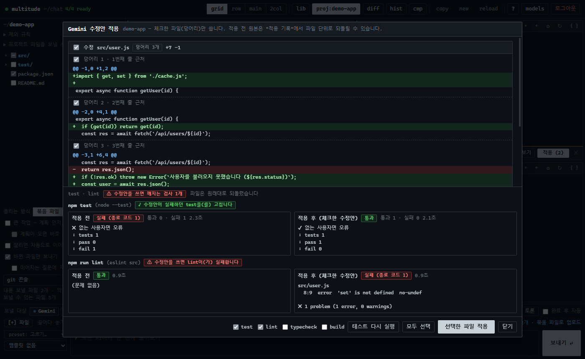
- **실행 방법**: 셸(cmd.exe)을 거치지 않고 `npm-cli.js test`를 실행합니다. npm과 같은 Node 설치의 `node.exe`가 있으면 그것으로(v0.12.1), 없을 때만 앱 자신(`process.execPath`, `ELECTRON_RUN_AS_NODE=1`)으로 실행합니다 — 이 값은 테스트가 띄우는 프로그램에도 물려가 Electron을 띄우는 테스트가 오동작하기 때문입니다. Windows에서 `npm.cmd`를 셸 없이 띄우면 EINVAL로 실패하기 때문입니다. `npm-cli.js`는 PATH의 절대 경로 폴더에 있는 npm에서만 찾습니다 (`%APPDATA%\npm`, `Program Files\nodejs`도 봄). Node.js가 설치돼 있어야 합니다.
- **제한**: 한 번에 하나, 3분 시간 제한(넘으면 그 프로세스와 하위 프로세스를 끔), 출력 2MB, 토큰 · 키처럼 보이는 글자는 가림 (git 콘솔과 같은 규칙). **테스트 중지**로 멈출 수 있고, 창을 닫아도 멈춥니다.
- **실행 중에는** 다른 적용 · 편집기 저장 · 프로젝트 닫기를 받지 않습니다.
- **앱이 도중에 꺼져도**: 잠깐 쓰기 전에 원본을 앱 데이터 폴더(`devtest-recovery.json`)에 적어 두고, 다음에 그 프로젝트를 열 때 원래대로 되돌립니다 (사이드바에 알림).
- 새로 만든 파일을 지운 뒤 그 파일을 위해 만든 빈 폴더는 남을 수 있습니다.

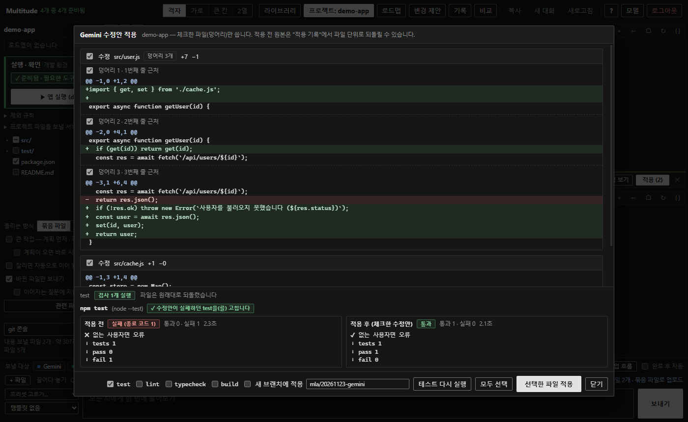

### 다른 언어 검사 · 고쳐 받기 · 관련 파일 · 새 브랜치 (v0.34.0)

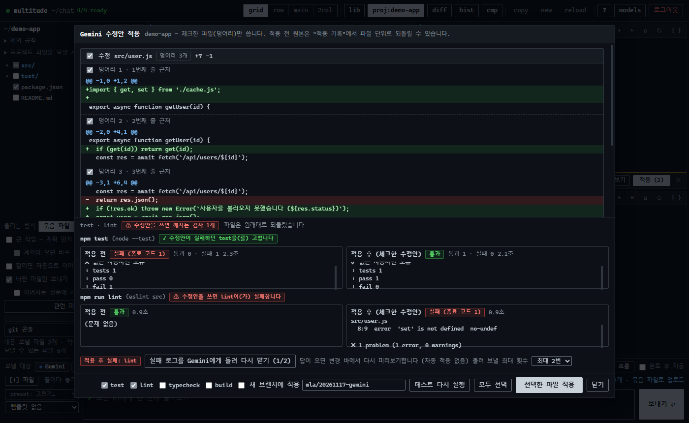

- **다른 언어 검사 (Windows 앱)**: 프로젝트 맨 위 폴더에 `pyproject.toml` · `Cargo.toml` · `go.mod`가 있으면 **테스트 실행**의 체크 칸에 `pytest` · `cargo-test` · `go-test`가 더해집니다 (있는 것만). 실행하는 명령은 이 셋뿐이고 고정입니다 — `python -m pytest -q` · `cargo test` · `go test ./...`. 셸 없이 직접 실행하고, 실행 파일은 PATH의 **절대 경로 폴더**에서만 찾습니다(Windows의 Microsoft Store용 가짜 `python`은 건너뛰고 `py -3`을 씁니다). 찾지 못하면 "실행 파일을 찾지 못함"으로 알립니다. `conftest.py` · `pyproject.toml` · `build.rs` · `go.mod` 같이 **검사가 도는 방식을 바꾸는 파일**을 수정안이 건드리면 확인 창에 ⚠로 따로 알립니다. 통과 · 실패 수는 pytest · cargo · go 출력에서 찾습니다.
- **실패 로그 돌려 다시 받기**: 적용 후 검사가 실패하면 결과 창에 **실패 로그를 ○○에게 돌려 다시 받기 (n/최대)** 가 나옵니다. 실패한 검사의 출력(비밀 정보는 가림, 길면 줄임)이 **같은 AI에게 후속 질문**으로 나가고, 답이 오면 새 변경 바로 올라와 다시 미리보기 · 검사합니다. **자동으로 적용하지 않습니다.** 횟수는 **기본 2번, 최대 3번**(0~3으로 바꿈, 기억함)이고, 새 질문을 하거나 적용하면 0으로 돌아갑니다.
- **관련 파일 찾기**: 사이드바 `관련 파일 찾기` — 고른 파일이 `import` · `require` · `from … import`로 부르는 프로젝트 안의 파일을 **깊이 2까지** 따라가 함께 보낼 만한 파일을 목록으로 제안합니다. 체크 상자로 골라 `선택한 파일 추가`. JS · TS(상대 경로) · Python(상대 · 프로젝트 안 모듈)만, `@/…` 별칭이나 코드로 만든 경로는 찾지 못합니다. 크롬 확장에서도 됩니다.

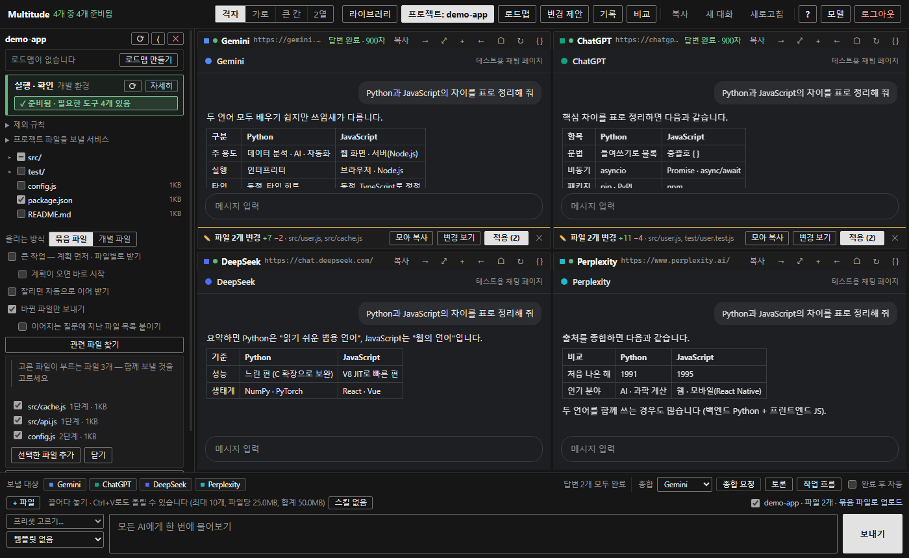

- **새 브랜치에 적용 (Windows 앱)**: 미리보기 창 아래 `새 브랜치에 적용`을 켜면 **적용 직전에** `git switch -c mla/<날짜>-<AI>`로 새 브랜치를 만들고 그 위에 씁니다(이름은 고칠 수 있지만 항상 `mla/`로 시작, 영문 · 숫자 · `. _ -`만). 같은 이름이 있으면 거절하고, **커밋도 push도 하지 않습니다.** 섞어서 적용에도 있습니다.

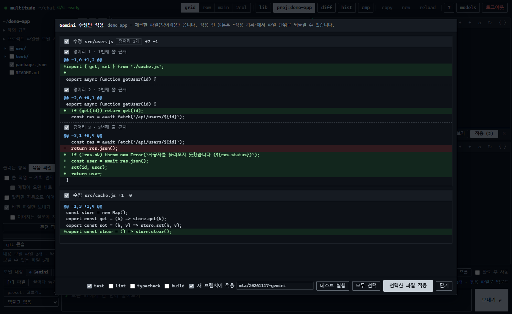

### 섞어서 적용 (v0.28.0)

여러 AI가 고친 파일을, 파일마다 어느 AI의 것으로 쓸지 골라 한 번에 적용합니다. **변경 제안** 화면 위 **섞어서 적용**(수정안이 있는 AI가 둘 이상일 때 켜짐)을 누릅니다.

- 파일마다 한 줄, AI마다 고르기 단추(`수정` · `새 파일` · `삭제`, +/− 줄 수, `⚠ 실행 영향` · `⚠ 잘림 · 생략?`)와 **빼기**. 여러 AI가 고친 파일은 노란 줄 · `AI 2곳이 고침`. 열 머리의 **○○ 것으로 모두**는 그 AI가 고친 파일을 모두 그 AI 것으로 고릅니다.
- **한 파일에는 한 AI의 수정안만** 고를 수 있습니다 (같은 파일을 두 AI 것으로 겹쳐 쓰지 않음). 처음에는 한 AI만 고친 안전한 파일만 골라 두고, 여러 AI가 고친 파일 · 실행 영향 파일 · 삭제는 직접 고릅니다. 실행 영향 · 삭제를 고르면 적용 전에 한 번 더 묻습니다.
- 둘 이상의 AI를 고르면 `⚠ 서로 다른 AI의 파일을 섞으면 맞지 않을 수 있습니다`. 앱은 파일끼리 맞는지(함수 이름 · import 등) 보지 않으니, 창의 **테스트 실행**으로 확인하세요.
- **고른 파일 적용**은 바의 적용과 같은 한 묶음입니다: 쓰기 직전에 파일이 바뀌었으면 다시 계산, 하나라도 쓰지 못하면 이미 쓴 파일을 되돌림, 적용 기록은 하나(`Gemini + ChatGPT`), 되돌리기도 한 번에. "이 AI가 이 파일을 안다"는 기록은 파일마다 그 수정안을 낸 AI에게만 남기고, 낸 AI들의 패널 바가 `✓ 적용됨`으로 바뀝니다.

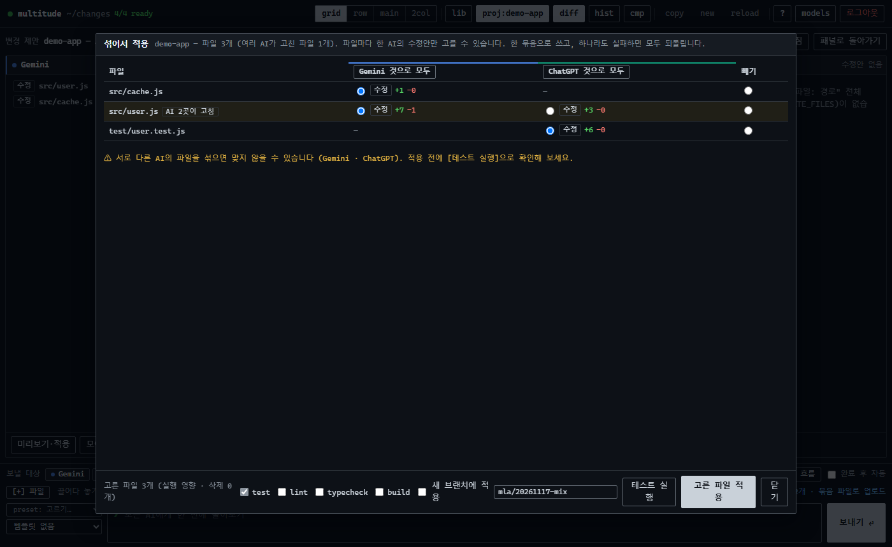

### 적용 후 커밋 (Windows 앱, v0.28.0)

적용이 끝나면 변경 바(`✓ 적용됨`)와 미리보기 · 섞어서 적용 창에 **커밋하기…**가 나옵니다. 설정(`?`) › **적용 후 커밋 제안**(기본 켬)으로 끄고 켭니다. git이 있는 Windows 앱에서만 보이고(크롬 확장은 없음), **누를 때만** 커밋 창이 열립니다.

- **메시지**: 적용한 파일과 수정안을 낸 AI로 미리 채웁니다 — `Apply Claude's changes: a.js, b.js`, 섞었으면 `Apply changes from Gemini, ChatGPT: …` 아래에 파일별 출처, 폴더 안 파일이면 전체 경로 목록. 마음대로 고칩니다.
- **AI에게 메시지 요약 부탁**: 수정안을 낸 AI 패널(섞었으면 파일을 가장 많이 낸 AI)에 **바꾼 파일 목록만** 보내 영어 한 줄 커밋 메시지를 부탁합니다(파일 내용은 보내지 않음 — 그 AI가 낸 수정안이라 이미 압니다). 답이 끝나면 메시지 첫 줄을 그 한 줄로 바꿉니다. 그 패널이 닫혀 있거나 이 프로젝트 파일을 보내지 않도록 정한 서비스면 누를 수 없습니다.
- 창에 **브랜치**, 실행될 **git 훅**(pre-commit 등), **이미 스테이징된 다른 파일**(`이번 커밋에 넣지 않고 그대로 둡니다`)을 보여 줍니다.
- **커밋**: `git add -A -- <적용한 경로>` → `git commit -m <메시지> -- <적용한 경로>`. 경로를 붙인 commit은 그 경로만 커밋하므로, 미리 스테이징해 둔 다른 파일은 커밋에 들어가지 않고 스테이징된 채 남습니다. 지운 파일도 커밋에 들어가고, 적용 뒤 사라졌고 git도 모르는 파일은 뺍니다. **push는 하지 않습니다** (필요하면 git 콘솔에서 직접).
- git 출력은 창 아래에 보여 주고(토큰 가림), 바에는 `커밋함 3f9c2a1`이 남습니다. 실패하면(훅 거절 · 사용자 이름 미설정 · `.gitignore`에 걸린 파일 등) 출력과 함께 알립니다. commit이 실패해도 앞 단계의 `git add`로 적용한 파일은 스테이징된 채 남을 수 있습니다(커밋은 되지 않음) — 고친 뒤 다시 누르면 됩니다.
- 안전장치는 git 콘솔과 같습니다: 셸 없이 PATH의 절대 경로 폴더에 있는 `git.exe`만, 인자 배열, 프로젝트 폴더가 작업 폴더, `--no-pager` · `core.editor=:` · `core.fsmonitor=false`, 경로는 글자 그대로(`--literal-pathspecs`), 단계마다 1분 제한. 프로젝트 밖 · `.git` 안 경로는 본체가 거절하고, git 저장소가 아니면 커밋하지 않으며, 테스트 실행이 수정안을 잠깐 써 둔 동안에는 받지 않습니다. 자세한 것은 [보안](security.md).

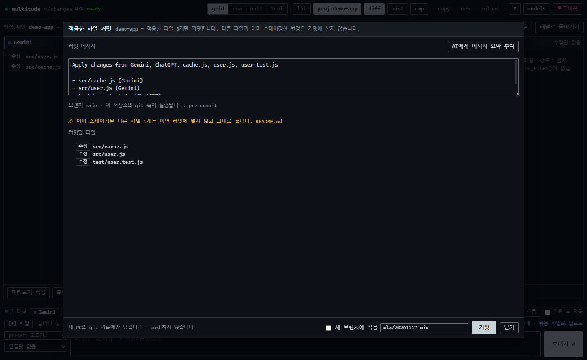

### 작업 이어 하기 (v0.28.0)

프로젝트 상태(Windows 앱 `projects/*.json` 암호화 · 크롬 확장 저장소)에 패널마다 다음을 함께 저장합니다. **파일 내용은 저장하지 않습니다.**

- **AI가 이미 받은 파일**: 경로와 내용 지문 · 줄 수 (바뀐 파일만 보내기 · ⇪ 바뀐 파일 보내기에 씀)
- **파일별로 받기** 진행: 계획의 파일 목록 · 몇 번째까지 · 받은 경로
- **이어 받기**: 이어 받던 경로와 횟수
- 대화 주소의 **지문**(주소 자체는 저장하지 않음)

한도: 패널 12개 · 패널마다 파일 3000개 · 계획 200개.

되살리는 규칙:

1. **같은 실행에서 프로젝트를 다시 열면**: 그동안 그 패널에서 ＋ 새 대화 · ⌂ · 패널 닫기를 하지 않았으면 바로 되살리고, 그 패널의 지금 답변으로 변경 바를 다시 그립니다. 사이드바 아래에 `지난 작업을 되살렸습니다: Claude(받은 파일 4개 · 파일별로 받기 3/5)`.
2. **앱을 다시 켠 뒤**: 패널은 새 대화로 열리므로 바로 되살리지 않고 사이드바에 **지난 실행의 작업** 칸을 띄웁니다.
   - 패널에서 **지난번 대화를 다시 열면**(사이트의 대화 목록에서) 주소 지문이 같아 저절로 이어집니다. 대화 id가 주소에 없는 사이트는 저절로 이어지지 않습니다.
   - **이어 쓰기**: 지금 그 패널의 대화로 되살립니다. **새 대화인데 누르면** 앱은 AI가 그 파일을 안다고 보고 다시 올리지 않으니, 지난 대화를 열어 둔 경우에만 누르세요.
   - **버리기**, 또는 그 패널의 ＋ 새 대화 · 패널 닫기면 버립니다. 2주가 지나도 버립니다.
3. **파일별로 받기**는 멈춘 상태로 되살아나 바에 `파일별로 받기 멈춤 3/5` + **▶ 이어서 계속**(멈춘 파일부터) · **처음부터** · ✕. 다시 켜기 전에 받은 파일의 수정안은 저장하지 않으므로 이어서 받은 묶음에 들어가지 않고, 끝날 때 알려 줍니다(필요하면 **처음부터**).
4. **이어 받기**는 횟수만 이어서 셉니다. 이어 받던 도중이었으면 앞부분이 없어 이어 붙일 수 없으니, 바의 **↪ 이어서 받기**나 **다시 요청**으로 다시 받습니다.

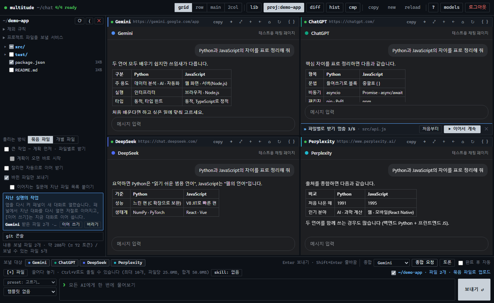

### 패널 아래 바 두 줄 (v0.28.0)

다시 보내기 · 다른 AI로 · 넘기기 제안 바(v0.26.0)와 프로젝트 변경 바가 함께 뜨면 **두 줄로 쌓습니다** — 변경 바가 맨 아래, 제안 바가 그 위. 예전에는 같은 자리를 써서 제안 바가 변경 바를 가렸습니다. 웹페이지는 바 줄 수만큼 짧아집니다.

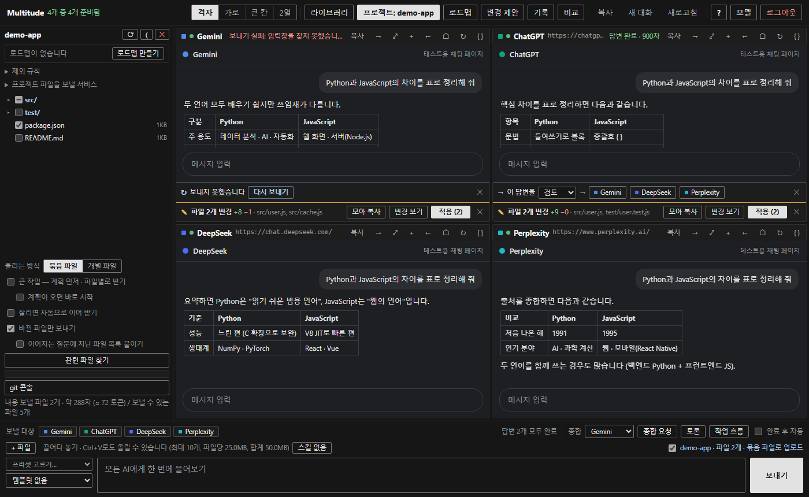

### git 콘솔 (Windows 앱)

프로젝트 사이드바 아래 **git 콘솔**을 누르면 그 폴더에서 git 명령을 실행하는 화면이 열립니다. `status`·`diff --stat`·`log`·`branch` 버튼, ↑↓로 이전 명령, **중지**, **터미널 열기**(그 폴더에서 Windows 터미널, 없으면 PowerShell)가 있습니다.

- **git 명령만**: 셸을 거치지 않고 git.exe를 바로 실행하므로 `;`·`&&`·`|` 같은 글자는 그냥 git 인자가 됩니다. git.exe는 PATH의 절대 경로 폴더에서만 찾습니다 (프로젝트 안의 가짜 `git.exe`는 쓰지 않음).
- **쓸 수 있는 하위 명령**: status · log · diff · show · blame · shortlog · reflog · ls-files · rev-parse · describe · add · rm · mv · restore · reset · commit · revert · cherry-pick · branch · switch · checkout · merge · tag · stash · fetch · pull · push · remote · init · config(읽기만) · version
- **막는 것**: git 앞 옵션(`-c`, `-C`, `--git-dir` …), `clean`·`rebase`·`submodule`·`grep`·`difftool`·`help` 등, 외부 프로그램을 띄우는 옵션(`--upload-pack`, `--exec`, `--ext-diff`), 다른 파일에 쓰는 `--output`, 대화형 옵션(`add -p`, `-i` …), 설정 쓰기, 메시지 없는 `commit`(편집기를 열 수 없음)
- **항상 붙이는 것**: `--no-pager`, `core.fsmonitor=false`, `core.editor=:`, `protocol.ext.allow=never` / 비밀번호는 터미널로 묻지 않음(`GIT_TERMINAL_PROMPT=0`, Git 자격 증명 관리자 창은 뜰 수 있음)
- **확인 창**: `reset --hard`, `push --force`·`+브랜치`·`:브랜치`, `branch -D`, `checkout -- 경로`·`-f`, `restore`, `stash drop/clear`, `rm`, `tag -d`, `remote remove/set-url`
- 한 번에 하나, 시간 제한(fetch·pull·push 2분, 나머지 1분), 출력 2MB까지. 출력과 입력 줄의 `https://아이디:토큰@` 주소와 알려진 키 모양은 가립니다.
- 콘솔을 열면 이 저장소의 **git 훅**(commit 등에서 실행되는 프로그램)이 있는지 알려 줍니다. AI 수정안은 `.git` 안쪽을 쓸 수 없으므로(v0.6.3) AI가 훅을 심을 수는 없습니다.

## 실행 · 확인 (v0.41.0~)

프로젝트를 열면 사이드바의 로드맵 카드 바로 아래에 **실행 · 확인** 칸이 생깁니다. "이 프로젝트를 이 PC에서 실제로 돌릴 수 있는지"를 한눈에 보여 주는 곳입니다. 테두리와 왼쪽 굵은 줄의 색이 상태를 알려 줍니다.

| 색 | 뜻 |
|---|---|
| 초록 `✓ 준비됨 · 필요한 도구 N개 있음` | 필요한 도구가 모두 있고 버전도 맞음 |
| 노랑 `⚠ 확인 필요 N` | 버전이 요구와 다르거나, 설치는 됐는데 PATH에 없거나, 준비할 것(의존성 미설치 · `.env` 없음 · 포트 사용 중 · Docker 엔진 꺼짐)이 있음 |
| 빨강 `✗ 없는 도구 N` | 꼭 필요한 도구가 이 PC에 없음 |
| 파랑 | 점검 중 · 크롬 확장(목록만) |

### 개발 환경 점검 (v0.41.0)

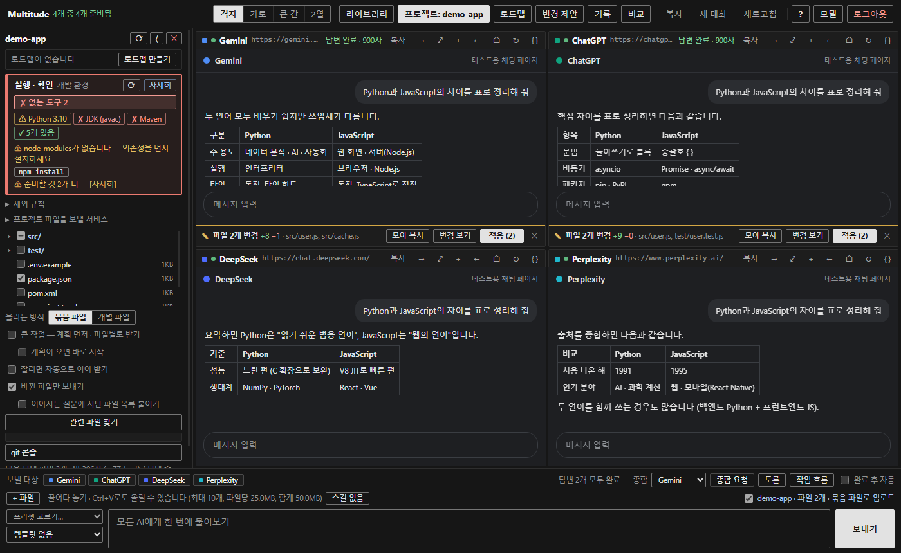

1. **필요한 도구 고르기** — 프로젝트 맨 위 폴더의 파일 이름을 봅니다 (파일 내용은 버전 요구를 읽는 몇 개만).

   | 표시 파일 | 확인하는 도구 |
   |---|---|
   | `package.json` (+ `pnpm-lock.yaml` · `yarn.lock` · `bun.lock`) | Node.js · npm · npx (+ pnpm · Yarn · Bun) |
   | `pyproject.toml` · `requirements.txt` · `setup.py` · `Pipfile` · `environment.yml` · `manage.py` | Python · pip (+ Poetry · uv · Pipenv · conda, ruff · mypy 설정이 있으면 선택) |
   | `pom.xml` · `build.gradle(.kts)` | JDK(javac) · Maven · Gradle (`mvnw` · `gradlew`가 있으면 Maven · Gradle은 선택) |
   | `CMakeLists.txt` · `Makefile` · `meson.build` · `*.c` `*.cpp` | CMake · make · Meson · Ninja + **C/C++ 컴파일러 셋 중 하나**(gcc/g++ · clang · MSVC) |
   | `*.csproj` · `*.sln` · `global.json` | .NET SDK |
   | `Cargo.toml` · `go.mod` · `Gemfile` · `composer.json` · `pubspec.yaml` | cargo · rustc · Go · Ruby · Bundler · PHP · Composer · Dart · Flutter |
   | `Dockerfile` · `compose.yaml` · `.devcontainer/` · `*.tf` · `k8s/` · `Chart.yaml` | Docker(+ 엔진이 켜져 있는지) · Terraform · kubectl · Helm |
   | `compose.yaml`의 `postgres` · `mysql` 이미지, `*.sqlite` | psql · mysql · sqlite3 (선택) |
   | `android/` · `AndroidManifest.xml` | Android SDK adb (선택) |
   | `.pre-commit-config.yaml` · `.github/` · `vercel.json` · `netlify.toml` · `firebase.json` · `.clang-format` · `playwright.config.*` | pre-commit · GitHub CLI · Vercel · Netlify · Firebase CLI · clang-format · Playwright 브라우저 (대부분 선택) |
   | 항상 | git |

   **선택** 도구는 없어도 빨강이 되지 않고 회색으로만 표시됩니다.
2. **필요한 버전 읽기** — `package.json`의 `engines` · `.nvmrc` · `.node-version`, `pyproject.toml`의 `requires-python` · `.python-version`, `pom.xml`의 `maven.compiler.release` · Gradle의 `JavaLanguageVersion.of(N)`, `go.mod`의 `go 1.xx`, `Cargo.toml`의 `rust-version`, `global.json`, `cmake_minimum_required`, `composer.json`의 `php`, `.ruby-version`, `pubspec.yaml`의 `sdk`. `>=20 <23` · `^18 || ^20` · `~=3.10` · `==3.12.*` 같은 꼴을 읽고, 읽을 수 없는 꼴은 판단하지 않습니다.
3. **이 PC에서 찾기** (Windows 앱) — PATH의 **절대 경로 폴더**에서만 실행 파일을 찾고, 도구마다 정해 둔 버전 묻기(`--version`, Java는 `-version` 등)만 셸 없이 5초 제한으로 실행합니다. **프로젝트 폴더 안의 실행 파일은 찾지도 실행하지도 않습니다.**
   - `npm` · `npx`는 실행하지 않고 npm 설치 폴더의 `package.json`에서 버전을 읽습니다. npm으로 깐 `.cmd` 도구(pnpm · Yarn · Vercel 등)도 실행하지 않고 옆의 `package.json`을 읽고, 없으면 "버전 확인 생략"으로 둡니다.
   - Microsoft Store의 가짜 `python`은 건너뛰고 `py -3`을 씁니다.
   - MSYS2 · `Program Files` · `JAVA_HOME` · Android SDK 같은 흔한 설치 자리에 있지만 PATH에 없으면 노랑 `PATH에 없음`과 그 폴더를 알려 줍니다.
   - MSVC는 Visual Studio 설치 도구(`vswhere`)로 C++ 빌드 도구를 찾습니다 (개발자 명령 프롬프트에서만 PATH에 잡힌다고 알림).
4. **준비 상태** — `package.json`에 의존성이 있는데 `node_modules`가 없음(→ `npm install` · `npm ci` · `pnpm install` …), 파이썬 가상 환경 없음(→ `py -m venv .venv`), `.env.example`은 있는데 `.env`가 없음(→ `copy .env.example .env`, 내용은 열지 않음), 개발 서버 기본 포트(Vite 5173 · Next 3000 · Angular 4200 · Django 8000 · Spring 8080 …)를 다른 프로그램이 쓰는 중, Docker는 있는데 엔진이 꺼짐, `JAVA_HOME`이 비었거나 javac가 없음.
5. **자세히** — 표로 상태 · 도구 · 이 PC의 버전 · 필요한 버전(어디서 읽었는지) · 왜 필요한지(표시 파일) · 해결(**설치 명령 복사** — `winget install --id … -e` 등, **설치 안내 ↗** — 공식 페이지)을 봅니다. **터미널 열기**로 그 폴더에서 터미널을 열어 복사한 명령을 붙여 넣고, **다시 점검**합니다.
6. **필요한 도구 고치기** — 자동으로 고른 목록이 틀렸으면 자세히 창 아래 체크 상자로 빼거나 더합니다. 이 PC에 프로젝트별로 기억합니다.

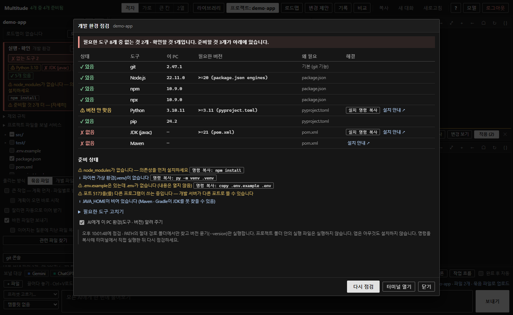

- **앱은 아무것도 설치하지 않습니다.** 설치는 사용자가 명령을 복사해 직접 실행합니다.
- 프로젝트를 열 때 한 번 자동으로 점검하고, 사이드바 ⟳ · 자세히 창 **다시 점검**으로 다시 합니다.
- 크롬 확장은 프로그램을 실행할 수 없어 같은 칸에 **필요한 도구 목록만** 보여 줍니다(파란색).

## 파일 모아보기

AI 답변에서 **고칠 파일과 새로 만들 파일**을 찾아 경로와 전체 코드를 한 화면에 모읍니다. 직접 복사해서 내 편집기에 붙여 넣는 용도이고, **파일에는 쓰지 않습니다** (파일에 바로 쓰려면 프로젝트 모드의 [변경 바 · 변경 제안](#프로젝트-모드). 프로젝트를 열어 두면 이 버튼은 패널 아래 변경 바 안의 **collect** 로 들어갑니다).

1. 답변이 끝났을 때 답변 안에 파일 코드가 있으면 그 패널 머리줄에 **파일 N개 모아보기** 버튼이 나타납니다. 처음 나타날 때 노란 테두리로 몇 번 깜빡이고, 누를 때까지 노란 테두리가 남습니다 (움직임 줄이기를 켜면 깜빡이지 않음). 변경 제안 화면의 AI별 칸에도 **모아보기**가 있습니다.
2. 누르면 파일마다 표시 · 경로 · 전체 코드가 나옵니다. 파일마다 **경로 복사** · **코드 복사**, 아래 **전체 복사**는 파일 목록과 `파일: 경로` + 코드 블록을 한 번에 복사합니다 (지울 파일은 `DELETE_FILES:` 한 줄).

| 표시 | 뜻 |
|---|---|
| **새 파일** | 프로젝트에 없는 파일 |
| **수정** | 있는 파일. AI가 바뀐 부분만(diff) 줘도 지금 파일과 합친 **완성된 전체 코드**로 보여 줌 |
| **변경 없음** | 지금 파일과 내용이 같음 |
| **삭제** | 답변의 `DELETE_FILES:` |
| **전체 코드** | 프로젝트를 열지 않아 새 파일인지 수정인지 모름 — AI가 준 코드 그대로 |
| **바뀐 부분(diff)** | 프로젝트를 열지 않았거나 지금 파일과 맞지 않아 전체 코드로 바꾸지 못함 — diff 그대로 |

**잡히는 답변 형식**: 코드 블록 바로 앞 줄에 `파일: 경로`(또는 `**경로**` · `### 경로`)가 있는 블록, ```` ```diff ```` 블록, 코드 블록 밖의 `DELETE_FILES:` 줄. 프로젝트 모드로 보낸 질문에는 이 형식을 요구하는 답변 규칙이 자동으로 붙고, 프로젝트 없이 물을 때는 기본 템플릿 **코드 수정 (파일 모아보기)** 를 쓰면 됩니다. 이 템플릿은 AI에게 다음을 요구합니다.

- 맨 앞에 바뀌는 파일 목록을 `[새 파일]` / `[수정]` / `[삭제]`로 표시
- 파일마다 `파일: 경로` 한 줄 + 전체 내용 코드 블록 하나 (diff 금지)
- (프로젝트 모드 · 코드 리뷰 · 종합으로 합치기, v0.17.0) 150줄보다 긴 기존 파일은 전체 대신 같은 코드 블록 안에 **찾기/바꾸기**로 바꿀 곳만:

  ```
  파일: src/main/main.js
  <<<<<<< 찾기
  (지금 파일의 그 부분 그대로 — 파일 안에서 한 곳만 맞게 앞뒤 줄 조금 포함)
  =======
  (바꾼 내용)
  >>>>>>> 바꾸기
  ```

  찾을 부분이 지금 파일에 **딱 한 곳** 있을 때만 바꿉니다 (줄 끝 · 앞뒤 공백 차이는 너그럽게). 못 찾거나 여러 곳이면 `⚠ 적용 불가` + **다시 요청**. 영어 표시(`<<<<<<< SEARCH` · `>>>>>>> REPLACE`)도 받습니다. 프로젝트 없이 모아보기를 쓰면 블록 그대로 보여 줍니다.
- 코드 생략 금지 (`... 기존과 동일` 같은 줄 없이 그대로 붙여 넣을 수 있는 전체 파일)
- 한 파일은 길어도 **코드 블록 하나**, 설명은 블록 밖에
- `.md` · `.txt`처럼 안에 ```` ``` ````가 든 파일은 바깥 울타리를 ````` ```` ````` (백틱 4개)로 — 안쪽 ```` ``` ````에서 블록이 끊기지 않게
- 지울 파일은 `DELETE_FILES: 경로1, 경로2`

AI가 규칙을 어기고 백틱 3개로 감싸 서비스 화면에서 이미 블록이 쪼개졌다면 앱이 되살릴 수 없습니다. "백틱 4개로 감싸서 다시 줘"라고 한 번 더 요청하세요.

## 잘린 답변 막기

AI 서비스마다 한 번에 쓸 수 있는 답의 길이(출력 한도)가 있어, 긴 파일을 여러 개 고치면 답이 중간에 끊깁니다. v0.17.0부터 끊긴 수정안이 파일을 망가뜨리지 않게 막습니다.

| 알아채는 것 | 어떻게 하나 |
|---|---|
| 코드 블록이 닫히지 않음 (로컬 LLM · 찾기/바꾸기의 끝 표시가 없음 등) | **적용 불가** — 바에 `✂ 답변이 잘림 N개`, 변경 제안에 **다시 요청** |
| 코드 파일인데 괄호가 닫히지 않음 (웹 채팅은 잘린 답도 코드 상자를 닫아서 보여 줌) | 의심 — `⚠ 끝이 잘린 것 같습니다 (괄호 N개가 닫히지 않음)` |
| 전체 교체인데 원본 끝부분이 통째로 사라짐 (원본 30줄 이상, 60% 미만으로 줄고 마지막 줄들이 없음) | 의심 — `⚠ 끝이 잘린 것 같습니다 (원본 N줄 → M줄)` |
| `// ... 기존 코드 ...` · `# ... (생략)` · `<!-- 이하 동일 -->`처럼 코드를 줄인 표시 | 의심 — `⚠ 코드를 줄인 표시가 있습니다` |

- **의심**인 파일은 적용할 수는 있지만 바의 **적용 (N)**에서 빠지고(`⚠ N개 확인 필요`), 미리보기에서 기본으로 체크되지 않습니다. −줄을 보고 직접 체크하세요.
- **다시 요청**은 지금 파일 내용을 첨부해 다시 달라고 하고, 긴 파일(150줄 넘음)은 전체 대신 찾기/바꾸기로 달라고 합니다 — 다시 받다가 또 잘리지 않게.
- 모아보기에서도 잘린 파일에는 `⚠ 답변이 중간에 잘려 이 파일의 뒷부분이 없습니다`를 붙입니다.

### 큰 작업 — 계획 먼저 · 파일별로 받기

v0.18.0부터 고칠 파일이 많거나 길어 한 답에 다 못 쓰는 작업은 **나눠서** 받습니다. 답 하나의 길이가 파일 하나로 줄어 출력 한도에 걸리지 않습니다.

1. 프로젝트 사이드바 아래 **큰 작업 — 계획 먼저 · 파일별로 받기**를 켭니다 (프로젝트마다 기억). 꺼져 있어도 고른 파일이 4개를 넘거나 합계 600줄을 넘으면 한 번 권합니다.
2. 평소처럼 질문합니다. 이번 답은 **코드 없이 계획만** 오게 부탁합니다: 무엇을 바꿀지 몇 줄 + 파일마다 `- 경로: 할 일` + 맨 끝 `PLAN_FILES: 경로1, 경로2, …` (지울 파일은 `DELETE_FILES:`).
3. 계획 답이 오면 그 패널의 변경 바에 `» 계획: 파일 N개`와 **▶ 파일별로 받기 시작**이 뜹니다 (마우스를 올리면 파일별 할 일).
4. 시작하면 앱이 "계획대로 1/N번째 파일만 줘: 경로 — 할 일"을 보내고, 답이 끝날 때마다 수정안을 모은 뒤 다음 파일을 보냅니다. 바에 `… 파일별로 받는 중 i/N`. 각 파일은 답변 규칙대로(짧은 파일은 전체, 긴 파일은 찾기/바꾸기) 받습니다.
5. 다 받으면(또는 **멈추기**) 모은 수정안이 한 묶음으로 바에 나옵니다: `» 파일별로 받음 M/N` + 미리보기 · 테스트 실행 · 적용. 그중 잘린 파일은 **↪ 이어서 받기**로 마저 받습니다.

- **계획이 오면 바로 시작** (v0.22.0, 큰 작업 아래 옵션): 켜 두면 계획 답이 올 때 **▶ 파일별로 받기 시작**을 누르지 않아도 바로 시작합니다. 시작 전에 바의 ✕로 계획을 버리면 시작하지 않습니다.
- **보낼 양 어림** (v0.22.0): 사이드바 요약에 고른 파일의 대략적인 토큰 수(`≈ 1.4만 토큰`, 파일 크기 ÷ 4로 어림)가 나옵니다. 1만 2천 토큰을 넘고 큰 작업이 꺼져 있으면 `[!] 큰 작업 권장`이 붙습니다.
- **건너뛰기**: 지금 파일은 받지 않고, 그 답이 끝나면 다음 파일로 갑니다. 답이 시간 초과 · 답변 없음으로 끝나면 자동으로 넘어가지 않으니 **멈추기**(여기까지 받은 것으로) 또는 건너뛰기를 누르세요.
- 여러 패널이 각자 따로 진행합니다. 그 패널에서 새 대화를 열면 멈춥니다.
- 계획에 적힌 경로라도 앱 내장 제외 경로(`.env`, `.git` 등)는 받지 않습니다. 계획은 최대 30개 파일.

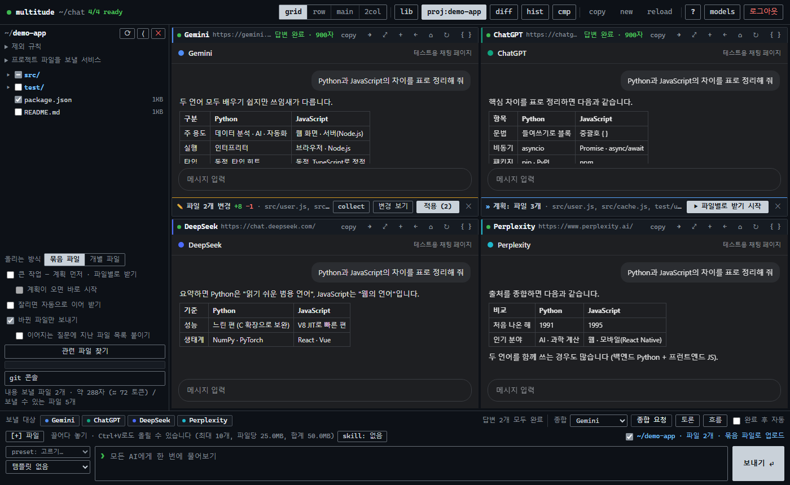

### 이어서 받기 (v0.17.1)

잘렸거나 끝이 잘린 것으로 의심되는 파일이 있으면 그 패널의 변경 바에 **↪ 이어서 받기**가 생깁니다.

1. 받은 코드의 마지막 줄은 중간에 끊겼을 수 있어 버리고, 그 앞 줄(기준 줄)을 보여 주며 같은 AI에게 부탁합니다: "이 줄을 첫 줄로 한 번 더 쓰고, 그 다음부터 파일 끝까지 나머지만 `파일: 경로 (이어서)` 코드 블록 하나로 줘". 찾기/바꾸기였으면 "끝난 N개 다음부터 남은 것만".
2. 답이 끝나면 **기준 줄이 겹치는지** 보고 이어 붙입니다 (잘린 줄을 마저 쓴 경우, 앞부분을 몇 줄 더 쓴 경우도 받음). 맞지 않으면 붙이지 않고 `이어 붙이지 못함`으로 알립니다 — 엉뚱한 곳에 붙여 코드를 망가뜨리지 않게.
3. 합친 파일로 다시 계산해 바 · 미리보기 · 테스트 실행에 그대로 넣습니다. 바에 `↪ 이어 받음 N번`. 끊긴 파일 뒤에 주려던 다른 파일이 이어 받은 답에 있으면 그것도 함께 넣습니다.
4. 또 끊기면 한 번 더 누릅니다 (한 파일 최대 3번). 그래도 안 되면 변경 제안의 **다시 요청**(긴 파일은 찾기/바꾸기로)을 쓰세요.

- **잘리면 자동으로 이어 받기** (v0.22.0, 사이드바 옵션): 켜 두면 잘린 파일이 생길 때 버튼을 누르지 않아도 같은 AI에게 나머지를 부탁합니다. 같은 파일 · 같은 횟수에는 한 번만 보내고, 한 파일 최대 3번까지만 합니다. 이어 붙이기에 실패하면 멈추고 알립니다.
- `... 기존 코드 ...`처럼 **줄인 표시**만 있는 파일은 이어 받을 것이 아니라 다시 요청이 맞아서 버튼이 뜨지 않습니다. diff 형식도 다시 요청으로 받습니다.
- 이어 받는 동안 그 패널에서 새 대화를 열면 이어 받기를 취소합니다.

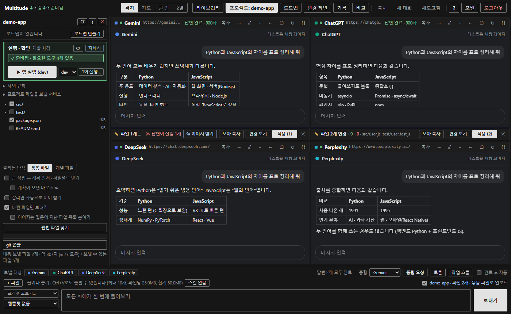

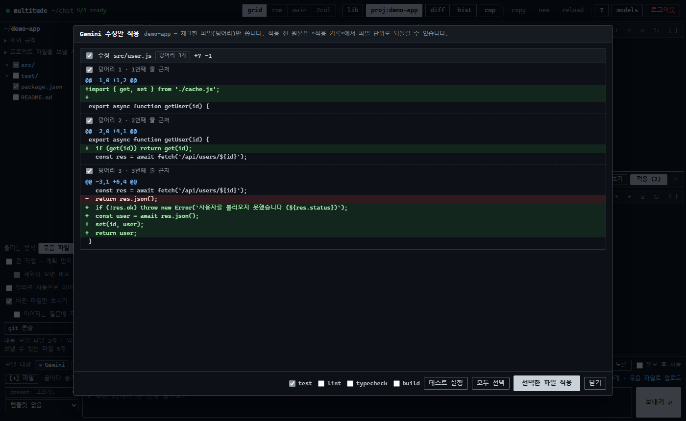

