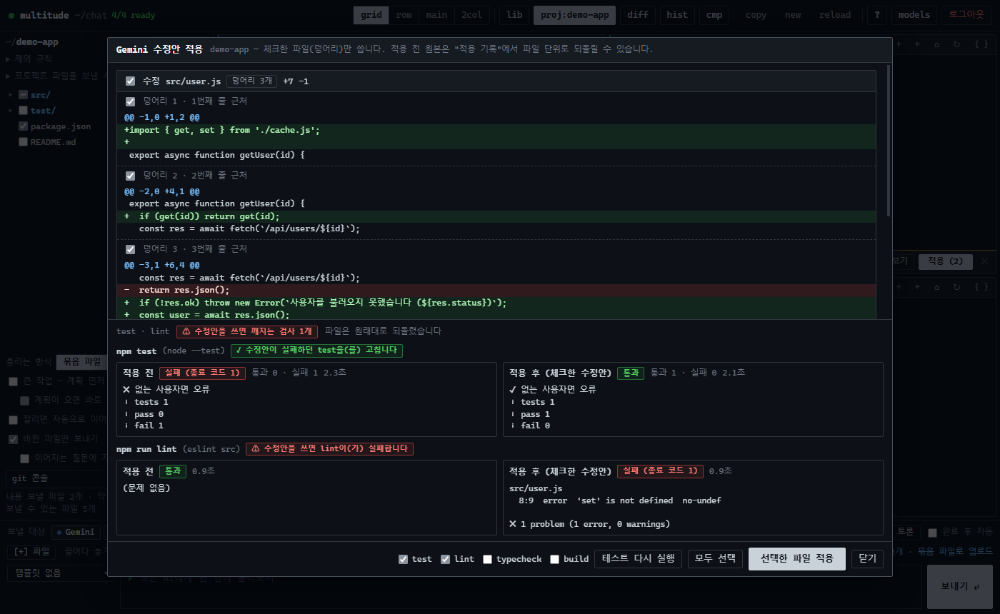
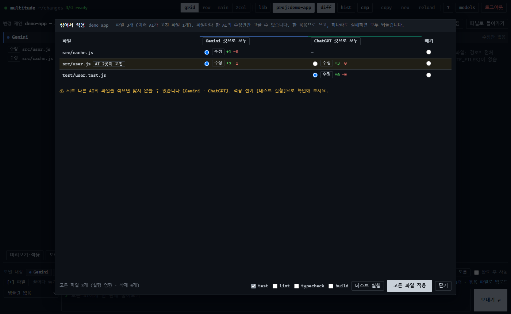
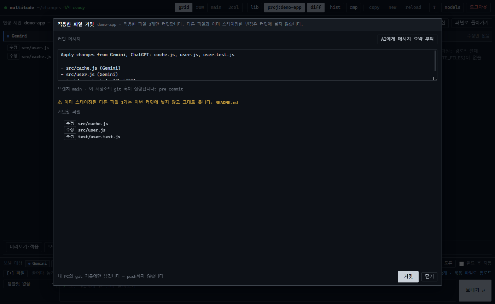
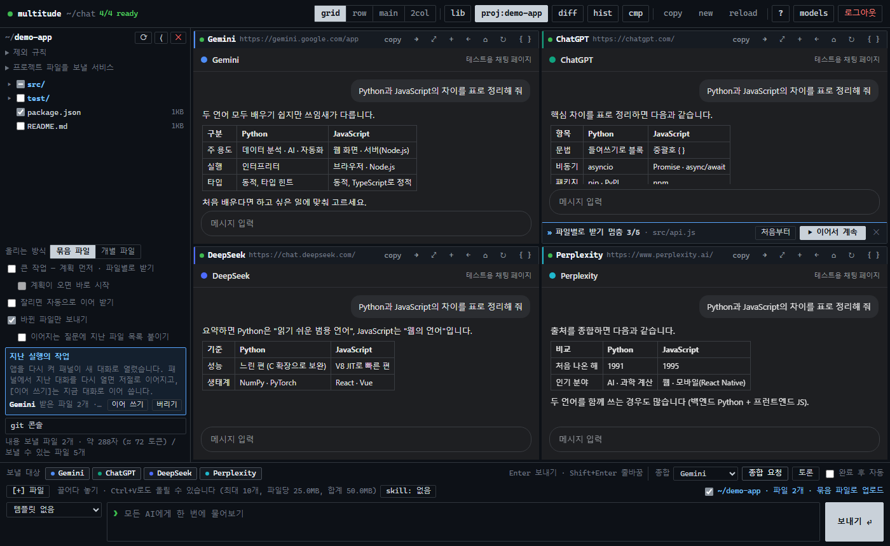
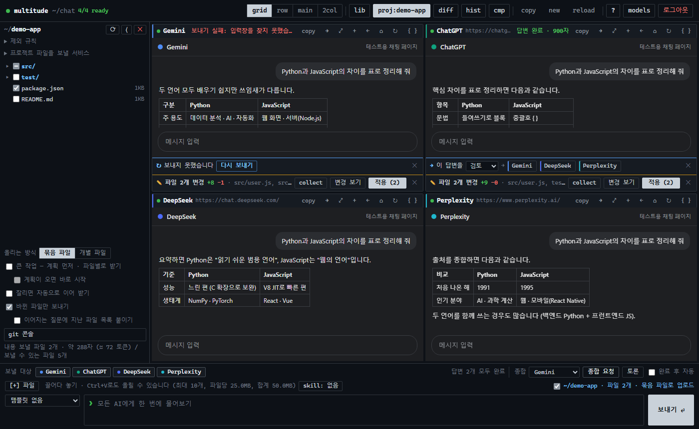

고도화 계획(v0.24.0~v0.30.0)의 **5단계** 버전입니다. 프로젝트 모드(코드 작업)가 늘었습니다: **검사 스크립트 여러 개**(test · lint · typecheck · build), **여러 AI의 수정안을 파일마다 골라 섞어 적용**, **적용 후 커밋**(Windows 앱), **앱을 다시 켜도 작업 이어 하기**, 그리고 v0.26.0부터 있던 **패널 아래 바 겹침**을 고쳤습니다.

## 바뀐 점

### 검사 스크립트 여러 개 (Windows 앱)

- 미리보기 창의 **테스트 실행** 옆에 `package.json`에 **있는** 검사 스크립트만 체크 칸으로 나옵니다: `test` · `lint` · `typecheck` · `build` (이 네 이름만, 기본은 `test` 하나). 하나뿐이면 예전처럼 체크 칸 없이.
- 고른 스크립트마다 **적용 전 → 수정안을 잠깐 쓴 후** 순서로 돌리고 원래 파일로 되돌립니다. 결과는 스크립트마다 한 줄 판정(`⚠ 수정안을 쓰면 lint이(가) 실패합니다` 등)과 **적용 전 | 적용 후** 출력을 나란히.
- 규칙은 예전 `npm test`와 같습니다: 셸 없이 `npm-cli.js test` / `npm-cli.js run <이름>`, 화면은 **이름만** 넘기고 스크립트 글은 `package.json`에서 읽음, 스크립트마다 3분 제한, 출력 2MB · 토큰 가림, 쓰기 전에 원본을 적어 두고 앱이 꺼져도 다음에 되돌림. 확인 창에는 고른 스크립트의 `pre<이름>` · `post<이름>`까지, 수정안이 그 스크립트를 바꾸면 `lint: 이전 → 이후`로 경고합니다.

### 섞어서 적용

- **변경 제안** 화면 위 **섞어서 적용**(수정안이 있는 AI가 둘 이상일 때) → 창에 파일마다 한 줄, AI마다 고르기 단추(+/− 줄 수 · `⚠ 실행 영향` · `⚠ 잘림 · 생략?`), **빼기**, 열 머리의 **○○ 것으로 모두**.
- **한 파일에는 한 AI의 수정안만** 고를 수 있습니다. 처음에는 한 AI만 고친 안전한 파일만 골라 두고, 여러 AI가 고친 파일(노란 줄, `AI 2곳이 고침`) · 실행 영향 · 삭제는 직접 고릅니다.
- 둘 이상의 AI를 고르면 `서로 다른 AI의 파일을 섞으면 맞지 않을 수 있습니다`를 띄웁니다(파일끼리 실제로 맞는지는 보지 않습니다 — 창의 **테스트 실행**으로 확인).
- 적용은 예전과 같은 한 묶음(하나라도 실패하면 모두 되돌림) · 적용 기록 하나(`Gemini + ChatGPT`) · 되돌리기. "이 AI가 이 파일을 안다"는 기록은 파일마다 그 수정안을 낸 AI에게만 남깁니다.

### 적용 후 커밋 (Windows 앱)

- 적용이 끝나면 변경 바(`✓ 적용됨`)와 미리보기 창에 **커밋하기…** — 설정 › **적용 후 커밋 제안**(기본 켬, git이 있는 Windows 앱에서만 보임). **누를 때만** 커밋 창이 열립니다.
- 커밋 창: 메시지(`Apply Claude's changes: a.js, b.js`, 섞었으면 `Apply changes from Gemini, ChatGPT: …` + 파일별 출처, 고칠 수 있음) · **AI에게 메시지 요약 부탁**(수정안을 낸 패널에 **파일 목록만** 보내 한 줄 메시지를 부탁, 답이 끝나면 첫 줄을 바꿈) · 브랜치 · 실행될 git 훅 · **이미 스테이징된 다른 파일** 경고 · 커밋할 파일.
- 커밋은 **적용한 파일만**: `git add -A -- <경로>` → `git commit -m <메시지> -- <경로>`. 경로를 붙인 commit이라 이미 스테이징해 둔 다른 파일은 커밋에 들어가지 않고 스테이징된 채 남습니다. **push는 하지 않습니다.** git 출력은 창 아래에, 바에는 `커밋함 3f9c2a1`.

### 작업 이어 하기

- 패널마다 **AI가 이미 받은 파일**(지문 · 줄 수만), **파일별로 받기** 진행(파일 목록 · 몇 번째 · 받은 경로), **이어 받기** 상태(경로 · 횟수)를 프로젝트 상태에 함께 저장합니다 (Windows 앱 `projects/*.json` 암호화 · 크롬 확장 저장소). **파일 내용은 저장하지 않습니다.** 패널 12개 · 패널마다 파일 3000개 · 계획 200개까지.
- **같은 실행에서 프로젝트를 다시 열면** 그동안 새 대화를 열거나 패널을 닫지 않은 패널은 바로 되살리고, 그 패널의 지금 답변으로 변경 바를 다시 그립니다. 사이드바에 `지난 작업을 되살렸습니다: Claude(받은 파일 4개 · 파일별로 받기 3/5)`.
- **앱을 다시 켠 뒤**에는 패널이 새 대화로 열리므로 바로 되살리지 않고 사이드바 **지난 실행의 작업** 칸에 둡니다. 패널에서 **지난번 대화 주소를 다시 열면 저절로**(주소의 지문만 저장), **이어 쓰기**를 누르면 지금 대화로 되살립니다. **버리기**, ＋ 새 대화 · 패널 닫기면 버립니다(2주 지나면 버림).
- 되살린 파일별로 받기는 바에 `파일별로 받기 멈춤 3/5` + **▶ 이어서 계속** · **처음부터**. 다시 켜기 전에 받은 파일의 수정안은 저장하지 않았으므로 이어서 받은 묶음에는 들어가지 않습니다(알림으로 알려 줌).

### 패널 아래 바 겹침 고침

- v0.26.0의 제안 바(다시 보내기 · 다른 AI로 · 넘기기)와 프로젝트 변경 바가 같은 34px 자리를 써서, 둘 다 뜨면 제안 바가 변경 바를 가렸습니다. 이제 **두 줄로 쌓습니다** — 변경 바가 맨 아래, 제안 바가 그 위. 본체(`main.js`)와 확장(`host.js`)이 웹페이지를 바 줄 수 × 34px만큼 줄입니다.

### 개발

- 새 공통 모듈: `src/shared/mix-select.js`(buildRows · defaultPicks · setPick · pickAllFrom · summarize · chosenItems), `src/shared/commit-msg.js`(defaultMessage · summaryPrompt · parseSummary · withSubject), `src/shared/project-session.js`(convKey · packPanel · packSession · restorePlan · describe). `layout.js`에 `barRows`.
- 새 본체 모듈: `src/main/commit-rules.js`(요청 검사 · git 인자 · 허용 단계) · `src/main/gitcommit.js`(`git:commitInfo` · `git:commit`). `test-rules.js`에 `CHECK_SCRIPTS` · `readScript` · `availableChecks` · `checkScriptNames` · `scriptArgs`, `devtest:trial(changes, scripts)`는 `results`(스크립트별)와 예전 모양(test의 before/after)을 함께 돌려줌.
- 새 화면 파일: `project-mix.js` · `project-commit.js` · `project-restore.js`(`project-changes.js` 다음). `layout:bar`는 `rows`(0~2)를 받음(예전 `on`도 받음). 설정 `commitOffer`(기본 true).
- 새 문구는 모두 `i18n-ko.js` · `i18n-en.js`.

## 확인한 것

- `npm test` 357개 통과 (338개에서 `test/check-scripts.test.js` 5개(이름 허용 목록 · 고른 이름 검사 · 실행 모양 · 확인 창 경고 · **실제 npm으로 test + lint 적용 전/후와 되돌림**), `test/mix-commit.test.js` 8개(섞기 표 · 고르기 · 커밋 메시지 · 요약 꺼내기 · 커밋 요청 검사 · git 인자 · **임시 git 저장소에서 적용한 파일만 커밋 · 다른 스테이징은 남음 · 저장소 아니면 거절 · 테스트 중엔 거절** · 연결), `test/project-session.test.js` 6개(대화 주소 열쇠 · 저장 모양과 한도 · 되살리기 규칙 · 바 줄 수 · 바 쌓기 연결 · 이어 하기 연결) 추가, 기존 `devtools` · `ipc-split` 테스트 갱신), `npm run check:ext` 통과.
- 스크린샷 도구로 모든 장면을 띄워 화면 스크립트 오류가 없고(사이드탭 장면의 예전부터 있던 preload 오류만), 가짜 본체에 가짜 프로젝트 폴더 · 테스트 실행 · git을 넣어 새 장면 `36-check-scripts` · `37-mix-apply` · `38-commit` · `39-bars-stacked` · `40-project-restore`를 그림으로 확인했습니다. 가짜 본체도 바 줄 수 · 사이드바만큼 패널 웹페이지를 줄이게 했습니다.
- 임시 프로필로 앱을 켜서(모델 고르기 화면) 오류 없이 뜨는 것을 확인했습니다.

## 알아 둘 것

- **실제 AI 사이트 · 실제 프로젝트에서는 써 보지 않았습니다.** 섞어서 적용 · 커밋 창 · 이어 하기 · 바 쌓기는 단위 테스트와 스크린샷 도구(가짜 본체)로만, 커밋은 임시 git 저장소의 단위 테스트로만 확인했습니다. 크롬 확장도 실제 크롬에서 확인하지 않았습니다.
- **AI에게 메시지 요약 부탁**은 커밋 창이 열린 동안(패널이 화면 밖으로 치워진 동안) 그 패널에 보내고 답을 기다립니다. 실제 사이트에서 이 상태로 보내기 · 답 감지가 잘 되는지는 확인하지 못했습니다. 안 되면 메시지를 직접 고쳐 커밋하면 됩니다.
- 커밋은 저장소의 **git 훅(pre-commit 등)을 그대로 실행**합니다(창에 훅 이름을 보여 줌). 서명(gpg) 설정이 암호를 물으면 1분 안에 끝나지 않을 수 있습니다. `.gitignore`에 걸린 파일은 `git add`가 거절해 커밋하지 않습니다(강제로 넣지 않음).
- 섞어서 적용은 **파일끼리 맞는지 보지 않습니다** — 경고만 띄웁니다. 한 파일 안에서 두 AI의 덩어리를 섞는 것은 하지 않습니다(그 파일은 한 AI 것).
- 이어 하기의 "같은 대화" 판단은 **주소 모양**만 봅니다: 대화 id가 주소에 없는 사이트는 저절로 이어지지 않고 **이어 쓰기**를 눌러야 합니다. 새 대화인데 **이어 쓰기**를 누르면 앱은 AI가 파일을 안다고 보고 "바뀐 파일만 보내기"에서 그 파일을 다시 올리지 않으니 주의하세요(버튼 설명에 적음). 사이트 안에서 직접 다른 대화로 옮긴 것은 앱이 모릅니다.
- 다시 켜기 전에 이어 받던 파일(↪ 이어서 받기 도중)은 앞부분을 저장하지 않으므로 다시 이어 붙일 수 없습니다 — 횟수만 이어서 세고, 바의 **↪ 이어서 받기**나 **다시 요청**으로 다시 받습니다.
- 예전 버전이 저장한 "AI가 받은 파일" 기록(`sent` 칸)은 그때도 같은 실행에서만 썼으므로 읽지 않습니다.
