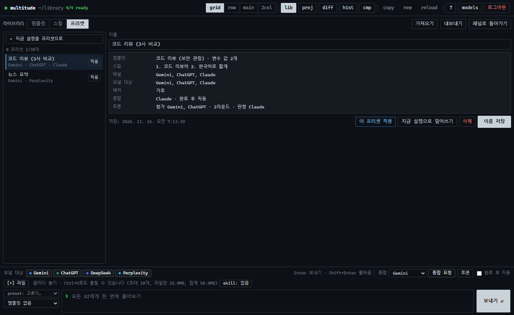
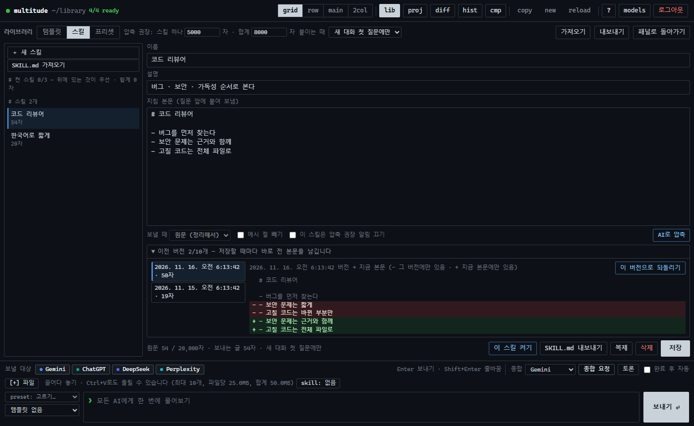
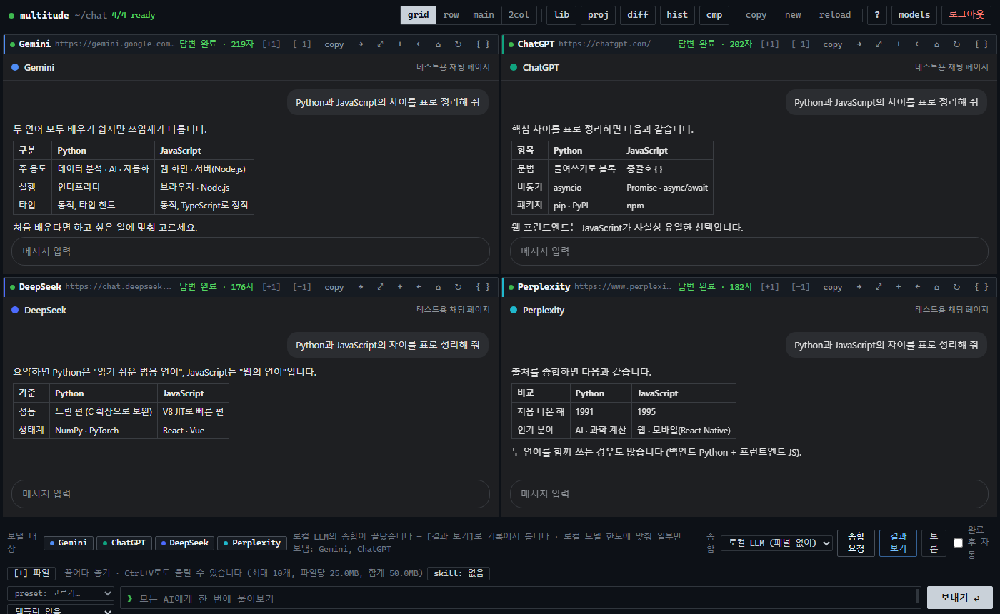
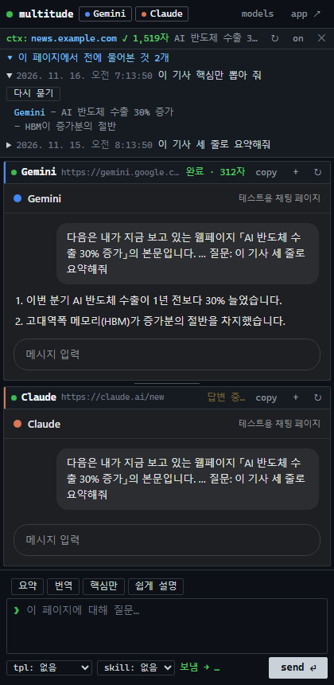
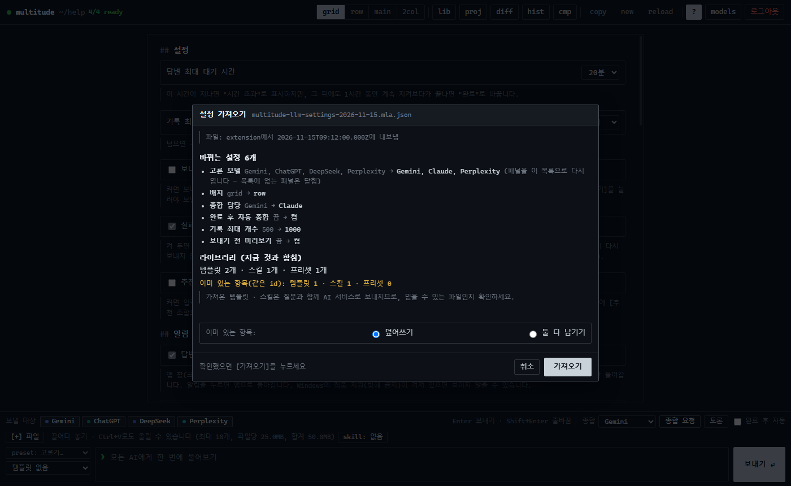

고도화 계획(v0.24.0~v0.30.0)의 **6단계** 버전입니다. 자주 쓰는 작업 환경을 **프리셋**으로 한 번에 바꾸고, 스킬을 고쳐도 **이전 버전**으로 돌아갈 수 있게 했습니다. **로컬 LLM**은 패널 없이도 종합 · 토론 판정 · 스킬 압축을 맡고 **컨텍스트 한도**를 지킵니다. 크롬 사이드탭에는 **한 번 누르기 질문**과 **이 페이지에서 전에 물어본 것**이, 설정에는 **설정 옮기기**(.mla.json, 비밀번호 암호화)가 생겼습니다.

## 바뀐 점

### 작업 프리셋

- 프리셋 하나 = **템플릿**(마지막 변수 값 포함) · **켠 스킬**(순서대로, 최대 3개) · **패널**(열 모델) · **보낼 대상** · **배치** · **종합 담당과 완료 후 자동** · **토론 설정**(참가 · 라운드 · 판정 — 토론 창에서 마지막으로 시작한 설정).
- 입력창 왼쪽 맨 위 `preset:`에서 고르면 바로 적용, **＋ 지금 설정을 프리셋으로**로 만들기, **lib: 프리셋 관리…**로 라이브러리 › **프리셋** 탭(이름 바꾸기 · 지금 설정으로 덮어쓰기 · 삭제 · 요약 보기).
- 패널이 다르면 "이 패널들로 다시 엽니다 (목록에 없는 패널은 닫힘)"를 확인한 뒤 **모델 열기와 같은 길**(`models:open`)로 다시 열고, 패널이 다 열린 뒤 보낼 대상 · 종합 담당을 맞춥니다(종합 담당은 열린 패널만 고를 수 있어서). 취소하면 패널은 그대로 두고 나머지만 바꿉니다. 지운 스킬 · 템플릿, 쓸 수 없는 서비스는 빼고 알려 줍니다.
- 라이브러리에 함께 저장(30개까지)되고, 라이브러리 **내보내기 · 가져오기**(가져올 때 템플릿 · 스킬 id를 새로 주고 프리셋 참조를 이어 줌)와 설정 옮기기에 들어갑니다.

### 스킬 이전 버전

- 스킬 본문을 고쳐 저장할 때마다 바로 전 본문을 `versions`에 남깁니다(최신이 앞, 최대 10개, 합계 6만 자 — 넘으면 오래된 것부터 버림, 같은 본문은 두 번 남기지 않음).
- 편집기 아래 **이전 버전**: 버전을 고르면 그 버전 → 지금 본문의 줄 단위 차이(jsdiff), **이 버전으로 되돌리기** = 그 본문으로 새로 저장(지금 본문은 이전 버전으로 남음).

### 로컬 LLM: 패널 없이 판정 · 압축, 컨텍스트 한도

- 설정에서 로컬 LLM을 켜 두면 **종합 담당 · 토론 판정 · AI로 압축**의 고르기에 **로컬 LLM (패널 없이)** 가 생깁니다. 이때는 보이는 패널의 대화와 따로인 **임시 대화**(그 질문 하나만, 스트리밍 없이, 최대 10분)로 묻습니다. 패널을 새로 여는 방법(배치가 바뀌고 패널 대화에 판정 요청이 섞임)보다 단순하고 안전해서 이렇게 했습니다. 로컬 LLM 패널이 열려 있으면 예전처럼 그 패널로 보냅니다.
- 패널 없이 맡긴 종합은 화면에 답이 보이지 않으므로, 끝나면 입력창 옆 **결과 보기**가 기록 화면에서 그 질문을 엽니다. 분석은 예전처럼 답변 비교 › 분석 탭.
- 설정 › 로컬 LLM › **로컬 모델 컨텍스트 한도**(2k · 4k · 8k · 16k · 32k · 128k 토큰, 기본 8k). 토큰은 어림(영문 4글자 ≈ 1, 한글 1글자 ≈ 1)이고 한도의 1/4은 답 자리로 남깁니다.
  - 로컬 LLM이 판정(패널이 있든 없든)일 때 넘을 것 같으면 다른 AI의 답을 **같은 비율로 앞부분만** 넣고 `(… 로컬 모델 컨텍스트 한도 때문에 일부만 보냄)`을 붙입니다. 입력창 아래 안내에 줄인 AI 이름. 토론 판정의 입장 글도 같게.
  - 그 밖의 질문은 줄이지 않고 **보내기 전 미리보기**(`localCtx` 경고)와 **로컬 LLM 패널**(지금까지 대화 전체로 셈)에 경고만.
  - 압축 요청이 한도를 넘을 것 같으면 보내기 전에 묻습니다.

### 사이드탭 (크롬 확장)

- 입력창 위 **요약 · 번역 · 핵심만 · 쉽게 설명**: 가져온 페이지와 함께 바로 보냅니다. **번역**은 페이지 글의 한글 비율로 방향을 정합니다(한국어 → 영어, 그 밖 → 한국어). 문구는 i18n 사전에.
- **이 페이지에서 전에 물어본 것 N개**: 사이드탭 기록(`history:side`)에서 같은 주소(`#` 뒤 · `utm_*` · `fbclid` · `gclid` 등 추적 칸을 뺀 주소)의 질문을 보여 주고, 펼치면 남은 답 앞부분과 **다시 묻기**(입력창에 넣기만). 페이지 본문은 새로 저장하지 않습니다.

### 설정 옮기기

- 설정(`?`) › **설정 옮기기** › **내보내기**: 고른 모델 · 배치 · 종합 담당과 자동 · 답변 대기 시간 · 기록 최대 개수 · 알림 · 보내기 전 미리보기 · 다시 보내기 · 추천 조합 · 적용 후 커밋 제안 · 로컬 LLM 설정 + 라이브러리(템플릿 · 스킬과 이전 버전 · 프리셋)를 `.mla.json` 하나로 (Windows 앱은 저장 창, 확장은 다운로드). **기록 · 프로젝트 · 쿠키 · 템플릿 변수 값은 넣지 않습니다.**
- 비밀번호(선택, 8자 이상)를 넣으면 PBKDF2-SHA256 25만 번 + AES-GCM 256(무작위 salt · iv)으로 암호화합니다. `crypto.subtle`만 써서 앱 · 확장이 같은 파일을 읽습니다.
- **가져오기…**: (비밀번호) → 바뀌는 설정 목록(지금 → 가져올 값) · 라이브러리 개수 · 같은 id 항목 수 → **덮어쓰기 / 둘 다 남기기** → **가져오기**. 설정은 원래 창구(`local.setPrefs` · `setSettings` · `setLayout` · `openModels` → `setSynth`)로 바꿔 본체가 예전과 같은 검사를 하고, 라이브러리는 `normalizeLibrary`를 거칩니다.

### 개발

- `src/shared/prompt-lib.js`: `normalizePreset` · `normalizePresets` · `presetFromState` · `presetPlan`, 스킬 `versions`(`normalizeVersions` · `withVersion` · `restoreVersion` · `versionDiff`), `importLibrary`/`exportLibrary`에 presets.
- 새 공통 모듈 `src/shared/settings-transfer.js`(cleanSettings · buildExport · parseFile · encrypt/decrypt · diffSettings · conflicts · mergeLibrary). `local-llm.js`에 `CONTEXT_CHOICES` · `normalizeContext` · `askOnce`, `send-plan.js`에 `estimateTokens` · `contextCheck` · `fitAnswers` · `localCtx` 경고, `rounds.js` adapter `localJudge`(main.js · host.js), `chain.normalizeDebate`에 판정 전용 id, `side-panel.js`에 `detectLang` · `quickPrompt` · `normalizePageUrl` · `recallFor`.
- 새 화면 파일 `library-presets.js` · `settings-transfer-ui.js`(library.js 다음). 새 IPC `local:ask`(글 20만 자까지), `file:save` kind `mla`. 설정 `local.contextTokens`.
- 스크린샷 도구: `preload-side.js`가 문서가 생기기 전에 `MutationObserver`를 걸어 나던 오류(`24-side-panel`의 preload 오류)를 고쳤습니다.
- 새 문구는 모두 `i18n-ko.js` · `i18n-en.js`.

## 확인한 것

- `npm test` 384개 통과 (357개에서 `test/presets.test.js` 7개(프리셋 검사 · 만들기 · 적용 계획 · 내보내기/가져오기 id 잇기 · 이전 버전 한도 · 되돌리기와 차이 · 화면 연결), `test/local-judge.test.js` 9개(토큰 어림 · **답변 비율 줄이기** · 미리보기 경고 · 한도 값 · 가짜 서버로 한 번 묻기(바깥 주소 거절 · 오류) · **패널 없는 로컬 종합/분석** · 패널이 있을 때 · 실패 · **토론 판정** · 본체/확장 연결), `test/side-quick.test.js` 5개, `test/settings-transfer.test.js` 6개(설정 고르기 · 파일 모양 · **실제 WebCrypto로 암호화/풀기 · 틀린 비밀번호 · 바뀐 파일 · 적은 반복 거절** · 차이 · 합치기 · 연결) 추가), `npm run check:ext` 통과.
- 스크린샷 도구로 모든 장면을 띄워 화면 스크립트 오류가 없습니다(예전 `24-side-panel` preload 오류도 없어짐). 새 장면 `41-side-recall` · `42-presets` · `43-skill-versions` · `44-local-judge` · `45-settings-transfer`를 그림으로 확인했습니다.
- 임시 프로필로 앱을 켜서(모델 고르기 화면) 오류 없이 뜨는 것을 확인했습니다.

## 알아 둘 것

- **실제 Ollama · LM Studio로는 확인하지 않았습니다.** 패널 없이 묻기 · 컨텍스트 한도 줄이기는 가짜 서버와 단위 테스트로만 봤습니다. 토큰 수는 어림이라 실제 모델 토크나이저와 다릅니다(한글을 넉넉히 세지만 코드 · 기호가 많은 글은 다를 수 있음). 컨텍스트 한도는 앱이 서버에 알려 주지 않습니다 — Ollama 자체의 `num_ctx` 설정이 더 작으면 서버가 앞부분을 자를 수 있습니다.
- **실제 크롬에서 확인하지 않았습니다.** 사이드탭 한 번 누르기 · 전에 물어본 것 · 확장의 설정 옮기기(다운로드 · 파일 고르기)는 스크린샷 도구의 가짜 크롬 API로만 봤습니다. 확장에서 가져온 파일이 로컬 LLM을 **켜는** 설정이면 크롬이 이 PC 주소 권한을 묻는데, 가져오기 버튼을 누른 뒤 저장을 기다리는 사이 사용자 동작으로 인정되지 않으면 켜지지 않고 "로컬 LLM 설정은 바꾸지 못했습니다"로 알립니다(설정 › 로컬 LLM에서 직접 켜면 됨). 사이드탭의 "보고 있는 탭 주소"는 탭 권한이 없으면 비어 있어, 페이지를 가져온 뒤에만 전에 물어본 것이 보일 수 있습니다.
- 프리셋 적용으로 패널을 다시 열면 목록에 없는 패널은 **닫혀 그 대화가 사라집니다**(확인 창에 적음). 프리셋은 패널 안 대화 · 로그인 상태는 담지 않습니다.
- **둘 다 남기기**로 같은 id의 스킬을 새로 더하면, 가져온 프리셋은 원래 id(=이미 있던 스킬)를 가리킵니다.
- 설정 옮기기 파일은 비밀번호가 없으면 **평문 JSON**입니다(템플릿 · 스킬 글이 그대로 보임). 비밀번호를 잊으면 풀 수 없습니다.
- 패널 없는 로컬 판정은 답을 한 번에 받으므로, 답이 길면 끝날 때까지 진행 표시만 보입니다(최대 10분). 토론 **멈추기**는 기다리기를 멈추지만 이미 보낸 로컬 요청은 끝까지 돕니다.
- 화면 글 대부분이 아직 한국어로 고정입니다(영어 전환은 v0.30.0).
