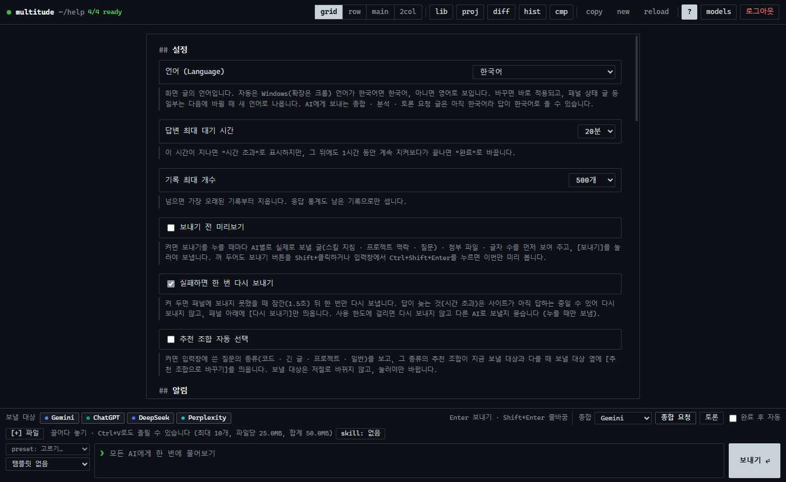

고도화 계획(v0.24.0~v0.30.0)의 **7단계(마지막)** 버전입니다. 화면을 **영어로도** 쓸 수 있게 됐고(설정 › 언어: 자동 · 한국어 · English), **접근성**(글자 대비 · 키보드 포커스 · 창 · 이름표)을 점검해 고쳤으며, 새 버전을 올리기 전에 사람이 직접 해 보는 **출시 전 확인 목록**을 문서로 만들었습니다.

## 바뀐 점

### 화면 언어

- 설정(`?`) 맨 위 **언어 (Language)**: **자동**(기본) · **한국어** · **English**. 자동은 Windows(크롬 확장은 크롬)의 표시 언어가 한국어면 한국어, 아니면 영어입니다. v0.29.0까지 모아 온 화면 문구 사전(약 1,670개 키 × 2개 언어)을 이제 실제로 고릅니다.
- **따르는 곳**: Windows 앱 화면 · 본체가 띄우는 창(저장 · 테스트 실행 확인)과 오류 글 · OS 알림 / 크롬 확장 앱 탭 · **사이드탭** · **오른쪽 클릭 메뉴**. 크롬 웹 스토어 이름 · 설명(`_locales`)은 원래대로 크롬 언어를 따릅니다.
- **바꾸면 그 자리에서** 바뀝니다. 화면을 다시 읽는 방법은 쓰지 않았습니다 — 다시 읽으면 패널 상태 글 · 열어 둔 프로젝트 작업 · 쓰던 질문이 사라지고, 크롬 확장은 AI 사이트(iframe)까지 전부 다시 열리기 때문입니다. 대신 고정 글을 다시 넣고 지금 화면을 다시 그립니다. 패널 머리줄의 상태 글처럼 본체가 알려 주는 글은 **다음에 바뀔 때** 새 언어로 나옵니다.
- 앱을 켤 때 첫 그림부터 고른 언어로 나옵니다 (Windows 앱: 화면이 시작할 때 본체에 한 번 물음 / 확장: 마지막 값을 적어 둔 사본을 먼저 읽음).
- [설정 옮기기](../guide.md#설정-옮기기-v0290) 파일에 언어도 들어갑니다.
- 함께 고친 것:
  - AI 사이트 **안에서 도는 코드**가 주던 한국어 실패 글("입력창을 찾지 못했습니다" 등 5가지)을 **코드**(`no-input` …)로 넘기고 화면 쪽에서 번역합니다. 그 코드는 여전히 다른 파일에 기대지 않습니다.
  - 날짜 모양(기록 · 프리셋 · 적용 기록 · 사이드탭)이 언어를 따릅니다.
  - 업데이트 안내의 `[다운로드]` · `[다시 시작해서 설치]`가 영어에서도 실제 버튼 글과 같습니다.
  - 자가진단 보고서의 "Windows 앱 / 크롬 확장", 요청 파일 보내기 확인 창의 "보내지 않은 이유", 모델 고르기 · 패널 머리줄 · 보낼 대상의 "로컬 LLM" 이름.
- 영어 문서([README.en.md](../../README.en.md) · [English user guide](../en/guide.md))의 그림을 영어 화면으로 바꿨습니다 (`docs/screenshots/en/`).

### 접근성

자세한 내용과 표는 **[접근성](../accessibility.md)**.

- **글자 대비**: 가장 흐린 보조 글 색(`--muted`)이 바탕과 4.1:1이라 WCAG AA(4.5:1)에 못 미쳤습니다 → #848d97(5.6:1, 가장 밝은 바탕에서도 4.8:1). 입력칸 안내 글 · 시간 · 글자 수 등 약 60곳이 조금 밝아집니다. 다른 글자색은 모두 기준을 넘는 것을 확인했습니다.
- **키보드 포커스**: 버튼 · 체크 상자 · 접는 줄 · 목록 줄에 2px 파란 테두리. 공통 입력창 · 사이드탭 입력창 · 파일 편집기는 포커스가 거의 안 보이던 것을 고쳤습니다.
- **창**: 다섯 창(미리보기 · 적용, 화면 상태, 보내기 전 미리보기, 토론, 설정 가져오기) 모두 `role="dialog"` · 제목 이름표. 열리면 포커스가 안으로, Tab은 창 안에서만, 닫으면 열기 전 버튼으로 (새 파일 `src/renderer/a11y.js`). Esc 닫기는 원래대로.
- **이름표**: 기호만 있는 버튼(`? ⟳ ⟨ ✕ → ⤢ + ← ⌂ ↻ { }` 등)과 이름 없던 입력칸(공통 입력창 · 기록 검색 · git 명령 · 편집기 · 압축본 · 사이드탭 입력창)에 화면 읽기 이름.
- **키보드로 닿기**: 클릭만 되던 라이브러리 · 프리셋 목록의 줄, 프로젝트 파일 나무의 폴더 · 파일 이름, 분석 표의 AI 입장 칸을 Tab + Enter로.
- **읽어 주기**: 입력창 아래 안내 · 준비 상태 · 창의 상태 줄 · 사이드탭 안내에 `aria-live`. 단축키 표에 (보이지 않는) 머리줄. 시스템의 "움직임 줄이기"를 따릅니다.

### 출시 전 확인 목록

- **[docs/release-checklist.md](../release-checklist.md)**: 자동 확인(`npm test` · `check:ext` · 한국어/영어 스크린샷) 다음에 사람이 해 볼 것 — Google · Apple 로그인 팝업, 실제 사이트 기본 흐름, `npm run selectors:probe`(앱을 끄고), OS 알림(설치한 빌드), 이전 버전에서 자동 업데이트, v0.23.x 기록 옮기기, 실제 크롬(압축해제 로드 · 권한 창 · 오른쪽 클릭 메뉴 · 사이드탭 · 이 PC 주소 권한), 실제 Ollama · LM Studio, 앱 ↔ 확장 설정 옮기기, 언어 바꾸기, 키보드만으로 한 바퀴. README "문서 지도"와 [설치 · 빌드 · 개발](../setup.md)에서 이어집니다.

### 개발

- `src/shared/i18n.js`: `LANG_PREFS` · `normalizeLangPref` · `pageError`, `apply()`가 `<html lang>`도 맞춤. 설정 `lang`(본체 `prefs.json` · 확장 `prefs`), state `lang` · `uiLang`, IPC `settings:set { lang }` · `i18n:lang`(동기, 시작할 때 한 번), `host.lang`.
- 화면: `relocalize()`(renderer-compose.js) · `mla:lang` 이벤트 · `tbutton()` · `keyClick()` · `svcLabel()`(renderer.js). 확장 `host.ui`는 getter.
- 새 테스트 `test/lang.test.js` · `test/a11y.test.js` · 도우미 `test/helpers/a11y-scan.js`. 스크린샷 도구 `MLA_SHOT_LANG=en`.
- `package-lock.json`의 버전 칸이 0.23.1로 남아 있던 것을 맞췄습니다 (`npm install`은 하지 않음 — 의존성은 그대로).
- 새 문구 25개(언어 설정 · 페이지 오류 · 보내지 않은 이유 · 이름표)는 두 언어 사전에.

## 확인한 것

- `npm test` 409개 통과 (385개에서 24개 추가):
  - `test/lang.test.js` 15개 — 언어 값 정리, **본체 `settings:set`이 아는 값만 받고 바로 적용**, 본체 · 화면 · 확장의 시작 순서, **가짜 크롬 API로 background가 저장된 언어로 메뉴를 만들고 바뀌면 다시 만드는지**, 설정 옮기기, 페이지 오류 code 번역, 업데이트 안내의 버튼 이름, **없는 키 찾기**(화면 뼈대의 `data-i18n*` 키 · 코드의 `t('키')` 약 1,270곳 · 사이드탭과 background가 읽는 사전만으로 충분한지), 스크린샷 도구, 영어 그림.
  - `test/a11y.test.js` 9개 — 화면 뼈대의 버튼 · 입력칸 약 200개에 이름이 있는지, 기호 버튼, 창의 역할 · 제목, **가짜 DOM으로 a11y.js의 포커스 이동 · Tab 가두기 · 돌려주기**, `aria-live`, **색 대비 계산**(글자색 12개 × 바탕 3개), 포커스 규칙, 표 머리줄, 문서.
- `npm run check:ext` 통과.
- 스크린샷 도구로 **한국어 37장면 · 영어 37장면**을 모두 띄워 화면 스크립트 오류가 없습니다. 영어는 01 · 02 · 04 · 05 · 06 · 11 · 12 · 13 · 17 · 24 · 26 · 28 · 32 · 37 · 42 · 45를 그림으로 확인하고 고쳤습니다: 모델 고르기 설명 · 날짜 모양 · 라이브러리 위쪽 줄 넘침 · "1 warnings". 한국어는 02 · 06을 확인했고, 색이 바뀌어 문서 그림 37장을 모두 다시 찍었습니다.
- 임시 프로필로 앱을 켜서(모델 고르기 화면) 오류 없이 뜹니다.

## 알아 둘 것

- **AI에게 보내는 글은 아직 한국어입니다.** 종합 · 분석 · 토론 요청, 넘기기 문구, 프로젝트 모드의 답변 규칙(파일: 경로 · NEED_FILES …), 스킬 압축 요청, 웹페이지 질문의 머리말이 그렇습니다. 영어 화면에서도 **그 답은 한국어로 올 수 있고**, 분석 표는 한국어 제목(`## 이견` 등)을 읽어 만들기 때문에 이번에는 요청 글에 "사용자 언어로 답하라"를 넣지 않았습니다(읽는 쪽을 함께 바꿔야 안전). 내 질문은 쓴 그대로 가므로 일반 질문의 답은 질문 언어를 따릅니다.
- **실제 앱에서 언어를 바꿔 보는 확인은 하지 않았습니다.** 영어 화면은 스크린샷 도구(처음부터 영어로 시작)와 단위 테스트로 봤고, "켜 둔 채로 바꾸기"(`relocalize`)는 코드와 사이드탭 장면(한국어로 그렸다가 설정을 읽고 영어로 다시 그림)으로만 확인했습니다. 바꾼 직후 옛 언어가 남을 수 있는 곳: 패널 머리줄의 상태 글 · 첨부 배지, 열려 있는 창(미리보기 등)의 내용, 프로젝트 변경 바, 로컬 LLM 패널 안내 — 다음에 그 부분이 다시 그려질 때 바뀝니다. 앱을 다시 켜면 전부 새 언어입니다.
- **실제 크롬 · 실제 Windows 언어 설정으로는 확인하지 않았습니다.** `app.getLocale()` · `chrome.i18n.getUILanguage()`가 주는 값으로 자동 언어가 맞게 골라지는지, 사이드탭 · 오른쪽 클릭 메뉴가 따라 바뀌는지는 [출시 전 확인 목록](../release-checklist.md) 10번으로 봐야 합니다. 확장을 새로 깔고 한 번도 앱 탭을 열지 않았으면 크롬 언어를 따릅니다.
- **"로컬 LLM"** 은 모델 고르기 · 패널 머리줄 · 보낼 대상에서만 "Local LLM"으로 보입니다. 기록 · 통계 · 분석 표 · 프리셋 요약에는 저장된 이름 그대로 "로컬 LLM"이 나옵니다 (그 이름으로 저장하고 서로 찾기 때문에 바꾸지 않음).
- 영어 화면에서도 **예시가 한국어인 곳**이 있습니다: 기본 템플릿의 본문(AI에게 보내는 글), 스크린샷의 예시 질문 · 답변, 스크린샷 도구가 손으로 그린 일부 장면(11번 미리보기 창 · 24번 사이드탭 상태 글). 붙여넣은 그림 파일 이름(`붙여넣은-이미지-…`)도 그대로입니다.
- 영어 사용 안내([docs/en/guide.md](../en/guide.md))는 화면이 한국어뿐일 때 쓴 것이라 본문에 한국어 버튼 이름이 함께 적혀 있습니다 (머리말에 설명을 더함). 영어 화면에 맞춘 전면 개정은 하지 않았습니다.
- **접근성은 코드 · 계산으로 확인했고, 화면 읽기 프로그램(NVDA · 내레이터)과 키보드만으로 실제 써 보는 확인은 하지 않았습니다.** 알려진 모자란 점: AI 사이트 안쪽은 고칠 수 없음, 입력칸 · 버튼 테두리 선의 대비(1.6:1)는 디자인 때문에 그대로, 패널 상태 글은 읽어 주지 않음, 파일 나무에서 폴더를 펼치면 포커스가 처음으로 돌아감 — [접근성](../accessibility.md).
- 흐린 글 색이 밝아져 화면 전체가 **조금 달라 보입니다**. 크롬 웹 스토어용 그림(`store/screenshots`)은 다시 찍지 않았습니다.
- 공통 입력창에 포커스가 있을 때 테두리가 파랑으로 보입니다 (예전에는 진한 회색). 키보드 포커스 표시를 위해서입니다.
- 출시 전 확인 목록의 **1~11번은 이번 버전에서 하지 않았습니다** (실제 로그인 팝업 · 실제 사이트 · 셀렉터 점검 · OS 알림 · 자동 업데이트 · v0.23.x 데이터 · 실제 크롬 · 실제 Ollama · 앱 ↔ 확장 설정 옮기기). 목록을 만든 것이고, 태그를 올리기 전에 해 봐야 합니다.
