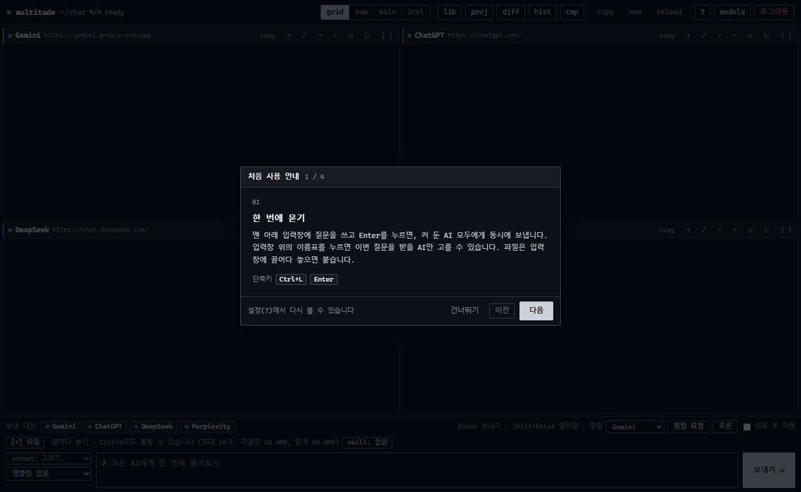
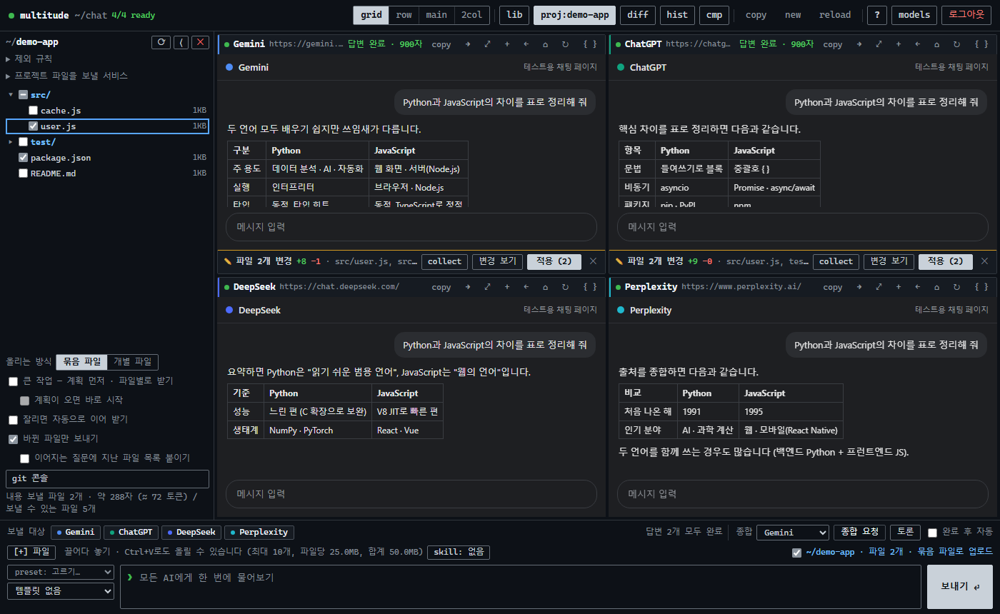

로드맵(v0.31.0~v0.37.0)의 **1단계(기반 정리)** 버전입니다. **AI에게 보내는 글이 화면 언어를 따르게** 했고, 처음 켜는 사람을 위한 **첫 사용 안내**를 넣었고, **접근성**에서 남아 있던 세 가지(테두리 대비 · 파일 나무 방향키 · 앱 화면 확대)를 고쳤고, 다시 커진 큰 파일을 나눴습니다.

## 바뀐 점

### AI에게 보내는 글이 화면 언어를 따름

v0.30.0에서 화면은 영어로도 쓸 수 있게 됐지만, 종합 · 분석 · 토론 · 프로젝트 모드 요청은 한국어로만 나가서 영어 화면에서도 답이 한국어로 오곤 했습니다. 이제 **같은 언어**로 나갑니다.

- **따르는 글**: 종합 · 분석 요청(머리글 `## Common ground · Disagreements · Weak evidence · Final answer`와 이견 표 머리) · 토론 요청 · 토론 판정 요청 · 넘기기(검토 · 반박 · 이어서) · 스킬 지침 머리글과 **AI로 압축** 요청 · 웹페이지로 질문 · 사이드탭 본문 전달 · 커밋 메시지 부탁 · **프로젝트 모드 전부**(답변 규칙 · 파일 요청 · 바뀐 파일 알림 · 다시 받기 · 이어서 받기 · 큰 작업 계획 · 파일별 요청 · 보내지 않은 이유) · **기본 템플릿 9개**(요약 · 쉽게 설명 · 단계별 · 장단점 · 사실 확인 · 번역 · 코드 리뷰 · 파일 모아보기 형식).
- **그대로 두는 글**: 내가 쓴 질문, 내 템플릿 · 스킬(쓴 그대로 보냄), 화면의 안내 글.
- **답을 읽는 쪽은 두 언어를 모두 받습니다**: 분석 답의 머리글은 한국어 · 영어를 둘 다 알아봐서, 언어를 바꾼 뒤에도 · 예전 기록의 분석도 같은 표로 읽힙니다. 수정안은 `File: path`와 `파일: path`, `<<<<<<< SEARCH`와 `<<<<<<< 찾기`(`>>>>>>> REPLACE` · `바꾸기`)를 둘 다 읽고, `DELETE_FILES` · `NEED_FILES` · `PLAN_FILES` 표시는 두 언어가 같습니다.
- 한국어 글은 v0.30.0까지와 **글자까지 같습니다** (기존 테스트가 그대로 통과).
- 글은 새 사전 파일 `src/shared/i18n-ko-prompt.js` · `i18n-en-prompt.js`(키 `prompt.*`, 128개)에 있고, 보낼 때마다 지금 언어로 만듭니다 — 앱을 켠 채 언어를 바꿔도 바로 따릅니다.

### 첫 사용 안내

- 새로 설치한 뒤 처음 패널 화면에 들어오면 **처음 사용 안내**(4걸음: 한 번에 묻기 → 답 비교하기 → 종합 · 넘기기 · 토론 → 더 해 볼 것)가 한 번 뜹니다. `다음` · `이전`(또는 `←` `→`), `건너뛰기` · `Esc` · `시작하기`로 닫으면 **다시 뜨지 않습니다.** 설정(`?`) 맨 아래 **다시 보기**로 다시 볼 수 있습니다. 걸음마다 쓸 단축키가 함께 나옵니다.
- **예전부터 쓰던 사람에게는 띄우지 않습니다** — 저장된 설정이 있는데 이 항목만 없으면 이미 쓰고 있는 것으로 봅니다. 설정 옮기기 파일에는 넣지 않습니다 (새 PC에서는 새로 보는 편이 맞음).
- 다른 창(미리보기 · 토론 · 자가진단 등)이 떠 있으면 끼어들지 않고, 띄운 화면을 떠나면(`Esc` 단축키 · 툴바) 닫습니다. 창은 다른 창들처럼 포커스를 안에 가두고 닫을 때 돌려줍니다.

### 접근성 ([접근성](../accessibility.md)의 "알려진 모자란 점" 세 가지)

- **테두리 대비**: 버튼 · 입력칸 · 고르기 칸의 테두리가 바탕과 1.6:1이던 것을 `--control-border` #656d76(3.1~3.6:1)으로 — WCAG 1.4.11(3:1). 칸을 나누는 선 · 상자 테두리는 옅은 그대로입니다. 마우스를 올린 버튼의 테두리도 더 또렷해졌습니다.
- **파일 나무 방향키**: 프로젝트 사이드바의 파일 나무가 `role="tree"`가 됐습니다. Tab 한 번에 나무로 들어가 `↑` `↓` `→` `←` `Home` `End` `Enter` `Space`로 움직입니다(키 설명은 [단축키](../guide.md#단축키)). 펼치거나 체크해서 다시 그려도 **보던 줄에 포커스가 남습니다** (예전에는 처음으로 돌아갔음). 줄은 `treeitem`(수준 · 펼침 · 선택 상태)으로 읽힙니다.
- **앱 화면 확대 (Windows 앱)**: `Ctrl` `+` / `-` / `0`(숫자판도)으로 앱 화면(툴바 · 입력창 · 목록 · 창)을 80%~200%(8단계)로 바꾸고 기억합니다. 메뉴를 없앤 뒤로 Electron 기본 확대 키가 듣지 않던 것을 직접 받습니다. AI 사이트 패널은 그 사이트의 크기 그대로이고, 패널 자리는 화면 크기에 맞춰 다시 계산합니다. 설정(`?`)의 단축키 표에 나옵니다 (크롬 확장은 브라우저 확대).

### 큰 파일 나누기 (동작은 그대로)

| 파일 | 전 → 후 | 새 파일 |
|---|---|---|
| `src/renderer/project-changes.js` | 1139 → 701줄 | `project-runs.js`(큰 작업 · 이어서 받기) · `project-devtest.js`(검사 실행) · `project-collect.js`(파일 모아보기) |
| `extension/host.js` | 1110 → 846줄 | `host-panels.js`(iframe · 패널) · `host-remote.js`(원격 셀렉터 · 업데이트) — 서로 `MLA.extHost`로 주고받음 |
| `src/main/main.js` | 1045 → 883줄 | `views.js`(세션 · AI 패널 뷰 · 로그인 팝업 규칙 · 셀렉터 자가진단) |

나눈 뒤 **빠진 이름이 없는지**를 파서로 확인했습니다(원본에서 풀리던 이름이 새 파일에서 풀리지 않는 경우 0개). 스크린샷 도구 37개 장면을 모두 띄워 콘솔 오류가 없었습니다.

### 문서 · 그림

- `PLAN.md` 맨 위의 개발 변경 메모(v0.4.1~v0.30.0, 47줄)를 [docs/plan-history.md](../plan-history.md)로 옮겼습니다. 앞으로 개발 메모는 릴리스 노트의 "개발" 절에 씁니다.
- 예전 디자인으로 남아 있던 프로젝트 모드 그림 6장(09 · 10 · 16 · 21 · 22 · 23)을 가짜 프로젝트 폴더(`demo-app`)로 새로 찍었습니다. 크롬 확장 탭 그림(08)만 남았습니다 (실제 크롬에서만 찍을 수 있음). 새 그림 46 · 47.
- [출시 전 확인 목록](../release-checklist.md)에 "첫 사용 안내 · 확대 · 파일 나무" 절을 더했고, 영어 화면 확인 항목을 새 동작에 맞게 고쳤습니다.

## 알아 둘 것

- **실제 AI 사이트로는 확인하지 못했습니다.** 영어 요청 글에 실제 AI가 영어 형식(`## Common ground`, `File: path`, `<<<<<<< SEARCH`)대로 답하는지는 사람이 해 봐야 합니다. 형식을 어기면 분석은 "형식이 맞지 않음"으로 글 그대로 보이고, 수정안은 읽히지 않을 수 있습니다 (두 언어 모두 같은 규칙).
- **실제 Windows 앱 · 실제 크롬에서 확인하지 못한 것**: 확대했을 때 패널이 툴바 · 입력창과 정확히 맞는지(계산은 단위 테스트로 확인), 나눈 확장 파일(`host-panels.js` · `host-remote.js`)이 실제 크롬에서 도는지, 화면 읽기 프로그램이 파일 나무를 어떻게 읽는지. 전부 [출시 전 확인 목록](../release-checklist.md)의 새 절에 있습니다.
- 확대는 **앱 화면만** 키웁니다. 200%에서는 창이 좁으면 패널 칸이 매우 작아집니다.
- 기본 템플릿을 영어로 만들었으므로, 영어 화면에서 템플릿으로 보낸 질문은 영어 지시문 + 내 질문입니다 (질문은 쓴 그대로).
- 영어 스크린샷(`docs/screenshots/en/`) 14장과 새 첫 사용 안내 그림을 다시 찍었습니다. 예시 질문 · 답은 한국어 그대로입니다.

## 개발

- 사전: `AREAS`에 `'prompt'` 추가(`src/shared/i18n.js`), `index.html` · `sidepanel.html`이 `i18n-*-prompt.js`를 읽음. `project-context.js`의 `RULES` · `PLAN_FIRST`는 값이 아니라 **읽을 때마다 만드는 getter**입니다. 프로젝트 파일 올리기의 보내지 않은 이유(`SKIP_WHY`)도 `reason`을 getter로.
- `analysis.js`: `SECTIONS`(한국어) + `SECTIONS_EN`, `sectionOf`는 둘 다 받음. `norm`은 `(you)` · `(me)`도 무시.
- `templates.js`: 글(`text`)을 `prompt.tpl.<id>`에서 꺼내는 getter.
- 새 파일: `src/shared/tree-nav.js`(파일 나무 키 계산) · `src/shared/onboarding.js`(걸음 · 보여 줄지) · `src/renderer/onboarding.js` · `src/main/views.js` · `src/renderer/project-{runs,devtest,collect}.js` · `extension/host-{panels,remote}.js`. 확대 계산은 `layout.js`(`ZOOM_STEPS` · `normalizeZoom` · `zoomStep` · `zoomKey` · `scaleRect`), 본체는 `computeRects()`를 화면(CSS) 픽셀로 계산하고 `pushState()`에서 `scaleRect`로 창 픽셀로 바꿉니다. 설정 `uiZoom` · `onboarded`(본체 `prefs.json` · 확장 `prefs`, state에 `onboarded`).
- 쪼갠 모듈 사이: 변경 쪽은 `MLA.projectUI`(P)에 싣고 꺼냄, 확장 host는 `MLA.extHost`(X), `main.js` ↔ `views.js`는 `createViews(ctx)`(값이 바뀌는 `win`은 getter).
- 새 테스트: `test/prompt-lang.test.js` · `tree-zoom.test.js` · `onboarding.test.js`, 도우미 `test/helpers/ext-host.js`(나뉜 host 파일을 이어 읽음). 스크린샷 도구에 장면 46 · 47과 프로젝트 장면용 가짜 폴더 확대.
