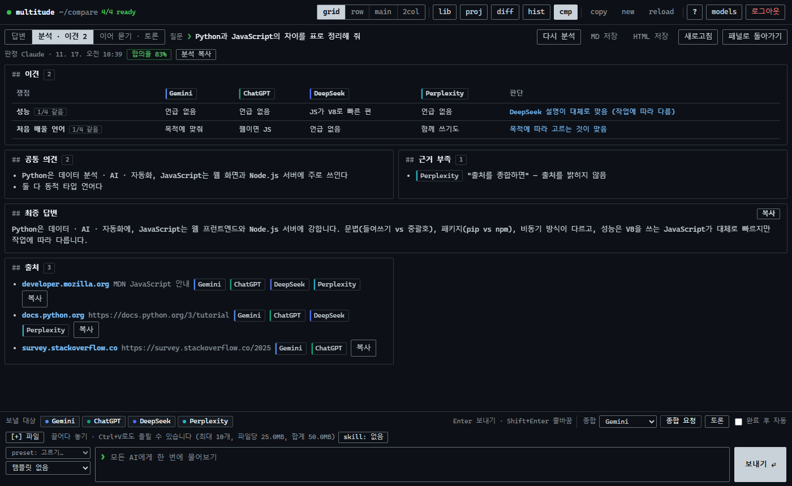
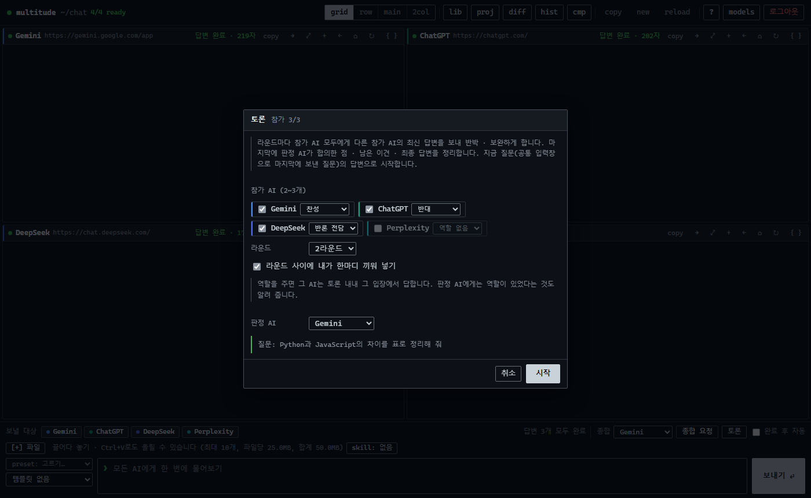
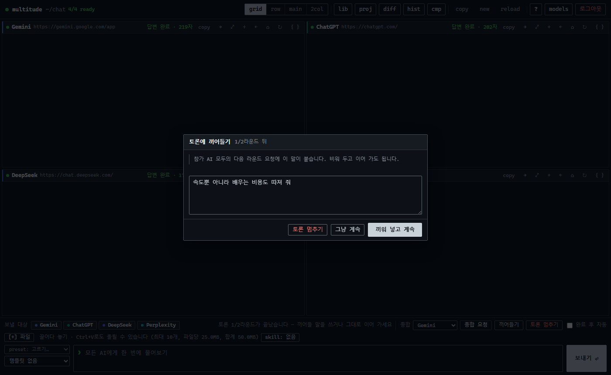
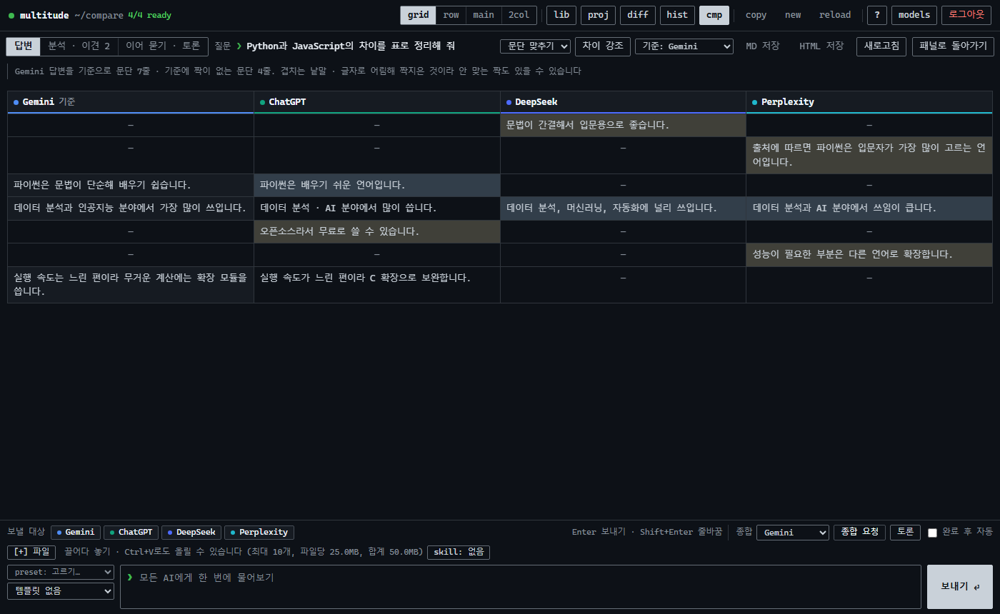
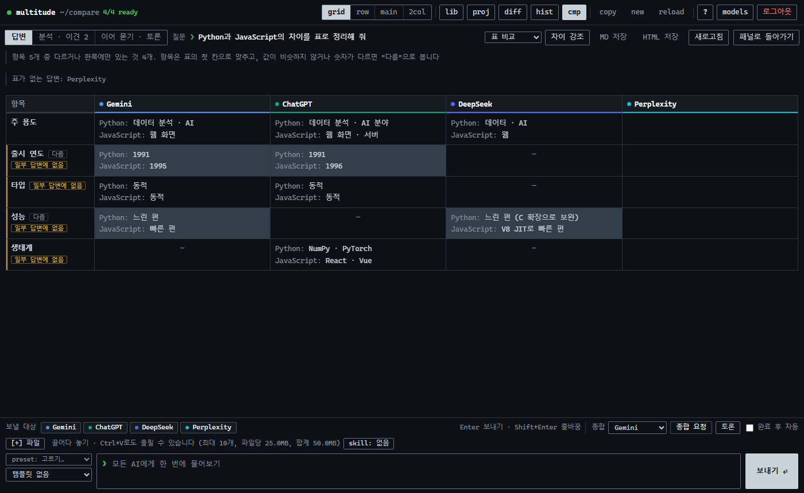

로드맵(v0.31.0~v0.37.0)의 **2단계(답 다루기)** 버전입니다. 분석에 **합의율 · 출처**를, 토론에 **역할 · 라운드 사이 끼어들기 · 틀 저장**을, 답변 비교에 **보기 방식 세 가지**(문단 맞추기 · 코드만 · 표 비교)를 더했습니다.

## 바뀐 점

### 분석: 합의율 · 같은 입장 수 · 출처

- **합의율**(분석 머리줄 `합의율 83%`): 공통 의견 하나를 "모두 같음", 이견 하나를 "입장을 쓴 AI 중 같은 입장인 AI의 비율"로 세어 평균을 낸 값입니다. 입장을 쓰지 않은 AI는 갈림이 아니라 "말이 없음"이라 깎지 않습니다. 입장 글이 없는 이견(글머리표만)은 0으로 셉니다.
- **같은 입장 수**(이견 줄의 `2/4 같음`): 비교한 AI 4개 중 비슷한 입장을 쓴 AI가 2개. 입장 글끼리 **숫자가 같고 글자 · 낱말이 많이 겹치면**(60% 이상) 같은 입장으로 묶고, 가장 큰 묶음의 크기를 셉니다. "언급 없음" · "not mentioned" 칸은 입장으로 세지 않습니다. 마우스를 올리면 계산이 보입니다.
- **출처 칸**: 답변 · 분석 글에 나온 링크를 주소별로 모읍니다. 마크다운 링크(제목 포함)와 맨 주소를 모두 읽고, 끝의 문장부호 · `#조각` · `utm_*` 값은 떼고 같은 주소는 하나로 묶습니다. 그 링크를 쓴 AI가 이름표로 보이고 여러 AI가 쓴 링크가 앞입니다(최대 30개). **앱 안에서는 링크를 열지 않고 복사만** 합니다 (패널 밖으로 나가는 이동을 만들지 않으려고).
- 비교 화면 · 기록 화면의 분석에서 같게 보입니다.

### 토론: 역할 · 끼어들기 · 틀 저장

- **역할**: 토론 설정 창에서 참가 AI마다 **찬성 · 반대 · 반론 전담**을 고릅니다. 요청 글 앞에 역할 한 단락이 붙고(반론 전담은 자기 결론보다 다른 답의 약점 · 반례를 찾음), 판정 AI에게는 입장 이름 옆에 역할과 "역할이 아니라 근거로 판정해 달라"는 말이 갑니다. 안 주면 요청 글이 예전과 **글자까지 같습니다**.
- **라운드 사이 끼어들기**: 설정 창에서 켜면 마지막 라운드 전까지 라운드가 끝날 때마다 토론이 멈추고 **끼어들기 창**이 뜹니다. 쓴 말은 **다음 라운드** 요청에만 붙어 참가 AI 모두에게 갑니다. `끼워 넣고 계속` · `그냥 계속` · `토론 멈추기`, `Ctrl+Enter`로 보내기. `Esc`로 닫아도 토론은 멈춘 채 그대로이고 입력창 아래 **끼어들기** 단추로 다시 엽니다.
- **기록**: 답마다 역할이, 끼어든 말은 그 말을 받은 라운드에 남고 비교 화면 · 기록 · MD · HTML에 "내가 끼워 넣은 말"로 나옵니다.
- **프리셋**: 참가 AI · 라운드 · 판정에 더해 **역할 · 끼어들기 설정**까지 [작업 프리셋](../guide.md#작업-프리셋-v0290)에 저장됩니다. 예전 프리셋은 그대로 읽힙니다.
- 한도: 참가 AI 3개 · 3라운드 상한은 그대로입니다.

### 답변 비교: 보기 방식

답변 탭 위쪽 `보기 방식`(고른 방식은 기억). 답변 글은 그대로고 보여 주는 모양만 바뀝니다.

- **문단 맞추기**: `기준:` 답변의 문단마다 한 줄, 다른 AI의 비슷한 문단을 같은 줄에. 낱말 · 글자 겹침이 30% 이상인 것을 큰 것부터 하나씩만 짝짓고, 짝이 없는 문단은 그 AI의 앞 문단이 있는 줄 바로 뒤에 노란 줄로 둡니다. 겹침이 적은 짝은 푸른 바탕으로 표시합니다. 표의 줄은 `a · b`로 보이고 구분 줄은 뺍니다. (분석 쪽에 이미 있던 문단 나누기 · 낱말 쪼개기를 씁니다.)
- **코드만**: 답변마다 코드 블록만(언어 이름 포함). `차이 강조`를 켜면 기준 코드에 없는 줄을 강조합니다.
- **표 비교**: 마크다운 표를 **첫 칸(항목 이름)** 으로 맞춰 칸 단위로. 값이 비슷하지 않거나 숫자가 다르면 `다름`, 일부 AI의 표에만 있는 항목은 `일부 답변에 없음`. 표가 없는 답변은 따로 알립니다.

### 문서 · 그림

- 한국어 · 영어 가이드, README, [출시 전 확인 목록](../release-checklist.md)(새 절 "답 다루기")을 고쳤습니다. 새 그림 48~53, 영어 그림도 다시 찍었습니다.

## 알아 둘 것

- **합의율 · 같은 입장 수 · 문단 짝 · 표 항목 맞추기는 모두 "겹침으로 어림"한 값입니다.** 뜻을 읽지 않으므로 같은 말을 다르게 쓰면 따로 세고(예: "느린 편" vs "느리다"), 다른 말이 우연히 겹치면 같게 셉니다. 화면의 안내 글과 마우스 올림 글에 어림이라고 적었습니다. 실제 AI의 답으로 얼마나 어긋나는지는 확인하지 못했습니다 (출시 전 확인 목록에 있음).
- 문단 맞추기는 문단 수가 많은 긴 답변 넷이면 줄이 길어지고, 서로 아주 다른 구성의 답이면 짝 없는 줄이 많이 생깁니다.
- 표 비교는 마크다운 표만 읽습니다 (구분 줄 `|---|`이 있는 표). 항목 이름이 AI마다 다르게 쓰이면(예: "성능" vs "속도") 다른 항목으로 갈립니다.
- 끼어들기는 실제 AI 사이트와 Windows 앱 패널 화면에서 확인하지 못했습니다 (가짜 화면 · 단위 테스트로 확인).

## 개발

- `src/shared/analysis.js`: `agreementOf` · `agreementSummary` · `extractSources` · `positionSimilarity`(숫자가 다르면 0). `src/shared/compare-modes.js`(새): `alignParagraphs` · `tidyParagraph` · `extractCode` · `markCodeLines` · `tablesOf` · `compareTables`. 화면 `src/renderer/compare-modes.js`(새)가 `renderCompareMode`를 `renderCompareAnswers`에 연결.
- 토론: `chain.js`(`ROLES` · `cleanRoles` · `cleanDebateExtras` · `buildDebatePrompt({ role, note })` · 판정 글의 역할, `normalizeDebate`가 정한 경우에만 `roles` · `interject`를 결과에 실음), `debate.js`(상태 `paused` · `interject(text)` · 라운드 기록에 `role` · `note`), `rounds.js`(`interjectDebate`), IPC `debate:interject`, preload · 확장 host, `history-core.cleanChain`, `export.js`, `prompt-lib.normalizePreset`. 화면 `debate-ui.js` · `index.html`(`#interjectModal` · `#debateNote`).
- 새 테스트 `test/answer-tools.test.js`(22개). 스크린샷 장면 48~53.
