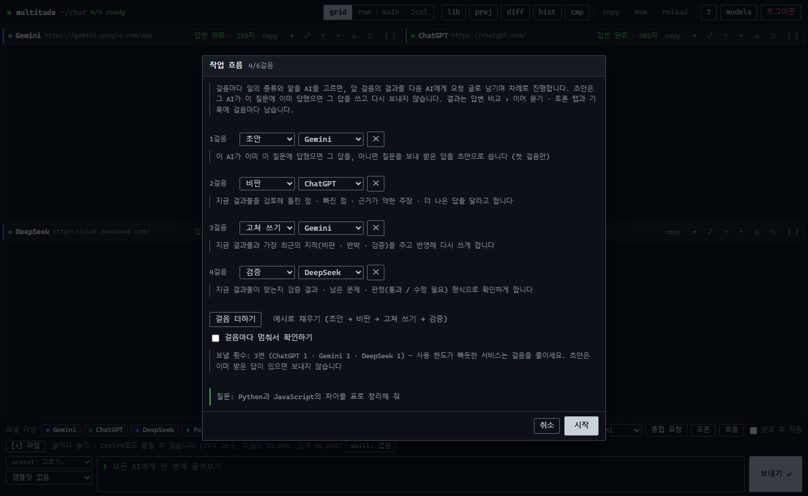
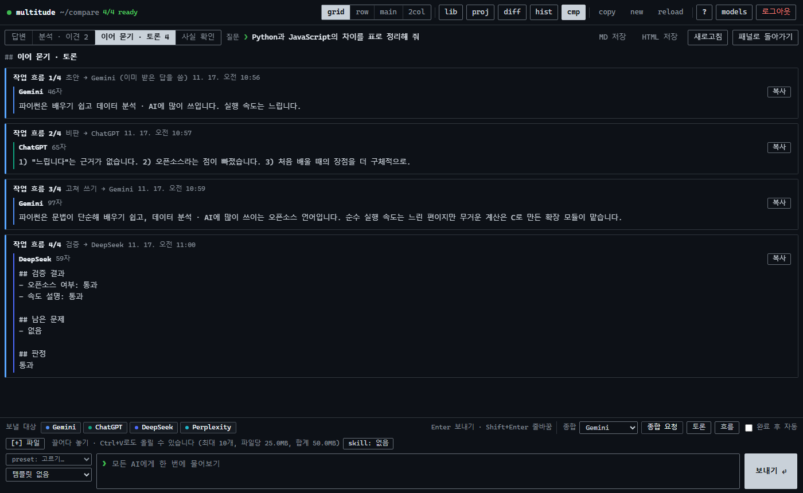
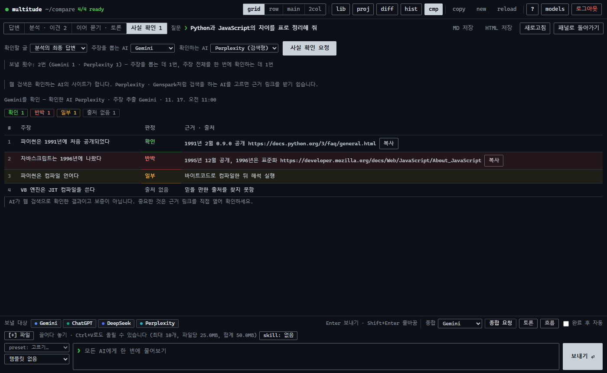

로드맵(v0.31.0~v0.37.0)의 **3단계(작업 흐름 · 사실 확인)** 버전입니다. 정한 순서대로 AI 여러 개에게 차례로 일을 시키는 **작업 흐름**과, 답의 사실을 AI가 웹 검색으로 확인하는 **사실 확인**을 더했고, 무료 사용 한도를 가늠하도록 시작 전에 **보낼 횟수**를 보여 줍니다.

## 바뀐 점

### 작업 흐름

입력창 아래 `흐름` → 설정 창. "A가 초안 → B가 비판 → A가 고쳐 쓰기 → C가 검증"처럼 **2~6걸음**을 정하면 앱이 차례로 요청합니다.

| 일 | 하는 일 | 받는 것 |
|---|---|---|
| 초안 | (첫 걸음만) 그 AI가 이 질문에 이미 답했으면 그 답을 쓰고 **다시 보내지 않음**, 없으면 질문을 보냄 | — |
| 비판 | 틀린 점 · 빠진 점 · 약한 주장 · 더 나은 답 (넘기기 › 검토와 같은 글) | 결과물 |
| 반박 | 반례 · 다른 관점 (넘기기 › 반박) | 결과물 |
| 고쳐 쓰기 | 결과물 + 가장 최근의 지적을 주고 처음부터 끝까지 다시 쓰게 함 | 결과물 + 지적 |
| 검증 | `검증 결과 · 남은 문제 · 판정(통과 / 수정 필요)` 형식으로 확인 | 결과물 |
| 이어서 | 결과물을 이어받아 발전시킴 (넘기기 › 이어서) | 결과물 |

- **규칙**(창에서 바로 알려 주고 `시작`을 막음): 첫 걸음은 초안 · 비판 / 반박 / 검증 / 이어서는 앞에 결과물이 · 고쳐 쓰기는 앞에 지적이 있어야 함 · 맡은 AI의 패널이 열려 있어야 함. 같은 AI를 여러 걸음에 써도 됩니다.
- **걸음마다 멈춰서 확인하기**: 걸음이 끝날 때마다 멈추고 `다음 걸음` · `다음 걸음 건너뛰기` · `흐름 멈추기`. 건너뛴 걸음 뒤에도 똑같이 멈춥니다. `흐름 멈추기`는 언제든 됩니다.
- **실패하면**(시간 초과 · 답변 없음 · 오류) 흐름을 멈추고 **받은 걸음까지는 기록에 남깁니다.** 끝나면 알림을 띄웁니다.
- **기록**: 걸음마다 `작업 흐름 2/4 · 비판 → ChatGPT`로 답변 비교 › 이어 묻기 · 토론 탭 · 기록 · MD · HTML에 남습니다 (기록의 chain에 새 종류 `workflow`).
- **프리셋**: 순서(걸음 종류 · AI)와 걸음마다 멈춤이 작업 프리셋에 저장됩니다. 예전 프리셋은 그대로 읽힙니다.

### 사실 확인

답변 비교 › **사실 확인** 탭.

1. **확인할 글**(한 AI의 답 · 분석의 최종 답변) · **주장을 뽑는 AI**(패널 없는 로컬 LLM도 됨) · **확인하는 AI**(Perplexity · Genspark 같은 검색형 권장, 기본으로 골라 줌)를 고르고 `사실 확인 요청`.
2. 주장을 뽑는 AI가 **확인할 수 있는 주장을 최대 10개** 번호 목록으로 줍니다 (숫자 · 날짜 · 이름 · 인과 관계 같은 것만, 의견 · 추천은 뺌).
3. 확인하는 AI에게 **주장 전체를 한 번에** 묻고 `번호 | 판정 | 근거 · 출처` 표로 받아 주장마다 **확인 · 반박 · 일부 · 출처 없음**으로 보여 줍니다 (반박은 붉게, 일부는 노랗게, 개수 요약). 근거 링크는 `복사` (앱 안에서는 열지 않음).

- 판정은 한국어 · 영어 표현을 모두 읽고, "확인 불가"처럼 "확인"이 들어간 말을 "확인"으로 잘못 읽지 않도록 "출처 없음"을 먼저 봅니다. 표에서 못 읽은 주장은 "읽지 못함"으로 따로 알립니다.
- 결과는 질문마다 기록에 남습니다 (synth의 새 `factcheck` 종류 — 기록 목록의 "종합" 개수에는 넣지 않음).
- **AI가 확인한 것이지 보증이 아닙니다.** 화면에도 적었습니다.

### 보낼 횟수 (한도 보호)

- 작업 흐름 창: "보낼 횟수: 3번 (ChatGPT 1 · Gemini 1 · DeepSeek 1)" (초안은 이미 받은 답이 있으면 빼고 셈).
- 사실 확인 탭: "보낼 횟수: 2번 (추출 1 + 확인 1)".
- 토론 창: "보낼 횟수: 7번 (참가 3개 × 2라운드 + 판정 1번)" — 라운드를 바꾸면 따라 바뀝니다.

### 고친 것

- 토론 · 작업 흐름 · 사실 확인이 **진행 중일 때 시작을 또 누르면** "이미 진행 중입니다"를 알리면서 진행 중인 것의 상태 표시를 "실패"로 덮어쓰던 문제 (토론은 v0.26.0부터 있던 것).

### 문서

- 한국어 · 영어 가이드, README, [출시 전 확인 목록](../release-checklist.md)(새 절 "작업 흐름 · 사실 확인"), [설치 · 빌드 · 개발](../setup.md)을 고쳤습니다. 새 그림 54~56 (영어 그림 포함).

## 알아 둘 것

- **실제 AI 사이트로는 확인하지 못했습니다.** 특히 ① 긴 요청 글(앞 걸음의 답이 통째로 들어감)을 각 사이트가 잘 받는지 ② 확인하는 AI가 `번호 | 판정 | 근거` 표 형식을 지키는지(어기면 "읽지 못함") ③ 판정이 맞는지(AI가 틀린 확인을 할 수 있음)는 사람이 해 봐야 합니다.
- 한 걸음의 요청 글에는 앞 결과가 12,000자까지 들어갑니다 (더 길면 자름).
- 작업 흐름의 `초안`은 **이미 받은 답**을 쓰므로, 같은 질문에 AI가 이미 여러 번 답했어도 가장 최근 답만 씁니다.
- 흐름 도중에 패널을 닫거나 새 대화를 열면 그 걸음의 답을 받지 못해 흐름이 멈출 수 있습니다.

## 개발

- 새 파일: `src/shared/workflow.js`(걸음 규칙 `normalizeWorkflow` · `countSends` · `buildStepPrompt` · 진행 엔진 `createWorkflow`) · `src/shared/factcheck.js`(`parseClaims` · `verdictOf` · `parseVerdicts` · `normalizeFactcheck` · 진행 엔진 `createFactcheck`) · `src/renderer/workflow-ui.js` · `src/renderer/factcheck-ui.js`.
- `rounds.js`: `startWorkflow` · `stopWorkflow` · `resumeWorkflow` · `startFactcheck` · `stopFactcheck`, `answers().factchecks`. 두 엔진은 토론처럼 `sendAndWait`로 보내고(패널 없는 로컬 LLM 포함), 진행은 `synth:status`의 `mode: 'workflow' | 'factcheck'`.
- IPC `workflow:start|stop|resume` · `factcheck:start|stop`(`ipc/chain.js`, 설정은 `cleanWorkflowCfg` · `cleanFactCfg`로 아는 칸만), preload · 확장 host 같은 이름. 요청 글은 `i18n-*-prompt.js`(`prompt.workflow.*` · `prompt.fact.*`).
- `history-core.cleanChain`: `kind: 'workflow'`(`step` · `steps` · `stepKind` · `to` …), 목록 요약에 `factcheck` 개수. `notify`: 모드 `workflow` · `factcheck`.
- 새 테스트 `test/workflow-fact.test.js`(20개), 스크린샷 장면 54~56.
