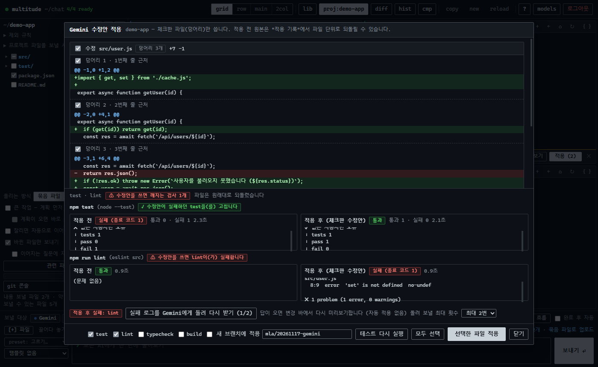
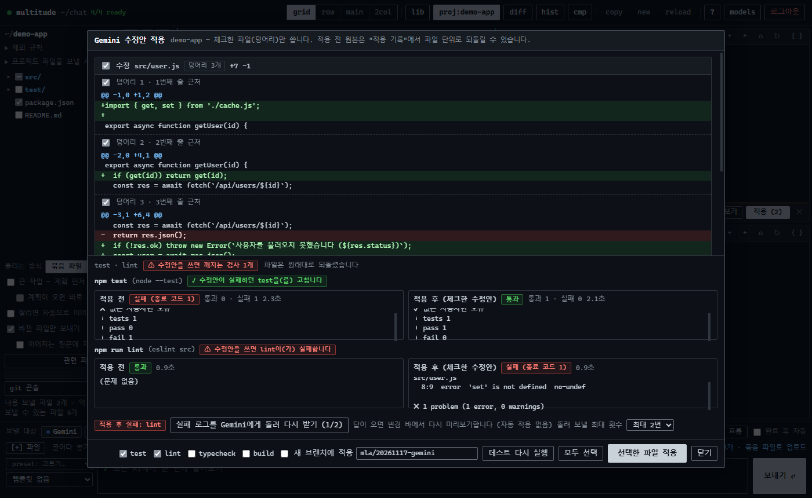
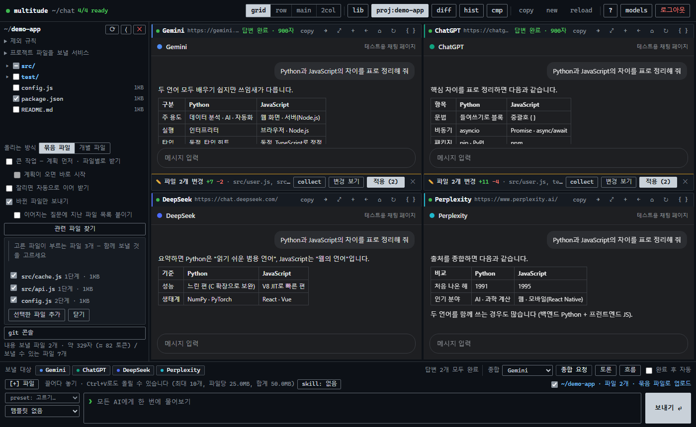
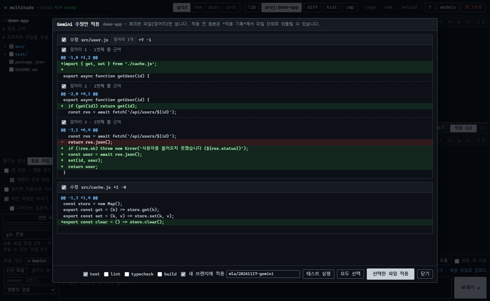

# v0.34.0 — 프로젝트 모드 고도화

로드맵(v0.31.0~v0.37.0)의 **4단계(프로젝트 모드)** 버전입니다. 테스트 실행이 Python · Rust · Go까지 넓어졌고, 적용 후 실패한 검사를 AI에게 돌려 다시 받을 수 있으며, 함께 보낼 관련 파일을 찾아 주고, 적용을 새 브랜치에 할 수 있습니다.

## 바뀐 점

### 다른 언어 검사 (Windows 앱)

- 프로젝트 맨 위 폴더에 `pyproject.toml` · `Cargo.toml` · `go.mod`가 있으면 **테스트 실행** 체크 칸에 `pytest` · `cargo-test` · `go-test`가 더해집니다 (있는 것만).
- 실행하는 명령은 **이 셋뿐**: `python -m pytest -q` · `cargo test` · `go test ./...`. 화면은 이름만 넘기고 본체가 고정된 인자로, **셸 없이** 실행합니다.
- 실행 파일은 PATH의 **절대 경로 폴더**에서만 찾습니다. Windows의 Microsoft Store용 가짜 `python`은 건너뛰고 `py -3`을 씁니다. `~/.cargo/bin` · `Program Files\Go\bin`도 봅니다. 못 찾으면 "실행 파일을 찾지 못함"으로 알립니다.
- `conftest.py` · `pyproject.toml` · `setup.py` · `pytest.ini` · `tox.ini` · `Cargo.toml` · `build.rs` · `go.mod` · `go.sum` · `.cargo/config`처럼 **검사가 도는 방식을 바꾸는 파일**을 수정안이 건드리면 확인 창에 ⚠로 따로 알립니다.
- 통과 · 실패 수는 pytest · cargo · go 출력에서 찾습니다. 시간 제한은 다른 검사와 같이 3분.

### 실패 로그 돌려 다시 받기

- 적용 후 검사가 실패하면 결과 창에 **실패 로그를 ○○에게 돌려 다시 받기 (n/최대)** 가 나옵니다.
- 실패한 검사의 출력이 **같은 AI에게 후속 질문**으로 나갑니다 (비밀 정보는 가림, 검사마다 6,000자 · 전체 14,000자까지). 답이 오면 새 변경 바로 올라와 다시 미리보기 · 검사합니다.
- **자동으로 적용하지 않습니다.** 횟수는 **기본 2번, 최대 3번**(0~3, 기억함). 새 질문을 하거나 적용하면 0으로 돌아갑니다.

### 관련 파일 찾기

- 사이드바 `관련 파일 찾기`: 고른 파일이 `import` · `require` · `from … import`로 부르는 프로젝트 안의 파일을 **깊이 2까지**(최대 30개) 따라가 제안합니다. 이미 고른 파일은 뺍니다.
- 체크 상자로 골라 `선택한 파일 추가`. 비밀 정보 확인 · 읽을 수 없는 파일 안내는 파일을 직접 고를 때와 같습니다.
- JS · TS(상대 경로, `index` · 확장자 생략) · Python(상대 import · 프로젝트 안 모듈)만. 별칭(`@/…`)이나 코드로 만든 경로는 못 찾습니다. 크롬 확장에서도 됩니다.

### 새 브랜치에 적용 (Windows 앱)

- 미리보기 창 아래 `새 브랜치에 적용`을 켜면 **적용 직전에** `git switch -c mla/<날짜>-<AI>`로 만들고 그 위에 씁니다. 섞어서 적용에도 있습니다.
- 이름은 고칠 수 있지만 항상 `mla/`로 시작하고 영문 · 숫자 · `. _ -`만 (`..` · 끝의 `.` · `.lock` · `--` 거절). 본체가 같은 규칙으로 다시 검사하고, 같은 이름이 있으면 거절합니다.
- **커밋도 push도 하지 않습니다.** git 프로젝트가 아니거나 다른 작업이 도는 중이면 만들지 않고 알립니다.

### 문서

- 한국어 · 영어 가이드, [프로젝트 모드](../project-mode.md), README, [출시 전 확인 목록](../release-checklist.md)(새 절 11-5), [설치 · 빌드 · 개발](../setup.md)을 고쳤습니다. 새 그림 57~59(영어 그림 포함), 36번 그림 새로 찍음.

## 알아 둘 것

- **실제 Python · Rust · Go 프로젝트로는 확인하지 못했습니다.** 테스트는 가짜 `cargo`(복사한 node)로 실제 실행 · 결과 읽기를 확인했고, pytest · go 출력 읽기는 예시 출력으로만 확인했습니다. 실제 설치 환경(venv · rustup · Go 설치 위치)에서 실행 파일을 찾는지는 사람이 해 봐야 합니다.
- 다른 언어 검사는 **AI가 고친 코드를 이 PC에서 실행**합니다(npm 검사와 같음). 확인 창을 꼭 읽으세요. `cargo test` · `go test`는 의존성을 내려받을 수 있습니다.
- 실패 로그를 받은 AI의 답이 맞는지는 보장하지 않습니다. 그래서 자동 적용을 하지 않습니다.
- 관련 파일은 정적 분석이라 동적 import · 별칭 · 모노레포 패키지 이름은 놓칩니다.
- 새 브랜치는 작업 트리에 **고치지 않은 변경이 있어도** 그대로 따라 옵니다(`git switch -c`의 동작). 되돌리기는 기존처럼 적용 기록에서 합니다.
- 크롬 확장에는 검사 실행 · 새 브랜치가 없습니다(같은 이유 — 로컬 실행 불가).

## 개발

- 새 파일: `src/shared/import-graph.js`(`parseImports` · `resolveImport` · `relatedFiles`) · `src/shared/branch-name.js`(`checkBranchName` · `suggestBranchName`) · `src/renderer/project-related.js`.
- `main/test-rules.js`: `RUNNERS` · `findRunnerExe` · `buildRunnerSpawn` · `isAllowedRunnerSpawn` · `runnerChecks`, `summarizeTestOutput`에 pytest · cargo · go. `main/devtest.js`: `findRunner` 주입, 검사 목록에 러너 합치기. `main/commit-rules.js` · `gitcommit.js`: `git:branchCreate`(`isAllowedCommitStep`은 `switch -c mla/…`만 허용).
- `shared/project-context.js`: `buildFixFeedback` · `normalizeFixRounds`(`DEFAULT_FIX_ROUNDS=2` · `MAX_FIX_ROUNDS=3`). `project-devtest.js`: `renderFixLoop`. `project-changes.js` · `project-mix.js`: `P.setupBranch` · `P.prepareBranch`.
- 새 테스트 `test/project-mode34.test.js`(21개), 스크린샷 장면 57~59.
