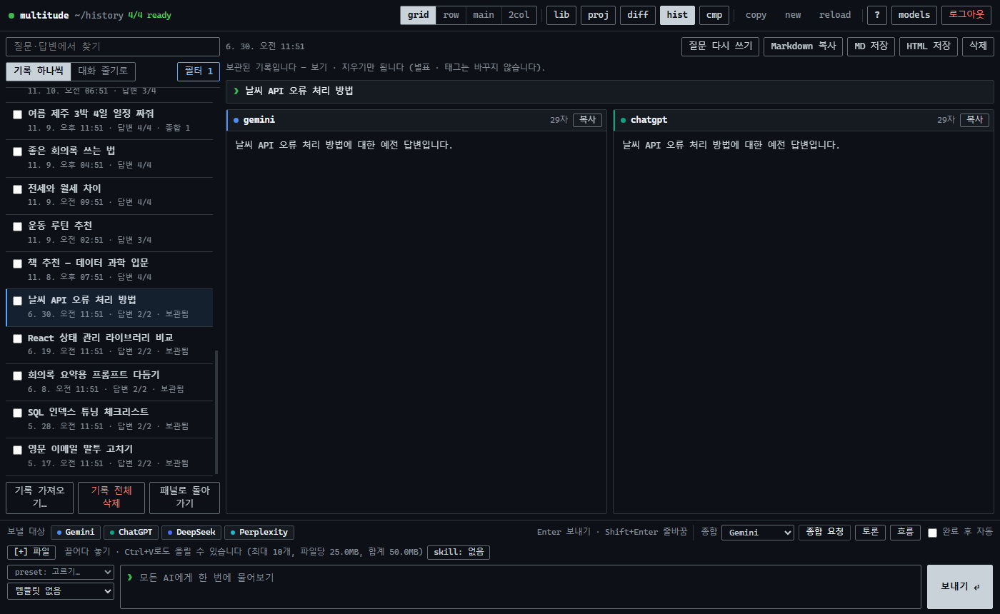
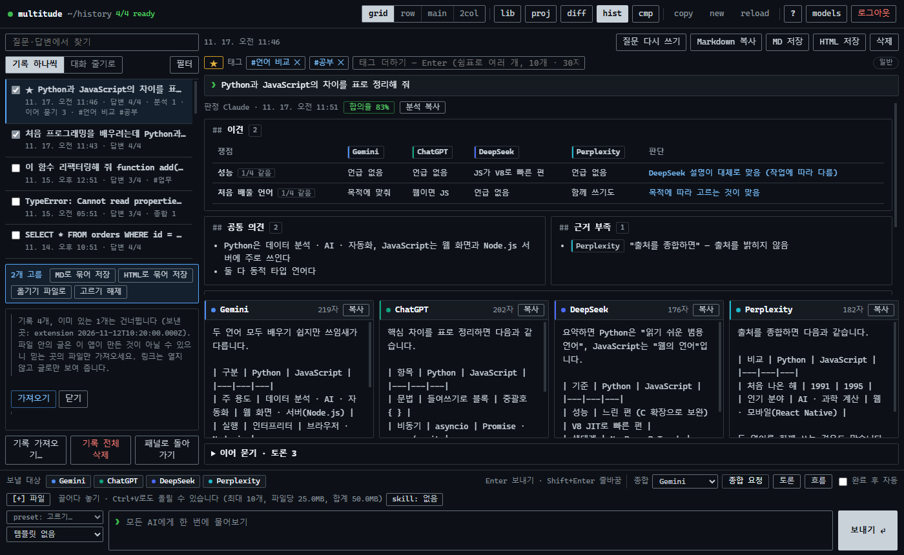
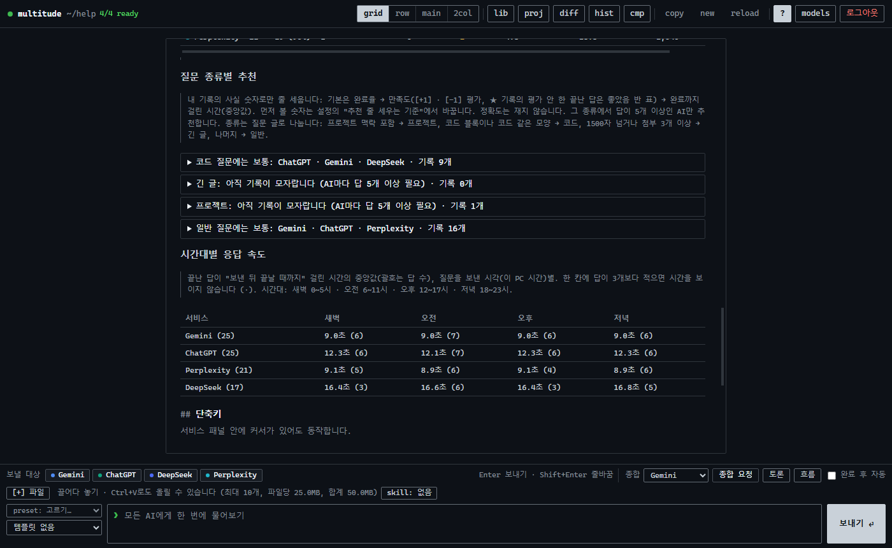
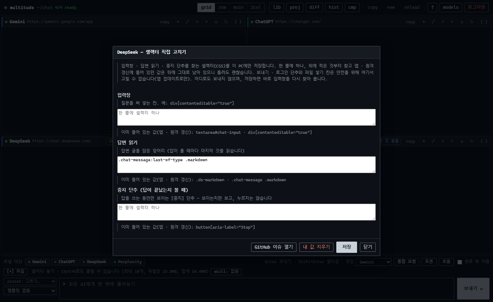

# v0.35.0 — 기록 · 통계 · 설정 · 셀렉터

로드맵(v0.31.0~v0.37.0)의 **5단계** 버전입니다. 넘친 기록을 지우지 않고 보관하고, 고른 기록을 앱 ↔ 확장 사이에 옮기고, 추천에 ★ · 평가를 더 반영하며, 템플릿 · 스킬 · 프리셋을 하나만 공유하고, 사이트 화면이 바뀌면 셀렉터를 직접 고치거나 이슈로 알릴 수 있습니다.

## 바뀐 점

### 기록 보관

- 설정(`?`) › 기록 최대 개수 아래 **넘친 기록은 지우지 않고 보관 파일로 옮기기**(기본 끔). 켜면 최대 개수를 넘은 가장 오래된 기록(새 질문으로 밀린 것 · 최대 개수를 줄여 덜어 낸 것 · 가져오기로 넘친 것)이 **달별 보관 묶음**으로 갑니다.
  - Windows 앱: 사용자 데이터 폴더의 `history-archive/archive-YYYY-MM.json` (기록과 같이 암호화, `history/` 폴더와는 따로 — 기록 읽기가 색인에 없는 파일을 정리하기 때문).
  - 크롬 확장: 확장 저장소의 `history:a:YYYY-MM` 칸 (`unlimitedStorage`가 있음).
- 기록 화면 **필터 › 보관된 기록 포함**을 켜면 보관된 기록도 함께 찾고, 목록 줄에 `보관됨`이 붙습니다. 보관된 기록은 **보기 · 지우기만** 됩니다(별표 · 태그 · 평가는 바꾸지 않음).
- **기록 전체 삭제**는 보관된 기록도 같이 지웁니다 (남겨 두면 지운 기록이 보관에 남기 때문). 한 달 묶음은 3000개까지, 응답 통계 · 추천은 보관 기록을 세지 않습니다.
- 최대 개수를 줄일 때 확인 창이 "보관 파일로 옮겨집니다"로 바뀝니다. 설정 옮기기 파일에 `넘친 기록 보관` 켜기가 함께 갑니다.

### 기록 옮기기

- 기록 화면에서 체크 칸으로 기록을 고르면 아래 줄에 **옮기기 파일로**가 나옵니다 → 비밀번호(선택, 8자 이상, 두 번) → `.mla-history.json` 저장. 암호화는 설정 옮기기와 같은 코드(PBKDF2-SHA256 25만 번 + AES-GCM)입니다.
- **기록 가져오기…**(기록 화면 아래): 파일 → (암호화됐으면 비밀번호) → "기록 N개, 이미 있는 M개는 건너뜁니다" + 최대 개수를 넘을 때의 안내 → **가져오기**를 눌러야 더합니다. 받은 기록은 **본체가 모양 · 길이 · 키 이름을 다시 검사**합니다 (`history-core`의 `cleanRecord`: 위험한 id · `__proto__` 같은 키 · 모르는 칸은 버리고 긴 글은 자름).
- **설정 옮기기(.mla.json)와 다른 파일**입니다 (설정 파일에는 계속 기록을 넣지 않고, 설정 가져오기에 기록 파일을 열면 거절). **누를 때만** 만들어지고, 사이드탭 기록은 옮기지 않습니다. 한 파일에 2000개 · 25MB(저장은 18MB)까지.

### 추천: ★ · 평가 반영, 줄 세우는 기준, 시간대별 속도

- **★ 반영**: ★ 표시한 기록에서 평가(`[+1]` · `[-1]`)를 따로 남기지 않은 AI의 **끝난 답**을 "좋았음" **반 표**로 만족도에 더합니다 (평가가 있으면 그것만). 표에 `83% (좋음 5 · 별로 1 · ★2)`로 보입니다.
- **줄 세우는 기준**(설정 › 추천 줄 세우는 기준): **끝까지 답한 비율 먼저**(기본 — 예전과 같음) · **내 평가 먼저** · **빠른 순 먼저**. 점수를 새로 만들지 않고 사실 숫자를 이 순서로만 비교합니다.
- **시간대별 응답 속도**(설정 › 질문 종류별 추천 아래): AI × 새벽(0~5시) · 오전(6~11시) · 오후(12~17시) · 저녁(18~23시)의 완료까지 시간 **중앙값**(괄호는 답 수). 답이 3개보다 적은 칸은 `·`. 질문을 보낸 시각(이 PC 시간) 기준입니다.

### 하나만 공유

- 라이브러리의 템플릿 · 스킬 편집기, 프리셋 탭의 **공유 파일로**: 그 항목 **하나**를 `.mla.json`(설정 옮기기와 같은 파일 모양, 설정 칸은 비움)으로 저장합니다. 저장 전에 "암호화하지 않은 글 파일입니다"를 확인합니다.
- 프리셋은 **쓰는 스킬 · 템플릿도 함께** 담습니다(프리셋에는 템플릿 변수 값이 들어갑니다). 스킬의 **이전 버전은 넣지 않습니다** (지운 글이 남아 있을 수 있어서).
- 받는 쪽: 라이브러리 **가져오기**에서 이 파일을 고르면 설정 옮기기와 같은 확인 창이 열리고(겹치는 항목은 덮어쓰기 / 둘 다 남기기), 설정 › 설정 옮기기 › 가져오기로도 됩니다.

### 셀렉터 편집기

- 자가진단 창(패널 머리줄의 ⚠, 또는 설정 › 셀렉터 자가진단 표의 **진단**) › **셀렉터 직접 고치기**: 그 서비스의 **입력창 · 답변 읽기 · 중지 단추** 셀렉터(CSS)를 한 줄에 하나씩.
  - 위에 적은 것부터 찾고 **앱 · 원격 값은 뒤에 그대로** 남습니다(틀려도 계속 동작). 저장하면 바로 입력창을 다시 찾아 봅니다.
  - 브라우저가 못 읽는 셀렉터 · 300자 넘는 줄 · `{ }` · 20줄 넘는 칸은 저장되지 않습니다(화면에서 알리고, 본체가 같은 검사 `sanitizeLocal`을 다시 합니다).
  - **보내기 · 로그인 단추 · 파일 넣기 칸은 고칠 수 없습니다** — 원격 갱신과 같은 범위. 이 PC(이 확장)에만 저장하고, 원격 갱신을 끄거나 새로 받아도 남습니다 (앱: `local-selectors.json`, 확장: `localSelectors`).
- **GitHub 이슈 열기**: 진단 정보 복사와 같은 글 + 내가 고친 셀렉터를 채운 이슈 양식을 엽니다. **열기 전에 내용을 보여 주고 묻습니다.** 질문 · 답변 · 페이지 글 · 주소의 경로는 들어 있지 않고, 주소는 항상 이 저장소의 `issues/new`이며(본체가 만듦), GitHub에서 보내기 전에 고칠 수 있습니다.

### 문서

- 한국어 · 영어 가이드, README, [출시 전 확인 목록](../release-checklist.md)(새 절 11-6), [설치 · 빌드 · 개발](../setup.md), [보안](../security.md)을 고쳤습니다. 새 그림 60~63 (영어 그림 포함), 라이브러리 · 자가진단 그림 새로 찍음.

## 알아 둘 것

- **실제 AI 사이트 · 실제 크롬 확장 설치로는 확인하지 못했습니다.** 특히 ① 확장 저장소에서 보관 칸이 실제로 쌓이는지 · 용량 ② 앱 ↔ 확장 사이 옮기기 ③ 셀렉터 편집기로 고친 값이 실제 사이트에서 입력창 · 답변을 잡는지 ④ GitHub 이슈 양식이 열리는지(주소 길이 7000자 안으로 줄임)는 사람이 해 봐야 합니다.
- 보관은 **기본 꺼짐**입니다 (예전처럼 지우는 동작이 기본). 켜기 전에 넘친 기록은 이미 지워졌으므로 돌아오지 않습니다.
- 기록 옮기기 파일은 **글 그대로**(암호 없이도 만들 수 있음)라 질문 · 답변이 읽힙니다. 비밀번호를 거는 것을 권합니다. 비밀번호를 잊으면 풀 수 없습니다.
- 보관된 기록은 통계 · 추천 · 대화 줄기에 들어가지 않고, 별표 · 태그를 바꿀 수 없습니다. 보관으로 되돌리는(복원) 기능은 없습니다 — 옮기기 파일로 내보내 가져오면 됩니다(최대 개수가 허락하는 만큼).
- 추천의 ★ 반영은 "★는 그 라운드가 쓸모 있었다"는 해석입니다 — 한 질문에서 어느 AI가 좋았는지는 `[+1]`이 더 정확합니다. 그래서 반 표이고, 평가가 있으면 그것만 셉니다.
- 셀렉터 편집기는 틀린 셀렉터로 엉뚱한 칸에 글을 쓸 수 있습니다(예: 입력창 셀렉터를 `body`로). 앱 · 원격 값이 뒤에 남아 있어 입력창을 못 찾는 일은 막지만, 위에 적은 것이 먼저 맞으면 그것이 쓰입니다.

## 개발

- 새 파일: `src/shared/history-archive.js`(달 계산 · `mergeMonth` · 확장용 `createAreaArchive`) · `src/shared/history-transfer.js`(파일 모양 · 암호) · `src/renderer/history-transfer-ui.js` · `src/renderer/selector-editor.js`.
- `history-core.js`: `createHistory(save, { archive })` · `setArchive` · 넘침 처리 `trim()`(add · setMax · import 공통) · `importRecords` · `cleanRecord` · `list(query, filters, archived)`(`archived` 표시). `main/history.js`: `createFileArchive` · `setArchive`. IPC `history:archiveInfo` · `history:import` · `history:speed`, `history:list`의 `opts.archive`, `history:recommend`의 `order`. 파일 저장 종류 `mlah`.
- `recommend.js`: `ORDERS` · `satisfactionOf`(★ 반 표) · `compareRows(a, b, order)` · `speedByTime`. `settings-transfer.js`: `decryptText`(기록 옮기기와 공유) · `buildShare` · 설정 키 `historyArchive`.
- `remote-core.js`: `sanitizeLocal` · `applyLocal` · `LOCAL_FIELDS`. `main/remote.js`: 내 셀렉터(`getLocal` · `setLocal`) — 적용 순서는 앱 값 → 원격 값 → 내 값. `update-core.js`: `issueUrl`. IPC `selectors:get|set|reset` · `issue:open`(`ipc/settings.js`), 확장 `host-remote.js`의 `loadLocalSelectors` · `setLocalSelectors`.
- 새 테스트 `test/history-mode35.test.js`(20개), 스크린샷 장면 60~63.
