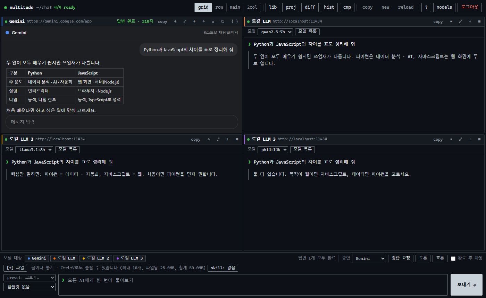
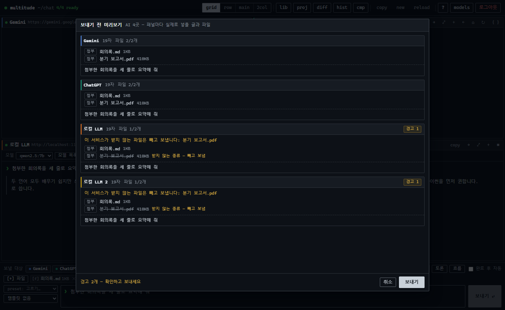
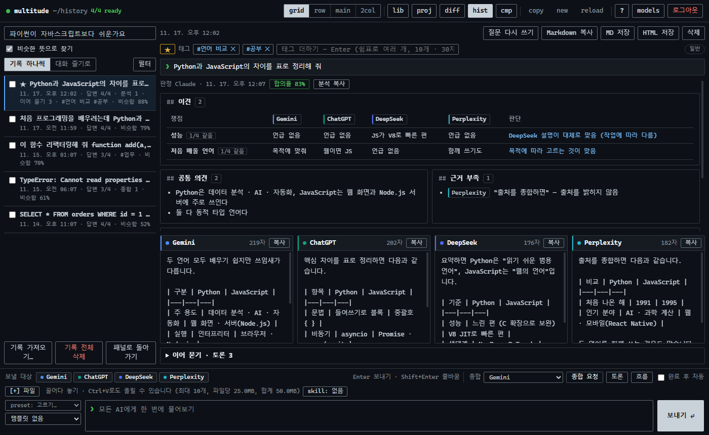
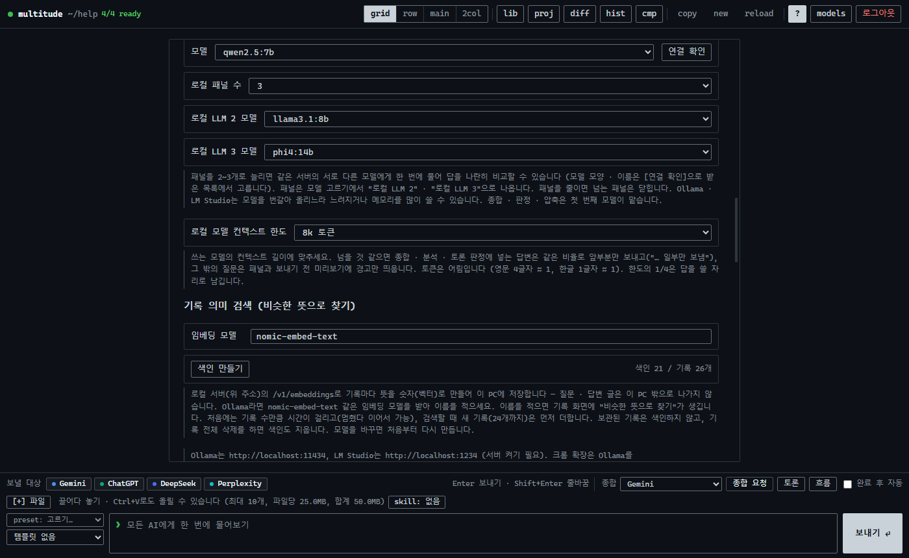

# v0.36.0 — 로컬 LLM · 의미 검색

로드맵(v0.31.0~v0.37.0)의 **6단계** 버전입니다. 로컬 LLM 패널을 최대 3개까지 쓰고(패널마다 모델), 글 파일을 로컬 모델에게 요청 글로 끼워 보내고, 기록을 단어가 달라도 **비슷한 뜻으로** 찾을 수 있습니다. 모두 **이 PC(localhost) 안에서만** 동작합니다.

## 바뀐 점

### 로컬 패널 최대 3개

- 설정(`?`) › 로컬 LLM › **로컬 패널 수**(1~3). 늘리면 모델 고르기에 `로컬 LLM 2` · `로컬 LLM 3`이 나옵니다 (패널 id는 `local` · `local-2` · `local-3`, 첫 패널은 예전과 같음).
- **패널마다 모델을 따로** 고릅니다 — 설정에서 또는 패널 머리줄의 모델 목록에서. 같은 서버의 서로 다른 모델에게 한 번에 물어 답을 나란히 비교할 수 있고, 답변 비교 · 분석 · 토론 · 작업 흐름 · 사실 확인 · 기록 · 통계는 웹 패널과 같은 길로 동작합니다.
- 패널 수를 **줄이면** 넘는 패널은 닫히고 보낼 대상 · 종합 담당에서 빠집니다 (고른 모델은 기억). 종합 · 판정 · 스킬 압축(패널 없이 한 번 묻기)은 **첫 번째 모델**이 맡습니다.
- 설정 옮기기 파일에 패널 수 · 모델들 · 임베딩 모델이 함께 갑니다.

### 글 파일 첨부

- 로컬 패널은 문서 업로드가 없어서 지금까지 이미지만 받았습니다. 이제 **글로 읽을 수 있는 파일**(종류 · 확장자로 판별: `.txt` `.md` `.csv` `.json` `.log` `.py` `.js` … 자막 포함)을 **요청 글 안에 끼워** 보냅니다.
- 패널에는 질문과 `📎 파일 이름`만 보이고 파일 글은 API로 보내는 글에만 붙습니다 (이어지는 질문에도 대화에 남음). 이미지는 예전처럼 따로(비전 모델일 때).
- **컨텍스트 한도**(설정)의 80%를 넘으면 뒤쪽 파일부터 · 파일 안에서는 뒷부분을 잘라 내고, 글에 "컨텍스트 한도 때문에 …앞부분만 보냈습니다"를 남기며 패널에 `(일부만)`이 붙습니다. 파일 하나는 20만 자까지, NUL이 든 파일은 글이 아닌 것으로 봅니다.
- **PDF · 문서 파일은 빼고** 보냅니다 — 보내기 전 미리보기에 "받지 않는 종류 — 빼고 보냄"으로 보입니다.

### 기록 의미 검색 (비슷한 뜻으로 찾기)

- 설정 › 로컬 LLM › **임베딩 모델**에 이름(Ollama라면 `nomic-embed-text` 같은 모델)을 적고 **색인 만들기**: 로컬 서버의 `/v1/embeddings`로 기록마다 질문 · 답변 앞부분(1200자)의 뜻을 벡터로 만들어 이 PC에 저장합니다(길이 1로 정규화, 코사인 유사도). 기다리지 않고 진행을 보여 주며, **멈췄다 이어서** 만들 수 있고 글이 바뀐 기록만 다시 만듭니다.
- 기록 화면 검색칸 아래 **비슷한 뜻으로 찾기**(임베딩 모델이 정해져 있을 때만 보임)를 켜고 검색하면 `비슷함 88%` 순으로 나옵니다 (0.2 미만은 뺌, 40개까지, 거르기도 함께). 검색할 때 색인에 없는 새 기록은 **24개까지** 먼저 더합니다.
- **글은 localhost 밖으로 나가지 않습니다** — 주소는 로컬 패널과 같은 검사(`localhost` · `127.0.0.1` · `[::1]`)만 통과합니다. 색인은 기록과 같이 암호화해 저장(앱: `history-embeddings.json`, 확장: `embedIndex`), 보관된 기록은 색인하지 않고, 모델을 바꾸면 처음부터 다시 만들며, **기록 전체 삭제**는 색인도 지웁니다.

### 문서

- 한국어 · 영어 가이드, README, [출시 전 확인 목록](../release-checklist.md)(새 절 11-7), [보안](../security.md)을 고쳤습니다. 새 그림 64~67 (영어 그림 포함).

## 알아 둘 것

- **실제 Ollama · LM Studio · 크롬 확장 설치로는 확인하지 못했습니다.** 테스트는 가짜 서버(스트리밍 응답 · `/v1/embeddings`)로 했습니다. 특히 ① 서버가 모델 둘 이상을 번갈아 올릴 때의 속도 · 메모리 ② 실제 임베딩 모델의 응답 모양(`data[].embedding`)과 유사도 품질(한국어) ③ 컨텍스트 한도 추정(영문 4자 ≈ 1토큰 · 한글 1자 ≈ 1토큰의 어림)이 실제 토크나이저와 얼마나 맞는지는 사람이 해 봐야 합니다.
- 패널이 여러 개여도 **종합 · 판정 · 압축은 첫 번째 모델 하나**입니다. 패널 수를 줄였다 늘려도 대화는 이어지지 않습니다(닫으면 지워짐).
- 글 파일을 붙이면 **그 파일이 대화에 계속 남아** 이어지는 질문마다 컨텍스트를 차지합니다. 한도를 넘기 전에 새 대화를 여세요 (패널에 한도 경고가 뜹니다).
- 의미 검색은 **질문 · 답변 앞부분**만 봅니다(긴 답의 뒷부분 내용으로는 못 찾음). 색인을 처음 만들 때는 기록 수 × 서버 속도만큼 걸립니다. 임베딩을 지원하지 않는 모델 이름을 적으면 "서버 응답을 읽지 못했습니다"가 나옵니다.
- 사이드탭 기록 · 보관된 기록은 의미 검색 대상이 아닙니다.

## 개발

- 새 파일: `src/shared/embed-index.js`(`recordText` · `hashText` · `normalize` · `cleanIndex` · `build` · `search` · `embedTexts` · `createEmbedService`).
- `local-llm.js`: `LOCAL_IDS` · `isLocalId` · `panelIndex` · `normalizePanels` · `modelOf` · `normalizeLocalPrefs` · `localServices` · `embedTextFiles`, `createLocalChat.send(text, images, { attach, files })`(파일 본문은 API 글에만). `send-plan.js`: `isTextLike`, 미리보기의 `textOnlyDocs`.
- `main.js` · `extension/host.js`: 로컬 대화를 `localChats`(Map)로, 패널별 모델 `getConfig`, 서비스 목록 `localServices`. `ipc/settings.js`: `local:setPrefs`에 `panels` · `extraModels` · `embedModel`. `ipc/history.js`: `embed:status|build|stop` · `history:semantic`, `history-core.listByIds`.
- 새 테스트 `test/local-mode36.test.js`(18개), 스크린샷 장면 64~67.
