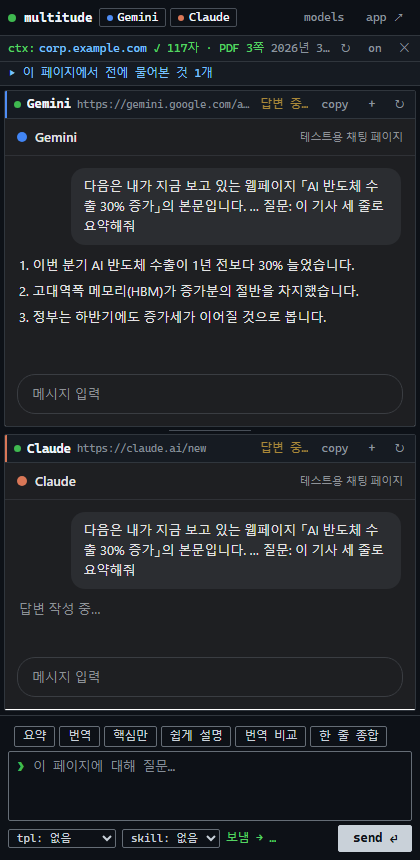
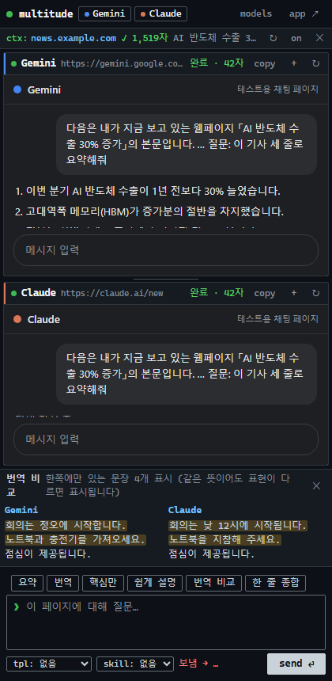
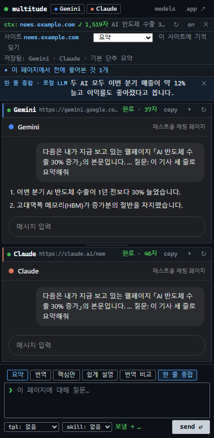

# v0.37.0 — 사이드탭 (PDF · 자막 · 번역 비교 · 한 줄 종합 · 사이트 프리셋)

로드맵(v0.31.0~v0.37.0)의 **마지막 7단계** 버전입니다. 크롬 확장의 사이드탭이 PDF와 영상 자막까지 맥락으로 읽고, 두 AI의 번역을 나란히 비교하고, 답이 끝나면 한 줄 결론을 붙이고, 사이트마다 쓸 AI를 기억합니다.

## 바뀐 점

### PDF 읽기

- 보고 있는 탭이 PDF면 맥락 줄이 `PDF 8쪽`으로 바뀝니다. 그 탭 **안에서** 같은 주소의 PDF를 받고(base64), 사이드 패널이 **vendor한 pdf.js**(Apache-2.0, `src/shared/vendor/pdf.min.mjs` · 워커 · 라이선스)로 쪽마다 글을 꺼내 `[3쪽]` 머리표를 붙여 본문처럼 함께 보냅니다.
- 150쪽 · 30MB · 30만 자까지(넘으면 앞부분 + `+` 표시). **암호가 걸린 PDF · 스캔한 PDF(글자가 그림) · 깨진 PDF는 읽지 못하고** 이유를 알립니다. 내 컴퓨터의 PDF는 크롬 확장 설정의 "파일 URL 허용"이 필요합니다.
- pdf.js는 호환을 위해 **legacy 빌드**(`Uint8Array.toHex` 같은 최신 기능이 없는 크롬에서도 동작)를 넣었고, `isEvalSupported: false`로 돌립니다. 한국어 PDF를 위해 **한국어 CMap**(Adobe-Korea1 · KSC · UniKS, 약 200KB)도 같이 넣었습니다. 확장 크기는 약 1.9MB 늘고, **Windows 앱 설치 파일에는 넣지 않습니다**(`electron-builder`에서 제외).
- 사이드 패널의 `connect-src`에 `'self'`가 더해졌습니다(pdf.js가 확장 안의 CMap을 읽음). 바깥 주소는 여전히 `raw.githubusercontent.com`뿐입니다.

### 영상 자막 맥락

- 페이지에 **이미 떠 있는 자막**만 읽습니다: 열려 있는 YouTube "스크립트" 패널(`ytd-transcript-segment-renderer`), 켜져 있어 cue가 있는 HTML5 자막 트랙. **자막을 따로 내려받거나 영상 사이트 주소를 부르지 않고, 자막 켜기 · 끄기도 바꾸지 않습니다**(꺼진 트랙은 읽지 않음).
- 40자 이상 읽히면 본문 대신 자막(`mm:ss 글` 줄)이 맥락이 되고 줄에 `자막`이 붙습니다. 못 읽으면 예전처럼 본문으로.
- 본문 읽기는 한 함수(`MLA.pageRead.readPageNow`)로 모았습니다 — 배경(오른쪽 클릭 · 단축키)과 사이드 패널의 ↻가 같은 것을 씁니다.

### 번역 비교

- `번역 비교` 단추: 페이지에서 **선택한 글만**(페이지는 붙이지 않음) 위 · 아래 두 AI에게 번역시키고, 둘 다 끝나면 아래에 나란히 보입니다. 한쪽에만 있는 문장은 표시됩니다(글자 두 개씩 묶은 Dice 유사도 0.55 미만) — **같은 뜻이어도 표현이 아주 다르면 표시되니 "틀린 문장"이 아니라 "다른 문장"입니다.**
- AI 2개가 열려 있고 글을 선택했을 때만(선택한 글을 읽으려면 그 탭에 권한이 있어야 함 — 단축키 · 메뉴 또는 자동 읽기).

### 한 줄 종합

- `한 줄 종합`을 켜 두면 두 AI의 답이 모두 끝날 때 한 문장 결론(80자 안팎)을 답 위에 붙입니다.
- 앱 설정에서 **로컬 LLM**을 켜 두었으면 그것이 만들고(background가 설정의 localhost 주소로만 요청 — 사이드 패널 화면에서 온 요청만 받음), 아니면 **위쪽 AI에게 이어서 물어** 그 답을 씁니다(그 AI의 대화에도 남습니다).

### 사이트별 프리셋

- 사이드탭의 `사이트` 줄 › `이 사이트에 기억`: 지금 열어 둔 AI 2개와 고른 **기본 단추**(없음 · 요약 · 번역 · 핵심만 · 쉽게 설명 · 번역 비교)를 그 호스트(`www.` 뺀 이름)에 저장합니다. 50개까지(오래된 것부터 빠짐), `잊기`로 지웁니다.
- 그 사이트의 탭으로 가면 **AI만 맞추고 질문은 저절로 보내지 않습니다**. 기본 단추는 테두리로 표시되고 입력창이 빈 채 Enter를 누르면 눌립니다. 같은 사이트에 머무는 동안은 다시 덮어쓰지 않습니다.

### 문서

- 한국어 · 영어 가이드, README, [출시 전 확인 목록](../release-checklist.md)(새 절 11-8), [보안](../security.md)을 고쳤습니다. 새 그림 68~70(영어 그림 포함).

## 알아 둘 것

- **실제 크롬 · 실제 PDF · 실제 영상 사이트로는 확인하지 못했습니다.** 테스트는 손으로 만든 PDF를 진짜 pdf.js로 읽는 것까지, 화면은 가짜 확장 API로 확인했습니다. 특히 ① 크롬 PDF 뷰어 탭에서 `executeScript`로 페이지 안 `fetch`가 되는지(로그인이 필요한 PDF · 크롬 버전별 차이) ② pdf.js 워커가 사이드 패널 CSP에서 도는지 ③ 유튜브 스크립트 패널 · 자막 트랙의 실제 DOM(사이트가 바꾸면 못 읽음) ④ 선택한 글 읽기 권한은 사람이 해 봐야 합니다.
- 자막은 **이미 떠 있는 것만** 읽으므로 자막을 켜지 않았거나 스크립트 패널을 열지 않았으면 못 읽습니다(본문으로 대신하고 안내는 하지 않음). 실시간으로 한 줄씩 나오는 화면 자막은 읽지 않습니다.
- PDF의 표 · 수식 · 2단 편집은 글 순서가 어긋날 수 있고, 한국어 외 CJK PDF는 일부 글꼴이 깨질 수 있습니다.
- 한 줄 종합을 위쪽 AI에게 물을 때는 그 AI 대화에 "한 문장으로" 요청이 남고 사용 한도를 한 번 더 씁니다.
- 번역 비교의 표시는 문장 단위 근사라 문장을 합치거나 나눈 번역은 둘 다 표시될 수 있습니다.

## 개발

- 새 파일: `src/shared/page-read.js`(`readPageNow` · `pickContext` · `looksPdf`) · `src/shared/pdf-text.js`(`fetchSelfBase64` · `base64ToBytes` · `extractPdfText`) · vendor `pdf.min.mjs` · `pdf.worker.min.mjs` · `pdf.LICENSE` · `cmaps/`.
- `scripts/build-extension.js`: vendor 하위 폴더 · `.mjs` · `.bcmap`을 바이트 그대로 복사. `side-panel.js`: `hostKey` · 사이트 프리셋 · `splitSentences` · `similarity` · `diffSentences` · `oneLinePrompt` · `cleanOneLine`, 맥락의 `source` · `pages`.
- `extension/sidepanel.js`: `readPdf`/`takePdf` · `quickCompare` · `onRunDone` · `oneLineSynth` · 사이트 프리셋. `extension/background.js`: `pickContext`로 PDF 표시 · `mla:local-ask`.
- 새 테스트 `test/side-mode37.test.js`(10개), 스크린샷 장면 68~70.
