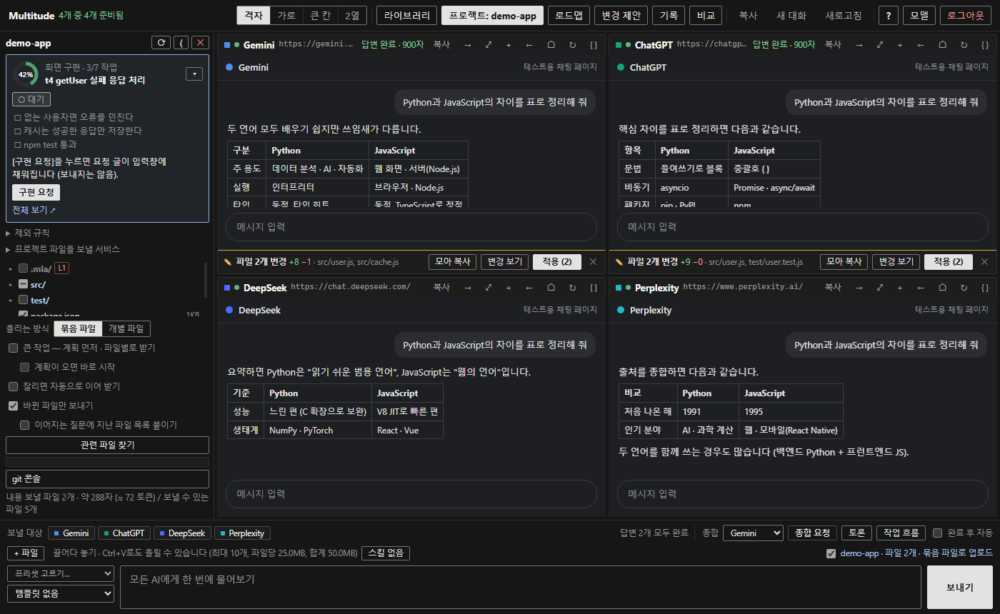
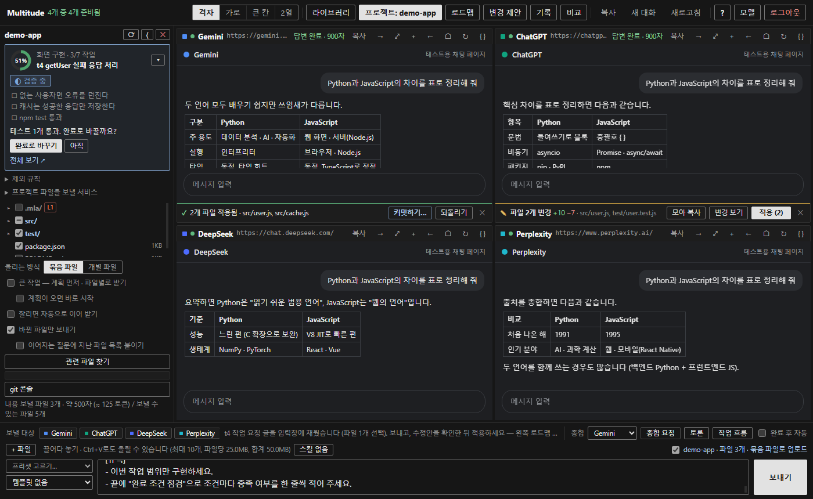

# v0.40.0 — 로드맵 카드: 창을 열고 닫지 않고, 같은 화면에서 계획대로

로드맵으로 계획서대로 진행할 때마다 로드맵 창을 열고(패널이 치워짐) → 구현 요청 → 닫고 → 보내기 · 적용 · 테스트 → 다시 열어 완료로 바꾸던 일을 줄였습니다. 프로젝트 사이드바 맨 위에 **로드맵 카드**가 붙고, 수정안을 적용하거나 테스트가 통과하면 작업 상태가 저절로 따라갑니다. Windows 앱 · 크롬 확장, 한국어 · 영어 화면 모두 같습니다.

## 바뀐 점

- **로드맵 카드** — 진행 링(가중치 기준 %) · `마일스톤 · 끝난 작업/전체` · 지금 작업 · 상태 · 완료 조건(최대 4줄) · 안내 한 줄 · **그 단계에 필요한 버튼만**. `전체 보기 ↗`는 로드맵 창의 작업 탭을 그 작업에서 엽니다. ▾ 로 한 줄로 접고(이 PC에 기억), 로드맵이 없는 프로젝트는 `로드맵이 없습니다 [로드맵 만들기]` 한 줄만.
- **적용하면 검증 중** — [구현 요청]으로 시작한 작업을 기억해 두었다가(`.mla/roadmap.json`의 `active`), 그 작업의 수정안을 적용하면 `▶ 진행 중` → `◐ 검증 중`. 미리보기 창에서 적용하든 패널 아래 변경 바에서 바로 적용하든 같습니다. 구현 요청 없이 적용한 수정안은 카드를 바꾸지 않습니다.
- **테스트 결과로 완료 묻기** — 미리보기 창의 테스트 결과를 카드가 기억합니다. 통과한 수정안을 적용하면 `테스트 N개 통과. 완료로 바꿀까요?` + **완료로 바꾸기** · **아직**. 실패하면 "실패 로그로 다시 받기"를 안내하고, 다시 받기 횟수를 다 쓰고도 실패하면 **막힘**을 권합니다.
- **카드의 테스트 실행** (Windows 앱) — 테스트 없이 적용했으면 카드에 **테스트 실행**이 먼저 보입니다. 지금 프로젝트 파일 그대로 한 번 돌리고(파일을 쓰거나 되돌리지 않음), 실행 전 확인 창은 그대로입니다.
- **테스트가 통과하면 바로 완료** — 로드맵 창 › 문서 탭 설정(기본 끔). 켜면 통과한 수정안을 적용하는 순간, 또는 카드의 테스트가 통과하는 순간 완료됩니다.
- **완료하면 다음 작업** — 자동 커밋 · 문서 갱신(설정대로) 뒤 잠금이 풀린 다음 작업이 카드에 올라옵니다. 쓰던 글이 지워지지 않게 입력창은 덮어쓰지 않습니다 — 다시 **구현 요청** 한 번.
- 시작할 수 있는 작업이 둘 이상이면 **다음 ›** 으로 바꿔 볼 수 있습니다. 막힌 작업은 이유와 함께 보이고 **다시 진행**으로 풉니다.

| 작업 하나에 직접 누르는 것 | 횟수 |
|---|---|
| v0.39.0 | 창 열기 → 구현 요청 → 닫기 → 보내기 → 적용 → 테스트 → 다시 열기 → 완료 → 닫기 (9번) |
| v0.40.0 | 구현 요청 → 보내기 → 적용 → 완료로 바꾸기 (4번, "바로 완료"를 켜면 3번) |

## 바뀌지 않은 것

- 보내기 · 적용은 언제나 직접 누릅니다. 자동 적용은 없고, 실패 로그로 다시 받기는 그대로 최대 3번입니다.
- 테스트는 정해진 명령(`npm test` 등, pytest · cargo test · go test)만, 실행 전 확인 창을 거칩니다.
- 로드맵 창(계획 분해 · 작업 편집 · 대시보드 · 문서)은 그대로 있고, 툴바 **로드맵**이 "전체 보기"입니다.

## 알아 둘 점

- 크롬 확장에는 테스트 실행이 없어서, 적용 뒤 카드에는 **완료** · **막힘**만 보입니다.
- 카드는 프로젝트 사이드바 안에 있어 창이 낮으면 파일 나무 자리가 줄어듭니다. 창 높이가 820px 이하면 완료 조건 목록을 숨기고, ▾ 로 접으면 한 줄만 남습니다.
- 실제 AI 사이트로 끝까지 한 번 돌려 보는 확인은 [출시 전 확인 목록 11-11](../release-checklist.md#11-11-로드맵-카드-v0400)에 적어 두었습니다.

## 개발

- `src/shared/roadmap.js`: `setActive` · `currentTask` · `nextPick` · `trialInfo`(검사 결과 → pass · fail · none) · `afterApply`(진행 중 → 검증 중) · `cardState`(단계 · 버튼), 로드맵 파일에 `active`, 설정 `autoDoneOnPass`.
- `src/renderer/roadmap-card.js`(새 파일, roadmap-ui.js 다음): 카드 그리기 · 버튼 · 신호 받기. `roadmap-ui.js`는 로드맵 하나를 카드와 같이 쓰도록 `MLA.roadmapUI`에 `load · onChange · implement · setStatus · replace · openAt`을 내놓고, 상태 바꾸기를 `setTaskStatus` 하나로 모았습니다.
- 신호: `project-changes.js` `applyPlans` 끝에서 `window.onRoadmapApplied`, `project-devtest.js` 테스트 결과에서 `window.onRoadmapTrial(r, { exhausted })`, `project.js` 사이드바 그리기에서 `window.onRoadmapProject`.
- 본체: `devtest:run`(지금 파일 그대로 한 번, 확인 창, 파일 쓰기 없음, 결과는 `after` 칸) · preload `host.devtest.run`. 확인 창 문구 `main.devtest.confirmNow`.
- 사전: `ui.roadmap.card.*` · `ui.roadmap.docs.autoDone*` (ko · en 짝).
- 테스트: `test/roadmap-card.test.js`(계산 4 · 가짜 화면으로 카드 흐름 7 · 연결 1), `test/check-scripts.test.js`에 실제 npm으로 `devtest:run`(실패 → 고친 뒤 통과 → 취소).
- 스크린샷: 장면 `73-roadmap-card` · `74-roadmap-auto`(구현 요청 → 변경 보기 → 테스트 → 적용을 실제 화면 코드로 눌러 감) · `75-roadmap-next`(완료 → 다음 작업). 프로젝트 장면은 사이드바에 카드 한 줄이 생겨 다시 찍었고, 크롬 웹 스토어 그림의 `19-local-llm`을 `73-roadmap-card`로 바꿨습니다.
