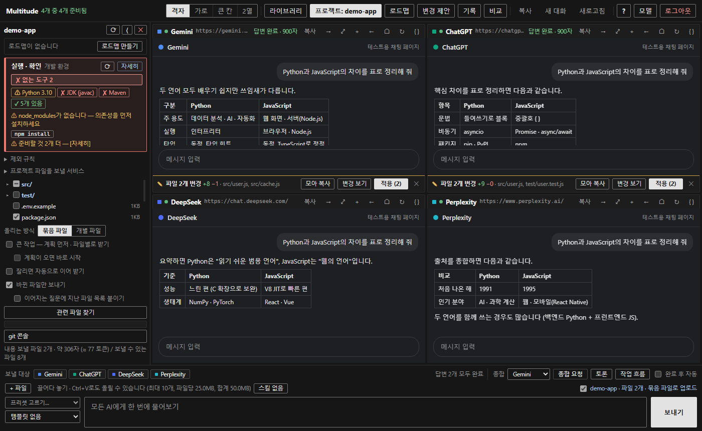
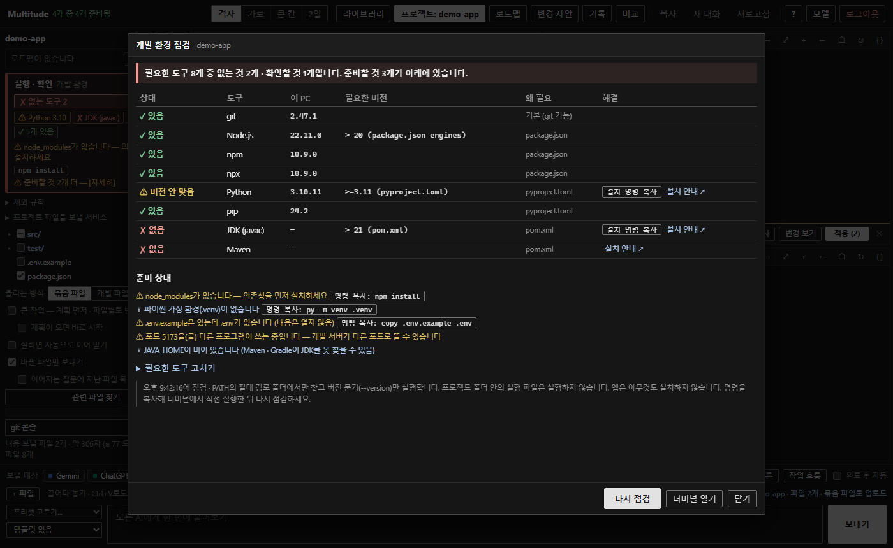

# v0.41.0 — 개발 환경 점검: 이 프로젝트를 이 PC에서 돌릴 수 있는지 한눈에

로드맵으로 프로젝트를 진행할 때, 테스트를 돌리거나 앱을 띄우기 전에 **필요한 도구가 이 PC에 있는지**부터 알 수 있게 했습니다. 프로젝트를 열면 사이드바의 새 **실행 · 확인** 칸이 node · npm · python · JDK · gcc · cmake · docker 같은 도구가 있는지, 버전이 맞는지를 색으로 보여 줍니다. "실행 · 확인" 기능 묶음(v0.41.0 ~ v0.46.0)의 첫 단계입니다.

## 바뀐 점

- **실행 · 확인 칸** — 로드맵 카드 바로 아래. 테두리와 왼쪽 굵은 줄 색이 상태: 초록 `✓ 준비됨 · 필요한 도구 N개 있음`, 노랑 `⚠ 확인 필요 N`, 빨강 `✗ 없는 도구 N`. 문제 있는 도구만 칩으로(`✗ JDK (javac)` `⚠ Python 3.10`), 있는 도구는 `✓ N개 있음` 한 칩. 준비할 것 한 줄과 **명령 복사** 단추.
- **필요한 도구 자동으로 고르기** — 맨 위 폴더의 파일 이름으로 50여 개 도구 중 고릅니다: `package.json` → Node.js · npm · npx(+ 잠금 파일로 pnpm · Yarn · Bun), Python(+ Poetry · uv · Pipenv · conda), JDK · Maven · Gradle(래퍼가 있으면 선택), CMake · make · Meson · Ninja + C/C++ 컴파일러 셋 중 하나(gcc · clang · MSVC), .NET · Rust · Go · Ruby · PHP · Dart/Flutter, Docker · Terraform · kubectl · Helm, DB 클라이언트 · adb · pre-commit · 배포 CLI(선택). git은 항상.
- **필요한 버전 비교** — `engines` · `.nvmrc` · `requires-python` · `maven.compiler.release` · Gradle toolchain · `go 1.xx` · `rust-version` · `global.json` · `cmake_minimum_required` · `composer.json php` · `.ruby-version` · `pubspec sdk`. `>=20 <23` · `^18 || ^20` · `~=3.10` · `==3.12.*`를 읽습니다.
- **준비 상태** — 의존성이 있는데 `node_modules` 없음(→ `npm install` / `npm ci` / `pnpm install` …), 가상 환경 없음, `.env.example`만 있고 `.env` 없음(내용은 열지 않음), 개발 서버 기본 포트 사용 중, Docker 엔진 꺼짐, `JAVA_HOME` 비었거나 javac 없음.
- **자세히 창** — 도구 · 이 PC 버전 · 필요한 버전(어디서 읽었는지) · 왜 필요한지 · **설치 명령 복사**(`winget install --id … -e`) · **설치 안내 ↗**(공식 페이지), **터미널 열기** · **다시 점검**, **필요한 도구 고치기**(체크로 빼고 더하기, 프로젝트별로 기억).

## 안전하게

- PATH의 **절대 경로 폴더**에서만 실행 파일을 찾고, **프로젝트 폴더 안의 실행 파일은 찾지도 실행하지도 않습니다.**
- 실행하는 것은 도구마다 정해 둔 버전 묻기(`--version` 등)뿐 — 셸 없이, 5초 제한, 작업 폴더는 사용자 홈. `.cmd` · `.bat`은 실행하지 않고 옆의 `package.json`만 읽습니다. npm · npx도 설치 폴더의 `package.json`에서 버전을 읽습니다.
- 포트는 127.0.0.1에 연결만 해 보고, Docker는 엔진 파이프에 연결만 해 봅니다.
- **앱은 아무것도 설치하지 않습니다.** 설치 명령은 복사만, 설치 안내는 목록에 있는 https 주소만 엽니다.

## 알아 둘 점

- 크롬 확장은 프로그램을 실행할 수 없어 같은 칸에 **필요한 도구 목록만** 보여 줍니다(파란색).
- PATH 밖의 흔한 설치 자리(MSYS2 · Program Files · `JAVA_HOME` · Android SDK 등)에서 찾으면 `PATH에 없음`으로 알립니다. 그 밖의 자리는 찾지 않습니다.
- MSVC(cl.exe)는 개발자 명령 프롬프트에서만 PATH에 잡혀 설치돼 있어도 노랑으로 보입니다.
- 실제 여러 프로젝트로 사람이 확인할 항목은 [출시 전 확인 목록 11-12](../release-checklist.md#11-12-개발-환경-점검-v0410)에 적어 두었습니다.

## 개발

- 새 공통 모듈 `src/shared/env-rules.js`(require · `MLA.envRules`): `TOOLS`(도구 · 버전 인자 · winget id · 공식 주소) · `detectNeeds` · `requirements` · `parseVersion` · `satisfies` · `evaluate` · `summarize` · `readiness` · `devPorts` · `installHint` · `envLine`(v0.42.0에서 AI 요청에 씀) · `cleanCheckRequest`.
- 새 본체 `src/main/envcheck.js`: `findTool`(PATH · 설치 자리 · Store python · py 런처) · `buildVersionSpawn` · `isAllowedVersionSpawn` · `checkEnv`(동시 4개) · `portBusy` · `dockerOn`, IPC `env:check` · `env:openInstall`, preload `host.env`.
- 새 화면 `src/renderer/dev-hub.js`(roadmap-card.js 다음): 사이드바 칸 · 자세히 창 · 고치기. 신호 `window.onDevProject`(project.js) · `window.onDevState`(renderer-compose.js) · `window.onDevEnvChecked`(v0.42.0용).
- 사전: 새 영역 `i18n-{ko,en}-dev.js`(`dev.*`), `i18n.js` AREAS에 `dev`.
- 테스트: `test/env-check.test.js` 11개(규칙 4 · 본체 3 · 가짜 화면 3 · 연결 1). `a11y.test.js` · `ipc-split.test.js` 목록에 새 창 · 새 본체 파일. 이 PC에서 실제로 돌려 node 24 · python 3.14 · JDK 25 · gcc 16 · cmake · docker · dotnet · gh 등을 찾는 것을 확인했습니다.
- 스크린샷: 새 장면 `76-env-hub` · `77-env-check`(한국어 · 영어). 사이드바에 칸 한 줄이 생겨 프로젝트 장면(09 · 10 · 16 · 21 · 22 · 23 · 36~40 · 47 · 57~59 · 71~75)을 다시 찍었습니다.
