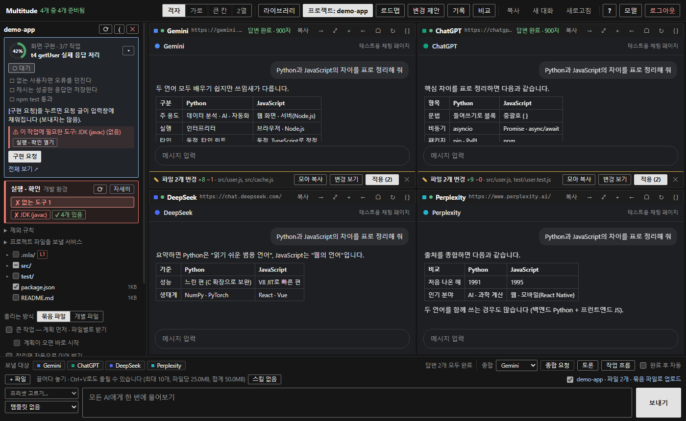

# v0.42.0 — 환경 정보 연결: AI와 로드맵이 이 PC의 도구를 안다

v0.41.0의 개발 환경 점검 결과를 AI 질문과 로드맵에 이었습니다. AI는 이 PC에 있는 도구와 버전을 알고 답하고, 로드맵 작업은 자기에게 필요한 도구를 적어 두어 없으면 카드가 먼저 알려 줍니다. "실행 · 확인" 묶음의 두 번째 단계입니다.

## 바뀐 점

- **AI에게 이 PC 환경 알려 주기** — 프로젝트 질문의 요청 끝에 `[이 PC의 개발 환경] git 2.47, Node.js 22.11.0, npm 10.9.0, Python 3.10.11, JDK (javac): -`와 "이 환경에서 돌아가는 코드로 답해 주세요. 없는 도구(-)가 꼭 필요하면 설치 방법을 먼저 알려 주세요"를 붙입니다. 이름과 버전만, 경로는 넣지 않습니다. 개발 환경 점검 창의 체크로 끄고(이 PC에 기억), 점검을 마친 Windows 앱에서만 붙습니다.
- **작업마다 필요한 도구** — 로드맵 분해 요청이 작업마다 `tools`를 적게 합니다. 작업 편집에 **필요한 도구** 칸, 작업 합치기는 두 목록을 합치고, 구현 요청 글에 `필요한 도구: …` 줄. `java` → JDK, `node.js` → Node.js, `g++` · `c++` → g++, `postgres` → psql처럼 흔한 이름을 알아듣습니다.
- **로드맵의 도구도 점검** — 끝나지 않은 작업이 적은 도구를 실행 · 확인 칸이 함께 점검합니다(새 프로젝트라 파일이 없어도). 자세히 창의 "왜 필요"에 `로드맵 t4`. 로드맵이 바뀌어 새 도구가 생기면 다시 점검합니다.
- **카드 경고** — 지금 작업의 도구 중 없거나 · 버전이 안 맞거나 · PATH에 없는 것이 있으면 카드에 빨간 줄 `⚠ 이 작업에 필요한 도구: JDK (javac) (없음)` + **실행 · 확인 열기**.
- **테스트 전에 미리 알림** — 미리보기 창과 카드의 **테스트 실행**은 그 검사에 꼭 필요한 도구(test · lint · typecheck · build → Node.js · npm, pytest → Python, cargo test → cargo, go test → Go)가 "없음"이면 실행하지 않고 원인을 바로 보여 줍니다.
- **파일 나무 자리 지키기** — 로드맵 카드와 실행 · 확인 칸이 모두 펼쳐져도 파일 나무는 120px 아래로 줄지 않고, 넘치면 사이드바가 스크롤됩니다.

## 알아 둘 점

- 환경 줄은 AI에게 가는 글이므로, 설치된 도구 이름 · 버전을 서비스에 알리고 싶지 않으면 끄세요(경로 · 사용자 이름은 들어가지 않습니다).
- 점검하지 않은 도구(필요 목록에 없던 것)는 테스트를 막지 않습니다.
- 크롬 확장은 점검을 하지 않아 환경 줄 · 카드 경고 · 테스트 전 거절이 없습니다(작업의 필요한 도구 칸은 있음).
- 사람이 확인할 항목: [출시 전 확인 목록 11-13](../release-checklist.md#11-13-환경-정보-연결-v0420).

## 개발

- `shared/roadmap.js`: 작업 `tools`(12개 · 40자), 분해 · 구현 요청 글(ko · en), `updateTask` · `mergeTasks`.
- `shared/env-rules.js`: `toolIdOf`(별칭) · `taskNeeds` · `problemsFor` · `CHECK_TOOLS` · `missingForChecks`.
- `renderer/dev-hub.js`: `needsNow`(파일 + 로드맵 + 직접 더함) · 로드맵 `onChange` 구독 · `envLine` · `problemsFor` · `blockReason`, 설정 `mla-env-line`.
- `renderer/project.js` 요청 끝에 `prompt.proj.env`, `project-devtest.js` · `roadmap-card.js`(`#rmcEnv` · `window.onDevEnvChecked`)에서 거절 · 경고.
- CSS: 사이드바 `overflow-y: auto`, `.ps-tree` 최소 120px.
- 테스트 5개 더함(env-check 4 · roadmap-card 1) — 621개 통과.
- 스크린샷: 새 장면 `78-env-task`(한국어 · 영어). 사이드바 높이 규칙이 바뀌어 프로젝트 장면을 다시 찍었습니다.
