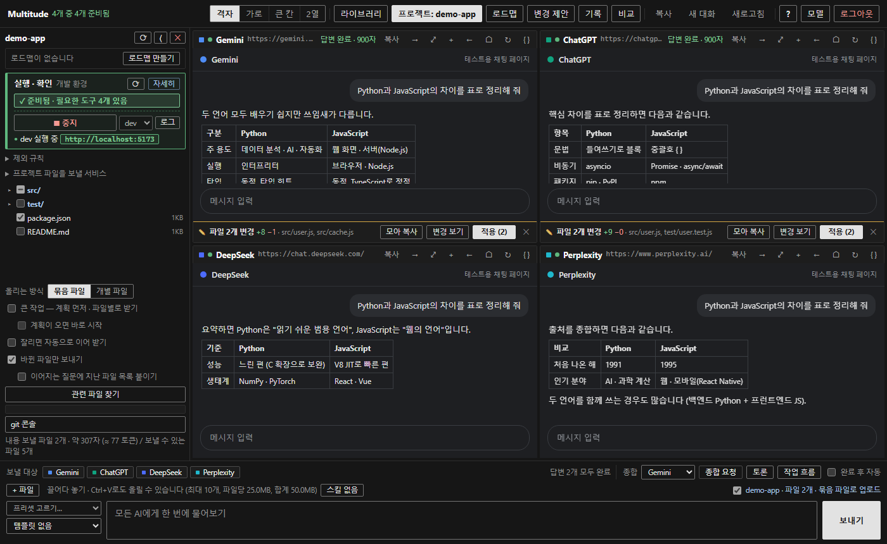
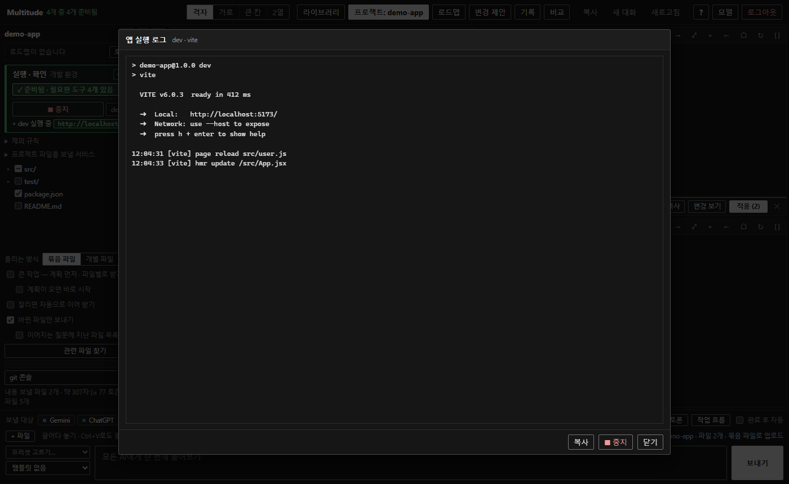

# v0.43.0 — ▶ 앱 실행: 개발 서버를 사이드바에서 띄우고 주소까지

터미널을 열어 `npm run dev`를 치지 않아도, 프로젝트 사이드바의 **▶ 앱 실행**으로 개발 서버를 띄우고, 서버가 알려 준 주소를 바로 볼 수 있습니다. "실행 · 확인" 묶음의 세 번째 단계입니다 (Windows 앱).

## 바뀐 점

- **▶ 앱 실행 (dev)** — 실행 · 확인 칸 아래. `package.json`의 `dev` · `start` · `serve` · `preview`가 있으면 보이고, 둘 이상이면 옆에서 고릅니다(이 PC에 기억).
- **확인 창** — 실행할 스크립트(`predev` · `postdev` 포함) · 폴더 · "이 프로젝트의 코드가 이 PC에서 계속 실행됩니다".
- **주소 찾기** — 출력에서 `http://localhost:5173/` 같은 이 PC 주소를 찾아 초록 단추로 크게 보여 줍니다. 누르면 기본 브라우저(이 PC 주소만). Vite · Next.js · CRA · Django 꼴과 `0.0.0.0`(→ localhost)을 읽고, 개발자 도구 포트 9229와 바깥 주소는 무시합니다.
- **로그 창** — 마지막 256KB, 색 코드 제거, 토큰 · 키 가림, 1초마다 새로 읽기, 복사 · 중지.
- **■ 중지** — 서버와 하위 프로세스를 함께 끝냅니다. 프로젝트를 닫거나 바꿀 때 · 앱을 끌 때도 끕니다. 스스로 끝나면 종료 코드와 함께 알립니다.
- **도구가 없으면 막기** — 실행 · 확인 점검에서 Node.js · npm이 "없음"이면 실행 단추를 막고 이유를 보여 줍니다.

## 안전하게

- 실행하는 것은 정해 둔 네 이름의 npm 스크립트뿐이고, 화면은 이름만 넘깁니다. 스크립트 글은 본체가 `package.json`에서 읽어 확인 창에 그대로 보여 줍니다.
- 셸 없이 `npm-cli.js run <이름>`(테스트 실행과 같은 Node · npm 찾기), 프로젝트 폴더에서, 한 번에 하나. 브라우저가 저절로 열리지 않게 `BROWSER=none`.
- 브라우저로 여는 주소는 `localhost` · `127.0.0.1` · `[::1]`만.

## 알아 둘 점

- 크롬 확장은 프로그램을 실행할 수 없어 이 단추가 없습니다.
- npm 스크립트가 아닌 프로젝트(Python 등)의 실행은 v0.46.0에서 더합니다.
- 실제 개발 서버(Vite · Next · CRA)로 사람이 확인할 항목: [출시 전 확인 목록 11-14](../release-checklist.md#11-14-앱-실행-v0430).

## 개발

- 새 본체 `src/main/devrun.js`: `findLocalUrl` · `isLocalUrl` · `runScripts` · `buildRunSpawn` · `isAllowedRunSpawn` · `setupDevRun`(IPC `devrun:info` · `start` · `stop` · `log` · `open`, 상태 알림 `devrun:state` 0.5초 묶음 · 주소는 바로). `main.js` 끌 때 · `ipc/project.js` 프로젝트 바꿀 때 · 닫을 때 끔. `test-rules.js`가 `readPkgScripts`를 내놓음.
- 새 화면 `src/renderer/dev-run.js`(dev-hub.js 다음): 칸 안 실행 줄 · 상태 줄 · 로그 창. 신호 `window.onDevRunProject`(dev-hub.js) · `window.onDevRunChanged`(v0.44.0 · v0.46.0용).
- `env-rules.js` `CHECK_TOOLS`에 dev · start · serve · preview → node · npm.
- 테스트: `test/dev-run.test.js` 6개 — 진짜 npm으로 작은 서버를 띄워 주소를 찾고 실제로 응답을 받은 뒤 중지 · 프로젝트 닫기로 꺼지는 것까지. 627개 통과.
- 스크린샷: 새 장면 `79-run-app` · `80-run-log`(한국어 · 영어). 예시 프로젝트 `package.json`에 `dev` 스크립트를 넣어 프로젝트 장면에 실행 줄이 보이게 다시 찍었습니다.
