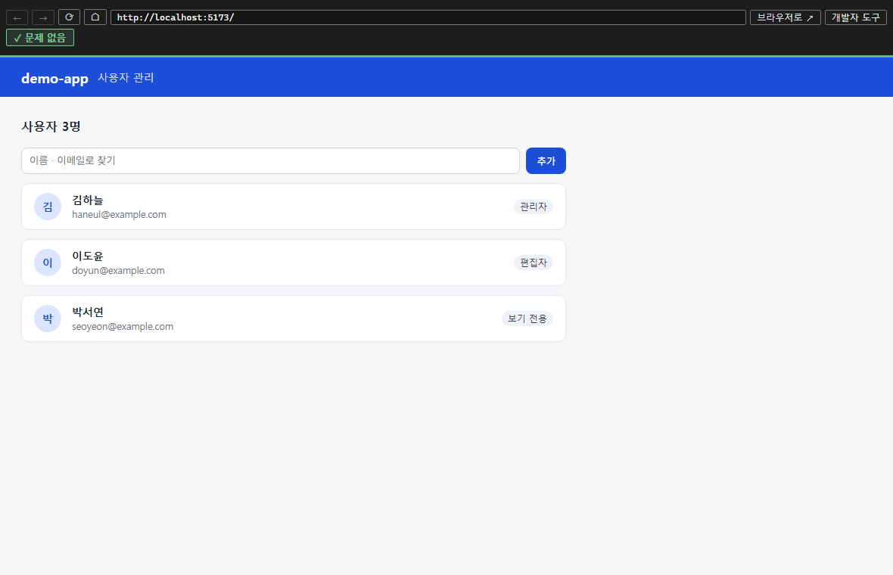
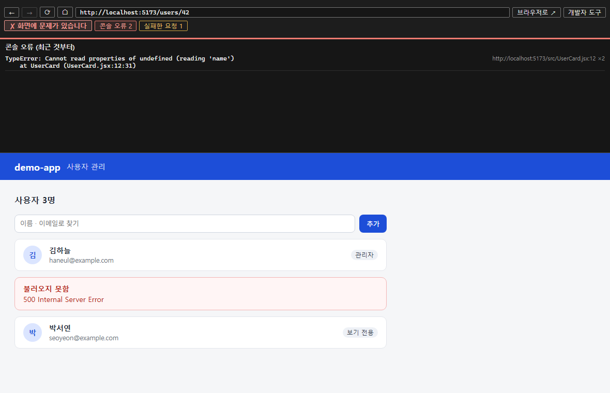

# v0.44.0 — 미리보기 창: 띄운 앱을 앱 안에서 보고, 오류를 자동으로 점검

▶ 앱 실행으로 띄운 개발 서버의 화면을 **앱 안의 미리보기 창**에서 바로 보고, 콘솔 오류 · 실패한 요청 · 빈 화면 · 열리지 않는 페이지를 자동으로 점검해 색으로 알려 줍니다. "구현이 끝났고 기능이 작동하는지 눈으로 확인"하는 단계의 중심입니다. "실행 · 확인" 묶음의 네 번째 단계입니다 (Windows 앱).

## 바뀐 점

- **미리보기 창** — 서버 주소를 처음 찾으면 한 번 저절로 열립니다. 사이드바의 **미리보기 열기 / 미리보기로**로 다시 엽니다. 도구 줄: ← → ⟳(F5) ⌂ · 지금 주소 · **브라우저로 ↗** · **개발자 도구**.
- **자동 점검** — 페이지마다 새로 셉니다. 초록 `✓ 문제 없음`, 노랑 `⚠ 확인이 필요합니다`(실패한 요청만), 빨강 `✗ 화면에 문제가 있습니다`(콘솔 오류) · `✗ 빈 화면`(다 읽고 1.5초 뒤 글 · 그림 · 입력칸 없음) · `✗ 페이지를 열지 못했습니다`(연결 거부 등). 도구 줄 아래쪽 굵은 선이 그 색입니다.
- **배지** — `콘솔 오류 N` · `실패한 요청 N`을 누르면 오류 글 · 위치, 상태 코드 · 주소가 펼쳐집니다(같은 것은 ×N, 최근 30개).
- **사이드바 한 줄** — 실행 · 확인 칸에 `미리보기 ✓ 문제 없음` / `미리보기 ✗ 콘솔 오류 2 · 실패한 요청 1`.

## 안전하게

- 이 PC 주소(localhost · 127.0.0.1 · [::1])만 엽니다. 링크 · 리다이렉트 · 새 창으로 바깥 주소에 가려 하면 막고 도구 줄에 알립니다.
- 앱 화면은 따로 된 세션(`mla-preview`)에서 돌아 AI 서비스 로그인과 섞이지 않습니다. preload · Node 없음 · sandbox, 권한 요청 모두 거절, 다운로드 막음.
- 도구 줄은 그 창에서 온 요청만 받고, 뒤로 · 앞으로 · 새로 고침 · 처음 주소 · 개발자 도구 · 이 PC 주소를 브라우저로 열기만 할 수 있습니다.
- 프로젝트를 닫거나 바꿀 때 · 앱을 끌 때 함께 닫힙니다.

## 확인한 것

- 실제 Electron 창으로(스크립트) 확인: 콘솔 오류 1개 · `/api/missing` 404 1개를 정확히 세고, 빈 페이지는 `빈 화면`, 바깥 링크(`https://example.com/`)로의 이동은 막히고 알림, 꺼진 포트는 `ERR_CONNECTION_REFUSED (-102)`, 이 PC 주소가 아닌 열기 요청은 거절. 이 과정에서 막힌 이동이 판정을 "읽는 중"으로 되돌리던 문제를 찾아 고쳤습니다.
- 사람이 실제 개발 서버로 확인할 항목: [출시 전 확인 목록 11-15](../release-checklist.md#11-15-미리보기-창-v0440).

## 알아 둘 점

- 크롬 확장에는 없습니다(앱 실행이 없으므로).
- 점검은 "오류가 났는지"만 봅니다. 기능이 완료 조건대로 동작하는지는 화면을 보고 판단하거나, v0.45.0의 화면 캡처를 AI에게 보내 확인받으세요.

## 개발

- 새 공통 모듈 `src/shared/preview-health.js`(`empty` · `blankFrom` · `PROBE_JS` · `addItem` · `isFailedRequest` · `verdict`).
- 새 본체 `src/main/preview.js`: 창(도구 줄 76px + `WebContentsView`), 세션 · 권한 · 다운로드 · 이동 막기, `console-message` · `webRequest.onCompleted/onErrorOccurred` · `did-fail-load` · `did-finish-load` 뒤 1.5초 빈 화면 검사, IPC `preview:open` · `preview:state` · `preview:close` · `pv:*`, 알림 `preview:state`(앱) · `pv:state`(도구 줄). `main.js` · `ipc/project.js`에서 닫기.
- 새 화면 `src/renderer/preview.html` · `preview.js` · `preview.css`, preload `src/preload/preview-preload.js`(`window.pv`).
- `dev-run.js`: 미리보기 단추 · 처음 주소에서 한 번 열기 · 점검 한 줄, 신호 `window.onPreviewState`.
- 테스트: `test/preview.test.js` 4개. 630개 통과.
- 스크린샷: 새 장면 `81-preview` · `82-preview-errors`(미리보기 창 — `scripts/screenshots/preload-preview.js`가 진짜 도구 줄에 가짜 상태를, 아래쪽에 예시 앱 페이지를 붙임), `79-run-app`에 미리보기 단추 · 점검 줄.
