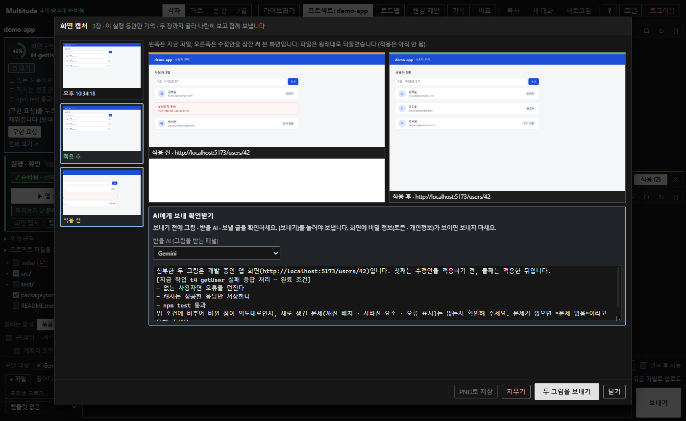
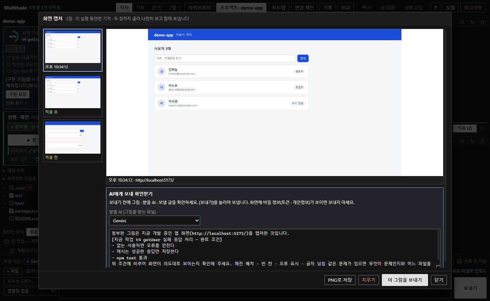

# v0.45.0 — 화면 캡처 · AI 확인 · 적용 전/후 비교

미리보기 창에 띄운 앱 화면을 **캡처해 AI에게 "완료 조건대로 보이는지" 물어보고**, 수정안을 적용하기 전에 **적용 전 · 후 화면을 나란히** 볼 수 있습니다. 보내기 전에는 언제나 그림 · 받을 AI · 보낼 글을 보여 주고, [보내기]를 눌러야 보냅니다. "실행 · 확인" 묶음의 다섯 번째 단계입니다 (Windows 앱).

## 바뀐 점

- **화면 캡처** — 사이드바 실행 · 확인 칸 또는 미리보기 도구 줄의 **화면 캡처**. 도구 줄은 빼고 앱 화면만 PNG로 찍습니다. 이 실행 동안 본체 메모리에만 최근 12장, 필요하면 **PNG로 저장**.
- **캡처 창** — 목록에서 두 장까지 골라 크게(두 장이면 나란히) 보고, 지울 수 있습니다.
- **AI에게 보내 확인받기** — 받을 AI는 지금 연 패널 중 그림을 받는 서비스만(마지막에 고른 것 기억). 보낼 글은 "화면이 의도대로 보이는지 · 문제면 무엇이고 어느 파일을 어떻게 · 없으면 '문제 없음'"으로 채우고, **로드맵의 지금 작업이 있으면 완료 조건을 넣습니다.** 글은 고칠 수 있고, **[보내기]를 눌러야** PNG와 함께 갑니다.
- **화면 비교** — 변경 보기 창 아래(미리보기가 열려 있을 때). 확인 창 → 지금 화면을 새로 고쳐 캡처 → 체크한 수정안을 잠깐 쓰고 새로 고쳐 캡처 → 원래 파일로 되돌림 → 캡처 창에 `적용 전` · `적용 후`를 골라 열고, 보낼 글도 비교용으로.

## 안전하게

- 캡처는 파일로 쓰지 않습니다(저장은 누를 때만, 저장 창으로).
- AI에게 보내기는 캡처 창에서 그림 · 받는 AI · 글을 본 뒤 직접 누를 때만. 화면에 비밀 정보가 보이면 보내지 말라고 창에 적어 두었습니다.
- 화면 비교는 테스트 실행과 **같은 잠금**(그동안 적용 · 저장 · 프로젝트 닫기를 받지 않음)과 **같은 암호화 복구 파일**을 쓰고, 성공 · 실패 · 앱 종료와 상관없이 원래 파일로 되돌립니다. 적용은 하지 않습니다.

## 확인한 것

- 실제 Electron 창으로(스크립트) 확인: 캡처(1164×705 PNG) · 캡처 그림 받기, 화면 비교에서 `BEFORE` 화면 → 수정안을 쓴 `AFTER` 화면이 실제로 다르게 찍히고, 끝난 뒤 파일이 `BEFORE`로 돌아오고 잠금이 풀린 것.
- 사람이 실제 AI · 실제 개발 서버로 확인할 항목: [출시 전 확인 목록 11-16](../release-checklist.md#11-16-화면-캡처--전후-비교-v0450).

## 알아 둘 점

- 개발 서버가 파일 바뀜을 늦게 알아채는 프로젝트(큰 빌드)는 `적용 후`가 바뀌기 전 화면일 수 있습니다(1.2초 기다린 뒤 새로 고침). 그럴 때는 적용한 뒤 직접 캡처하세요.
- 크롬 확장에는 없습니다.

## 개발

- `main/devtest.js` `withTrial(changes, fn)`: 테스트 실행의 "잠깐 쓰기 → 되돌리기"를 다른 일에도 쓸 수 있게(잠금 · 복구 파일 · 항상 되돌림).
- `main/preview.js`: `captureNow`(사이트 화면 `capturePage`) · `reloadAndWait` · IPC `preview:capture` · `captures` · `captureData` · `captureRemove` · `captureSave` · `compare`, 도구 줄 `pv:capture`. `main.js`가 `devTest`를 넘김.
- 새 화면 `src/renderer/dev-capture.js`(dev-run.js 다음): 사이드바 캡처 줄 · 캡처 창 · 보내기(`host.sendPrompt` + PNG `ArrayBuffer`) · `compare`. `project-devtest.js`에 `#patchShot`. AI에게 가는 글 `prompt.cap.ask` · `prompt.cap.compare` · `prompt.cap.accept`(ko · en).
- 테스트: `test/capture.test.js` 4개(진짜 파일로 `withTrial` 포함). 635개 통과.
- 스크린샷: 새 장면 `83-capture-send` · `84-compare`(캡처 그림은 81 · 82 미리보기 그림을 잘라 씀).
