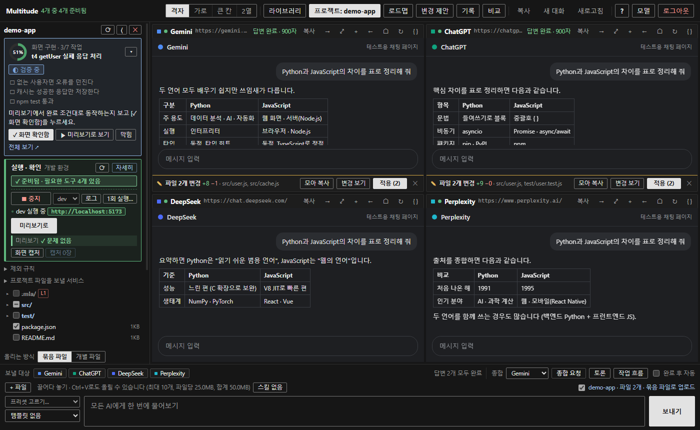
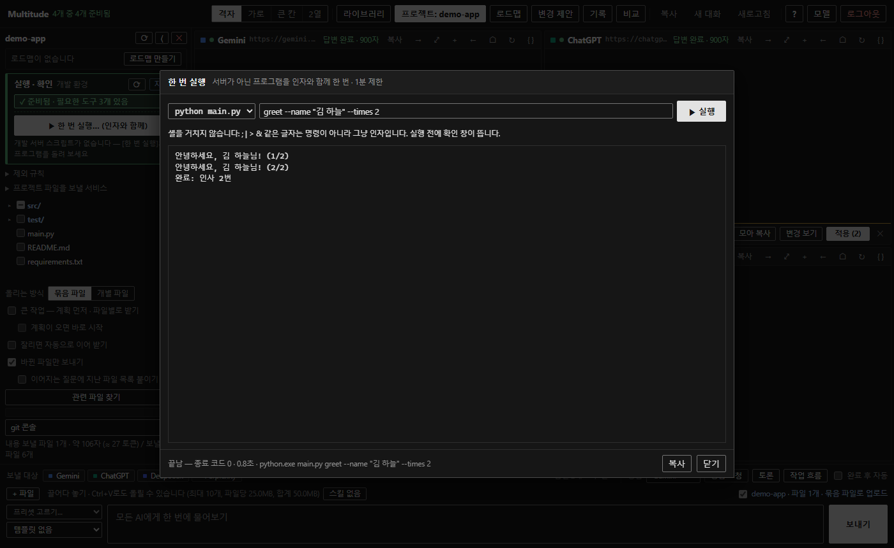

# v0.46.0 — 로드맵 카드에서 실행해서 보기 · 1회 실행

로드맵으로 진행할 때 "구현이 끝났고 정말 동작하는지"를 **카드에서 바로 눈으로 확인**하는 단계를 넣었습니다. 그리고 화면이 없는 CLI · 스크립트도 인자를 넣어 한 번 실행해 결과를 봅니다. "실행 · 확인" 묶음(v0.41.0 ~ v0.46.0)의 마지막 단계입니다 (Windows 앱).

## 바뀐 점

- **▶ 실행해서 보기** — 수정안을 적용해 검증 중인 작업 카드에(띄울 스크립트가 있는 프로젝트). 개발 서버가 없으면 ▶ 앱 실행(주소를 찾으면 미리보기가 열림), 떠 있으면 **▶ 미리보기로 보기**.
- **✓ 화면 확인함** — 미리보기가 열리면 생깁니다. 미리보기에 콘솔 오류 · 빈 화면 같은 오류가 보이면 한 번 더 묻습니다.
- **완료 전에 실행해서 화면 확인** — 로드맵 창 › 문서 탭 설정(기본 끔). 켜면 화면을 확인하기 전에는 카드에 완료 단추가 없고 안내 한 줄이 나옵니다. 띄울 스크립트가 없는 프로젝트는 막지 않습니다. "테스트가 통과하면 바로 완료"와 함께 켜면, 통과한 작업은 화면을 확인하는 순간 완료됩니다.
- **1회 실행** — 실행 · 확인 칸의 **1회 실행…**(서버 스크립트가 없으면 **▶ 한 번 실행… (인자와 함께)**). npm 스크립트 + `--` 인자, `package.json`의 `bin` · `main`, 맨 위의 `cli.js` · `index.js` · `main.js` · `main.py` · `app.py` · `cli.py` · `__main__.py` · `manage.py`를 인자와 함께 한 번 돌리고 출력과 종료 코드를 보여 줍니다. 고른 대상과 인자는 프로젝트별로 기억합니다.

## 한 작업을 끝내는 흐름 (Windows 앱)

**구현 요청 → 보내기 → 적용 → (테스트 실행) → ▶ 실행해서 보기 → 미리보기에서 확인 (필요하면 화면 캡처를 AI에게) → ✓ 화면 확인함 → 완료**

## 안전하게

- 1회 실행은 셸을 거치지 않고 인자 배열로 실행합니다 — `;` `|` `>` `&` 같은 글자는 명령이 아니라 그냥 인자입니다. 화면은 대상 id와 인자 글만 넘기고, 본체가 대상 목록을 다시 만들어 확인합니다(프로젝트 밖 · `.git` 안 거절). 실행 파일은 node · python뿐이고, 실제 명령 줄을 확인 창에 보여 줍니다. 1분 제한, 출력 256KB · 비밀 가림.

## 확인한 것

- 진짜 실행(자동 테스트): `node cli.js greet --name "Kim Ha" ; echo hacked` → 인자 6개가 글자 그대로 전달(셸 명령으로 실행되지 않음), 종료 코드 3 전달, `npm run start -- --x 1`, `python main.py a "b c"`.
- 이 과정에서 `npm test`처럼 npm 옆에 node.exe가 없는 환경에서 Node 대상을 못 찾던 문제를 찾아, PATH의 node로 찾도록 고쳤습니다.
- 사람이 실제 프로젝트로 확인할 항목: [출시 전 확인 목록 11-17](../release-checklist.md#11-17-카드-실행-확인--1회-실행-v0460).

## 개발

- `shared/roadmap.js`: 설정 `runCheck`, `cardState(…, { canRun, pvOpen, seen })` — 검증 단계에 `run` · `seen`, runCheck면 `verifyRun` 단계(완료 숨김). 예전 계산은 `cardStateBase`.
- `renderer/roadmap-card.js`: `runApp` · `markSeen`, 신호 `window.onDevRunChanged` · `window.onPreviewState`. `roadmap-ui.js` 설정 칸 `#roadmapRunCheck`.
- `main/devrun.js`: `parseArgs` · `onceTargets` · `safeRel` · `buildOnceSpawn` · `isAllowedOnceSpawn`, IPC `devrun:onceInfo` · `once` · `onceStop`. 새 화면 `renderer/dev-once.js`(dev-capture.js 다음) · 창 `#onceModal`.
- 테스트: `test/run-check.test.js` 7개(진짜 node · npm · python 실행 포함). 642개 통과.
- 스크린샷: 새 장면 `85-run-check` · `86-run-once`, 실행 줄에 1회 실행 단추가 생겨 프로젝트 장면을 다시 찍었습니다.
