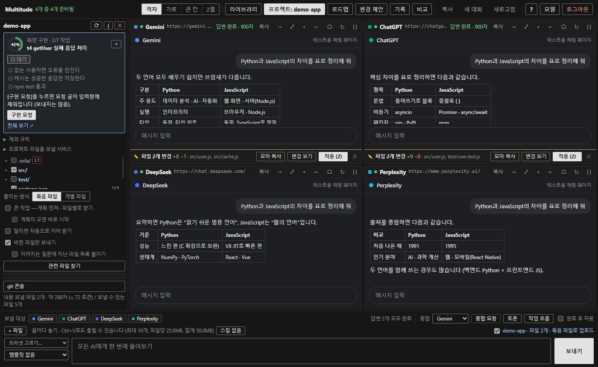
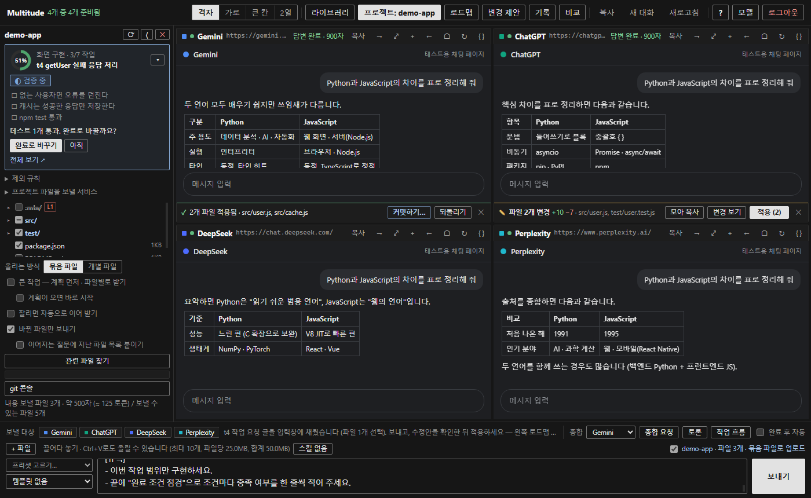
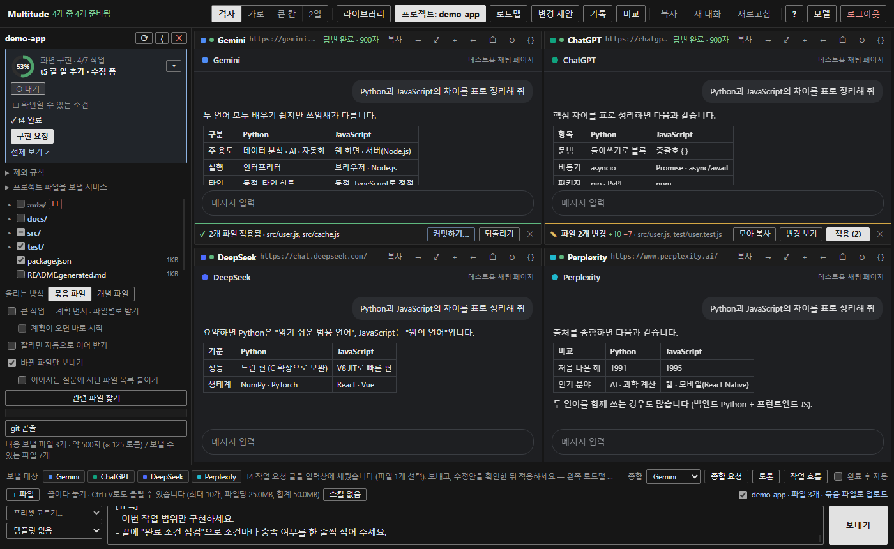
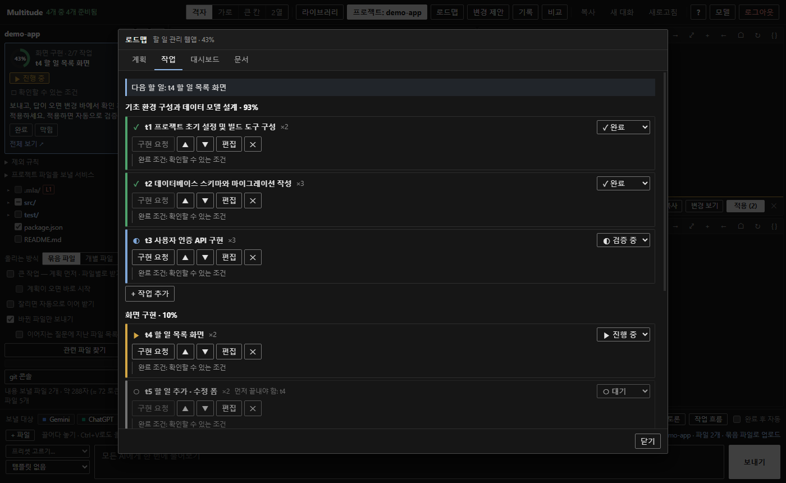
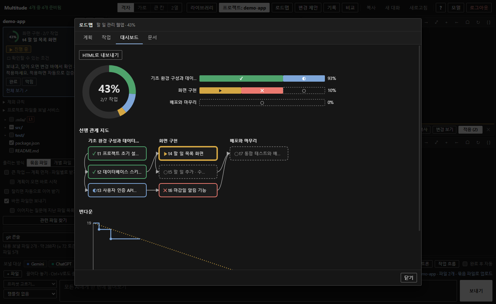

# 로드맵 · 계획서 → 단계 → 진행 그림 → 문서

[← README](../README.md)

프로젝트 계획서를 **마일스톤 → 작업**으로 쪼개고, 작업마다 어디까지 했는지 기록해 **진행 그림**으로 보여 주고, 진행 과정을 프로젝트 폴더의 **`docs/procedure.md`** 와 **`README.md`** 로 정리해 주는 기능입니다 (v0.38.0). Windows 앱과 크롬 확장 프로그램이 같은 화면 · 같은 계산을 씁니다.

v0.40.0부터는 로드맵 창을 열고 닫지 않아도 됩니다. 프로젝트 사이드바 맨 위의 **로드맵 카드**가 지금 할 작업과 다음에 누를 버튼을 보여 주고, 수정안을 적용하거나 테스트가 통과하면 작업 상태가 저절로 따라갑니다 ([사이드바 카드](#사이드바-카드-v0400)).

> 웹 채팅의 AI가 폴더를 직접 고치지는 않습니다. **완전 자동으로 끝까지 구현하는 기능이 아니라**, 작업 하나씩 요청 글을 만들어 주고 보내기 · 수정안 확인 · 적용 · 테스트는 프로젝트 모드의 기존 흐름대로 **사람이 확인**하며 진행하는 반자동 방식입니다.

## 쓰는 순서

1. 툴바 **proj**로 프로젝트 폴더를 열고, 툴바 **로드맵**을 누릅니다.
2. **계획 탭** — 계획서를 붙여 넣거나(`PLAN.md` 불러오기 · `.md` `.txt` 파일 고르기) AI를 골라 **AI에게 분해 부탁**. 답이 끝나면 **AI 답변 가져오기**(또는 직접 붙여 넣기) → **작업 목록으로 만들기**. 앱이 JSON을 읽고 검사합니다.
   - 선행 관계가 돌고 돌면 거절합니다. 완료 조건이 비었거나 너무 큰 작업(크기 5)은 경고합니다.
   - 완료한 작업이 있는데 새 분해로 바꾸면 확인을 받습니다.
3. **작업 탭** — 마일스톤별 작업 목록.
   - 상태: `○ 대기` · `▶ 진행 중` · `◐ 검증 중` · `✓ 완료` · `✕ 막힘`. **선행 작업이 끝나지 않은 작업은 진행 · 검증 · 완료로 못 바꿉니다**(잠김). 막힘은 이유를 적을 수 있습니다.
   - 완료한 작업을 되돌렸는데 그 뒤에 이어지는 작업을 이미 시작 · 완료했다면 **다시 확인하라고 알려 줍니다**(후속 작업의 상태는 그대로 둠).
   - **구현 요청** — 그 작업의 요청 글(작업 내용 · 완료 조건 · 이미 끝난 작업 · 뒤에 이어질 작업 제목)을 **입력창에 채워 줄 뿐 보내지 않습니다**. 작업의 예상 파일 중 프로젝트에 있는 것은 고른 파일에 넣고 상태를 `진행 중`으로 바꿉니다. 이어서 보내기 → 변경 보기 → 적용 → 테스트 실행 → (필요하면) 실패 로그로 다시 받기를 프로젝트 모드에서 하고, 끝나면 로드맵에서 `완료`로 바꿉니다.
   - 편집: 제목 · 내용 · 완료 조건 · 파일 · 선행 · 크기 고치기, 위 · 아래로, 두 작업 **합치기**, 추가, 삭제.
4. **대시보드 탭** — 한눈에 보는 그림 4개 (아래). **HTML로 내보내기**로 파일 저장.
5. **문서 탭** — 문서 만들기 · 설정 (아래).

진행 데이터는 프로젝트 폴더의 **`.mla/roadmap.json`** 에 저장됩니다(다른 PC로 옮기거나 팀과 나눌 수 있음). `.mla/`는 AI에게 보내는 파일에서 **항상 제외(L1)** 입니다.

## 사이드바 카드 (v0.40.0)

프로젝트를 열면 사이드바 맨 위에 카드가 붙습니다. 패널 화면을 그대로 둔 채 같은 화면에서 진행합니다.



- **보이는 것**: 작은 진행 링(가중치 기준 %), `마일스톤 · 끝난 작업/전체 작업`, 지금 작업의 id와 제목, 상태(기호 + 글자), 완료 조건(줄마다 하나, 최대 4줄), 안내 한 줄, **그 단계에 필요한 버튼만**, `전체 보기 ↗`(로드맵 창의 작업 탭을 그 작업에서 엶).
- **지금 할 작업**: [구현 요청]으로 시작한 작업(진행 · 검증 · 막힘) → 진행 · 검증 중인 작업 → 시작할 수 있는 대기 작업(위에서부터). 시작할 수 있는 작업이 둘 이상이면 **다음 ›** 으로 바꿔 볼 수 있습니다.
- **▾** 로 한 줄로 접을 수 있습니다(이 PC에 기억). 로드맵이 없는 프로젝트에서는 `로드맵이 없습니다 [로드맵 만들기]` 한 줄만 보입니다.

### 작업 하나를 끝내는 순서

| 단계 | 누가 | 화면 |
|---|---|---|
| 1. **구현 요청** | 직접 | 요청 글이 입력창에 채워지고 예상 파일이 골라짐, 상태 `▶ 진행 중` (보내지는 않음) |
| 2. **보내기** | 직접 | 지금처럼 입력창에서 보냄 |
| 3. 미리보기에서 **테스트 실행** (선택) | 직접 | 결과를 카드가 기억함. 실패하면 "실패 로그로 다시 받기"를 쓰라고 안내, 다시 받기를 다 쓰고도 실패하면 **막힘**을 권함 |
| 4. **적용** | 직접 | 미리보기 창 · 변경 바 어느 쪽에서 적용해도 됨 (자동 적용 없음) |
| 5. 검증 중으로 | 자동 | 적용하면 상태가 `◐ 검증 중`으로 바뀜 |
| 6. 완료 확인 | 자동 | 3에서 통과했으면 `테스트 N개 통과. 완료로 바꿀까요?` + **완료로 바꾸기** · **아직**. 테스트를 안 돌렸으면 **테스트 실행** · **완료** |
| 7. **완료로 바꾸기** | 직접 | 설정 "테스트가 통과하면 바로 완료"를 켜면 이 단계도 자동 |
| 8. 다음 작업 | 자동 | 자동 커밋 · 문서 갱신(설정대로) 뒤, 잠금이 풀린 다음 작업이 카드에 올라옴. 입력창은 덮어쓰지 않음 — 다시 **구현 요청** 한 번 |





- 카드의 **테스트 실행**은 지금 프로젝트 파일 그대로 한 번 돌립니다(파일을 쓰거나 되돌리지 않음). 실행 전 확인 창, 검사는 `package.json`의 `test`(없으면 pytest · cargo test · go test 중 있는 것) — 미리보기 창의 테스트와 같은 규칙입니다.
- 적용 · 테스트 결과는 **[구현 요청]으로 시작한 작업에만** 반영합니다. 로드맵과 상관없이 적용한 수정안은 카드를 바꾸지 않습니다.
- 크롬 확장에는 테스트 실행이 없어서 적용 뒤 카드에 **완료** · **막힘**만 보입니다.

## 진행 그림





| 그림 | 내용 |
|---|---|
| **진행 링** | 도넛 + 가운데 큰 `61%` · `3/8 작업`. 진행률은 **가중치 기준**: 완료 100% · 검증 중 80% · 진행 중 40% · 대기 · 막힘 0%. 상태마다 진행률에 보탠 몫만큼 색을 칠해 **칠한 부분의 합 = 가운데 %** 이고, 나머지는 회색 바탕 (v0.38.1) |
| **마일스톤 막대** | 마일스톤마다 완료 · 검증 · 진행 · 막힘 · 대기를 한 줄에 쌓은 막대와 % |
| **선행 관계 지도** | 마일스톤을 열로, 작업을 칸으로, 선행 → 후속은 화살표(같은 마일스톤 안의 화살표는 칸 왼쪽으로 돌아 들어감). 지금 할 작업은 굵은 테두리, 잠긴 작업은 흐리게. 칸을 누르면 그 작업으로 이동. 긴 제목은 칸 폭에 맞춰 `…`로 줄임 |
| **번다운** | 남은 가중치가 줄어드는 계단선. 완료한 작업이 2개 이상이면 시작부터 지금까지의 평균 속도로 0에 닿는 점선과 **예상 완료일**(추정) |

색만으로 구분하지 않도록 상태마다 기호(`✓ ▶ ◐ ○ ✕`)를 같이 그리고, 대기는 점선 테두리입니다. 그림은 외부 라이브러리 없이 인라인 SVG입니다.

## 문서 만들기

프로젝트 폴더에 아래를 만듭니다.

```text
<프로젝트 폴더>/
├─ README.md            ← 프로젝트 소개 (한눈에 보는 문서)
├─ docs/
│  └─ procedure.md      ← 구현 단계 과정 설명서
└─ .mla/roadmap.json    ← 진행 데이터
```

- **`docs/procedure.md`** — 개요(진행률 · 다음 할 일) · 단계 표 · 단계별 상세(내용 · 파일 · 완료 조건 · 선행 · 커밋 · 완료 시각 · 메모) · 진행 요약(상태별 개수, 마일스톤별 막대, **mermaid** 선행 관계 지도) · 변경 이력.
- **`README.md`** — 한 줄 소개 + 진행률 · 주요 기능 · 진행 현황 표 · 폴더 구조 · 사용 방법(기술 스택 · 설치 · 스크립트) · `procedure.md` 링크.
- 사실(작업 · 상태 · 커밋 · 기록 · `package.json` · 폴더 구조)은 앱이 직접 채웁니다. **소개 문장과 주요 기능 목록만** **소개 문장 받기**로 AI에게 맡기며(받기 전에는 안내 문구), 틀릴 수 있으니 확인하세요.

### 내 글을 지키는 방법

- 문서의 앱이 쓰는 부분은 `<!-- mla:이름:start -->` … `<!-- mla:이름:end -->` 표식 안쪽뿐입니다. 갱신할 때 **표식 안쪽만 바꾸고 바깥에 쓴 글은 그대로** 둡니다.
- **기존 `README.md`에 표식이 없으면**(내가 쓴 README) 설정에 따라 다룹니다.

| 설정 | 동작 |
|---|---|
| **별도 파일로** (기본) | 기존 파일은 그대로 두고 `README.generated.md`(`procedure.md`는 `procedure.generated.md`)에 씀 |
| 기존 글 끝에 붙이기 | 내 글 뒤에 표식 구역을 붙임 |
| 교체 | 파일을 통째로 바꿈 (미리보기에서 확인) |

- 새로 만들기 · 표식 구역 갱신 · 별도 파일 쓰기는 **자동 갱신**해도 안전하지만, **끝에 붙이기 · 교체**는 항상 미리보기에서 **문서 쓰기**를 눌러야 씁니다.
- 쓰기 직전에 **비밀 정보 검사**를 하고, 걸리면 쓰지 않습니다. 여러 파일 쓰기가 중간에 실패하면 이미 쓴 파일을 원래대로 되돌립니다(덮어쓴 파일은 전 글로, 이번에 새로 만든 파일은 지움). **방금 쓴 문서 되돌리기**로 한 번 되돌릴 수 있습니다(창을 닫고 앱을 다시 켜기 전까지).

### 설정

계획을 나누기 전(로드맵이 없을 때) 문서 탭에서 바꾼 설정도 기억했다가 새 로드맵에 그대로 씁니다 (v0.38.1).

| 설정 | 기본 |
|---|---|
| 문서 자동 생성 | 켬 |
| 갱신 시점: 작업 완료마다 / 마일스톤 완료마다 / 직접 누를 때만 | 작업 완료마다 |
| 기존 README가 있을 때: 별도 파일 / 끝에 붙이기 / 교체 | 별도 파일 |
| 문서 언어: 앱 언어 따름 / 한국어 / English | 앱 언어 |
| mermaid 다이어그램 포함 | 켬 |
| 작업 완료 시 작업 단위 자동 커밋 (Windows 앱) | **끔** |
| 테스트가 통과하면 바로 완료 (Windows 앱, v0.40.0) | **끔** |

자동 커밋을 켜면 작업을 `완료`로 바꿀 때 그 작업의 예상 파일 중 프로젝트에 있는 것만 `feat(t3): 제목` 메시지로 커밋하고(push 없음) 커밋 번호를 작업에 남깁니다.

## 한계

- AI가 낸 분해 품질은 AI에 달려 있습니다. 그래서 검사하고, 편집할 수 있게 했습니다.
- 진행률 · 예상 완료일은 **추정**입니다. 가중치와 상태로 계산한 값이며 일정 보증이 아닙니다.
- **PDF 계획서는 직접 읽지 않습니다**(글을 복사해 붙여 넣기).
- 크롬 확장에는 git이 없어 자동 커밋을 쓸 수 없고, 테스트 실행이 없어 카드가 테스트 결과로 완료를 묻지 않습니다.
- 카드는 프로젝트 사이드바 안에 있어서 창이 낮으면 파일 나무 자리가 줄어듭니다. 창 높이가 820px 이하면 카드의 완료 조건 목록은 숨기고(로드맵 창에는 그대로), ▾ 로 접으면 한 줄만 남습니다.
- 프로젝트를 닫은 채로는 열 수 없습니다 (먼저 폴더를 여세요).
